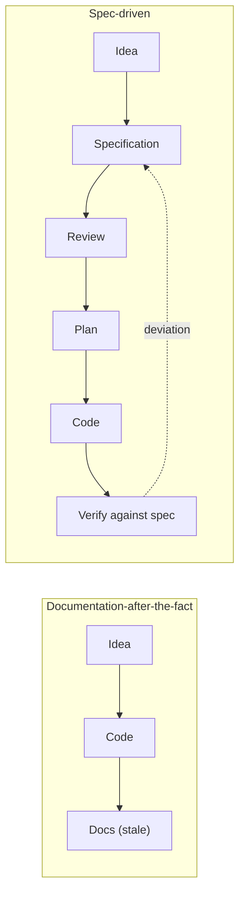
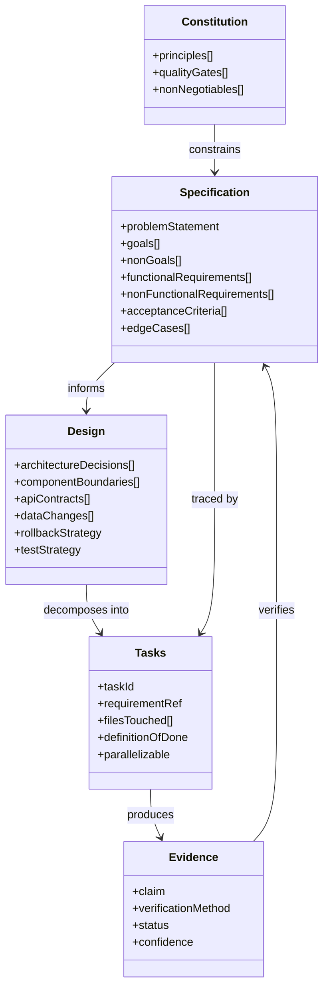
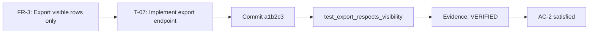
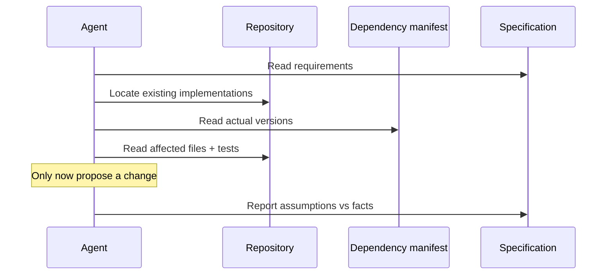
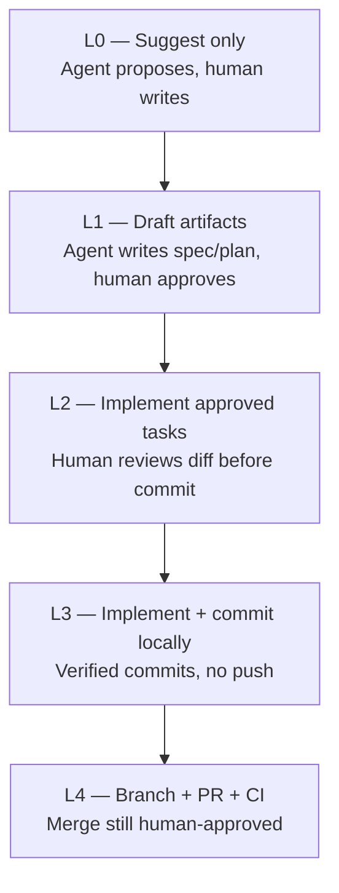
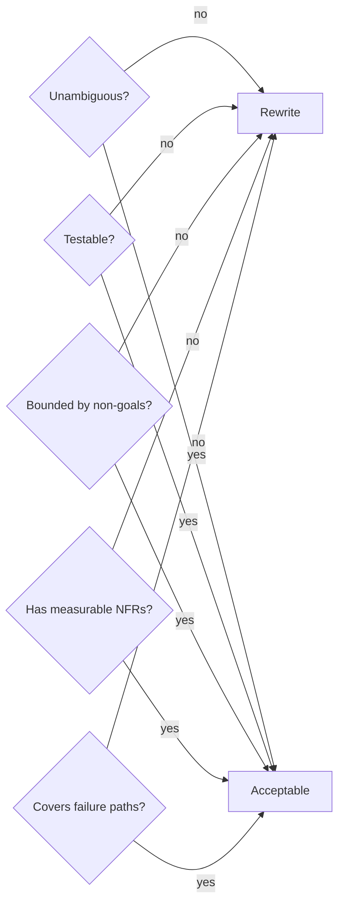
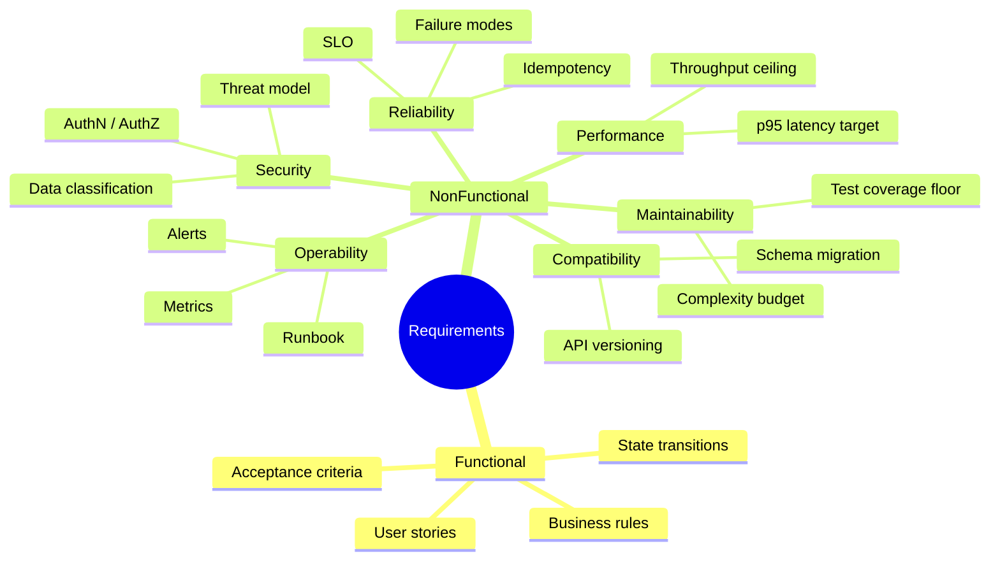
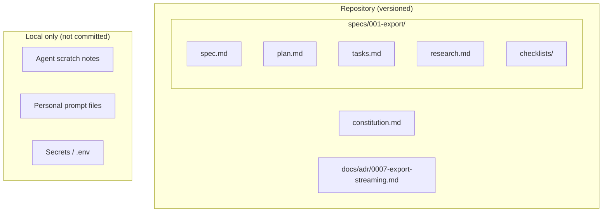
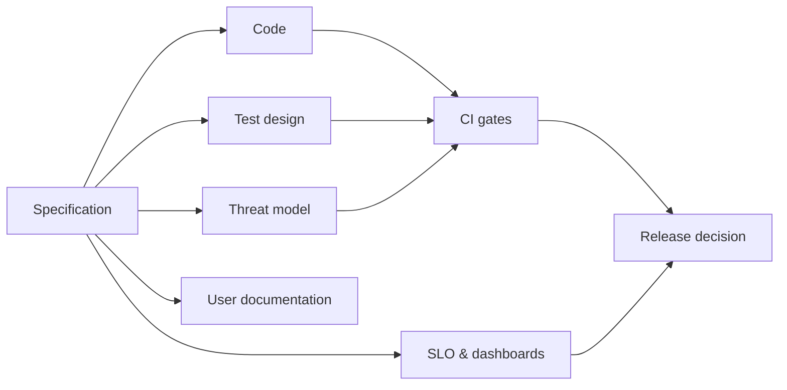
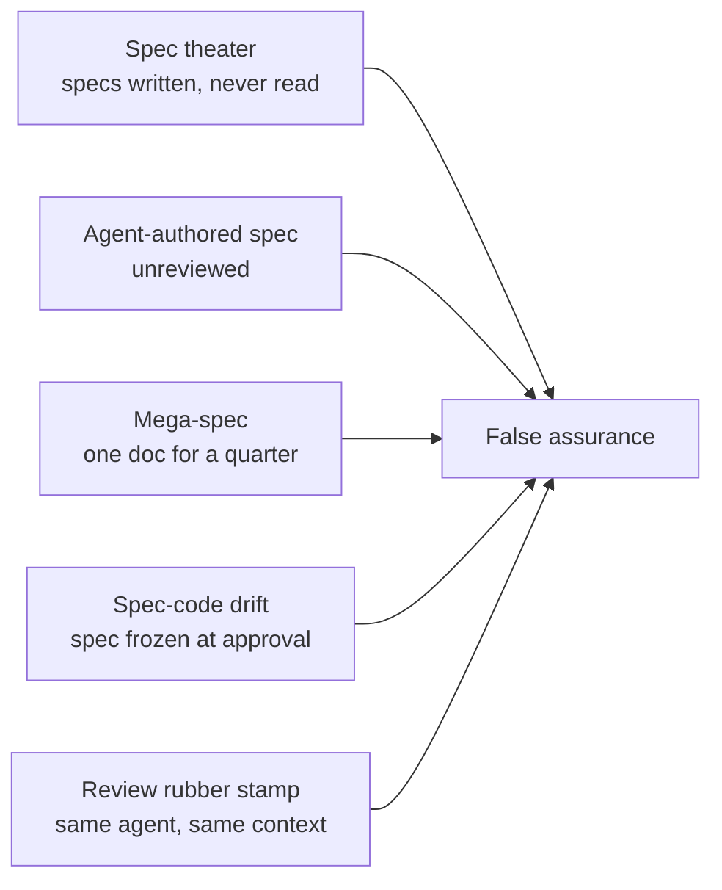

# 01 — Spec-Driven Development Fundamentals

> **Prerequisite for everything else.** If you only read one chapter, read this one.
> Verified tool behavior appears in later chapters; this chapter is methodology.

---

## 1. Purpose

Spec-Driven Development (SDD) is an engineering discipline in which **an explicit, reviewable
specification is produced and approved before implementation begins**, and in which
**completion is decided by evidence against that specification**, not by the implementer's
confidence.

The word *driven* matters. The specification is not documentation produced after the fact. It
is the input that controls what gets built and the instrument that decides whether the work is
finished.



### What SDD is not

| Mistake | Why it fails |
| --- | --- |
| "Write a big design document once" | Becomes stale, is not testable, and nothing verifies against it |
| "Prompt engineering with more words" | Prompts are ephemeral; specifications are versioned and reviewed |
| "Let the agent write the spec too" | An unverified machine-authored spec launders assumptions into authority |
| "Specs replace tests" | Specs state intent; tests produce evidence. You need both |
| "Strict waterfall" | SDD is iterative: clarify → plan → implement → converge loops are expected |

---

## 2. When to use SDD

| Situation | Use SDD? | Rationale |
| --- | --- | --- |
| Feature spanning multiple modules or teams | **Yes, full loop** | Coordination cost dominates; ambiguity is expensive |
| Backend/API change with consumers | **Yes, full loop** | Contract compatibility must be explicit |
| Data migration or schema change | **Yes, full loop** | Irreversible risk requires a documented rollback |
| Security-relevant change | **Yes, full loop + security review** | Threat model must precede implementation |
| Single-file bug fix with a reproduction | **Lightweight** | Bug report + regression test is the specification |
| Typo, formatting, dependency bump | **No** | Process cost exceeds risk |
| Exploratory spike | **No, but time-box and discard** | Do not let spike code become production code silently |

---

## 3. The artifact model

Five artifact families, each with a distinct job. They are not interchangeable.



| Artifact | Answers | Owner | Must be reviewable without code |
| --- | --- | --- | --- |
| **Constitution** | What principles are non-negotiable? | Tech leadership | Yes |
| **Specification** | What problem, what outcome, how do we know it is done? | Requirements engineer / product analyst | Yes |
| **Design / ADR** | How will it work, what did we reject, how do we roll back? | Architect | Yes |
| **Tasks** | What are the smallest verifiable steps? | Architect + implementer | Yes |
| **Evidence ledger** | What do we actually know, and how do we know it? | Whoever makes a claim | Yes |

### Traceability is the point



Every task references a requirement. Every requirement is satisfied by at least one verified
test or inspection. If you cannot draw this line, you have untraceable work.

---

## 4. The core principles

### 4.1 Specification before implementation

**Rule.** No production source change without an approved specification or bug report.

**Why.** Agents are excellent at producing plausible code for an under-specified problem.
That is the failure mode: not bad code, but *confidently wrong* code. A specification forces
the ambiguity to surface while it is still cheap to resolve.

**Enforcement.** Branch protection requiring a spec link in the PR; CI check that
`docs/specs/<id>/spec.md` exists for feature branches; reviewer checklist item.

### 4.2 Read before write

**Rule.** The agent inspects the repository, the installed dependency versions, and the
existing patterns before proposing a change.



### 4.3 Evidence over confidence

Every non-trivial claim carries a status:

| Status | Meaning | Allowed in a completion report? |
| --- | --- | --- |
| `VERIFIED` | Observed directly (test run, build output, file line reference, official doc for the exact version) | Yes |
| `PARTIALLY VERIFIED` | Some evidence exists; scope is limited | Yes, with the limit stated |
| `UNVERIFIED` | No evidence yet | Yes, but never as "done" |
| `CONTRADICTED` | Evidence contradicts the claim | Yes, as a blocker |

### 4.4 Small, traceable increments

A task should be reviewable in one sitting and revertible in one operation. If a task touches
more than roughly 400 changed lines or more than one architectural boundary, split it.

### 4.5 Independent review

The reviewer must not be the implementer's continuation of the same context. Same-context
"self-review" rationalizes decisions already made.

### 4.6 Explicit uncertainty

An agent that says "I could not reproduce this; here is what I ruled out" is more valuable
than one that invents a fix. See [chapter 23](./23-hallucination-prevention.md).

---

## 5. The autonomy ladder

SDD defines how much the agent may do without a human in the loop. The ladder is deliberate:
you move up only when the lower rung is boring and reliable.



| Rung | Agent may | Agent must not | Typical adoption trigger |
| --- | --- | --- | --- |
| L0 | Read, analyze, suggest | Edit files | First week with a new repo |
| L1 | Write specs, plans, ADR drafts | Change source code | Spec review is consistently useful |
| L2 | Implement approved tasks, run tests | Commit or push | Diffs are consistently reviewable |
| L3 | Commit verified changes on a branch | Push | Commit hygiene is consistently good |
| L4 | Push branch, open PR, wait for CI | Merge, deploy | CI is trustworthy and required checks exist |

> **Default recommendation for a new installation: L2 (Mode 2 in [chapter 22](./22-git-and-commit-policy.md)).**
> It produces the highest information-per-risk for a team learning the practice.

---

## 6. Anatomy of a good requirement

A requirement is usable when an engineer who has never spoken to you can implement it and a
reviewer can decide unambiguously whether it is met.

### Bad

```text
The export feature should work well and be fast.
```

### Good

```markdown
### FR-3: CSV export respects row visibility

The export endpoint SHALL include only rows the authenticated user is authorized to read.

**Acceptance criteria**
- AC-3.1 Given a user with `viewer` role on project A only, when they export project A,
  then the CSV contains exactly the rows visible in the UI list for that user.
- AC-3.2 Given a user with no access to project B, when they request
  `GET /projects/B/export`, then the response is `403` and no rows are returned.

**Non-goals**
- Export formats other than CSV.
- Asynchronous export for >100k rows (see FR-9).
```

### The requirement quality checklist



| Criterion | Test question |
| --- | --- |
| Unambiguous | Could two engineers implement it differently and both claim compliance? |
| Testable | Can you write an assertion for it without asking the author? |
| Bounded | Is it clear what is explicitly **not** included? |
| Measurable | Are performance/security targets numeric and conditional? |
| Complete | Are failure, empty, and boundary cases specified? |

---

## 7. Functional vs non-functional requirements

Most SDD failures are non-functional gaps, because functional behavior is what people
remember to write down.



### Non-functional requirement template

```markdown
**NFR-2: Export latency**
Under a dataset of 100,000 rows and 20 concurrent exports, `GET /projects/{id}/export`
SHALL return a streaming response with first byte within 1.5 s (p95) and complete
within 30 s (p95), measured on the reference environment (4 vCPU / 8 GB).
Verification: load test `perf/export_load_test.*`, recorded in the evidence ledger.
```

Every NFR needs three things: a **number**, a **condition**, and a **verification method**.
Without the third, it is a wish.

---

## 8. Where specifications live



**Commit:** constitution, spec, plan, tasks, ADRs, evidence ledgers for significant changes,
review reports that gate releases.

**Do not commit:** agent scratch pads, personal preferences, secrets, generated caches,
tool-local state that the tool documents as machine-specific.

> Tool-specific commit rules differ. OpenSpec commits `openspec/`; Spec Kit commits
> `.specify/` and the feature directory; BMAD commits `_bmad/` (v6) or its configured output
> folder. Verify per chapter — do not generalize.

---

## 9. SDD and the surrounding engineering system

SDD does not replace version control, testing, security scanning, or observability. It
*coordinates* them by making intent explicit early.



| Discipline | What SDD adds | What SDD does not replace |
| --- | --- | --- |
| Testing | Test cases traceable to acceptance criteria | Test implementation skill, coverage tools |
| Security | Threat model before code, security review gate | SAST/DAST tools, pen testing |
| Operations | SLOs and rollback defined up front | Monitoring platforms, incident tooling |
| Documentation | Spec is the durable record | User-facing docs, API reference generation |

---

## 10. Anti-patterns



| Anti-pattern | Symptom | Correction |
| --- | --- | --- |
| **Spec theater** | Specs exist but no review references them | Require requirement IDs in review findings and PR descriptions |
| **Agent-authored spec** | Spec restates the agent's first guess | Human approves spec before planning; agent may draft, never approve |
| **Mega-spec** | 40-page document nobody reads | One spec per bounded change; split by user-visible outcome |
| **Spec-code drift** | Code does more than the spec says | Convergence step diffing implementation against acceptance criteria |
| **Rubber-stamp review** | Findings are always "LGTM" | Independent context; require at least one falsifiable check per review |
| **Evidence theater** | "Tests pass" with no output | Paste command and result, or mark `UNVERIFIED` |

---

## 11. Verification of this chapter

This chapter contains no tool commands, so there is nothing executable to verify. The
definitions are consistent with the normative rules in
[chapter 23](./23-hallucination-prevention.md) and the policies in
[chapter 22](./22-git-and-commit-policy.md).

---

## 12. Official references

- GitHub Spec Kit methodology — <https://github.github.io/spec-kit/concepts/sdd.html>
- OpenSpec philosophy — <https://openspec.dev/docs>
- AWS Kiro specs — <https://kiro.dev/docs/specs/>
- BMAD Method — <https://docs.bmad-method.org/>
- Spec Kitty (governance model) — <https://github.com/spec-kitty/spec-kitty>
- *Arc42* for architecture documentation structure — <https://arc42.org/>
- Michael Nygard, *Documenting Architecture Decisions* (ADR origin) —
  <https://cognitect.com/blog/2011/11/15/documenting-architecture-decisions>

---

**Next:** [02 — Engineering lifecycle](./02-engineering-lifecycle.md)
