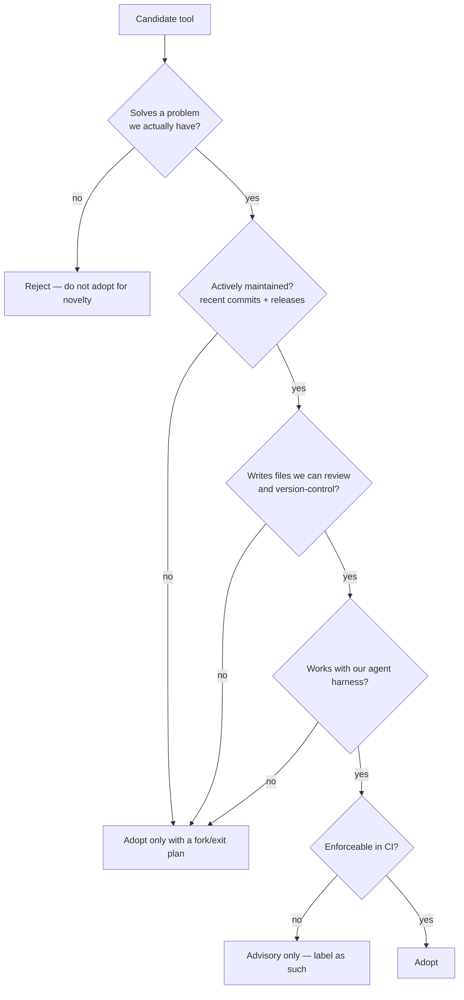
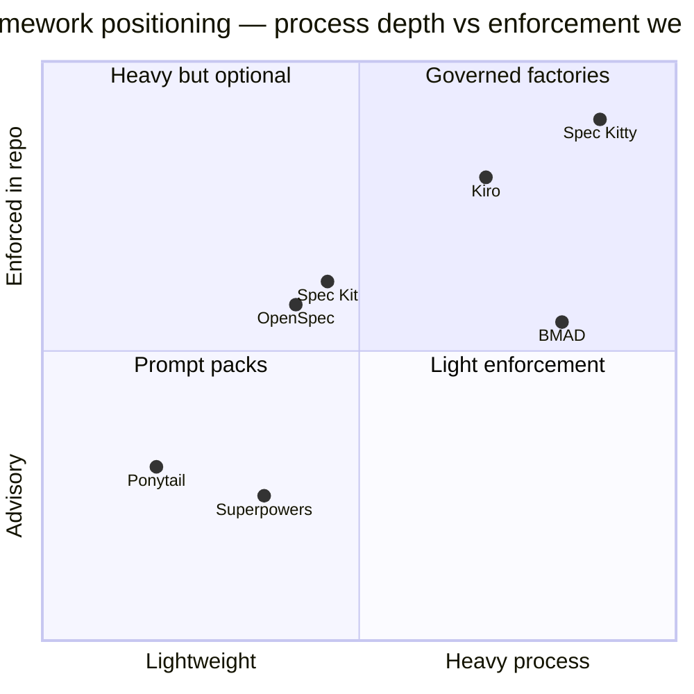
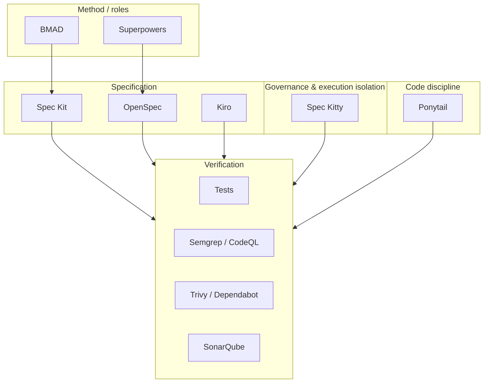
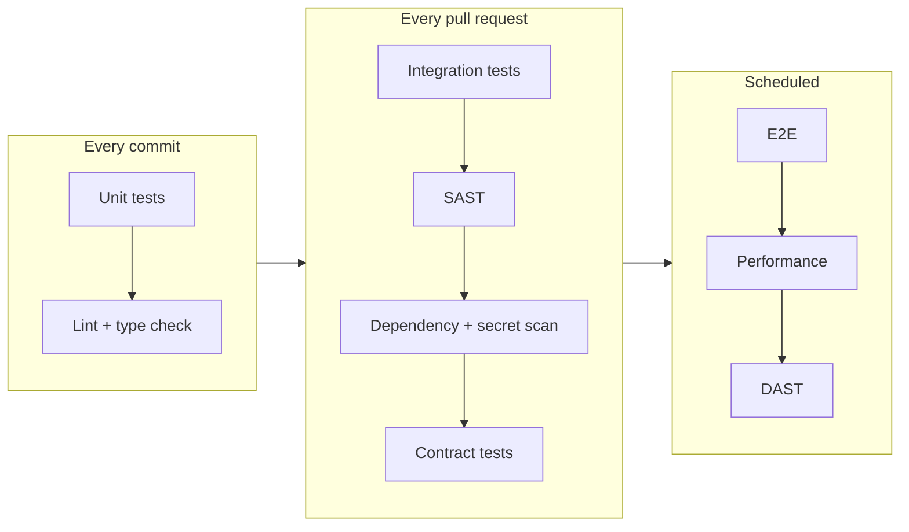
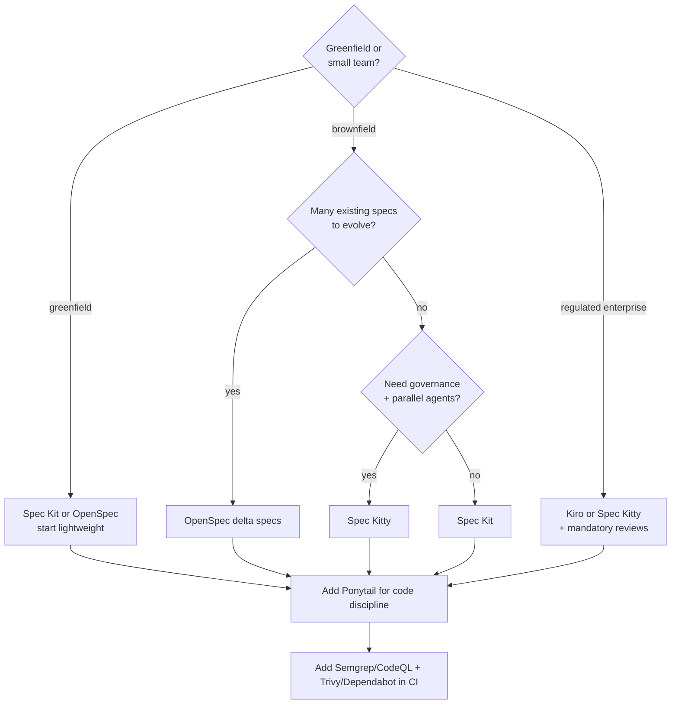

# 04 — Tool Comparison

> Everything in this chapter was checked on **2026-11-02** against primary sources. Version
> numbers are snapshots. Re-verify before installing.

---

## 1. Purpose

Choose a small, coherent toolchain instead of accumulating tools. This chapter compares SDD
frameworks, agent methodologies, and verification tools on the dimensions that actually
determine adoption: **what problem it solves, what it does not solve, where it runs, and what
it writes into your repository.**

---

## 2. Selection criteria

| Criterion | Weight | Why |
| --- | --- | --- |
| Problem fit | High | Tools that solve hypothetical problems create real maintenance |
| Maintenance status | High | Abandoned tools become security debt |
| Artifact transparency | High | Opaque state cannot be reviewed or migrated |
| Agent compatibility | Medium | Lock-in to one harness is a strategic risk |
| CI enforceability | Medium | Advisory rules decay |
| Reversibility (uninstall) | Medium | Must be removable without destroying work |
| License compatibility | High | Enterprise legal gate |

---

## 3. SDD frameworks — verification snapshot

| Tool | Version verified | License | Primary language | Installer | Artifact root |
| --- | --- | --- | --- | --- | --- |
| **GitHub Spec Kit** | 1.2.5 (2026-10-28) | MIT | Python | `uv tool install specify-cli` | `.specify/`, feature dirs |
| **OpenSpec** | 1.16.0 (2026-10-30) | MIT | TypeScript | install script, npm, Homebrew | `openspec/` |
| **AWS Kiro** | product docs, no public semver | Proprietary (AWS) | — | AWS distribution | `.kiro/specs/`, `.kiro/steering/` |
| **BMAD Method** | 6.12.4 stable; v7 alpha | MIT | Python (workflows) | npm installer / skills CLI | `_bmad/` (v6), configured output |
| **Spec Kitty** | CLI 3.2.7 stable; 4.0.0rc2 RC | MIT | Python | pipx / uv tool | `kitty-specs/`, `.worktrees/` |
| **Ponytail** | 5.3.3 (2026-10-29) | see repository | Prompt/skills | plugin marketplace / skill copy | agent skill dirs |
| **Superpowers** | 7.0.1 (2026-10-21) | MIT | Shell/skills | per-harness plugin | agent plugin dirs |

> **License note.** BMAD's GitHub license API reports `NOASSERTION`, while the repository
> `LICENSE` file states MIT. Confirm with your legal process rather than the API badge.

---

## 4. What each framework is actually for

Coordinates are an author assessment for orientation, not measured data. Treat the chart as a
conversation aid and validate against the chapters that follow.

### Spec Kit

| Dimension | Assessment |
| --- | --- |
| **Solves** | Structured artifact pipeline (constitution → specify → clarify → plan → checklist → tasks → analyze → implement → converge), multi-agent integrations, presets/extensions |
| **Does not solve** | Your requirements quality; it structures whatever you give it |
| **Agents** | Many integrations via `--integration <key>` (Copilot, Claude, Codex, Cursor, Gemini, …); the authoritative list is in the docs |
| **OS** | Linux, macOS, Windows |
| **Project vs global** | Project files in `.specify/`; CLI installed globally via `uv`/`pipx` |
| **Review without code** | `/speckit-analyze` is explicitly read-only |
| **Known limits** | Generated command files must not be hand-edited; customize via presets/overrides |
| **Docs** | <https://github.github.io/spec-kit/> |

### OpenSpec

| Dimension | Assessment |
| --- | --- |
| **Solves** | Brownfield-friendly delta specs: change proposals that modify existing specs, archived on completion |
| **Does not solve** | Test execution, code review, deployment |
| **Agents** | Tool-agnostic skills + commands; installer writes to the agent's folder (`.claude/`, `.agents/`, …) |
| **OS** | macOS/Linux (shell installer), Windows (PowerShell installer) |
| **Project vs global** | `openspec/config.yaml` per project; CLI settings in `~/.config/openspec/config.json`; stores registry in user data dir |
| **Review without code** | `openspec validate`, `openspec show`, read-only artifacts |
| **Known limits** | Stores/worksets are beta; artifact quality depends on schema rules |
| **Docs** | <https://openspec.dev/docs> |

### AWS Kiro

| Dimension | Assessment |
| --- | --- |
| **Solves** | Integrated spec workflow (requirements/design/tasks), steering files, event hooks, parallel task waves, property-based correctness analysis |
| **Does not solve** | Vendor independence; offline use |
| **Agents** | Kiro's own IDE/CLI/web/mobile surfaces |
| **OS** | Wherever Kiro is distributed (desktop app + CLI) |
| **Project vs global** | `.kiro/specs/`, `.kiro/steering/`, `.kiro/hooks/` (workspace); `~/.kiro/` (global) |
| **Review without code** | Markdown Review on spec documents; spec review before task execution |
| **Known limits** | Proprietary; hook surfaces differ by product surface (e.g. web has no event hooks per docs table) |
| **Docs** | <https://kiro.dev/docs/> |

### BMAD Method

| Dimension | Assessment |
| --- | --- |
| **Solves** | Right-sized planning paths, role-based agents (product, architecture, dev, QA), existing-codebase onboarding |
| **Does not solve** | Enforcement in CI; it is a method plus skills |
| **Agents** | Skills-capable tools; v6 installer supports common IDEs; v7 is skills-first |
| **OS** | Cross-platform via Node.js |
| **Project vs global** | Project install (`_bmad/` in v6), no global runtime |
| **Review without code** | Review workflows operate on artifacts; implementation is separate |
| **Known limits** | v7 is preview alpha with breaking changes; v6.12 frozen except bug fixes |
| **Docs** | <https://docs.bmad-method.org/> |

### Spec Kitty

| Dimension | Assessment |
| --- | --- |
| **Solves** | Governed multi-agent delivery: work packages, lanes, acceptance gates, git worktree isolation, retrospectives, audit trail |
| **Does not solve** | Small one-off edits; teams not using Git |
| **Agents** | Claude Code, Codex, Cursor, Gemini, Copilot, Windsurf, OpenCode |
| **OS** | Cross-platform (Python 3.11+) |
| **Project vs global** | `kitty-specs/` in repo; `.worktrees/`; `.kittify/config.yaml` |
| **Review without code** | `for_review` lane, `spec-kitty agent tasks status --json` |
| **Known limits** | Heavier setup; 4.x RC not yet stable |
| **Docs** | <https://github.com/spec-kitty/spec-kitty> |

### Ponytail

| Dimension | Assessment |
| --- | --- |
| **Solves** | Over-engineering: a 7-rung "laziness ladder" that prefers deletion, reuse, stdlib, native features, and installed dependencies before new code; plus `/ponytail-review` and `/ponytail-audit` |
| **Does not solve** | Requirements definition; it does not write specs |
| **Agents** | Claude Code, Codex, Cursor, Gemini, Copilot (rules-only adapter), Kiro, others |
| **OS** | Anywhere the host agent runs (prompt-only) |
| **Project vs global** | Project `AGENTS.md` or installed skill |
| **Review without code** | `/ponytail-review` (diff scope) and `/ponytail-audit` (repo scope) are review commands; verify host-specific write permissions |
| **Known limits** | Instruction-only adapters load rules without commands; cannot technically enforce read-only |
| **Docs** | <https://github.com/DietrichGebert/ponytail> |

### Superpowers

| Dimension | Assessment |
| --- | --- |
| **Solves** | Methodology-as-skills: spec elicitation, chunked design review, implementation plans, subagent-driven development with TDD |
| **Does not solve** | Organizational governance, audit trail, CI gates |
| **Agents** | Many harnesses (Claude Code, Codex, Cursor, Copilot CLI, Gemini CLI, OpenCode, …) |
| **OS** | Host-dependent |
| **Project vs global** | Per-harness plugin install |
| **Review without code** | Skill-driven review steps; not a technical read-only boundary |
| **Known limits** | Skills trigger automatically — behavior can surprise teams that expected explicit invocation |
| **Docs** | <https://github.com/obra/superpowers> |

---

## 5. Composition, not replacement

These tools overlap partially. The realistic combinations:

| Combination | Works because | Watch out for |
| --- | --- | --- |
| Spec Kit + Ponytail | Spec Kit defines *what*; Ponytail constrains *how much* | Ponytail must not delete tests to satisfy the ladder |
| OpenSpec + Superpowers | Delta specs + disciplined implementation loop | Both want to own the planning step; pick one |
| Kiro + Semgrep + Trivy | Native specs + external enforced scanning | Hooks are local; CI still needs its own gates |
| Spec Kitty + Spec Kit | Possible overlap in task generation | Do not run two task systems on one change |
| BMAD + Spec Kit | BMAD planning, Spec Kit execution | Duplicate templates confuse agents; declare one source |

> **Rule of composition:** one tool owns each artifact type. If two tools generate `tasks.md`,
> you have two sources of truth.

---

## 6. Verification tooling

### Static analysis and quality

| Tool | Solves | Does not solve | License (verified) | Docs |
| --- | --- | --- | --- | --- |
| **SonarQube / SonarCloud** | Code smells, duplication, coverage tracking, quality gates, taint analysis in commercial editions | Runtime behavior; dependency CVEs (limited) | SonarSource licensing (edition-dependent) | <https://docs.sonarsource.com/> |
| **Semgrep** | Pattern-based SAST, custom rules, fast CI runs, secrets | Deep data-flow in all languages | LGPL-2.1 (OSS CLI) + commercial platform | <https://semgrep.dev/docs/> |
| **CodeQL** | Semantic code analysis, variant analysis, security queries | Non-GitHub-native CI without setup; private repos need GHAS | Proprietary (free on public repos) | <https://codeql.github.com/docs/> |

### Supply chain and dependencies

| Tool | Solves | Does not solve | License | Docs |
| --- | --- | --- | --- | --- |
| **Trivy** | Container/FS/repo/IaC/secret scanning, SBOM | Full SAST | Apache-2.0 | <https://trivy.dev/> |
| **OWASP Dependency-Check** | Known-vulnerable components via NVD/CVE | Zero-days, license policy | Apache-2.0 | <https://owasp.org/www-project-dependency-check/> |
| **Dependabot** | Automated dependency PRs, alerts | Non-GitHub ecosystems hosting; transitive policy nuance | GitHub-native | <https://docs.github.com/en/code-security/dependabot> |

### Test frameworks

| Tool | Ecosystem | Strength | Notes |
| --- | --- | --- | --- |
| **JUnit 5** | Java/Kotlin | Jupiter API, extensions, parameterized tests | Use with Surefire (unit) + Failsafe (IT) |
| **Testcontainers** | Java, .NET, Python, Node, Go | Real dependencies in Docker for integration tests | Requires a container runtime in CI |
| **pytest** | Python | Fixtures, parametrization, plugins | `pytest-xdist` for parallelism |
| **xUnit** | .NET | `[Fact]`/`[Theory]`, parallel by collection | NUnit/MSTest are valid alternatives |
| **Playwright** | JS/TS, Python, Java, .NET | Cross-browser E2E, auto-wait, tracing | Keep E2E to critical journeys |
| **Pact** | Multi-language | Consumer-driven contract testing | Requires a broker for scale |

---

## 7. Decision guide

### Recommendation for this repository

This repository is a **documentation and methodology repository**, not an application. The
recommendation is deliberately minimal:

| Need | Recommendation | Why |
| --- | --- | --- |
| SDD framework | **None installed by default** | Installing a framework here would generate command files for an application workflow with no application |
| Reference implementations | Documented in chapters 05–11 | Readers adopt in *their* repos |
| Doc validation | `tools/validate_docs.py` | Local, dependency-free, real |
| Agent methodology | Adopt per consuming project | Avoid imposing one vendor |
| Commit policy | Mode 1 (docs-only) for this repo | See [chapter 22](./22-git-and-commit-policy.md) |

---

## 8. What not to compare

| Claim to avoid | Reason |
| --- | --- |
| "Tool X produces better code" | No controlled evidence; confounded by task and model |
| "More artifacts = more rigor" | Unread artifacts are negative value |
| "Framework Y is enterprise-ready" | Enterprise readiness is organizational, not a badge |
| "Zero-configuration" | Every tool writes files and expects conventions |

---

## 9. Common mistakes

| Mistake | Consequence |
| --- | --- |
| Installing three frameworks "to compare" | Conflicting commands, duplicated artifacts, confused agents |
| Adopting a preview/RC version in production | Breaking changes mid-delivery |
| Ignoring the installer's generated files in review | Unreviewed prompt injection surface |
| Treating a marketplace listing as an audit | Community components are not endorsed by default |
| Measuring success by artifact count | Process theater |

---

## 10. Verification of this chapter

| Check | Method | Result |
| --- | --- | --- |
| Version numbers | GitHub Releases API + PyPI + npm registry, 2026-11-02 | VERIFIED |
| Licenses | GitHub repository metadata; noted where API and LICENSE disagree | PARTIALLY VERIFIED (BMAD) |
| Feature claims | Official docs pages linked per tool | VERIFIED where linked; otherwise labeled |
| Quadrant coordinates | Author assessment | UNVERIFIED — explicitly labeled |

---

## 11. References

- <https://github.com/github/spec-kit>
- <https://www.npmjs.com/package/@fission-ai/openspec>
- <https://pypi.org/project/spec-kitty-cli/>
- <https://www.npmjs.com/package/bmad-method>
- <https://github.com/DietrichGebert/ponytail>
- <https://github.com/obra/superpowers>
- <https://kiro.dev/docs/>
- <https://owasp.org/www-project-dependency-check/>
- <https://trivy.dev/>
- <https://semgrep.dev/docs/>
- <https://codeql.github.com/docs/>
- <https://docs.sonarsource.com/>
- <https://docs.github.com/en/code-security/dependabot>
- <https://junit.org/junit5/>
- <https://testcontainers.com/>
- <https://docs.pytest.org/>
- <https://xunit.net/>
- <https://playwright.dev/>
- <https://docs.pact.io/>

---

**Previous:** [03 — Repository discovery](./03-repository-discovery.md) ·
**Next:** [05 — GitHub Spec Kit](./05-github-spec-kit.md)
