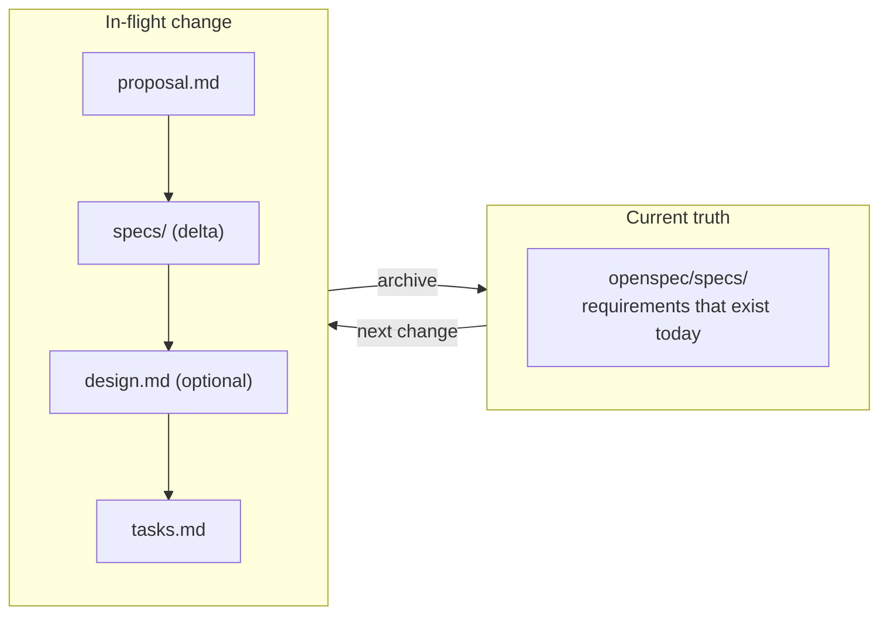
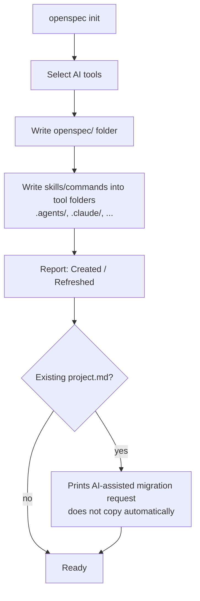
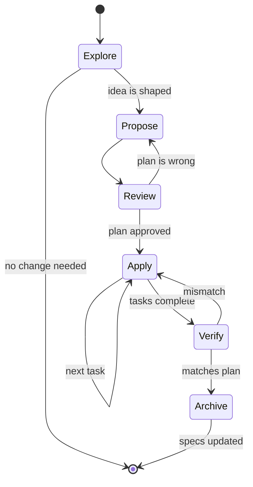
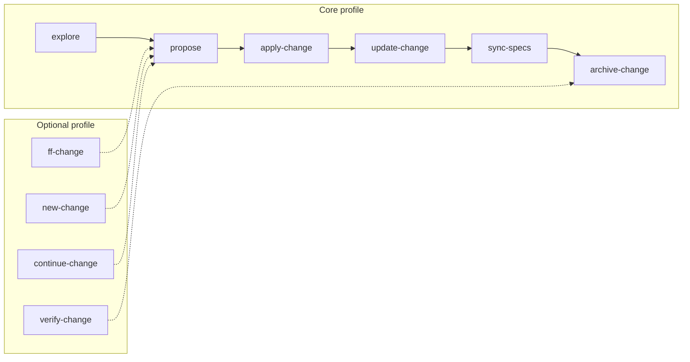
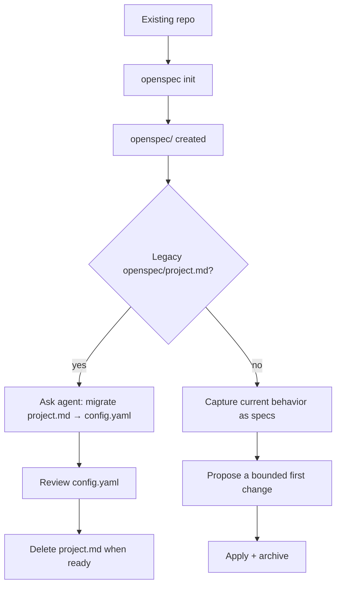
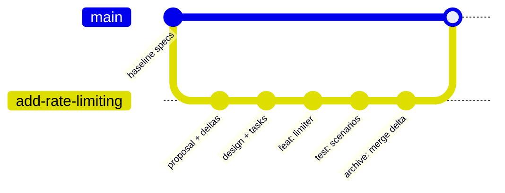
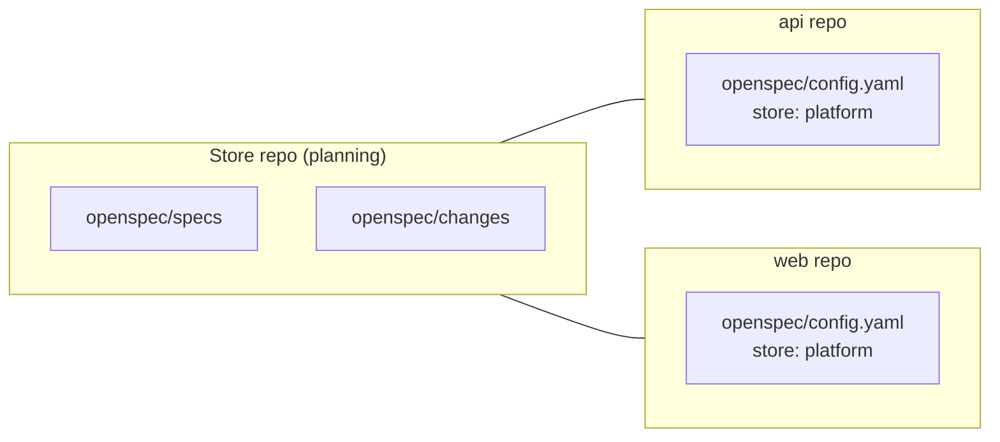
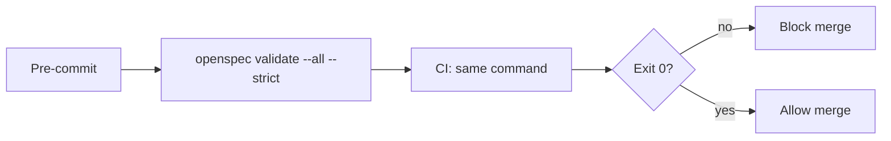

# 06 — OpenSpec

> Verified against `@fission-ai/openspec` **1.16.0** (release 2026-10-30) and
> <https://openspec.dev/docs> on **2026-11-02**.

---

## 1. Purpose

OpenSpec is an MIT-licensed, TypeScript-based spec framework built around **change proposals
and delta specifications**. Its distinguishing idea: existing specs (`openspec/specs/`) are
the current truth, and every change is a *delta* that adds, modifies, or removes requirements.
On archive, the delta is merged into the specs.

It is explicitly designed for **brownfield** repositories and for keeping planning artifacts
inside the repo where agents and humans both read them.



---

## 2. When to use it

| Use OpenSpec when | Avoid it when |
| --- | --- |
| You have existing specs/behavior to evolve carefully | You need an integrated IDE spec UI |
| You want diffs to requirements, not full rewrites | You cannot install Node or use the install script |
| Multiple repos need a shared planning source (stores, beta) | You require a non-beta multi-repo setup today |
| You want the tool to be harness-agnostic | Your security policy forbids third-party install scripts |

---

## 3. Prerequisites

| Requirement | Detail |
| --- | --- |
| OS | macOS, Linux, Windows |
| Node.js | 22.12.0+ **if** installing via npm |
| Shell | `bash`/`sh` for the install script; PowerShell for Windows script |
| Agent | Any tool that reads `AGENTS.md`-style skills or commands |
| Git | Required for versioned collaboration (not enforced by the CLI) |

---

## 4. Installation

### Option A — standalone installer (recommended by upstream)

```bash
# macOS / Linux
curl -fsSL https://openspec.dev/cli/install.sh | sh
```

```powershell
# Windows PowerShell
irm https://openspec.dev/cli/install.ps1 | iex
```

If the installer prints an `export PATH=...` line, run it.

> **Security note:** piping a remote script into a shell executes unreviewed code. In regulated
> environments, download, inspect, and run locally, or use the package-manager route.

### Option B — package managers

```bash
# npm (Node.js 22.12.0+)
npm install -g @fission-ai/openspec@latest

# Homebrew
brew install openspec
```

### Verify

```bash
openspec version
```

---

## 5. Initialization and configuration

```bash
cd your-project
openspec init
```

`init` asks which AI tools you use, writes workflow files for each, and reports what it
created. Re-running `init` is safe: existing tools print `Refreshed`, and selecting a new tool
adds it. `--tools` skips the picker.



### Project structure

```text
your-project/
├── openspec/
│   ├── config.yaml                  # schema, context, rules, operations
│   ├── specs/                       # current truth (per capability)
│   └── changes/
│       ├── add-rate-limiting/
│       │   ├── proposal.md          # why + what changes
│       │   ├── specs/               # delta requirements (ADDED/MODIFIED/REMOVED)
│       │   ├── design.md            # only when the change needs one
│       │   ├── tasks.md             # implementation checklist
│       │   └── .openspec.yaml       # change metadata
│       └── archive/
│           └── 2026-11-02-add-rate-limiting/
└── <source code>
```

### `openspec/config.yaml` — verified fields

| Key | Type | Required | Effect |
| --- | --- | --- | --- |
| `schema` | string | **Yes** | Workflow schema (`spec-driven` or a project-defined schema) |
| `context` | string | No | Injected into every artifact, apply, and archive (50 KB limit) |
| `rules` | map: artifact ID → list of strings | No | Extra rules for one artifact's built-in guidance |
| `operations` | map: operation → `guidance` list | No | Advisory guidance for `apply` and `archive` only |
| `store` | string | No | Fallback root when this `openspec/` is config-only |
| `references` | list | No | Stores whose specs are indexed into instructions (not inlined) |

```yaml
# openspec/config.yaml — example
schema: spec-driven

context: |
  Designs and tasks must cover Windows, macOS, and Linux.
  Write all artifacts in English.
  Never add a runtime dependency without an ADR.

rules:
  proposal:
    - Keep proposals under 500 words.
    - Always state what is out of scope.
  tasks:
    - Break tasks into chunks of at most 2 hours.

operations:
  apply:
    guidance:
      - Keep test summaries concise.
  archive:
    guidance:
      - Summarize the archive outcome before finishing.
```

> Invalid fields never fail a command: each field is validated independently and a bad value is
> dropped **with a warning**. The exception is `openspec validate`, which exits `1` on an
> unreadable or invalid YAML file so CI can catch it. Design your CI accordingly.

### Change metadata — `openspec/changes/<name>/.openspec.yaml`

| Key | Type | Required | Effect |
| --- | --- | --- | --- |
| `schema` | string | **Yes** | Pinned at creation; wins over project config |
| `created` | `YYYY-MM-DD` | No | Creation date |
| `goal` | string | No | What the change sets out to do |
| `affected_areas` | list of strings | No | Areas expected to change |
| `initiative` | map (`store`, `id`) | No | Owning initiative |
| `skip_specs` | boolean | No | Declares no spec deltas (zero deltas validate) |
| `retire_capabilities` | boolean | No | Authorizes archive to delete an emptied capability |

### Global CLI settings

CLI behavior lives in `~/.config/openspec/config.json` (Windows path varies), separate from
project configuration. Telemetry opt-out and config/data directory locations are controlled by
environment variables.

---

## 6. The workflow



| Step | What happens | Writes code? |
| --- | --- | --- |
| 1 · Explore | Agent investigates and challenges the idea | No |
| 2 · Propose | Creates `proposal.md`, spec deltas, `design.md`, `tasks.md` | No |
| 3 · Review | You correct the plan in Markdown | No |
| 4 · Apply | Agent works through `tasks.md`, checking boxes | **Yes** |
| 5 · Archive | Delta merged into `specs/`, change moved to `archive/` | No |

### Delta spec format

```markdown
## ADDED Requirements

### Requirement: Theme selection
The app SHALL let users switch between light and dark themes,
defaulting to the system preference.

#### Scenario: User toggles dark mode
- **WHEN** the user clicks the theme toggle
- **THEN** the app switches to dark mode and persists the choice
```

Delta sections are `ADDED`, `MODIFIED`, `REMOVED` (and equivalent operations depending on
schema). Requirements are stated as behavior with at least one concrete scenario.

---

## 7. Skills and commands

OpenSpec installs **skills** (auto-selected by the agent) and, for many tools, **commands**
(explicit slash commands). The CLI demo in upstream docs uses `/opsx:explore`,
`/opsx:propose`, `/opsx:apply`, `/opsx:archive`; command names are tool-dependent — check the
files written into your agent's folder.

### Core skills (installed by default)

| Skill | Job | Creates |
| --- | --- | --- |
| `openspec-explore` | Think through an idea; never writes code | Nothing (optionally captures insights) |
| `openspec-propose` | Create a change proposal with all planning artifacts | `openspec/changes/<name>/` |
| `openspec-apply-change` | Implement tasks, checking them off | Code |
| `openspec-update-change` | Revise an existing change's plan | Artifact edits |
| `openspec-sync-specs` | Merge spec updates into `specs/` | Spec updates |
| `openspec-archive-change` | Move a finished change to the archive | Archive move |

### Optional skills (via profiles)

| Skill | Job |
| --- | --- |
| `openspec-new-change` | Start a change as an empty scaffold |
| `openspec-continue-change` | Create the next artifact, one at a time |
| `openspec-ff-change` | Create every artifact implementation needs in one pass |
| `openspec-verify-change` | Check implementation matches the plan |
| `openspec-bulk-archive-change` | Archive several changes at once |
| `openspec-onboard` | Learn the workflow via one real change |



> **Root resolution:** every skill verifies an OpenSpec root before writing. If auto-selected
> without an explicit OpenSpec request and no root exists, the agent drops OpenSpec and answers
> normally. If you explicitly named OpenSpec, it stops and asks: run `openspec init`, target a
> store with `--store <id>`, or continue without OpenSpec.

---

## 8. CLI reference (verified subset)

| Command | Purpose |
| --- | --- |
| `openspec init` | Initialize project; write workflow files |
| `openspec update` | Refresh installed workflow files |
| `openspec list` | List changes/specs |
| `openspec show` | Show an item's content |
| `openspec view` | Interactive/structured view |
| `openspec status` | Show artifact completion and next ready step |
| `openspec validate <name>` | Validate one change or spec |
| `openspec validate --all` | Validate everything |
| `openspec archive` | Archive a completed change |
| `openspec new` | Create a new change scaffold |
| `openspec instructions` | Print instructions for an artifact/operation |
| `openspec schemas` / `openspec schema` | Inspect or manage schemas |
| `openspec config` | Read/modify CLI and project config |
| `openspec context` | Show resolved context |
| `openspec doctor` | Diagnose environment problems |
| `openspec store` | Manage multi-repo stores (beta) |
| `openspec workset` | Manage worksets (beta) |

### `validate` options (verified)

| Flag | Effect |
| --- | --- |
| `--all` | Validate every change and spec |
| `--changes` | Validate every change |
| `--specs` | Validate every spec |
| `--archived` | Check task completion in archived changes |
| `--strict` | Treat warnings as failures |
| `--type <change\|spec>` | Disambiguate a shared name |
| `--json` | Structured report |
| `--report <mode>` | Report mode |

### Resuming in a fresh session

```bash
openspec status
# [x] proposal  [x] specs  [x] design  [x] tasks
# Next: openspec instructions apply --change "add-rate-limit" --json
```

Progress lives in `tasks.md` checkboxes. There is no hidden state, so a new session resumes at
the first unchecked task.

### Custom workflow schemas

| Command | Purpose |
| --- | --- |
| `openspec schemas` | List available schema names |
| `openspec schema init` | Create a new schema |
| `openspec schema fork` | Copy an existing schema as a starting point |
| `openspec schema validate` | Validate a schema definition |
| `openspec schema which` | Show which schema resolves for a path |
| `openspec new --schema <name>` | Create a change using a specific schema |

Set the project default with `schema:` in `openspec/config.yaml`. A change **pins** its schema at
creation in `.openspec.yaml`, so changing the project default later does not rewrite existing
changes.

> Schema commands are part of the verified CLI surface, but schema authoring is an advanced
> feature. Fork `spec-driven` rather than writing one from scratch.

---

## 9. Existing-project adoption and migration



1. Initialize (safe to re-run).
2. If `project.md` exists, init keeps it and prints a migration request. Move project-wide facts
   to `config.yaml` `context`; move artifact-specific guidance to `rules`; move apply/archive
   guidance to `operations`. Do not paste generic boilerplate.
3. Do **not** attempt to retro-specify the entire system. Start with one bounded change and let
   `specs/` grow through archived deltas.

---

## 10. Git and commit policy

Upstream guidance: **commit all of it** — `openspec/` and the workflow files — like any other
source.

| What | Commit? | Notes |
| --- | --- | --- |
| `openspec/config.yaml` | Yes | It is project policy |
| `openspec/specs/` | Yes | It is the current truth |
| `openspec/changes/<active>/` | Yes | In-flight plan must be reviewable |
| `openspec/changes/archive/` | Yes | Audit trail of what shipped |
| Tool workflow files (`.claude/`, `.agents/`, …) | Yes, per team decision | They are deterministic output; review them |
| `~/.config/openspec/config.json` | No | Machine-local CLI settings |
| Store registry in `~/.local/share/openspec/stores/` | No | Machine-local |



> **Do not** commit a change folder that is half-archived. Archive is a single operation:
> merge spec deltas, move the folder.

---

## 11. Multi-repo: stores and worksets (beta)



| Concept | Purpose | Status |
| --- | --- | --- |
| **Store** | Separate planning repo shared by code repos | Beta |
| **Workset** | Grouping of related work across stores | Beta |
| **references** | Index another store's specs into instructions (never inlined) | Verified field |

Commands seen in the verified CLI reference include `openspec store setup`, `store register`,
`store unregister`, `store remove`, `store list`, `store doctor`, and `openspec workset create|list`.
Treat exact flags as beta and confirm with `openspec store --help`.

---

## 12. Verification

| Check | Command | Expected |
| --- | --- | --- |
| CLI present | `openspec version` | prints version |
| Project structure | `ls openspec/config.yaml openspec/specs openspec/changes` | all exist |
| Structural validity | `openspec validate --all` | exit 0 |
| CI-grade strictness | `openspec validate --all --strict` | exit 0 |
| Machine-readable | `openspec validate --all --json` | JSON report |
| Next step | `openspec status` | names next ready artifact/command |
| Environment | `openspec doctor` | no blocking issues |



---

## 13. Common mistakes

| Mistake | Effect | Fix |
| --- | --- | --- |
| Writing full specs instead of deltas | Archive overwrites truth unpredictably | Use `ADDED/MODIFIED/REMOVED` sections |
| Skipping review of `specs/` in the change | Tasks implemented against weak requirements | Review `specs/` before `tasks.md` |
| Applying in the same context as proposal | Plan and code rationalize each other | Start a fresh session for apply |
| Treating `design.md` as always required | Noise for small changes | It is created only when the change needs one |
| Editing `openspec/config.yaml` with invalid YAML | Fields silently dropped (except `validate`) | Run `openspec validate` in CI |
| Putting project-wide facts in `rules` | Repeated per artifact, wasted context | Project-wide → `context` |
| Ignoring the beta label on stores | Unstable multi-repo behavior | Pilot only; keep a fallback |
| Migrating `project.md` wholesale | Bloated, stale context | Keep context concise; drop generic material |

---

## 14. Troubleshooting

| Symptom | Cause | Action |
| --- | --- | --- |
| Agent ignores OpenSpec | No resolved root | Run `openspec init` in the repo root |
| "Store cannot be resolved" | `store:` names an unregistered/invalid store | `openspec store list`, `openspec store register` |
| `validate` exits 1 with no message | Invalid YAML config | Run `openspec config path`, fix YAML |
| Skills not visible in agent | Tool folder not written/refreshed | Re-run `openspec update` or `init` with `--tools` |
| `init` cleaned nothing from an older version | It asks before cleanup | Confirm the prompt |
| Tasks resume at the wrong place | Someone edited checkboxes manually | Inspect `tasks.md`; it is the only state |
| `openspec archive` refuses | Unchecked tasks or invalid deltas | `openspec status`, `openspec validate --all` |

---

## 15. Security considerations

| Risk | Control |
| --- | --- |
| Remote install script | Inspect before running; prefer npm/brew with lockfile in CI |
| Agent-written `config.yaml` | Treat as code; review changes to `context`/`rules` |
| Store access | Stores can be remote Git; restrict credentials to read-only where appropriate |
| Spec content | May include internal architecture details; apply repo access controls |
| Auto-selected skills | Can act without explicit invocation; review the written skill files once |
| Telemetry | Opt-out is documented via environment variables; verify for your policy |

---

## 16. Maintenance: update and uninstall

| Action | Command | Notes |
| --- | --- | --- |
| Refresh workflow files | `openspec update` | Re-writes skills/commands for the configured tools |
| Update the CLI | Re-run the installer, or use the package manager you installed with | Upstream documents switching from npm/Homebrew to the standalone installer |
| Add a tool later | `openspec init` again and select the new tool | Existing tools print `Refreshed` |
| Uninstall | Remove the global package with the same manager, then delete `openspec/` and generated tool files | `openspec/` is your content — archive before deleting |

**Preserving customizations:** `openspec/config.yaml`, `specs/`, and `changes/` are project content
and are never regenerated by `update`. Custom schemas live under the project and survive updates.
Tool workflow files are regenerated; do not hand-edit them.

## 17. Official references

- Documentation — <https://openspec.dev/docs>
- Installation — <https://openspec.dev/docs/installation>
- Setup — <https://openspec.dev/docs/setup>
- Quickstart — <https://openspec.dev/docs/quickstart>
- Skills reference — <https://openspec.dev/docs/skills>
- CLI reference — <https://openspec.dev/docs/cli>
- `config.yaml` — <https://openspec.dev/docs/configuration/config-yaml>
- Change metadata — <https://openspec.dev/docs/configuration/change-metadata>
- Profiles — <https://openspec.dev/docs/profiles>
- Stores (beta) — <https://openspec.dev/docs/stores>
- Repository — <https://github.com/Fission-AI/OpenSpec>

---

**Previous:** [05 — GitHub Spec Kit](./05-github-spec-kit.md) ·
**Next:** [07 — AWS Kiro](./07-aws-kiro.md)
