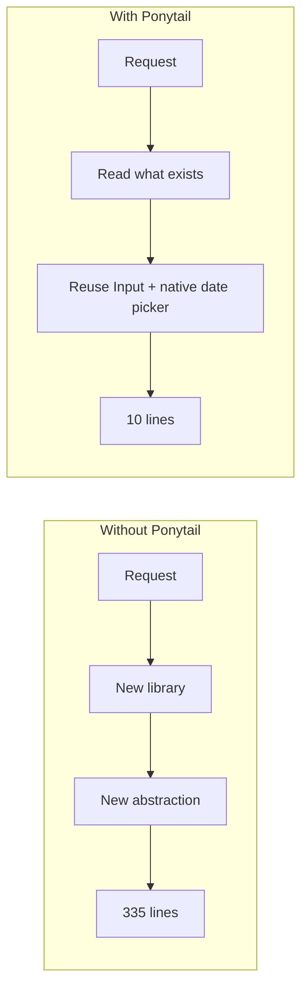
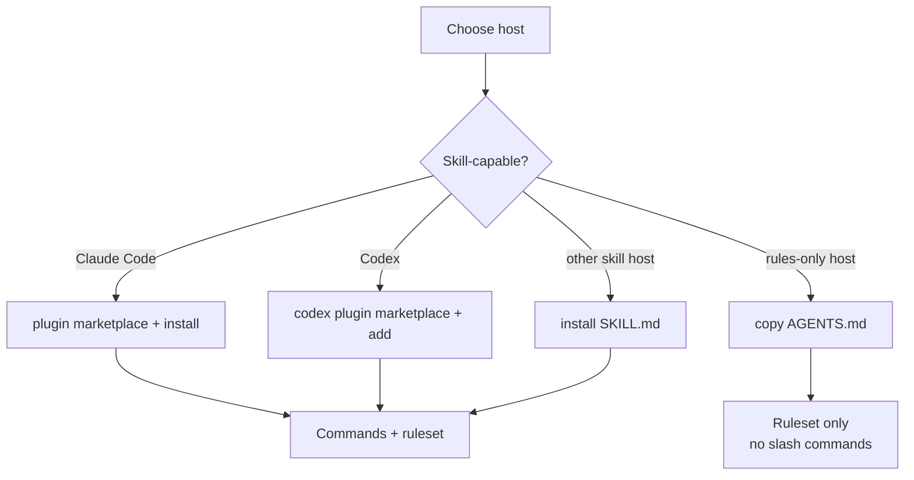
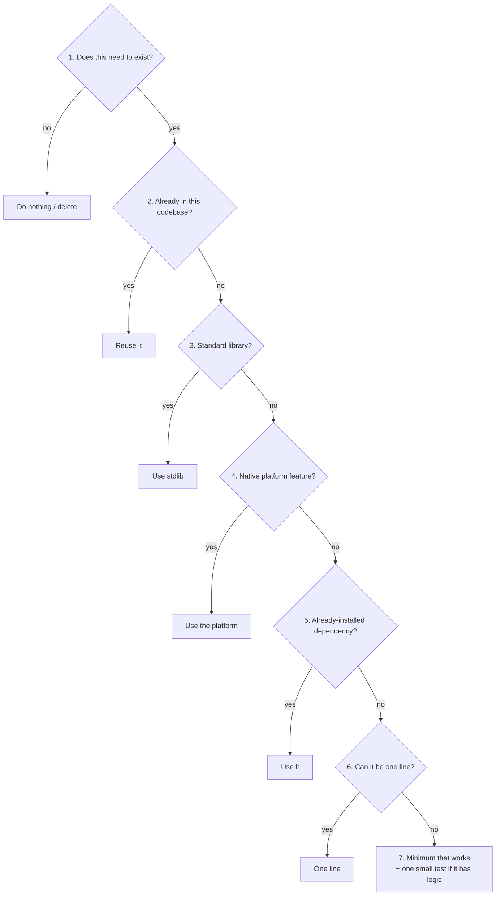
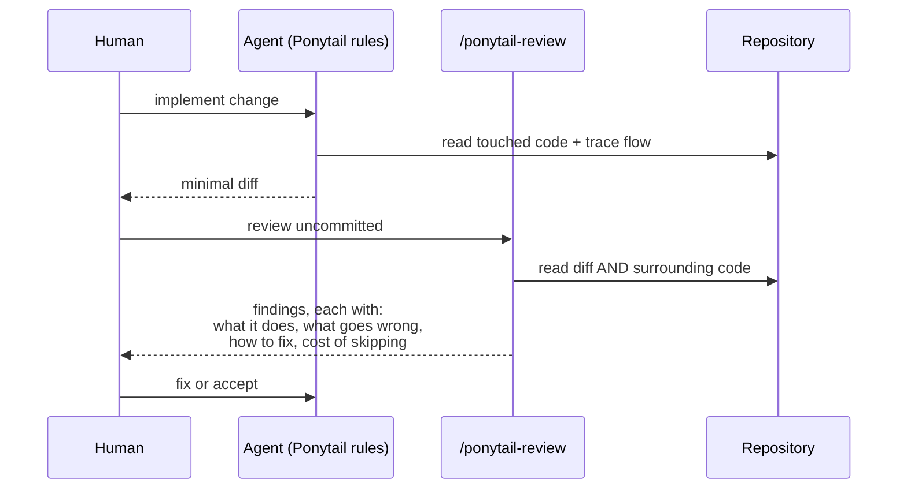
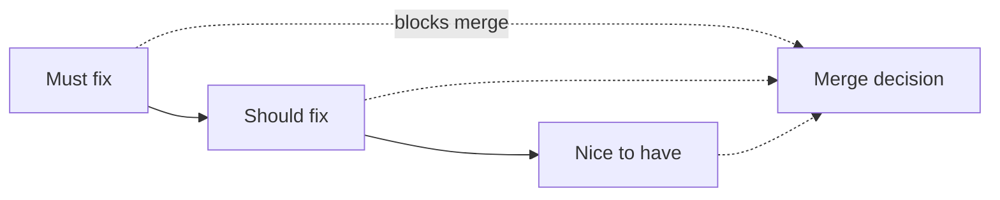
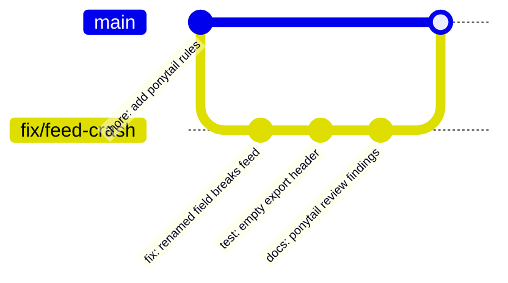

# 10 — Ponytail

> Verified against **v5.3.3** (release 2026-10-29) and the repository README on **2026-11-02**.
> Repository: <https://github.com/DietrichGebert/ponytail>.

---

## 1. Purpose

Ponytail is a **minimal-code discipline** for AI agents: "the best code is the code you never
write." Instead of adding process artifacts, it changes *how much* code the agent produces by
forcing a ladder of cheaper alternatives before new implementation.

It also ships two review commands:

| Command | Scope | Purpose |
| --- | --- | --- |
| `/ponytail-review` | Current diff (`uncommitted`, `staged`, `branch`, or a PR) | Bugs, security, real load, missing tests, speed, and what to cut |
| `/ponytail-audit` | Whole repository | Same checks, ranked "fix this first" |



The upstream benchmark compares the same agent with and without the skill on 39 tasks
(including a real FastAPI + React repository). Treat published benchmark numbers as vendor
claims, not independent verification.

---

## 2. When to use it

| Use Ponytail when | Avoid it when |
| --- | --- |
| Agents over-engineer, add dependencies, or duplicate code | You need requirements/planning artifacts (it does not provide them) |
| You want a review that looks outside the diff | You need org-level governance and audit trails |
| You already have a spec workflow and want code discipline | The task is genuinely novel and needs new abstractions |

> **It is complementary, not a replacement.** Ponytail does not write specifications. Pair it
> with a spec framework from [chapters 05–09](./05-github-spec-kit.md).

---

## 3. Prerequisites

| Requirement | Detail |
| --- | --- |
| Agent | A skill-capable host for commands; any agent for the always-on ruleset |
| OS | Wherever the host agent runs (prompt/skill only) |
| Runtime | None for the ruleset; Claude Code 2.1.290+ for the optional v5.3 "band" UI |
| Trust | Install **only** from `DietrichGebert/ponytail` on GitHub or `@dietrichgebert/ponytail` on npm |

> Upstream explicitly states it never ships `.exe` or `.dll` files. A copy that does is not
> the original project.

---

## 4. Installation

### Claude Code

```text
/plugin marketplace add DietrichGebert/ponytail
/plugin install ponytail@ponytail
```

### Codex

```bash
codex plugin marketplace add DietrichGebert/ponytail
codex plugin add ponytail@ponytail
```

### Any other agent

Two options, both verified in the README:

1. Copy [`AGENTS.md`](https://github.com/DietrichGebert/ponytail/blob/main/AGENTS.md) into your
   project (the compact, always-on ruleset).
2. Ask your agent to install
   [`skills/ponytail/SKILL.md`](https://github.com/DietrichGebert/ponytail/blob/main/skills/ponytail/SKILL.md)
   as a skill.

Step-by-step instructions for Copilot, Cursor, OpenCode, Gemini and others live in
[`INSTALL.md`](https://github.com/DietrichGebert/ponytail/blob/main/INSTALL.md).



### Host capability matrix (verified statements)

| Host | Ruleset | `/ponytail-*` commands |
| --- | --- | --- |
| Claude Code | Yes | Yes |
| Codex | Yes | Yes, namespaced (`$ponytail:ponytail-review`) |
| Cursor (with hooks) | Yes | Level switching only, as a plain message |
| Windsurf, Cline | Yes | No (instruction-only adapter) |
| GitHub Copilot | Yes | No (rule file adapter) |
| Kiro | Yes | No |
| Antigravity (AGENTS.md fallback) | Yes | No |

---

## 5. Configuration: the laziness ladder

The ladder runs **after** the agent understands the problem — it reads the code the change
touches and traces the real flow first. "Lazy about the solution, never about reading."



### What "yes" looks like

| Rung | Anti-pattern it prevents | Example |
| --- | --- | --- |
| 1 | Building unused features | Adding a config flag nobody toggles |
| 2 | Duplicating a component | Writing a second date picker when `Input type="date"` + existing `Input` exists |
| 3 | Dependency for trivial work | `left-pad`, hand-rolled `uuid` when `crypto.randomUUID()` exists |
| 4 | Reimplementing the browser/OS | Custom scrollbars, custom file dialogs |
| 5 | Adding a second library for an existing job | Two HTTP clients in one service |
| 6 | Multi-file ceremony | A 40-line helper for a one-line transform |
| 7 | Premature abstraction | Interfaces/factories for a single implementation |

> **The ladder is not a license to skip tests.** Upstream: "plus one small test if it has
> logic." Deleting tests to reduce lines violates the method.

---

## 6. Review workflow



### Review scope arguments

| Argument | Scope |
| --- | --- |
| `uncommitted` | Working tree |
| `staged` | Index |
| `branch` | Branch vs base |
| PR link | Pull request diff |

### Finding format (upstream-described)

Each finding states:

1. **What the code does**
2. **What goes wrong**
3. **How to fix it**
4. **What happens if you skip it**

This structure matters: it separates evidence from recommendation and makes the consequence
explicit for a human decision.



The audit ranks repository-wide findings as *must fix / should fix / nice to have* and ends with
a verdict such as "fix 1 first".

---

## 7. Complete example

### 7.1 Before/after

```python
# Over-engineered: 40 lines, a class, a registry, a plugin hook
class DatePickerFactory:
    _formats: dict[str, "DatePickerFormat"] = {}
    ...
```

```tsx
// Ponytail outcome: reuse what exists
<Input type="date" value={date} onChange={setDate} />
```

### 7.2 Review output (illustrative)

```markdown
## /ponytail-review — branch

### Must fix
**`src/routes/feed.js:88` — Atom feed crashes on every request**
- **What it does:** reads `order.total_cents`, renamed to `amount_cents` by this change.
- **What goes wrong:** untouched file now returns 500 for every request.
- **Fix:** update the field reference, or keep a compatibility alias.
- **If skipped:** feed consumers break silently until they page you.

### Should fix
**`src/services/export.ts:41` — no test for empty result set**
- **What it does:** streams a CSV with a header row.
- **What goes wrong:** an empty export may emit no header, contradicting AC-3.3.
- **Fix:** add one test for the empty case.
- **If skipped:** consumers that require a header fail on empty projects.

### Nice to have
**`src/services/export.ts:1-30` — `CsvWriter` abstraction has one implementation**
- **What it does:** wraps a single call to `stringify`.
- **Fix:** delete the wrapper, call the library directly.
- **If skipped:** one more layer to read for no behavior.
```

> **Note the value:** the highest finding is *outside the diff*. This is the point of reading
> the code the change touches, not just the changed lines.

### 7.3 Audit output shape (illustrative)

```markdown
## /ponytail-audit — warehouse-stock

1. **Must fix** — office batches with 1,200 rows fail completely.
2. **Must fix** — import silently skips bad rows.
3. **Must fix** — a mistyped SKU in an office batch is silently ignored.
4. **Should fix** — risky code paths have no tests.
5. **Nice to have** — API crashes on a body that is not an object.

**Verdict:** fix 1 first.
```

---

## 8. Git and commit policy

| What | Commit? | Notes |
| --- | --- | --- |
| `AGENTS.md` (Ponytail ruleset) | Yes, if the team adopts it | It is shared policy |
| `skills/ponytail/SKILL.md` | Yes, if vendored | Review on upgrade |
| Plugin installs managed by the host | No | Host-managed |
| Review output | Yes, when it gates a change | Attach to PR or `docs/reviews/` |
| Personal `/ponytail` level settings | No | Local preference |



---

## 9. Verification

| Check | How | Expected |
| --- | --- | --- |
| Ruleset active | Ask the agent to justify a new dependency | Cites the ladder |
| Command available | Type `/ponytail-review` (skill host) | Command recognized |
| Review reads outside diff | Include an untouched caller in the change | Finding mentions it |
| Tests preserved | Compare test count before/after | No reduction without justification |
| Audit ranks findings | Run `/ponytail-audit` | Ordered list + verdict |
| No binaries | `git ls-files`, then filter for `.exe` / `.dll` | Empty |

> **Read-only caveat:** the review *commands* are review-oriented, but Ponytail is an
> instruction-level constraint. On hosts that permit file edits, nothing technically prevents
> the agent from editing during a review. See [chapter 19](./19-read-only-code-review.md) for
> real enforcement.

---

## 10. Common mistakes

| Mistake | Effect | Fix |
| --- | --- | --- |
| Treating the ladder as "write no tests" | Fragile code, false savings | Rung 7 explicitly includes a test |
| Applying it to novel architecture | Under-design, hidden coupling | Use judgment; document deviations |
| Installing from a fork/mirror | Supply-chain risk | Official repo or npm scope only |
| Expecting slash commands on Copilot/Kiro | Not available in rules-only adapters | Use `AGENTS.md`; verify manually |
| Accepting "must fix" without evidence | Rubber-stamping | Require file:line and a failure mode |
| Deleting abstractions that exist for a reason | Regressions in extensibility | Check call sites and history first |
| Ignoring findings outside the diff | The most expensive bugs ship | Read the touched code, not just the diff |

---

## 11. Troubleshooting

| Symptom | Cause | Action |
| --- | --- | --- |
| Rules seem inactive | `AGENTS.md` not at the expected location for that host | Check host docs; place at repo root |
| `/ponytail-review` unknown | Host lacks skill commands | Use rules-only mode; run a separate review agent |
| Band not visible | Claude Code < 2.1.290, or VS Code panel/cloud/`claude -p` | Use a supported surface |
| Review misses cross-file breakage | Diff-only scope requested | Use `branch` or name a wider target |
| Agent adds dependencies anyway | Conflicting instruction file wins | Remove contradictory rules; one source of truth |
| Benchmark claims do not reproduce | Different model/tasks/environment | Treat as vendor claim |

---

## 12. Security considerations

| Risk | Control |
| --- | --- |
| Prompt-only enforcement | Do not rely on it as a security boundary |
| Third-party copies | Verify source; never install binaries |
| "Minimal code" applied to auth/crypto | Never hand-roll security primitives to save lines |
| Review may normalize risky shortcuts | Escalate security-relevant findings to [chapter 21](./21-security-review.md) |
| Auto-triggering | Rules can apply without explicit invocation; review what was installed |

---

## 13. Maintenance: update and uninstall

| Action | How |
| --- | --- |
| Update (Claude Code) | Re-run `/plugin install ponytail@ponytail` from the marketplace |
| Update (Codex) | Re-run `codex plugin add ponytail@ponytail` |
| Update (other agents) | Reinstall `SKILL.md`, or refresh the copied `AGENTS.md` block |
| Uninstall (plugin) | Use the host's plugin manager to remove `ponytail` |
| Uninstall (rules only) | Delete the `skills/ponytail/` directory and the rules block you copied into `AGENTS.md` |

**Preserving customizations:** Ponytail holds no state. If you adapted the ruleset, keep your
version under your own name so updates do not silently overwrite it.

## 14. Official references

- Repository — <https://github.com/DietrichGebert/ponytail>
- Install guide — <https://github.com/DietrichGebert/ponytail/blob/main/INSTALL.md>
- Skill prompt — <https://github.com/DietrichGebert/ponytail/blob/main/skills/ponytail/SKILL.md>
- Compact ruleset — <https://github.com/DietrichGebert/ponytail/blob/main/AGENTS.md>
- npm package — <https://www.npmjs.com/package/@dietrichgebert/ponytail>

---

**Previous:** [09 — Spec Kitty](./09-spec-kitty.md) ·
**Next:** [11 — Superpowers](./11-superpowers.md)
