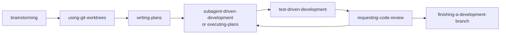
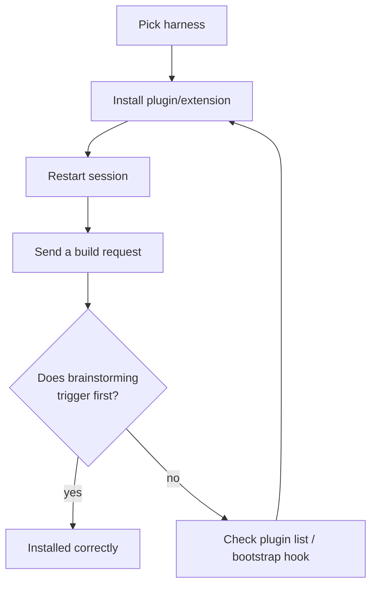
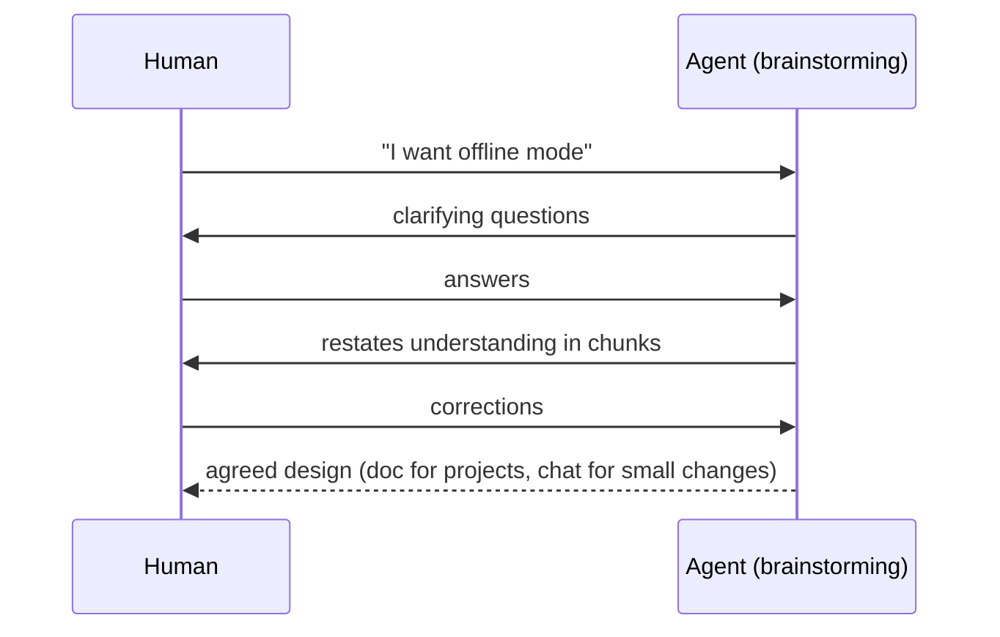
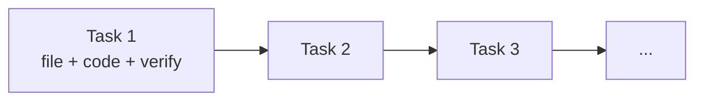
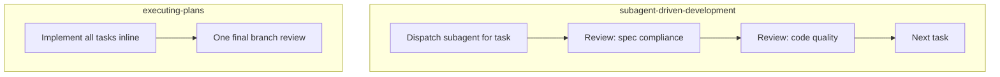
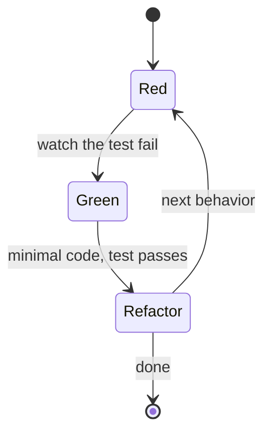
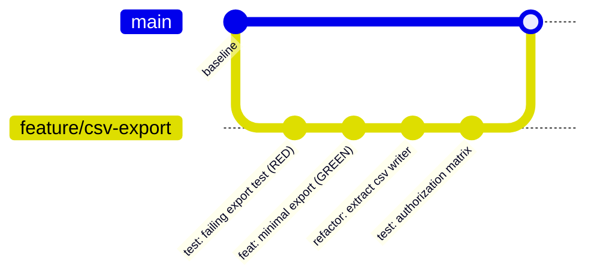

```mermaid
gantt
    title Superpowers loop for a small feature
    dateFormat X
    axisFormat %s
    section Planning
    Brainstorm + design      :a1, 0, 20
    Worktree + baseline      :a2, 20, 8
    Write plan               :a3, 28, 12
    section Execution
    Task 1 + review          :b1, 40, 12
    Task 2 + review          :b2, 52, 12
    Task 3 + review          :b3, 64, 12
    section Close
    Branch review            :c1, 76, 10
    Finish + cleanup         :c2, 86, 6
```

# 11 — Superpowers

> Verified against **v7.0.1** (release 2026-10-21) and the repository README on **2026-11-02**.
> Repository: <https://github.com/obra/superpowers> (MIT).

---

## 1. Purpose

Superpowers is a **methodology packaged as composable skills**. It installs a bootstrap
instruction (`using-superpowers`) that makes the agent check for relevant skills before acting,
and then supplies skills for the whole delivery loop: brainstorming, worktrees, plan writing,
subagent-driven development, TDD, code review, and branch finishing.

Its stated philosophy is unusually aligned with this handbook:

| Principle | Meaning in practice |
| --- | --- |
| Test-driven development | Write the failing test first, watch it fail, then minimal code |
| Systematic over ad-hoc | A process per problem type, not improvisation |
| Complexity reduction | Simplicity as the primary goal |
| Evidence over claims | Verify before declaring success |



---

## 2. When to use it

| Use Superpowers when | Avoid it when |
| --- | --- |
| You want an opinionated, TDD-first agent workflow | You need an audit trail and governance lanes |
| Your harness is one of the supported ones | Your agent cannot load skills/plugins |
| You want subagent-per-task execution with review | Automatic skill triggering conflicts with your policy |
| You want a plan detailed enough for a junior engineer | You need organization-specific approval workflows |

> **Automatic activation is a feature and a risk.** Skills trigger without explicit invocation.
> Teams that require explicit human-initiated actions should evaluate this carefully.

---

## 3. Prerequisites

| Requirement | Detail |
| --- | --- |
| Agent | Claude Code, Codex (App/CLI), Cursor, Devin CLI, Factory Droid, Gemini CLI, GitHub Copilot CLI, Grok Build, Kimi Code, OpenCode, Pi, Qwen Code, Hermes Agent, Muse, Antigravity |
| Skills support | Native skills or a compatibility layer supplied by the plugin |
| Git | Required by worktree skills |
| Subagent support | Recommended for `subagent-driven-development` |

---

## 4. Installation (per harness — verified commands)

Install **separately for each harness** you use.

### Claude Code

```text
/plugin install superpowers@claude-plugins-official
```

or via the Superpowers marketplace:

```text
/plugin marketplace add obra/superpowers-marketplace
/plugin install superpowers@superpowers-marketplace
```

### Antigravity

```bash
agy plugin install https://github.com/obra/superpowers
```

### Codex

```text
/plugins          # open plugin search
superpowers       # search
                  # select "Install Plugin"
```

### Cursor

```text
/add-plugin superpowers
```

### Devin CLI

```bash
devin plugins install obra/superpowers
devin plugins update superpowers
```

### Factory Droid

```bash
droid plugin marketplace add https://github.com/obra/superpowers
droid plugin install superpowers@superpowers
```

### Gemini CLI

```bash
gemini extensions install https://github.com/obra/superpowers
gemini extensions update superpowers
```

### GitHub Copilot CLI

```bash
copilot plugin marketplace add obra/superpowers-marketplace
copilot plugin install superpowers@superpowers-marketplace
```

### Grok Build CLI

```bash
grok plugin install superpowers@xai-official --trust
```

### Kimi Code

```text
/plugins install https://github.com/obra/superpowers
```

### OpenCode

```text
Fetch and follow instructions from https://raw.githubusercontent.com/obra/superpowers/refs/heads/main/.opencode/INSTALL.md
```

### Pi

```bash
pi install git:github.com/obra/superpowers
```

### Qwen Code

```bash
qwen extensions install obra/superpowers
qwen extensions update superpowers
```

### Hermes Agent

```bash
hermes plugins install obra/superpowers --enable
```

> **Hermes caveat (verified):** Hermes has no post-compaction hook. A very long session that
> compacts over its first turn loses the bootstrap — start a fresh session if skills stop
> triggering.

### Muse

```bash
muse plugins install ./superpowers
muse plugins approve superpowers
```



**Verification trick (from upstream):** start a fresh session and send
`Let's make a react todo list`. A working install auto-triggers `brainstorming` **before any code
is written**.

---

## 5. Configuration and behavior

Superpowers is configured through its skills, not through a central YAML file. There is no
project-level settings file described upstream; behavior is driven by which skills are installed
and how your harness exposes them.

| Concept | Location | Notes |
| --- | --- | --- |
| Skills library | Installed by the plugin | Read the installed skills to see exactly what runs |
| Bootstrap | `using-superpowers` | Injected at session start (and after compaction where hooks exist) |
| Worktrees | Created by `using-git-worktrees` | Isolated workspace per branch |
| Plans | Written by `writing-plans` | Bite-sized tasks with file paths and verification steps |

> **Do not guess at configuration keys.** This project's configuration surface is its skills.
> Inspect the installed files rather than inventing settings.

---

## 6. The workflow in detail

### 6.1 Brainstorming

Activates before building. Draws out intent through questions, then plays its understanding back
for correction. Small changes are agreed in chat; projects get a written design document.



### 6.2 Worktree isolation

After design approval, creates an isolated workspace on a new branch, runs project setup, and
**verifies a clean test baseline**.

> This is the same baseline principle as [chapter 03](./03-repository-discovery.md): without a
> green baseline you cannot attribute failures.

### 6.3 Writing plans

Breaks work into tasks of roughly **2–5 minutes**, each with:

- Exact file paths
- Complete code (not pseudocode)
- Verification steps



### 6.4 Execution: subagents vs inline

| Mode | How | Cost | Thoroughness |
| --- | --- | --- | --- |
| `subagent-driven-development` | Fresh subagent per task, review after each | Highest | Highest |
| `executing-plans` | Inline in current session, one review of the whole branch at the end | Lowest | Lower |



The two-stage review (spec compliance **then** code quality) is a useful pattern to copy even
without Superpowers: it separates "did we build the right thing" from "did we build it well".

### 6.5 Test-driven development

Enforces RED → GREEN → REFACTOR:



Stated rule: **code written before tests is deleted.** This is strict; adopt it deliberately.

### 6.6 Review and finish

| Skill | Behavior |
| --- | --- |
| `requesting-code-review` | Reviews against the plan; reports by severity; **critical issues block progress** |
| `receiving-code-review` | Structures the response to feedback |
| `finishing-a-development-branch` | Verifies tests, presents merge/PR/keep/discard options, cleans up worktree |
| `verification-before-completion` | Confirms the fix actually works |
| `systematic-debugging` | Four-phase root-cause process |

### 6.7 Diagnostics

If a session misbehaves (a skill fires or stays silent, the agent ignores its plan, burns tokens),
ask: *"figure out what went wrong with superpowers in this session"* — the
`diagnosing-superpowers` skill reads the transcript, reports line-level evidence, and can package
a scrubbed bundle for a bug report.

> **Privacy:** scrubbing is best-effort. Review any bundle before sharing it externally.

---

## 7. Complete example

```text
# 1 — intent
Let's add CSV export to the orders page.

# brainstorming triggers; answer its questions; approve the design.

# 2 — worktree
# using-git-worktrees creates a branch and verifies a green baseline.

# 3 — plan
# writing-plans produces 2–5 minute tasks with file paths and verification.

# 4 — implement
# subagent-driven-development dispatches one subagent per task,
# reviewing spec compliance then code quality.

# 5 — review
# requesting-code-review blocks on critical findings.

# 6 — finish
# finishing-a-development-branch verifies tests and asks: merge, PR, keep, or discard.
```



---

## 8. Git and commit policy

| What | Commit? | Notes |
| --- | --- | --- |
| Installed skills/plugin manifests | Per host convention | Host-managed; do not vendor unless required |
| Worktrees | **No** | Transient; add to `.gitignore` |
| Design documents produced by brainstorming | Yes | They are the durable intent |
| Plans | Yes, when they gate work | Keeps review traceable |
| TDD commits | Yes, small and frequent | RED/GREEN/REFACTOR gives natural boundaries |



> `finishing-a-development-branch` **presents options**; it does not silently merge or push. That
> is the correct default — see [chapter 22](./22-git-and-commit-policy.md).

---

## 9. Verification

| Check | How | Expected |
| --- | --- | --- |
| Install works | Fresh session: "Let's make a react todo list" | `brainstorming` triggers before code |
| Skills present | Inspect installed skills directory | `using-superpowers`, `brainstorming`, `writing-plans`, … |
| Plan quality | Open the generated plan | Every task has path + code + verification |
| TDD actually followed | `git log` per task | Test commit precedes implementation |
| Review blocks criticals | Introduce a deliberate defect | Review reports critical and stops |
| Baseline green | Worktree creation output | Test suite run, clean result |
| Diagnostics | Ask "what went wrong with superpowers" | Transcript-based report with evidence |

---

## 10. Common mistakes

| Mistake | Effect | Fix |
| --- | --- | --- |
| Installing for only one harness and expecting others to work | Skills absent elsewhere | Install per harness |
| Disabling automatic triggering via conflicting rules | Method silently stops | One source of truth for behavior |
| Treating 2–5 minute tasks as too granular | Perceived overhead | They make review and revert cheap |
| Skipping the baseline verification | Misattributed failures | Let worktree skill run the suite |
| Using inline execution on risky work | Only one end-of-branch review | Use subagent-driven mode |
| Sharing diagnostic bundles unscrubbed | Potential data leak | Review before sharing |
| Expecting org governance | No lanes, no audit schema | Use [Spec Kitty](./09-spec-kitty.md) instead |

---

## 11. Troubleshooting

| Symptom | Cause | Action |
| --- | --- | --- |
| Skills never trigger | Bootstrap not injected; plugin not enabled | Restart session; check plugin list |
| Skills stop mid-session | Context compaction dropped the bootstrap | Start a fresh session (Hermes has no post-compaction hook) |
| Worktree creation fails | Dirty tree or missing baseline | Commit/stash deliberately; fix the failing suite |
| Plan tasks are huge | Scope too broad | Ask for a re-plan with smaller tasks |
| Review passes a real defect | Review scoped to the plan, not the diff | Add an independent review ([chapter 19](./19-read-only-code-review.md)) |
| Agent skips TDD | Conflicting instructions | Remove competing rules |
| High token usage | Subagent-per-task overhead | Switch to inline execution for low-risk work |

---

## 12. Security considerations

| Risk | Control |
| --- | --- |
| Automatic skill activation executes workflows without explicit request | Audit the installed skills once; document the behavior |
| Subagents may run shell commands | Constrain with sandbox/permissions at the harness level |
| Worktrees multiply credential exposure | Use per-worktree env, never copy secrets |
| Plugin supply chain | Install from official marketplaces/repos; verify publisher |
| Transcript export | Scrub before sharing; treat as sensitive |
| "Delete code written before tests" | Can destroy unrelated work if scoped wrong — require review of deletions and never run on a dirty tree |

---

## 13. Maintenance: update and uninstall

| Harness | Update command (verified) |
| --- | --- |
| Devin CLI | `devin plugins update superpowers` |
| Gemini CLI | `gemini extensions update superpowers` |
| Qwen Code | `qwen extensions update superpowers` |
| Muse | `muse plugins update superpowers` |
| Claude Code / Codex / Cursor / Copilot CLI / others | Re-run the install step for that harness |

| Action | Guidance |
| --- | --- |
| Uninstall | Use the host's plugin/extension manager; remove the installed skill directory |
| Switch harness | Install separately per harness; they do not share state |
| Clean up worktrees | Remove worktrees created by `using-git-worktrees` after the branch is finished |

**Preserving customizations:** design documents and plans produced by the skills are your artifacts
and live in the repository. Locally modified skills will be replaced on update — keep changes in a
fork or a custom skill.

## 14. Official references

- Repository — <https://github.com/obra/superpowers>
- OpenCode instructions — <https://github.com/obra/superpowers/blob/main/.opencode/INSTALL.md>
- Kimi instructions — <https://github.com/obra/superpowers/blob/main/docs/README.kimi.md>
- OpenCode guide — <https://github.com/obra/superpowers/blob/main/docs/README.opencode.md>
- Marketplace (Claude Code) — <https://github.com/obra/superpowers-marketplace>
- Official Codex plugins — <https://github.com/openai/plugins>
- Author — <https://blog.fsck.com>

---

**Previous:** [10 — Ponytail](./10-ponytail.md) ·
**Next:** [12 — Coding-agent integration](./12-coding-agent-integration.md)
