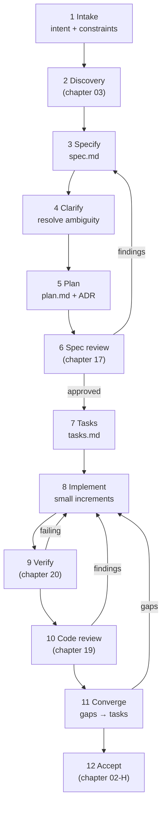
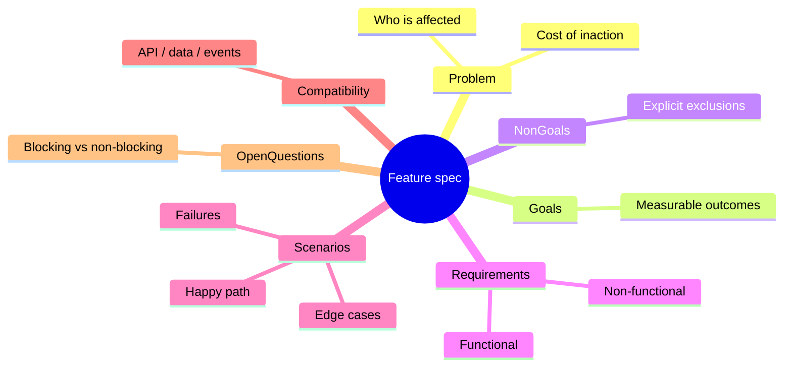
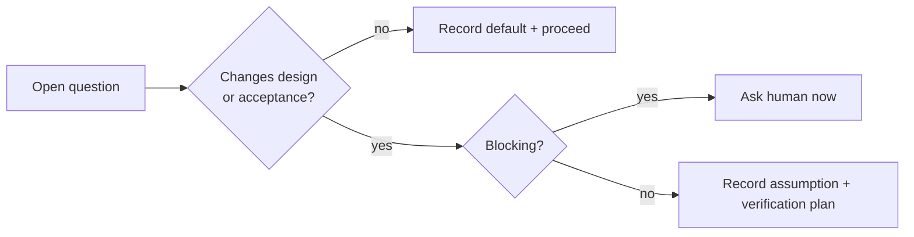
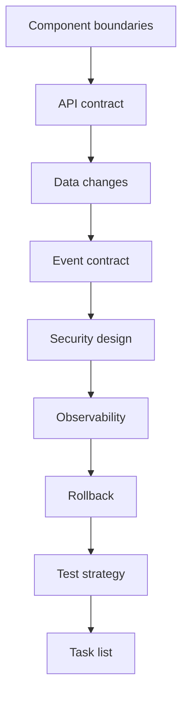
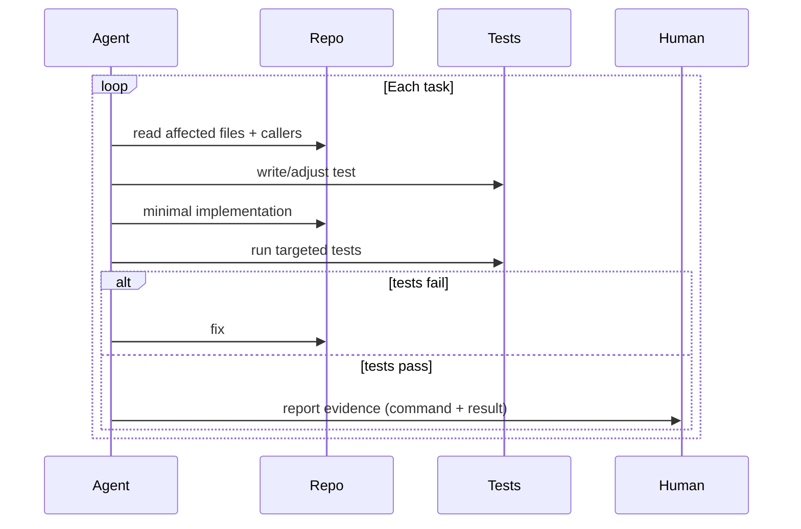
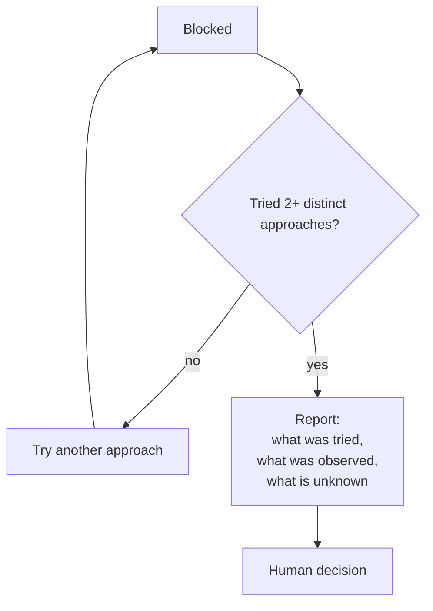
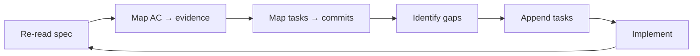

# 14 — Feature Development

> The end-to-end loop for shipping a feature under specification control. This is the chapter to
> read before your first real adoption.

---

## 1. Purpose

Turn a business intent into reviewed, verified production code with minimal ambiguity and
maximum traceability — without turning the process into a waterfall.

---

## 2. When to use it

| Use the full loop | Use a lighter path |
| --- | --- |
| Multi-module or multi-team feature | Single-file addition |
| External API or event contract change | Internal helper with no consumers |
| Data model change | Pure UI copy change |
| Security-relevant behavior | Documentation-only change |
| Anything requiring a rollback plan | Time-boxed spike (do not merge) |

---

## 3. The loop



---

## 4. Step 1 — Intake

Capture the request **without solution bias**.

```markdown
## Intake — 2026-11-02

**Requester:** Finance operations
**Request:** "We need to get order data out of the system for reconciliation."
**Observed workaround:** manual copy-paste from the UI, ~3 hours/week
**Deadline/constraint:** before quarter close (2026-12-15)
**Constraints stated by requester:** must respect permissions; CSV is acceptable
**Not stated (must clarify):** volume, retention, audit, format details
```

| Rule | Reason |
| --- | --- |
| Record the workaround | Reveals real requirements |
| Separate requester's proposed solution from the problem | Prevents premature design |
| Capture the deadline, then test it | Deadlines drive scope, not quality |
| List what was **not** stated | Those become clarification questions |

---

## 5. Step 2 — Discovery

Run [chapter 03](./03-repository-discovery.md). Output: a discovery note with facts,
assumptions, unknowns, and risks.

**Gate:** no blocking unknown remains, or a human explicitly accepts it.

---

## 6. Step 3 — Specification

Use [`templates/feature-spec.md`](./templates/feature-spec.md). The minimum viable spec has
seven parts:



### Sizing rule

One spec = one user-visible outcome that can ship independently.

| Signal | Action |
| --- | --- |
| More than ~15 functional requirements | Split by outcome |
| More than two teams must coordinate | Split, or add a coordination spec |
| Acceptance criteria exceed one page | Split |
| Non-goals list is empty | You have not bounded the work |

---

## 7. Step 4 — Clarify

Ask only questions whose answers change the design.



| Question | Why it matters |
| --- | --- |
| Who is authorized, exactly? | Authorization is the most common defect class |
| What happens at the boundary (0, 1, max)? | Edge behavior is usually unspecified |
| What happens when a dependency fails? | Failure semantics drive design |
| What must remain unchanged? | Compatibility boundary |
| How will we know it worked? | Makes acceptance criteria measurable |

> **Ask up to five targeted questions at a time**, then encode the answers into the spec. Repeated
> clarification loops are normal and cheaper than rework.

---

## 8. Step 5 — Plan

Use [`templates/implementation-plan.md`](./templates/implementation-plan.md). The plan must be
reviewable without code.



### ADR trigger

Write an ADR when a decision is:

- Expensive to reverse (schema, protocol, public API)
- Cross-cutting (auth model, caching strategy)
- A rejection of an obvious alternative (you need the "why not")

---

## 9. Step 6 — Specification review

Independent, read-only. See [chapter 17](./17-specification-review.md).

**Gate:** zero critical/high findings.

---

## 10. Step 7 — Tasks

```markdown
## Tasks

### Phase 1 — Setup
- [ ] T-01 Add `ExportRequest`/`ExportResponse` types · FR-3 · files: `src/api/types.ts`
- [ ] T-02 Add feature flag `export_v2` (default off) · FR-9 · files: `src/config/flags.ts`

### Phase 2 — Foundational (blocking)
- [ ] T-03 Add index migration · FR-3, NFR-2 · files: `migrations/0042.sql`
- [ ] T-04 Repository streaming query · FR-3 · files: `src/repo/orders.ts` · depends: T-03

### Phase 3 — User story 1 (export happy path)
- [ ] T-05 CSV encoder + unit tests · AC-3.1 · files: `src/export/csv.ts`
- [ ] T-06 Handler + integration test · AC-3.1, AC-3.2 · depends: T-04, T-05

### Phase 4 — User story 2 (authorization)
- [ ] T-07 Authorization matrix test · AC-3.2 · depends: T-06
- [ ] T-08 403 mapping + test · AC-3.3

### Phase 5 — Polish
- [ ] T-09 Metrics + alert · NFR-3
- [ ] T-10 Runbook · NFR-3
```

| Rule | Reason |
| --- | --- |
| Every task has a requirement ID | Traceability |
| Every task lists expected files | Review scoping and conflict detection |
| Dependencies are explicit | Enables safe parallelism |
| Foundational phase is blocking | Prevents agents building on shifting ground | 
| Polish is last | Stops gold-plating before core works |

---

## 11. Step 8 — Implementation



### Context hygiene

| Practice | Why |
| --- | --- |
| One task per agent turn | Prevents scope drift |
| Fresh context for implementation | Avoids rationalizing the plan |
| Read callers, not just the target file | Prevents cross-file breakage |
| Stop and report on scope change | Prevents silent architecture decisions |
| Never "fix" unrelated failing tests | Keeps the diff reviewable |

### When the agent gets stuck



> Never let an agent produce a "best guess" fix and label it verified. See
> [chapter 23](./23-hallucination-prevention.md).

---

## 12. Step 9 — Verification

```bash
# Illustrative; use the repository's real commands
pnpm test -- --run src/export
pnpm exec tsc --noEmit
```

Record in the verification report:

| AC | Test | Result | Evidence |
| --- | --- | --- | --- |
| AC-3.1 | `export.test.ts::happy path` | PASS | 1 passed in 0.42 s |
| AC-3.2 | `authz.test.ts::viewer denied` | PASS | 1 passed |
| AC-3.3 | — | **UNVERIFIED** | Perf environment unavailable |

---

## 13. Step 10 — Code review

Independent, read-only, severity-ranked. See [chapter 19](./19-read-only-code-review.md).

---

## 14. Step 11 — Convergence

Convergence compares the implementation against the original artifacts and appends remaining work.



| Tool | Convergence mechanism |
| --- | --- |
| Spec Kit | `/speckit-converge` appends remaining tasks |
| OpenSpec | `openspec-verify-change` (optional skill) compares implementation to plan |
| Kiro | Task checkboxes + review of design conformance |
| Spec Kitty | Lanes + `next` + accept gate |
| BMAD | `bmad-review` / `bmad-retrospective` |

---

## 15. Step 12 — Acceptance

Completion report with per-AC status. Never mark complete with `UNVERIFIED` criteria.

---

## 16. Worked example — CSV export

| Phase | Artifact | Key content |
| --- | --- | --- |
| Intake | Intake note | Workaround, deadline, unstated volume |
| Discovery | Discovery note | FastAPI, SQLAlchemy async, no streaming helper |
| Spec | `spec.md` | FR-1..FR-5, NFR-1..NFR-3, 8 ACs |
| Clarify | Spec update | Admin override behavior resolved |
| Plan | `plan.md` | Streaming cursor, no new deps, index |
| ADR | `0007-streaming-export.md` | Rejected: background job + S3 |
| Review | Findings S-01..S-03 | Authorization precedence conflict |
| Tasks | 10 tasks, 3 phases | Foundational migration blocking |
| Implement | 6 commits | One per task group |
| Verify | Report | 7/8 AC verified, perf unverified |
| Review | Findings C-01 | Missing limit on `LIMIT` param |
| Converge | +2 tasks | Fix and perf test |
| Accept | PARTIAL | Perf pending staging run |

---

## 17. Common mistakes

| Mistake | Consequence | Fix |
| --- | --- | --- |
| Spec written by the implementer without review | Assumptions become requirements | Separate reviewer |
| Tasks without requirement IDs | Untraceable work | Enforce mapping |
| Implementing while clarifying | Rework | Finish spec review first |
| One giant task | Unreviewable diff | Split by file ownership |
| Skipping convergence | Spec and code drift | Always converge |
| "Tests pass" without output | Unverifiable claim | Paste command + result |
| Agent fixes unrelated issues | Diff bloat, hidden risk | Report, don't fix |

---

## 18. Troubleshooting

| Symptom | Cause | Action |
| --- | --- | --- |
| Endless clarification | Requirement is too broad | Split the feature |
| Spec review finds contradictions every round | No single owner | Assign one author |
| Agent repeatedly exceeds scope | Task too large or plan vague | Smaller tasks, explicit non-goals |
| Tests pass but bug remains | Test asserts wrong behavior | Review AC-to-test mapping |
| Review finds nothing | Reviewer context too shallow | Require reading callers and tests |
| Convergence keeps adding tasks | Acceptance criteria too vague | Tighten criteria, not tasks |

---

## 19. References

- [Chapter 02 — Engineering lifecycle](./02-engineering-lifecycle.md)
- [Chapter 17 — Specification review](./17-specification-review.md)
- [Chapter 19 — Read-only code review](./19-read-only-code-review.md)
- [Chapter 20 — Testing and verification](./20-testing-and-verification.md)
- [templates/feature-spec.md](./templates/feature-spec.md)
- [prompts/implementation-agent.md](./prompts/implementation-agent.md)

---

**Previous:** [13 — Language guides](./language-guides/README.md) ·
**Next:** [15 — Bug fixing](./15-bug-fixing.md)
