# 15 — Bug Fixing

> Root cause first. A fix without a confirmed cause is a guess with a commit message.

---

## 1. Purpose

A disciplined bug workflow that produces three things every time:

1. A **reproduction** that fails before and passes after
2. A **confirmed cause** (not a plausible one)
3. A **regression test** that would have caught it

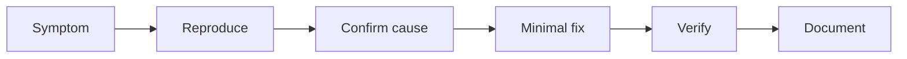

---

## 2. When to use it

| Situation | Path |
| --- | --- |
| Reproducible defect | Full 13-step workflow |
| Production incident | Incident variant (§7), then full workflow |
| Intermittent/flaky | §8 — evidence-first, no code changes until reproduced |
| Security vulnerability | §9 + [chapter 21](./21-security-review.md) |
| Dependency bug | §10 + upgrade/rollback decision |

---

## 3. The 13-step workflow

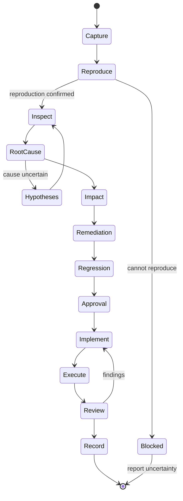

| # | Step | Output |
| --- | --- | --- |
| 1 | Capture the reported symptom | Bug report with exact repro steps |
| 2 | Reproduce the problem | Failing test or documented manual repro |
| 3 | Inspect logs and relevant code | Evidence list with file:line |
| 4 | Identify the actual root cause | Cause statement with mechanism |
| 5 | Separate facts from hypotheses | Evidence ledger entries |
| 6 | Assess potential impact | Blast radius, data integrity, security |
| 7 | Propose a minimal remediation | Options with trade-offs |
| 8 | Define regression tests | Tests that fail pre-fix |
| 9 | Obtain approval where required | Recorded approver |
| 10 | Implement the fix | Minimal diff |
| 11 | Execute reproduction + regression | Command output |
| 12 | Perform independent review | Severity-ranked findings |
| 13 | Record final verification | Bug report status |

---

## 4. Step 2 — Reproduce

A reproduction is the **specification for a bug fix**. Without one, you are editing code and
hoping.

| Reproduction type | When | Artifact |
| --- | --- | --- |
| Failing unit test | Logic bug | Test committed with the fix |
| Failing integration test | Wiring/data bug | Test with real dependencies |
| Scripted HTTP repro | API bug | `curl`/`.http` file |
| Recorded trace | UI bug | Playwright trace |
| Query + dataset | Data bug | SQL + seed data |
| Load profile | Performance bug | k6/Gatling script |
| Heap/thread dump | Memory/concurrency | Dump + analysis notes |

```bash
# API reproduction (illustrative)
curl -sS -D - -o /dev/null \
  -H "Authorization: Bearer $TOKEN" \
  "http://localhost:8080/projects/p2/orders/export"
# Expect: 403, no body. Observed: 200 with CSV → bug confirmed.
```

### If you cannot reproduce

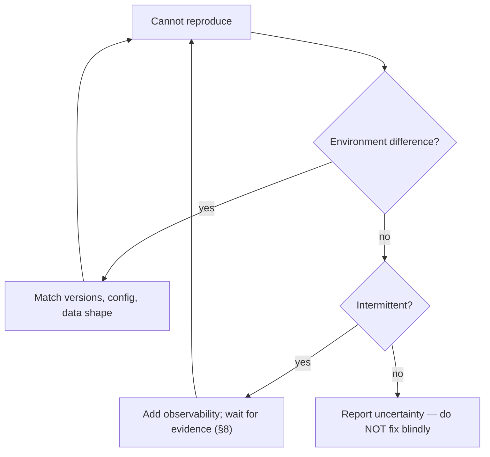

**Report, do not guess.** "Could not reproduce; here is what I ruled out" is a valid, valuable
outcome.

---

## 5. Steps 3–5 — Confirm the cause

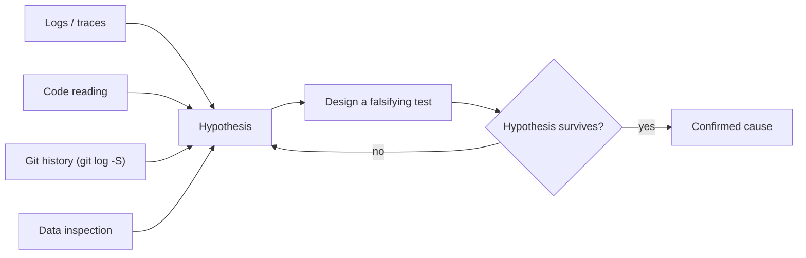

```bash
# When did this line change, and why?
git --no-pager log -S 'total_cents' --oneline -- src/
git --no-pager blame -L 80,95 src/routes/feed.js
```

### Cause statement template

```markdown
## Confirmed cause

**Mechanism:** `src/routes/feed.js:88` reads `order.total_cents`. Commit `a1b2c3d`
renamed the column to `amount_cents` and updated `src/services/orders.js` but not the
feed route. The feed therefore dereferences `undefined`, which throws inside the
`AtomFeed` builder, producing a 500 for every request.

**Evidence**
- Reproduction: `curl /feed.atom` → 500 (before), 200 (after fix)
- `git log -S total_cents` → rename in `a1b2c3d`
- Stack trace: `TypeError: Cannot read properties of undefined (reading 'toFixed')`
  at `feed.js:88`
- `grep -rn total_cents` → 1 remaining occurrence

**Not the cause**
- Cache: reproduced with cache disabled
- Data: reproduced with a fresh fixture
```

| Status | Meaning |
| --- | --- |
| `VERIFIED` | Falsification test executed; cause confirmed |
| `PARTIALLY VERIFIED` | Strong evidence but one path unverified |
| `UNVERIFIED` | Hypothesis only |
| `CONTRADICTED` | Evidence rules it out |

---

## 6. Steps 6–9 — Impact, remediation, regression, approval

### Impact assessment

| Dimension | Question |
| --- | --- |
| Users affected | All, some cohort, one tenant? |
| Data integrity | Did it corrupt or drop data? |
| Security | Does it expose data or allow privilege escalation? |
| Financial | Billing errors, SLA credits? |
| Workaround | Is there one, and is it acceptable? |
| Blast radius of the fix | What else could the change break? |

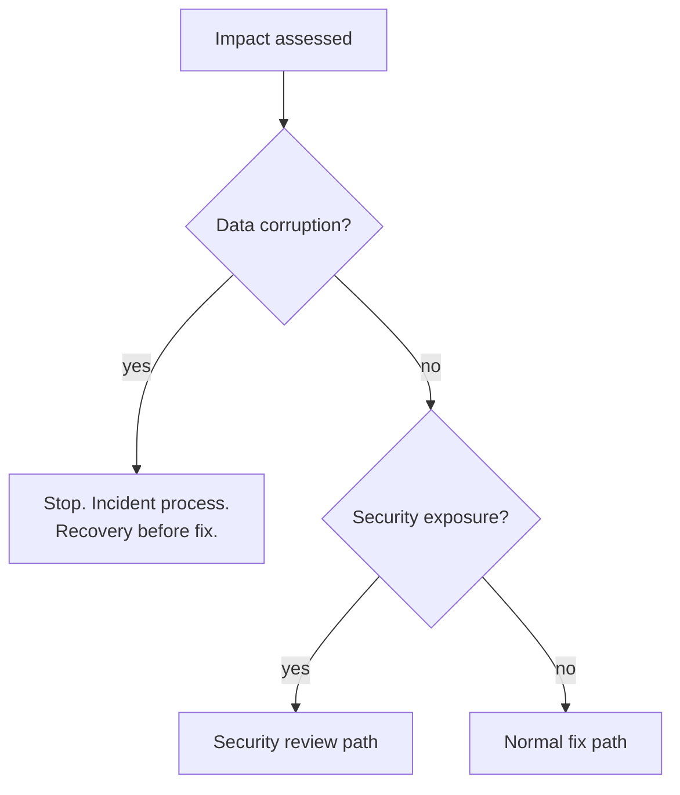

### Minimal remediation

| Option | When | Risk |
| --- | --- | --- |
| Revert the offending commit | Recent regression, clean revert | Loses accompanying work |
| One-line correction | Localized defect | Low |
| Guard + follow-up | Cannot fix root cause immediately | Masks the issue; needs a ticket |
| Feature flag off | Fast mitigation | Hides the defect |
| Restore from backup | Data loss | Data loss window |

The proposed fix must state **why it is minimal** and **what it deliberately does not change**.

### Regression test requirements

| Requirement | Example |
| --- | --- |
| Fails before the fix | Verified by running it on the pre-fix commit |
| Passes after the fix | Verified in CI |
| Asserts the user-visible behavior | Not an internal implementation detail |
| Covers the exact boundary | Empty, max, unauthorized, concurrent |

---

## 7. Production incidents

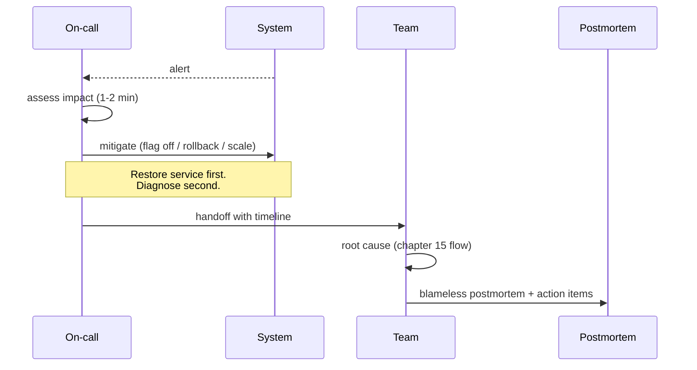

| Phase | Goal | Allowed actions |
| --- | --- | --- |
| Detect | Know it is happening | Alerting, SLO burn rate |
| Triage | Bound the impact | Read dashboards/logs |
| Mitigate | Stop the bleeding | Flag off, rollback, failover, scale |
| Diagnose | Understand the cause | Read code, diff, data |
| Fix | Correct it | Minimal change + regression test |
| Learn | Prevent recurrence | Postmortem, action items with owners |

**Incident rules:**

1. **Mitigate before diagnosing.** Do not pair-debug on the critical path.
2. **One incident commander.** Parallel heroics cause conflicting changes.
3. **Every action is timestamped.** The timeline is the postmortem's evidence.
4. **No unreviewed code in production** unless it mitigates an active outage; then review within 24h.
5. **Fix and mitigation are separate changes** where possible.

---

## 8. Intermittent bugs

Intermittent failures are usually one of: concurrency, timing, environment, data shape, or
resource exhaustion.

| Symptom | First evidence to collect |
| --- | --- |
| Fails ~1 in 100 | Structured logs with request IDs; trace sampling |
| Fails under load only | Metrics: pool saturation, queue depth, GC |
| Fails on specific hosts | Host-level logs, kernel/OS version |
| Fails on specific data | Input distribution; failing payload capture (redacted) |
| Fails after deploy | Version correlation cohort analysis |

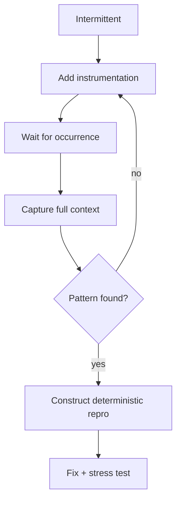

Rules:

- **Never "fix" a flake by adding `sleep`.** That converts a race into a slower race.
- **Never mark a flaky test as skipped** without an owner and a link.
- **Reproduce with a harness** (loop 10k times, or use a scheduler fuzzer) before changing code.

---

## 9. Specialized bug classes

### 9.1 Concurrency bugs

| Evidence | Tool |
| --- | --- |
| Data race | Go `-race`; Java `-Xcheck:jni`/ThreadSanitizer; C++ TSan |
| Deadlock | Thread dump (`jstack`, `py-spy dump`), lock ordering analysis |
| Lost update | Transaction isolation test, `SELECT ... FOR UPDATE` audit |
| Double processing | Idempotency key audit |

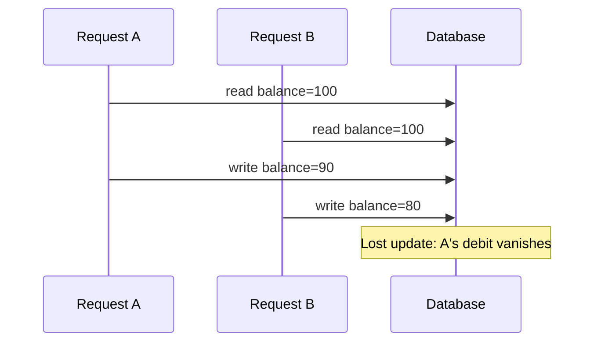

Fix patterns: atomic `UPDATE ... SET x = x - 10 WHERE x >= 10`, optimistic concurrency
(`version` column), pessimistic locks with a defined order.

### 9.2 Memory leaks

| Evidence | How |
| --- | --- |
| Heap growth over time | Heap dump at t0 and t1; diff retained objects |
| Unbounded caches | Cache entry count metric |
| Listener accumulation | Registration/deregistration audit |
| Connection leaks | Pool `active` vs `idle` over time |

**Rule:** prove growth first (`-Xmx` bounded run, or a 1-hour soak with a leak assertion), then
find the retaining path. Do not "optimize" allocations as a substitute for finding the leak.

### 9.3 Performance regressions

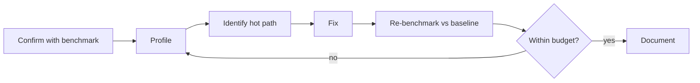

Rules:

- Compare against a **recorded baseline** on the same hardware.
- Separate **latency** from **throughput**; a fix can improve one and hurt the other.
- Check **p99**, not just average.
- Record the before/after numbers in the report.

### 9.4 Database inconsistencies

| Symptom | First check |
| --- | --- |
| Missing rows | Foreign keys, cascade rules, soft-delete filters |
| Duplicate rows | Missing unique constraint, retry without idempotency |
| Wrong aggregates | Double counting from joins |
| Stale reads | Replica lag, transaction isolation |

**Rule:** write a **reconciliation query** that quantifies the damage before fixing. Data repair
is a separate, reviewed migration.

### 9.5 Dependency bugs

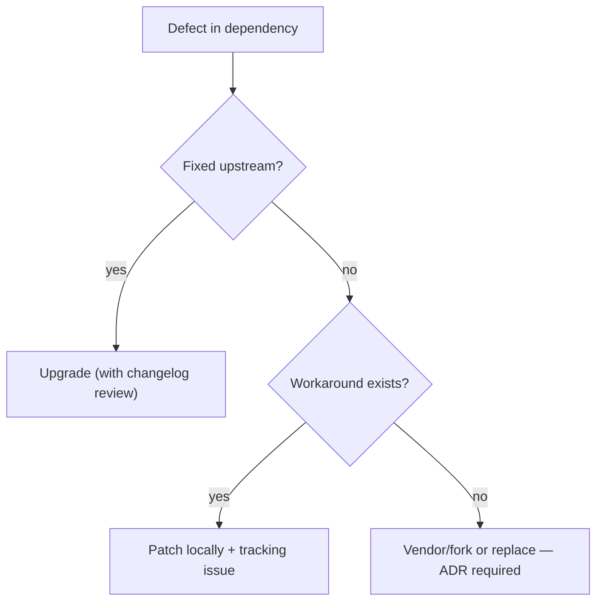

Never patch inside `vendor/` or `node_modules/` without a durable mechanism (patch file,
`patches/` directory, or fork) and an ADR.

---

## 10. Approval rules

| Change | Approval |
| --- | --- |
| Localized defect, tests pass | Standard review |
| Production hotfix | Incident commander + post-hoc review |
| Data repair migration | Data owner + DBA |
| Security fix | Security reviewer |
| Dependency upgrade | Owner + changelog review |
| Behavior change discovered during fix | Spec update + product approval |

---

## 11. Bug report template usage

See [`templates/bug-report.md`](./templates/bug-report.md). Minimum fields:

```markdown
# Bug: <short title>

**Status:** NEW | REPRODUCED | ROOT-CAUSED | FIXED | VERIFIED | CLOSED
**Severity:** S1 (outage) | S2 (major) | S3 (minor) | S4 (cosmetic)
**Affected versions:** ...
**First seen:** ...
**Environment:** ...

## Symptom
## Reproduction (exact steps / command / test)
## Expected vs actual
## Evidence
## Root cause (mechanism + evidence + non-causes)
## Impact
## Fix
## Regression test
## Verification
## Follow-ups
```

---

## 12. Verification of the fix

| Check | Evidence required |
| --- | --- |
| Reproduction now passes | Command + output |
| Regression test fails on pre-fix commit | Cherry-pick test onto base, run, record failure |
| Existing suite passes | Command + summary line |
| No new static analysis findings | Tool output |
| Performance unchanged | Benchmark comparison |
| Data repaired (if applicable) | Reconciliation query result |
| Monitoring reflects recovery | Dashboard/alert screenshot or query |

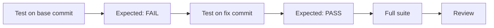

> The "test fails on base" step is what separates a regression test from a test that happens to
> be green.

---

## 13. Common mistakes

| Mistake | Consequence | Fix |
| --- | --- | --- |
| Fixing the symptom | Bug returns | Confirm mechanism |
| No reproduction | Cannot prove the fix | Write the failing test first |
| Bundling refactoring into a fix | Unreviewable diff | Separate changes |
| "Fixing" a flake with sleeps | Slower flake | Find the race |
| Editing data without a reconciliation query | Unknown damage | Quantify first |
| Skipping the pre-fix test run | Test may be vacuous | Verify it fails before |
| Closing on "deployed" | No verification | Verify in the environment |
| Ignoring the same pattern elsewhere | Recurrence | Search the codebase for the pattern |

---

## 14. Troubleshooting

| Symptom | Cause | Action |
| --- | --- | --- |
| Bug disappears when logging added | Heisenbug (timing) | Use sampling/tracing instead of prints |
| Fix works locally, not in prod | Config/version difference | Compare environments explicitly |
| Regression test passes on base | Test does not reproduce | Assert the failing behavior |
| Multiple plausible causes | Insufficient evidence | Design a falsifying test per hypothesis |
| Fix breaks other tests | Hidden coupling | Review callers before fixing |
| Customer cannot reproduce | Data/environment specificity | Capture their payload and versions |

---

## 15. References

- [Chapter 20 — Testing and verification](./20-testing-and-verification.md)
- [Chapter 21 — Security review](./21-security-review.md)
- [Chapter 23 — Hallucination prevention](./23-hallucination-prevention.md)
- [templates/bug-report.md](./templates/bug-report.md)
- [prompts/bug-triage-agent.md](./prompts/bug-triage-agent.md)
- [prompts/bug-fix-agent.md](./prompts/bug-fix-agent.md)
- Google SRE Book, *Managing Incidents* — <https://sre.google/sre-book/managing-incidents/>
- *Debugging* (Agans) — systematic elimination
- `git bisect` documentation — <https://git-scm.com/docs/git-bisect>

---

**Previous:** [14 — Feature development](./14-feature-development.md) ·
**Next:** [16 — Refactoring](./16-refactoring.md)
