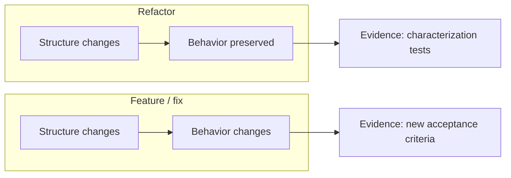
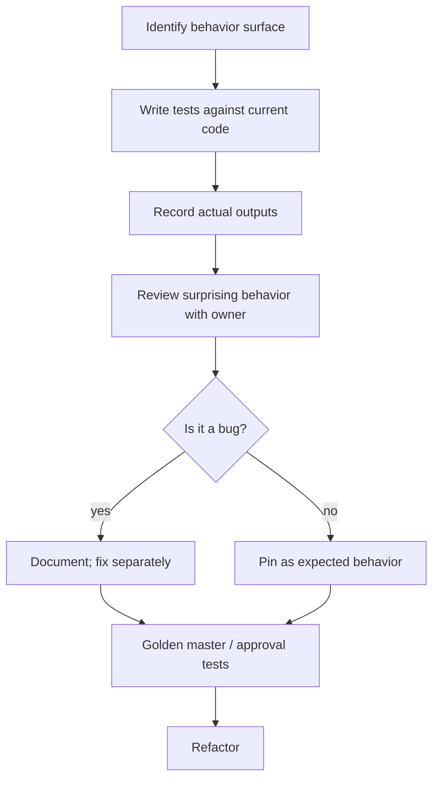
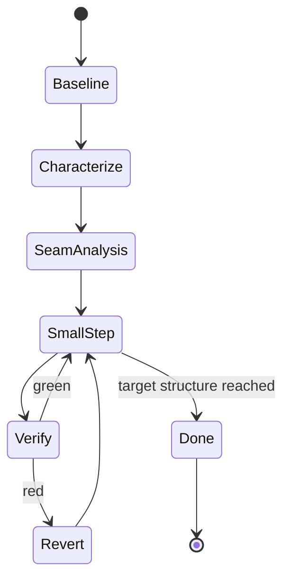
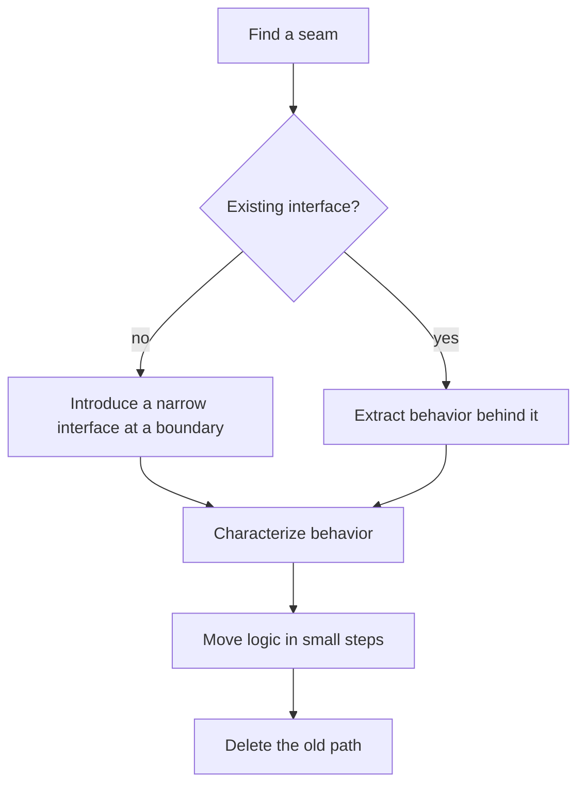
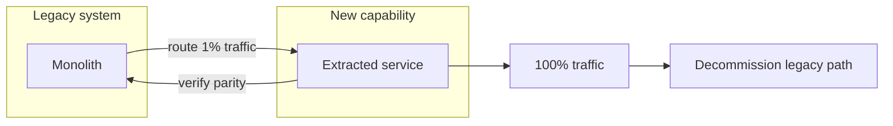
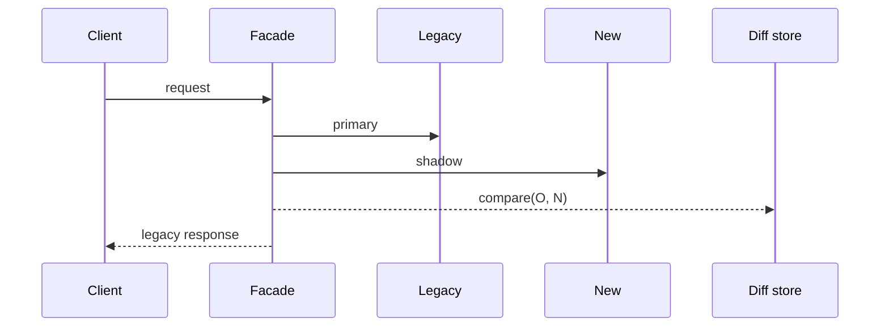
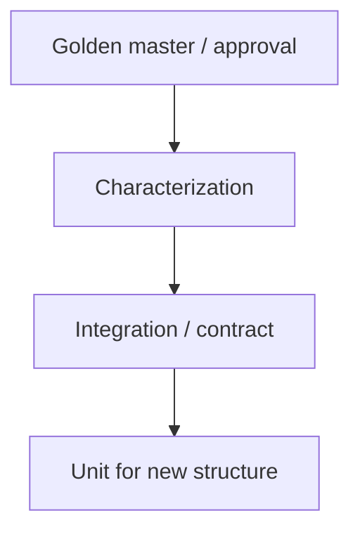

# 16 — Refactoring and Legacy Modernization

> Refactoring changes structure without changing behavior. If behavior changes, it is a feature
> or a bug fix — and it needs a different specification.

---

## 1. Purpose

Make structural change safe in codebases where tests are thin, ownership is unclear, and the
system cannot stop for a rewrite.



---

## 2. When to use it

| Trigger | Approach |
| --- | --- |
| Change is hard because of structure | Refactor first, then change |
| Duplicate logic with drift | Extract + unify, with behavior tests |
| Monolith to services | Strangler fig, one seam at a time |
| Framework upgrade | Strangler + parallel run |
| Performance work | Profile first; refactor only if structure is the cause |
| "Rewrite it properly" | Almost always: incremental extraction instead |

---

## 3. The safety net: characterization tests

Characterization tests pin **current** behavior — including bugs you intend to preserve.



| Test style | Use for |
| --- | --- |
| Golden master / approval | Complex output (documents, reports, HTML) |
| Snapshot of serialized response | API responses during extraction |
| Table tests from production samples (redacted) | Parsers, validators, pricing |
| Contract tests | Service boundaries |
| Property tests | Invariants that must survive |

```python
# Golden-master style: capture, then compare
def test_invoice_rendering_is_unchanged(golden):
    html = render_invoice(sample_invoice())
    assert html == golden("invoice_basic.html")
```

> **Redact production samples** before committing them. Golden files are code and can leak data.

---

## 4. Refactoring workflow



| Step | Output |
| --- | --- |
| 1. Baseline | Green test run recorded (or documented red baseline) |
| 2. Characterize | Tests pinning current behavior at the seam |
| 3. Seam analysis | Where the change can be isolated |
| 4. Small step | One structural change |
| 5. Verify | Full suite + static analysis |
| 6. Commit | One reversible step |
| 7. Repeat | Until the target is reached |

**Rules**

1. **No behavior change in a refactoring commit.** If you must change behavior, stop and write a
   spec.
2. **One structural idea per commit.** "Extract service + rename fields + upgrade library" is
   three commits.
3. **Tests stay green.** If red, revert rather than push through.
4. **Deletions are part of the work.** A refactor that only adds indirection failed.

---

## 5. Seams: where to cut



| Seam type | Example | Risk |
| --- | --- | --- |
| HTTP route | Replace handler internals | Low |
| Repository interface | Swap implementation | Low |
| Domain service | Extract cohesive module | Medium |
| Database table | Dual-write + migrate | High |
| Event contract | Add new event version | Medium |
| Build/module boundary | Extract package | Medium |

**The last step is deletion.** Until the old path is gone, you have two systems.

---

## 6. Legacy modernization: strangler fig



| Phase | Activity | Exit criterion |
| --- | --- | --- |
| 1. Characterize | Pin behavior at the boundary | Tests green |
| 2. Intercept | Add a routing/facade layer | Both paths callable |
| 3. Implement | Build the new path | Parity tests pass |
| 4. Shadow | Run both, compare outputs | Zero unexplained divergence |
| 5. Canary | Route a small percentage | SLOs hold for a week |
| 6. Ramp | Increase traffic | SLOs hold |
| 7. Decommission | Delete the legacy path | Dead code removed |



> **Shadow mode requires idempotent reads.** Never shadow a write path without a dry-run mode.

---

## 7. Specification for refactoring

A refactoring spec is different from a feature spec: **behavior is the invariant**.

```markdown
# Refactor spec: extract export into a module

## Current behavior (invariants)
| ID | Behavior | Evidence |
| --- | --- | --- |
| INV-1 | CSV columns and order | golden `invoice_export.csv` |
| INV-2 | Authorization identical for 5 roles | existing matrix test |
| INV-3 | Empty result emits header only | `test_empty_export` |
| INV-4 | HTTP status codes unchanged | contract test |

## Target structure
- `src/export/` module with `ExportService`, `CsvWriter`
- `src/api/orders.py` delegates; no business logic remains

## Explicit non-changes
- No dependency upgrades
- No schema changes
- No response format changes
- No log format changes

## Success criteria
- INV-1..INV-4 verified by unchanged tests
- `src/api/orders.py` line count reduced by ≥ 60%
- No new public API surface
- Cyclomatic complexity of touched functions ≤ 10

## Rollback
Single revert of the final commit stack; no data changes.

## Out of scope
- Async export
- Caching
```

### Metrics that justify the refactor

| Metric | Before | Target | Tool |
| --- | --- | --- | --- |
| Changed-lines per feature | 180 | < 60 | git history |
| Cyclomatic complexity | 24 | ≤ 10 | SonarQube / radon / PMD |
| Test runtime | 12 min | < 5 min | CI timing |
| Duplication | 18% | < 5% | SonarQube |
| Incident rate in module | 3/quarter | 0 | tracker |

> Without a measurable goal, "refactoring" becomes unbounded gold-plating.

---

## 8. Tasks

| Task | Size | Reversible |
| --- | --- | --- |
| Add characterization tests | Medium | Yes |
| Extract one module | Medium | Yes |
| Move one function | Small | Yes |
| Rename with compatibility shim | Small | Yes |
| Remove old path | Small | Yes |
| Update docs/ADRs | Small | Yes |

**Definition of done:**

- [ ] Characterization tests exist and were green before the change
- [ ] Behavior is unchanged (tests unmodified)
- [ ] Old path deleted
- [ ] No mixed behavior+structure commits
- [ ] Metrics recorded before/after
- [ ] ADR for any boundary change

---

## 9. Testing strategy



| Layer | Purpose in a refactor |
| --- | --- |
| Characterization | Detect any behavior change |
| Contract | Prove the external interface is stable |
| Integration | Prove wiring still works |
| Unit (new) | Describe the new structure |
| Performance | Prove no regression |

> **Do not "improve" characterization tests during a refactor.** Changing the test while changing
> the code destroys the evidence.

---

## 10. Review focus

| Area | Question |
| --- | --- |
| Behavior | Any observable change? Any changed tests? |
| Scope | Mixed feature work hidden in a refactor? |
| Deletion | Is the old code actually gone? |
| Indirection | Did we add layers without benefit? |
| Naming | Do new names reflect the domain? |
| Public API | Any accidental export? |
| Performance | Any new allocation/query in a hot path? |
| Tests | Are characterization tests unmodified? |

**High-severity refactoring findings:**

- Test assertions modified to match changed output (behavior change disguised).
- Old code path left active behind a flag with no removal plan.
- Public API surface changed without a versioning decision.
- Data access pattern changed (N+1 introduced).

---

## 11. Common mistakes

| Mistake | Consequence | Fix |
| --- | --- | --- |
| Refactor with no characterization tests | Silent behavior change | Pin behavior first |
| "Big bang" rewrite | Long freeze, risky cutover | Strangler fig |
| Mixed refactor + feature | Unreviewable diff | Separate commits/PRs |
| Renaming without shims | Breaks consumers | Expand/contract |
| Adding abstractions only | More code, same behavior | Delete the old path |
| Editing tests during refactor | Destroys evidence | Tests are the invariant |

---

## 12. Troubleshooting

| Symptom | Cause | Action |
| --- | --- | --- |
| Characterization test reveals nondeterminism | Time/random/order dependency | Inject clock/seed; sort output |
| Can't isolate the seam | Tangled dependencies | Introduce a facade first |
| Tests too slow to run often | Integration-heavy | Extract unit-testable core |
| Golden files huge/unreviewable | Output too broad | Narrow the assertion scope |
| Parity never reached | Hidden behavior differences | Compare logs/outputs field by field |
| Refactor keeps expanding | No target structure | Write the target in the spec |

---

## 13. References

- Martin Fowler, *Refactoring* — <https://refactoring.com/>
- Michael Feathers, *Working Effectively with Legacy Code*
- Martin Fowler, *StranglerFigApplication* — <https://martinfowler.com/bliki/StranglerFigApplication.html>
- Approval Tests — <https://approvaltests.com/>
- SonarQube metrics — <https://docs.sonarsource.com/>
- [Chapter 17 — Specification review](./17-specification-review.md)
- [templates/architecture-decision-record.md](./templates/architecture-decision-record.md)

---

**Previous:** [15 — Bug fixing](./15-bug-fixing.md) ·
**Next:** [17 — Specification review](./17-specification-review.md)
