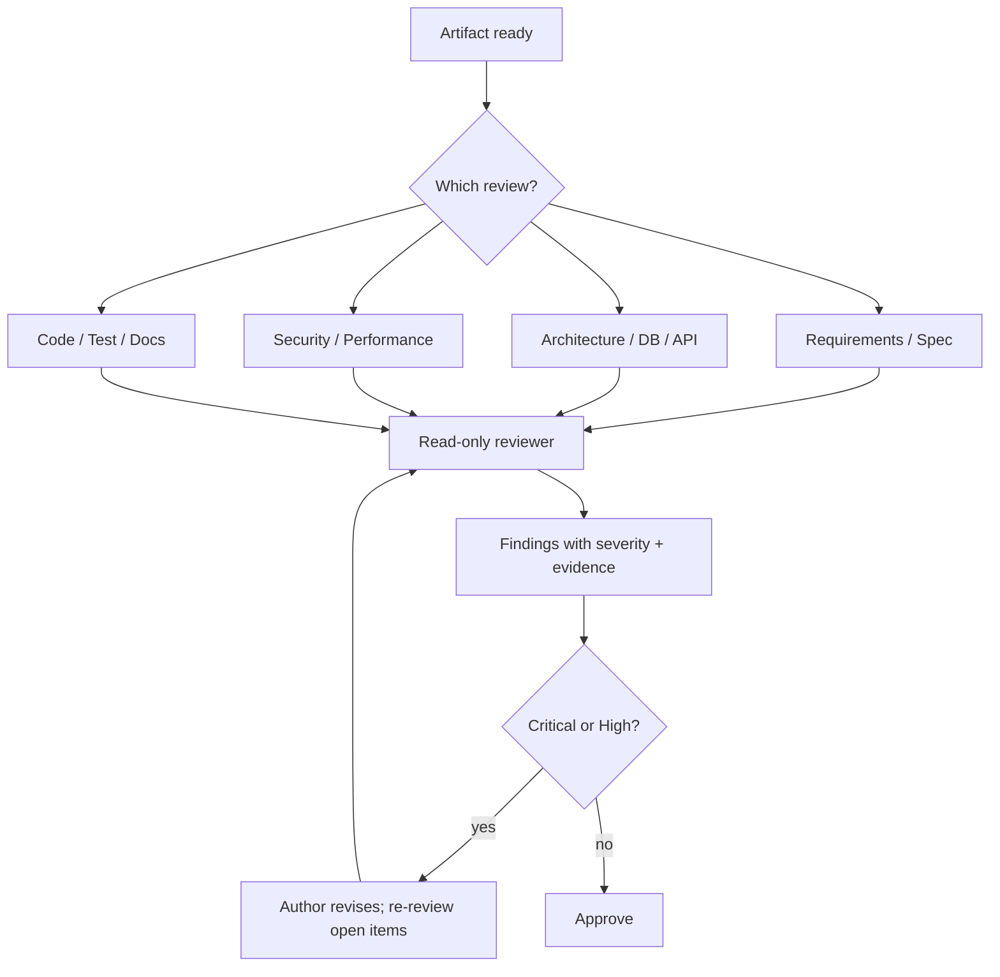
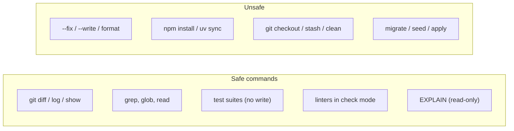
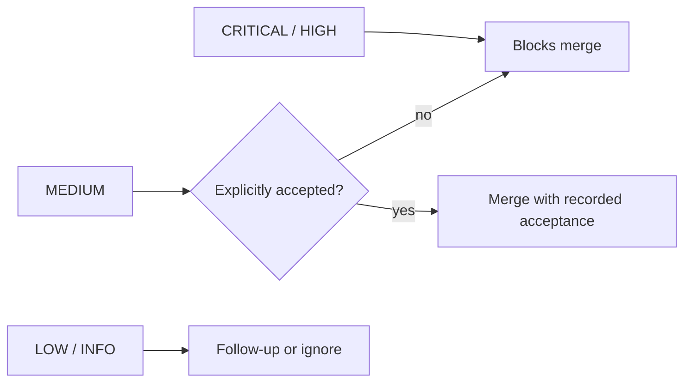
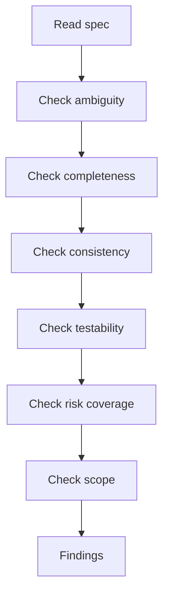
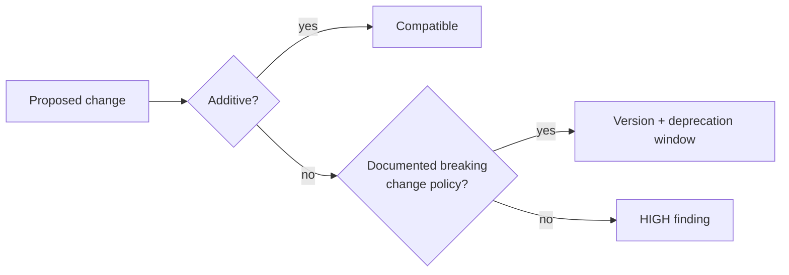
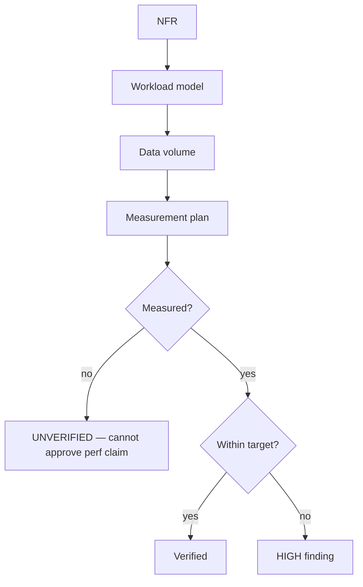

# 17 — Review Without Implementation

> A review that edits code is not a review. It is an implementation with a report attached.

---

## 1. Purpose

Define a **read-only review discipline** across ten review types, with a shared severity model,
evidence requirements, and reusable prompts. Reviews must be independent, falsifiable, and
incapable of silently changing the artifact under review.

---

## 2. The review matrix

| Review | Artifact | Primary question | Chapter |
| --- | --- | --- | --- |
| Requirements review | Intake, user stories | Are we solving the right problem? | §5 |
| Specification review | `spec.md` | Is it complete, consistent, testable? | §6 |
| Architecture review | `plan.md`, ADRs | Will this hold under real conditions? | [18](./18-architecture-review.md) |
| Database design review | Schema, migrations | Is it correct, reversible, performant? | §7 |
| API review | OpenAPI/AsyncAPI | Is the contract stable and usable? | §8 |
| Security review | Design + diff | What can an attacker do? | [21](./21-security-review.md) |
| Performance review | Design + benchmarks | Will it meet the NFRs? | §9 |
| Code review | Git diff | Is it correct and maintainable? | [19](./19-read-only-code-review.md) |
| Test review | Test code | Does it prove the requirement? | §10 |
| Documentation review | Docs | Is it accurate and current? | §11 |



---

## 3. Read-only policy

### Allowed

- Read files, diffs, history, and issues
- Search the repository
- Run **safe** tests and static analysis (no `--fix`, no formatters that write)
- Inspect logs and read-only database replicas
- Generate reports

### Forbidden

- Edit source, tests, or documentation
- Reformat files
- Apply fixes "while reviewing"
- Commit, push, create branches, or change issue state
- Run migrations, seeders, or schema pushes
- Modify configuration or infrastructure



### Enforcement levels

| Level | Mechanism | Guarantee |
| --- | --- | --- |
| **1. Technical** | Read-only filesystem mount or container with repo `:ro` | Strong |
| **2. Tool-level** | Reviewer agent has no write/edit tools | Strong for that tool |
| **3. Worktree** | Separate checkout the reviewer does not own | Medium (same user can still write) |
| **4. Instruction** | "Do not edit" in the prompt | Weak — advisory only |

> **State the limitation explicitly.** If you rely on level 3 or 4, the review report must say:
> *"Read-only access was not technically enforced; compliance relied on instructions."*

Verify with `git status --short` before and after the review. Any change is a finding against the
process, not just the code.

---

## 4. Severity model

Use one model everywhere. Severity is about **impact if shipped**, not about effort to fix.

| Severity | Definition | Merge decision |
| --- | --- | --- |
| **CRITICAL** | Data loss, security breach, outage, or silently wrong results in a core path | Block |
| **HIGH** | Broken requirement, major regression, or authorization gap in a secondary path | Block |
| **MEDIUM** | Correctness risk under plausible conditions, missing test for a key path, maintainability hazard | Fix or explicitly accept |
| **LOW** | Style, naming, minor duplication, documentation gap | Optional / follow-up |
| **INFO** | Observation, question, or suggestion | No action required |



### Confidence

Every finding also carries a confidence score (`1–10`) and its basis:

| Basis | Example |
| --- | --- |
| Executed proof | Failing test demonstrating the bug |
| Static certainty | Type error, unreachable branch |
| Strong reading | Contract violation visible in the diff |
| Heuristic | Pattern that is usually wrong |

Low-confidence findings are still useful, but must be labeled as questions, not assertions.

---

## 5. Requirements review

**Question:** are we solving the right problem?

| Check | Failure signal |
| --- | --- |
| Problem statement is solution-neutral | "We need a Kafka topic" in the problem line |
| Affected users identified | "Users want…" with no cohort |
| Cost of inaction stated | No reason the work matters now |
| Success is measurable | "Better UX" |
| Scope bounded | No non-goals |
| Constraints explicit | Hidden compliance/deadline assumptions |

```markdown
## Requirements review findings

| ID | Severity | Location | Finding | Evidence | Recommendation |
| --- | --- | --- | --- | --- | --- |
| R-01 | HIGH | intake.md:12 | Success criterion "faster exports" is not measurable | no metric, no baseline | Define p95 target and dataset size |
| R-02 | MEDIUM | intake.md:20 | Requester-proposed solution recorded as a requirement | "must use Kafka" under *Problem* | Move to *Considered solutions*; re-derive requirement |
```

---

## 6. Specification review

**Question:** can a competent engineer implement this without asking the author?



| Dimension | What to look for |
| --- | --- |
| **Ambiguity** | Words like "appropriate", "reasonable", "fast", "secure" without a definition |
| **Completeness** | Missing failure paths, empty states, limits, auth rules |
| **Consistency** | Two requirements that cannot both be true |
| **Testability** | Acceptance criteria without an observable assertion |
| **Risk coverage** | No security/performance/compatibility requirements |
| **Scope** | No non-goals, or non-goals that contradict goals |
| **Traceability** | Requirements without IDs; criteria without a parent |

### The falsification technique

For each requirement, try to construct two implementations that both satisfy the literal text but
behave differently. If you can, the requirement is ambiguous.

```markdown
**FR-3:** "Export only the rows the user can see."

Implementation A: filter by project membership.
Implementation B: filter by project membership and record-level ACL.

Both satisfy the sentence. → Finding: define the authorization model explicitly.
```

---

## 7. Database design review

| Check | Evidence |
| --- | --- |
| Normalization justified | Documented denormalization reason |
| Keys and constraints | PK, unique, FK, check constraints named |
| Index strategy | Query patterns → indexes, not "add indexes later" |
| Migration safety | Lock analysis, batching, `CONCURRENTLY` where needed |
| Reversibility | `down()` tested, or forward-fix documented |
| Data retention | Retention/deletion policy stated |
| Multi-tenancy | Tenant isolation enforced at the schema or query layer |
| Audit | Immutable history for regulated data |

```markdown
| ID | Severity | Finding | Evidence | Recommendation |
| --- | --- | --- | --- | --- |
| D-01 | CRITICAL | Backfill updates 40M rows in one transaction | migration:22 has no batching | Batch with `LIMIT` + `SKIP LOCKED` |
| D-02 | HIGH | `down()` is a no-op | migration:41 `pass` | Implement drop, or document forward-fix and mark irreversible |
```

See [SQL guide](./language-guides/sql.md) for the expand/contract pattern.

---

## 8. API review

| Check | Failure signal |
| --- | --- |
| Resource naming and verbs | `POST /getOrders` |
| Status codes | `200` with `{"error": ...}` |
| Error model | Inconsistent shapes across endpoints |
| Pagination | Unbounded lists |
| Versioning | Breaking change without a version strategy |
| Idempotency | Retryable `POST` without idempotency key |
| AuthN/AuthZ | Documented per operation |
| Rate limits | Unspecified |
| Backward compatibility | Removed fields in a minor release |



```markdown
| ID | Severity | Endpoint | Finding | Recommendation |
| --- | --- | --- | --- | --- |
| A-01 | HIGH | `GET /orders/export` | No maximum page/row limit; unbounded memory | Add `maxRows` or stream with a hard cap |
| A-02 | MEDIUM | `POST /orders` | No idempotency key; retries create duplicates | Accept `Idempotency-Key` |
```

---

## 9. Performance review

| Check | Evidence required |
| --- | --- |
| NFR is numeric and conditional | "p95 < 300 ms at 50 RPS, dataset 5M rows" |
| Dataset size stated | Test data volume |
| Hot path identified | Profile or trace |
| Complexity analyzed | N+1, nested loops, unbounded scans |
| Resource limits | Pool sizes, timeouts, memory ceilings |
| Measurement method | k6/Gatling/benchmark script committed |
| Regression baseline | Previous numbers |



---

## 10. Test review

**Question:** would these tests fail if the behavior were wrong?

| Check | Failure signal |
| --- | --- |
| Asserts observable behavior | Only asserts mocks were called |
| Fails on the buggy version | Never verified against a broken implementation |
| Covers boundaries | No empty/max/unauthorized cases |
| Deterministic | Time/random/network dependent |
| Independent | Order-dependent tests |
| Readable failure message | `assert result` with no context |
| Maps to acceptance criteria | Test names unrelated to ACs |

```markdown
| ID | Severity | Test | Finding | Recommendation |
| --- | --- | --- | --- | --- |
| T-01 | HIGH | `test_export_ok` | Asserts only `status == 200`; CSV content unverified | Assert header + row count + a known row |
| T-02 | MEDIUM | `test_auth` | Mocks the authorization function, so it cannot fail | Use a real policy with a fake principal |
```

**The mutation test:** change one line of the implementation to an obviously wrong behavior. If
the suite still passes, the test does not prove the requirement.

---

## 11. Documentation review

| Check | Failure signal |
| --- | --- |
| Matches implementation | Documented flag does not exist |
| Commands are executable | Placeholder paths presented as real |
| Version-specific claims are dated | "Latest version" with no date |
| Internal links resolve | Broken relative links |
| No duplicated contradictory rules | Two docs describe different commit policies |
| Examples are labeled | Illustrative vs verified |

---

## 12. Finding format

```markdown
### <ID> — <one-line title>

- **Severity:** CRITICAL | HIGH | MEDIUM | LOW | INFO
- **Confidence:** 1–10 (basis: executed proof | static certainty | strong reading | heuristic)
- **Location:** `path/to/file.ext:line` (or artifact section)
- **Requirement:** FR-3 / AC-3.2 (or "no requirement covers this")
- **Evidence:** the exact quote, diff hunk, command output, or test result
- **Impact:** what breaks, for whom, under what conditions
- **Remediation:** the smallest change that resolves it
- **Verification:** how to prove the remediation worked
- **Read-only:** confirmed — `git status` unchanged
```

### Report header

```markdown
# <Review type> report — <artifact> @ <commit>

**Reviewer:** <agent/human> (independent of author: yes/no)
**Date:** 2026-11-02
**Scope:** <files/artifacts/diff range>
**Read-only enforcement:** technical | tool-level | worktree | instruction-only
**Verdict:** APPROVE | APPROVE WITH COMMENTS | REQUEST CHANGES | BLOCK
**Summary:** 1 CRITICAL, 2 HIGH, 3 MEDIUM, 4 LOW, 2 INFO
```

---

## 13. Reusable prompts

| Review | Prompt |
| --- | --- |
| Requirements | [`prompts/requirements-agent.md`](./prompts/requirements-agent.md) or [`review-prompts.md` §1](./prompts/review-prompts.md) |
| Specification | [`prompts/specification-reviewer.md`](./prompts/specification-reviewer.md) |
| Architecture | [`prompts/architecture-reviewer.md`](./prompts/architecture-reviewer.md) |
| Database design | [`prompts/review-prompts.md` §4](./prompts/review-prompts.md) |
| API | [`prompts/review-prompts.md` §5](./prompts/review-prompts.md) |
| Security | [`prompts/security-reviewer.md`](./prompts/security-reviewer.md) |
| Performance | [`prompts/review-prompts.md` §7](./prompts/review-prompts.md) |
| Code | [`prompts/read-only-code-reviewer.md`](./prompts/read-only-code-reviewer.md) |
| Test | [`prompts/review-prompts.md` §9](./prompts/review-prompts.md) |
| Documentation | [`prompts/review-prompts.md` §10](./prompts/review-prompts.md) |

Every prompt in this handbook carries the same non-negotiables: read-only, evidence required,
severity-ranked, no invented facts.

---

## 14. Common mistakes

| Mistake | Consequence | Fix |
| --- | --- | --- |
| Reviewer "fixes" a small thing | Review is no longer independent | Report it |
| Findings without location | Unactionable | `file:line` or section |
| Severity inflation | Everything blocks; team ignores | Use impact definitions |
| Reviewing the summary, not the artifact | Misses real issues | Read the source |
| Same context as the author | Rationalizes decisions | Independent reviewer |
| No read-only verification | Silent edits | `git status` before/after |
| Rubber-stamp verdicts | Process theater | Require at least one falsifiable check |

---

## 15. Troubleshooting

| Symptom | Cause | Action |
| --- | --- | --- |
| Review produces only style nits | Reviewer read only the diff | Require reading requirements + callers |
| Endless review loops | Findings not scoped or prioritized | Block only critical/high; accept mediums explicitly |
| Reviewer cannot run tests | Environment missing | Record as limitation; do not guess |
| Conflicting reviewer opinions | No shared severity model | Adopt §4 verbatim |
| Findings disputed | Evidence too weak | Require reproduction or cite lines |

---

## 16. References

- [Chapter 18 — Architecture review](./18-architecture-review.md)
- [Chapter 19 — Read-only code review](./19-read-only-code-review.md)
- [Chapter 21 — Security review](./21-security-review.md)
- [templates/specification-review-report.md](./templates/specification-review-report.md)
- [templates/code-review-report.md](./templates/code-review-report.md)
- ISO/IEC/IEEE 29148 — requirement quality characteristics
- *Software Architecture in Practice* (Bass, Clements, Kazman)

---

**Previous:** [16 — Refactoring](./16-refactoring.md) ·
**Next:** [18 — Architecture review](./18-architecture-review.md)
