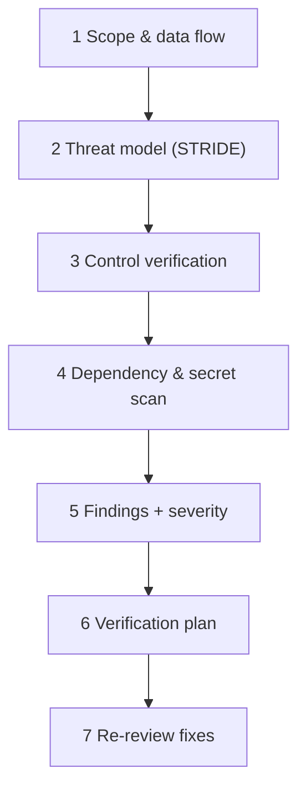
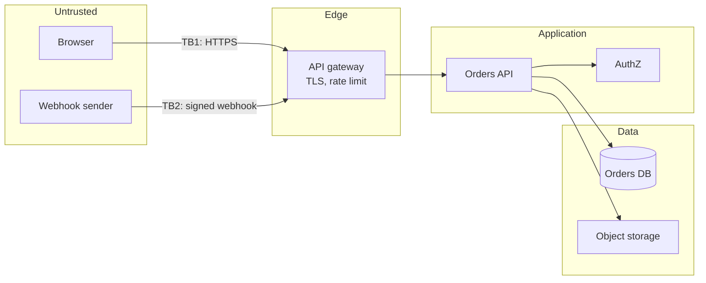
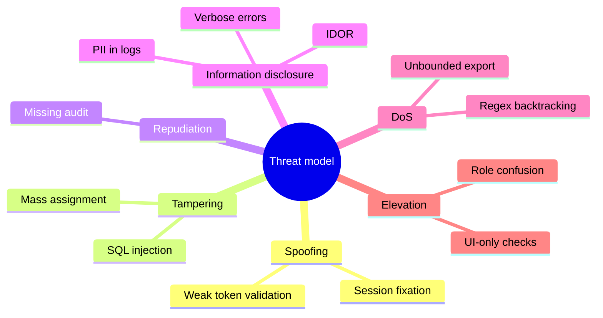
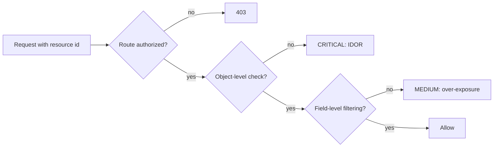
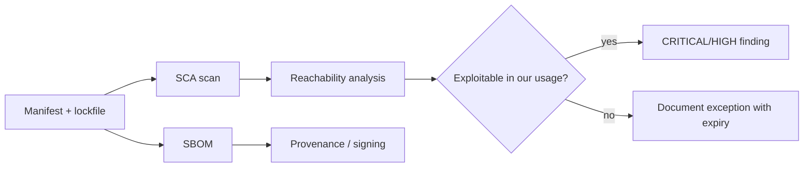
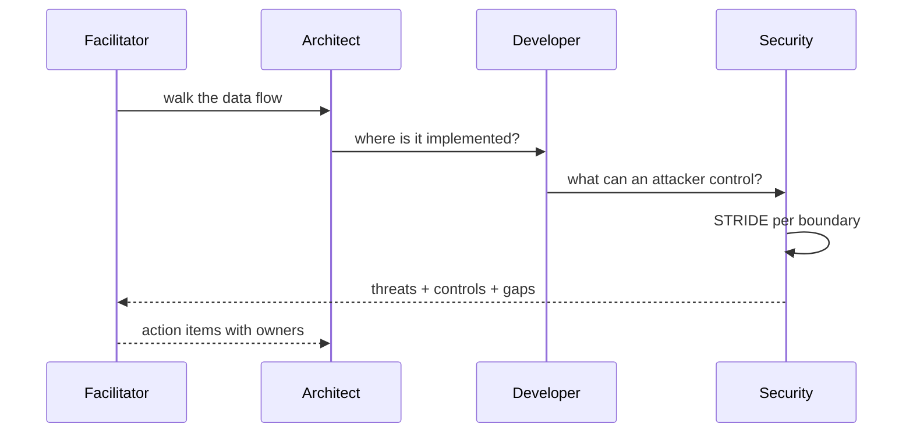
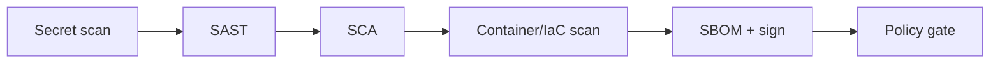

# 21 — Security Review

> Security review is threat modeling plus evidence. A checklist without a threat model finds
> style issues; a threat model without evidence finds fiction.

---

## 1. Purpose

Review a change for security impact **before** it ships, with a repeatable method that produces
actionable, evidence-backed findings and does not modify code.

---

## 2. When it is mandatory

| Trigger | Depth |
| --- | --- |
| New or changed authentication/authorization | Full threat model |
| New external endpoint or webhook | Full |
| PII, payment, health, or credential data | Full + data-flow review |
| New dependency or base image | Supply-chain review |
| File upload/download, archive extraction | Full + fuzzing |
| Cryptography, tokens, sessions | Full + specialist review |
| Infrastructure/IAM change | Full + policy-as-code |
| Internal refactor with no boundary change | Light |

---

## 3. Method



### 3.1 Data flow and trust boundaries



For each boundary, record: what crosses it, how it is authenticated, how it is validated, and
what happens if validation fails.

### 3.2 STRIDE

| Threat | Question | Typical control |
| --- | --- | --- |
| **S**poofing | Can someone claim another identity? | Strong authN, signed tokens, mTLS |
| **T**ampering | Can data be modified in transit/at rest? | TLS, signatures, integrity checks |
| **R**epudiation | Can an action be denied later? | Audit log with actor + timestamp |
| **I**nformation disclosure | Can data leak? | AuthZ, encryption, log hygiene |
| **D**enial of service | Can a caller exhaust resources? | Rate limits, quotas, bounded queries |
| **E**levation of privilege | Can a user gain rights? | Server-side AuthZ, least privilege |



---

## 4. Control verification checklist

### Authentication

- [ ] Tokens validated (signature, `exp`, `nbf`, `aud`, `iss`, algorithm)
- [ ] `alg: none` rejected
- [ ] Session rotation on privilege change
- [ ] Credential storage uses a modern KDF (Argon2id/bcrypt/scrypt)
- [ ] MFA enforceable for privileged roles

### Authorization

- [ ] Enforced server-side at one place per resource
- [ ] Object-level checks (IDOR): every ID is authorized, not just the route
- [ ] Deny-by-default on new routes
- [ ] Role/permission changes audited
- [ ] Matrix test exists per role



### Input and output

- [ ] Validation at the boundary with an allow-list
- [ ] Parameterized queries only
- [ ] Output encoding per context (HTML, JS, URL, SQL, shell)
- [ ] File upload: type, size, content sniffing, storage outside webroot
- [ ] Archive extraction protected against zip-slip and zip bombs
- [ ] SSRF protection for user-supplied URLs

### Data protection

- [ ] Classification recorded (public/internal/confidential/restricted)
- [ ] Encryption in transit and at rest
- [ ] Secrets from a secret manager, never in code
- [ ] PII excluded from logs, traces, and error messages
- [ ] Retention and deletion implemented

### Cryptography

- [ ] No custom crypto
- [ ] Approved algorithms and key sizes
- [ ] Random from a CSPRNG
- [ ] Key rotation plan
- [ ] Constant-time comparison for secrets

### Session and browser

- [ ] `HttpOnly`, `Secure`, `SameSite` cookies
- [ ] CSRF protection for state-changing requests
- [ ] CSP, HSTS, `X-Content-Type-Options`
- [ ] No sensitive data in URLs or `localStorage`

### Abuse resistance

- [ ] Rate limits per identity and per IP
- [ ] Pagination/row caps on list and export endpoints
- [ ] Timeouts on every external call
- [ ] Regex and parsing bounded against pathological input

---

## 5. Dependency and supply chain



| Check | Tool examples |
| --- | --- |
| Known CVEs | Dependabot, Trivy, OWASP Dependency-Check, `pip-audit`, `npm audit`, `govulncheck`, `cargo audit` |
| License policy | `cargo deny`, licensee, FOSSA (commercial) |
| SBOM | Syft, CycloneDX plugins |
| Image scanning | Trivy, Grype |
| Secret scanning | GitHub secret scanning, Gitleaks, Trivy |
| Provenance | Sigstore/cosign, SLSA attestations |

> **A scanner result is not a risk decision.** Record exploitability in context: is the vulnerable
> function reachable, with attacker-controlled input, in a deployed configuration?

---

## 6. Severity for security findings

Use CVSS-like reasoning but keep it decision-oriented.

| Severity | Criteria |
| --- | --- |
| **CRITICAL** | Unauthenticated remote compromise, auth bypass, data exfiltration, RCE |
| **HIGH** | Authenticated privilege escalation, IDOR on sensitive data, secret exposure |
| **MEDIUM** | Requires unusual preconditions, limited data, or defense-in-depth gap |
| **LOW** | Hardening, missing header, verbose error without sensitive data |
| **INFO** | Observation |

Include: attack preconditions, affected versions, and whether exploitation leaves evidence.

---

## 7. Finding format

```markdown
### SEC-01 — Export lacks object-level authorization (IDOR)

- **Severity:** HIGH · **Confidence:** 9/10 (executed proof)
- **Location:** `src/api/export.py:54`
- **Threat:** Information disclosure (STRIDE: I), Elevation of privilege
- **Preconditions:** valid low-privilege session
- **Evidence:**
  ```
  GET /projects/other-tenant/orders/export
  Authorization: Bearer <viewer-token-for-tenant-A>
  → 200, 1,284 rows from tenant B
  ```
- **Impact:** cross-tenant data exposure; regulatory notification likely.
- **Remediation:** enforce object-level authorization in `OrderQuery.visible_to_user()`
  and add a matrix test.
- **Verification:** same request returns 403; matrix test covers 5 roles × 2 tenants.
- **Compensating control (if fix is delayed):** disable export for non-admin roles.
```

---

## 8. Threat-model workshop (lightweight)



Time-box: 45 minutes for a bounded change. Output: a table of threats, controls, gaps, owners.

| Threat | Boundary | Control | Gap | Owner |
| --- | --- | --- | --- | --- |
| Spoofing | TB2 webhook | HMAC signature | No replay protection | API team |
| DoS | TB1 export | none | Unbounded rows | API team |
| Info disclosure | Response | field filtering | Admin sees all fields | Product |

---

## 9. CI integration



| Gate | Blocking condition |
| --- | --- |
| Secret scan | Any verified secret |
| SAST | High-confidence high-severity rule |
| SCA | CVSS ≥ 7 with reachable vulnerable path |
| IaC | Public data store, wildcard IAM |
| Container | Critical CVE in a base layer |
| License | Denied license |

---

## 10. Read-only constraints

Security review may run scanners and **read** configuration. It must not:

- Change IAM policies or firewall rules
- Rotate credentials
- Apply patches
- Modify tests to make a scan pass
- Disable a rule to silence a finding

If a scan requires write access (for example, a tool that writes a cache), run it in a throwaway
container with the repository mounted read-only.

---

## 11. Common mistakes

| Mistake | Consequence | Fix |
| --- | --- | --- |
| Checklist-only review | Misses design flaws | Threat model first |
| Trusting the scanner | False negatives | Add manual boundary analysis |
| Suppressing findings without expiry | Debt accumulates | Exception with owner + date |
| Reviewing after merge | Costly remediation | Gate on PR |
| Ignoring authorization on new routes | IDOR | Deny-by-default + matrix test |
| Logging request bodies "for debugging" | PII/token leak | Structured allow-list logging |

---

## 12. Troubleshooting

| Symptom | Cause | Action |
| --- | --- | --- |
| Scanner floods findings | No baseline | Baseline + diff-only gating |
| False positive blocks release | No triage process | Document exception with expiry |
| Cannot reproduce a finding | Environment/config | Record preconditions; lower confidence |
| Team disputes severity | No shared criteria | Use §6 |
| Secrets in git history | Committed earlier | Rotate first, then purge history |

---

## 13. References

- [Chapter 17 — Review without implementation](./17-specification-review.md)
- [Chapter 25 — CI/CD integration](./25-ci-cd-integration.md)
- [prompts/security-reviewer.md](./prompts/security-reviewer.md)
- OWASP Top 10 — <https://owasp.org/www-project-top-ten/>
- OWASP ASVS — <https://owasp.org/www-project-application-security-verification-standard/>
- OWASP Cheat Sheet Series — <https://cheatsheetseries.owasp.org/>
- OWASP SAMM — <https://owaspsamm.org/>
- STRIDE — <https://learn.microsoft.com/azure/security/develop/threat-modeling-tool-threats>
- CWE Top 25 — <https://cwe.mitre.org/top25/>
- NIST SSDF — <https://csrc.nist.gov/projects/ssdf>
- SLSA — <https://slsa.dev/>
- Sigstore — <https://www.sigstore.dev/>
- GitHub secret scanning — <https://docs.github.com/en/code-security/secret-scanning>

---

**Previous:** [20 — Testing and verification](./20-testing-and-verification.md) ·
**Next:** [22 — Git and commit policy](./22-git-and-commit-policy.md)
