# 22 — Git and Commit Policy

> The most destructive thing an AI agent can do in a repository is not write bad code. It is
> rewrite history or discard work that was never committed.

---

## 1. Purpose

Define **explicit, declared operating modes** for what an agent may do with Git, plus the
conventions that make history reviewable, bisectable, and revertible.

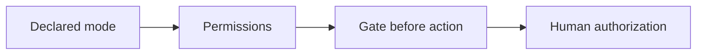

---

## 2. Operating modes

**One mode is active at a time and must be declared in the agent's instructions or the task
prompt.** If no mode is declared, assume **Mode 1**.

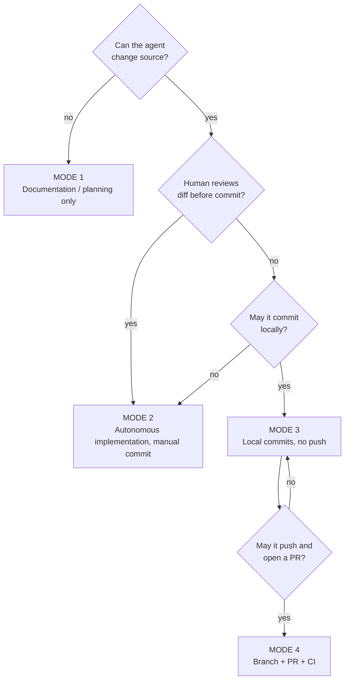

### Mode comparison

| Capability | Mode 1 | Mode 2 | Mode 3 | Mode 4 |
| --- | --- | --- | --- | --- |
| Edit source code | ❌ | ✅ | ✅ | ✅ |
| Edit documentation | ✅ (authorized) | ✅ | ✅ | ✅ |
| Run tests | ✅ | ✅ | ✅ | ✅ |
| Create commits | ❌ | ❌ | ✅ (verified only) | ✅ |
| Create branch | ❌ | ❌ | ✅ | ✅ |
| Push | ❌ | ❌ | ❌ | ✅ |
| Open/update PR | ❌ | ❌ | ❌ | ✅ |
| Merge | ❌ | ❌ | ❌ | ❌ (unless separate policy) |
| Deploy | ❌ | ❌ | ❌ | ❌ (unless separate policy) |

---

### Mode 1 — Documentation / planning only

**Use for:** planning, reviews, research, this handbook's own repository, onboarding.

| Rule | Detail |
| --- | --- |
| Source changes | Forbidden |
| Documentation | Allowed only when authorized for that task |
| Commits | Forbidden |
| Pushes | Forbidden |
| Working tree | Preserve unrelated changes exactly as found |

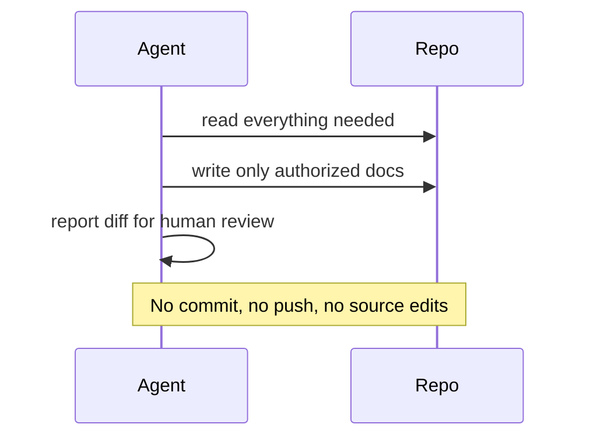

---

### Mode 2 — Autonomous implementation, manual commit **(recommended default)**

**Use for:** new installations, unfamiliar codebases, regulated environments, any team still
building trust.

| Rule | Detail |
| --- | --- |
| Implementation | Allowed within the approved spec |
| Tests | Must be run and reported |
| Commits | **Forbidden** |
| Push | Forbidden |
| Deliverable | A reviewed diff plus a summary and verification report |

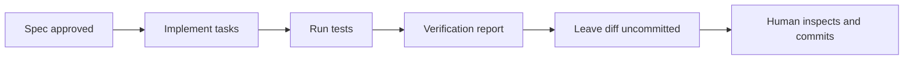

**Why this is the default:** it produces the maximum information per unit of risk. The agent does
the expensive work; the human keeps the irreversible action.

---

### Mode 3 — Autonomous implementation with local commits

**Use for:** teams with mature review, CI on every branch, and clean commit hygiene.

| Rule | Detail |
| --- | --- |
| Commits | Allowed, **verified changes only** |
| Push | Forbidden |
| Commit granularity | One logical change per commit |
| Unrelated changes | Never included |
| Failing/unverified work | Never committed |

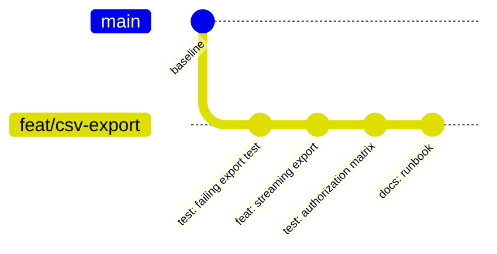

---

### Mode 4 — Full CI/CD automation

**Use for:** established pipelines with required checks, protected branches, and auditable
automation policy.

| Rule | Detail |
| --- | --- |
| Branch | Created from the default branch, prefixed by type |
| Commits | Conventional Commits, atomic |
| Push | Allowed to the agent's own branch only |
| PR | Opened/updated with a filled template |
| CI | Must pass before requesting review |
| Merge | **Requires explicit human approval** unless a separate, documented automation policy exists |
| Deploy | Never automatic without a separate approved policy |

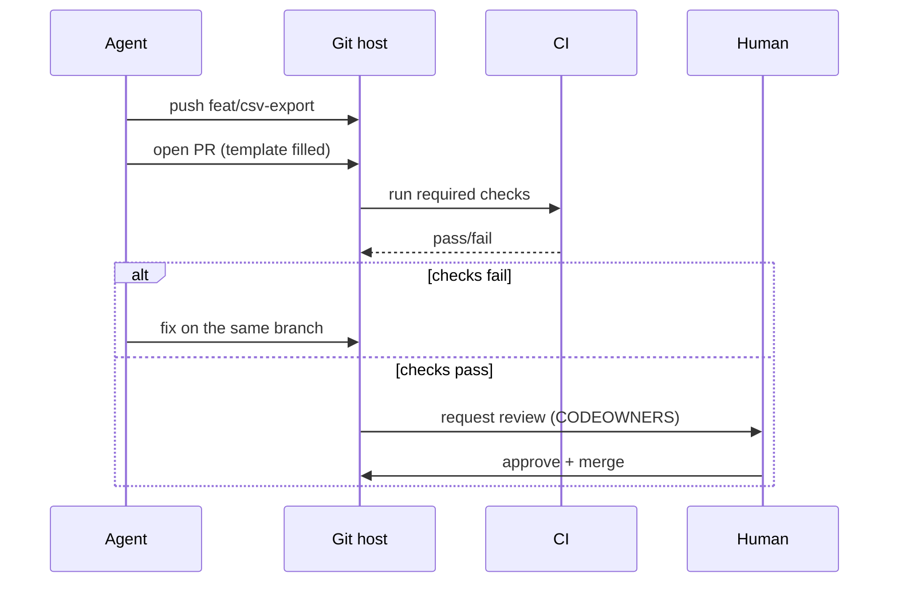

---

## 3. Branch naming

```text
<type>/<ticket-or-slug>
```

| Type | Use |
| --- | --- |
| `feat/` | New capability |
| `fix/` | Bug fix |
| `refactor/` | Behavior-preserving change |
| `perf/` | Performance change |
| `docs/` | Documentation only |
| `test/` | Test-only change |
| `chore/` | Build, tooling, deps |
| `hotfix/` | Production emergency |
| `release/` | Release preparation |

Examples: `feat/csv-export`, `fix/feed-crash`, `chore/bump-fastapi-0.115`.

| Rule | Reason |
| --- | --- |
| Lowercase, hyphen-separated | Case-insensitive filesystems, URLs |
| Include a ticket when one exists | Traceability |
| Never reuse a merged branch name | Confuses tooling and bisect |
| Never `main`/`master` for agent work | Protects the default branch |

---

## 4. Commit messages — Conventional Commits

```text
<type>(<scope>): <subject>

<body: why, not what>

<footer: BREAKING CHANGE / Refs / Co-authored-by>
```

| Type | Meaning |
| --- | --- |
| `feat` | User-visible capability |
| `fix` | Bug fix |
| `refactor` | No behavior change |
| `perf` | Performance |
| `test` | Tests only |
| `docs` | Documentation |
| `build` | Build system/deps |
| `ci` | Pipeline |
| `chore` | Maintenance |
| `revert` | Reverts a previous commit |

### Good vs bad

| Bad | Good |
| --- | --- |
| `fix stuff` | `fix(feed): use amount_cents after rename` |
| `update` | `docs(export): document row limit and 403 behavior` |
| `feat: big refactor + new feature` | Split into `refactor(export): extract CsvWriter` and `feat(export): add streaming endpoint` |

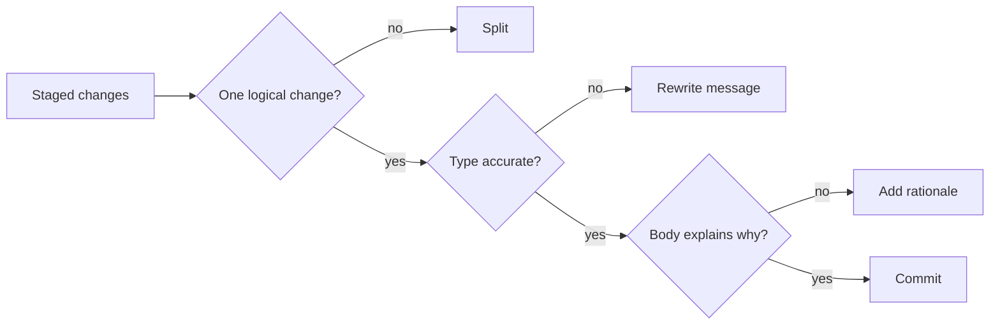

> **Subject line ≤ 72 characters, imperative mood, no trailing period.** Enforce with
> `commitlint` if the project has it.

---

## 5. Atomic commits

A commit is atomic when it can be reverted alone without breaking the build.

| Test | Passes? |
| --- | --- |
| Does it build on its own? | Must be yes |
| Do its tests pass on its own? | Must be yes |
| Does it mix unrelated concerns? | Must be no |
| Does the message describe exactly this change? | Must be yes |

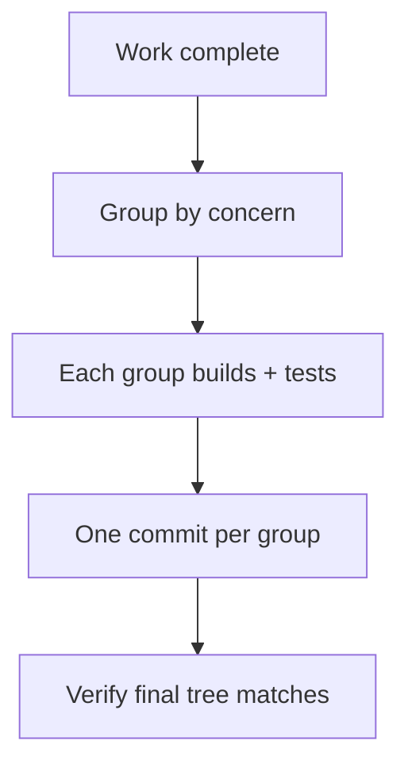

> Commit-order discipline matters for `git bisect`. A commit that only passes with a later
> commit defeats bisection.

### When to commit — and when not to

| Situation | Commit? | Reason |
| --- | --- | --- |
| Tests pass, change is complete, one logical concern | **Yes** | Reviewable, revertible, bisectable |
| Work in progress that does not build | **No** | Breaks `git bisect` and CI on the branch |
| Unverified change ("should work") | **No** | Committing is an implicit correctness claim |
| Refactor plus feature in one working tree | **Split** | Different risk, different review |
| Generated files changed by a build | **No** | Regenerate; commit the source |
| Unrelated user changes in the tree | **Never** | Stage explicit paths only |
| Documentation-only change | **Yes** | Still needs a reviewable history |
| Emergency mitigation | **Yes**, with a post-hoc review | Restore service first, then review within 24 h |
| Mode 1 or Mode 2 is active | **No** | The mode forbids it |

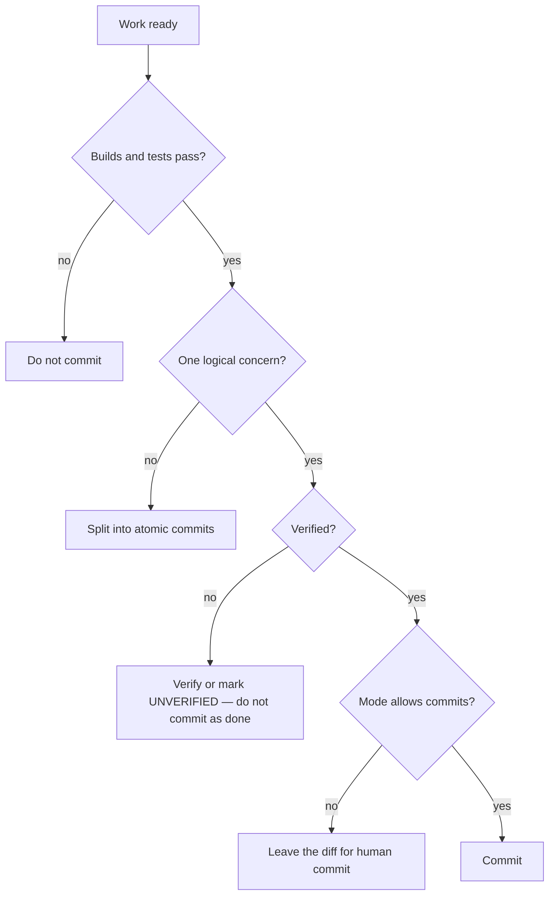

---

## 6. The authorization matrix

| Action | Mode 1 | Mode 2 | Mode 3 | Mode 4 | Notes |
| --- | --- | --- | --- | --- | --- |
| `git status`, `diff`, `log`, `show` | ✅ | ✅ | ✅ | ✅ | Always safe |
| `git add` (staging) | ❌ | ❌ | ✅ | ✅ | Scoped to task files |
| `git commit` | ❌ | ❌ | ✅ | ✅ | Verified changes only |
| `git switch -c` | ❌ | ❌ | ✅ | ✅ | New branch only |
| `git push` (own branch) | ❌ | ❌ | ❌ | ✅ | Never to default branch |
| `git push --force-with-lease` | ❌ | ❌ | ❌ | ⚠️ | Only on own unmerged branch, with approval |
| `git push --force` to shared branch | ❌ | ❌ | ❌ | ❌ | Never |
| `git reset --hard` | ❌ | ❌ | ❌ | ❌ | Never without explicit authorization |
| `git clean -fd` | ❌ | ❌ | ❌ | ❌ | Never without explicit authorization |
| `git checkout -- <file>` | ❌ | ❌ | ❌ | ❌ | Discards user work |
| `git stash drop` | ❌ | ❌ | ❌ | ❌ | Destroys the only copy |
| `git rebase` on shared branch | ❌ | ❌ | ❌ | ❌ | Rewrites others' history |
| `git commit --amend` | ❌ | ❌ | ⚠️ | ⚠️ | Only own, unpushed commit |
| `git revert` | ❌ | ❌ | ✅ | ✅ | Preferred rollback |
| `git tag` | ❌ | ❌ | ❌ | ⚠️ | Release process owns tags |
| Merge to default branch | ❌ | ❌ | ❌ | ❌ | Human or separate policy |

**⚠️ = requires explicit approval recorded in the task or PR.**

---

## 7. Rollback and revert

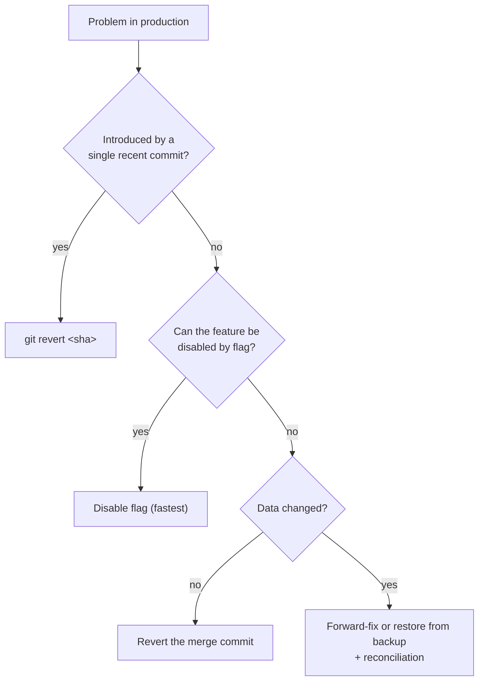

| Situation | Preferred action | Never |
| --- | --- | --- |
| Bad deploy, no data change | Redeploy previous tag | `reset --hard` on shared branch |
| Feature behaves badly | Disable flag | Delete the branch |
| Schema migration wrong | Forward-fix or documented restore | Edit the applied migration in place |
| Secret committed | Rotate secret, then purge history with a reviewed plan | Just delete the file |
| Agent produced bad commits (unpushed) | Delete the local branch | Force-push shared branches |

```bash
# Safe revert of a bad commit on a shared branch
git revert --no-edit <sha>

# Undo the last local commit but keep the changes staged
git reset --soft HEAD~1

# Undo the last local commit and keep changes in the working tree
git reset --mixed HEAD~1
```

> `--soft`/`--mixed` only affect **local, unpushed** commits. Never rewrite shared history.

---

## 8. Worktrees

Worktrees let multiple agents work in parallel without fighting over one checkout.

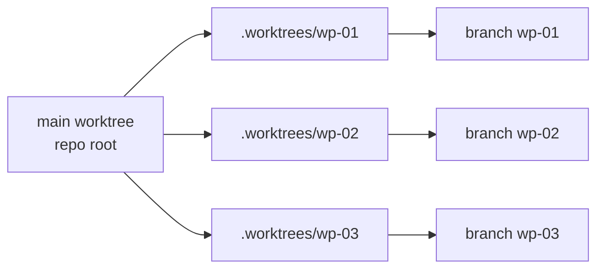

```bash
git worktree add ../repo-wp-01 -b wp-01
git worktree list
git worktree remove ../repo-wp-01
```

| Rule | Reason |
| --- | --- |
| One agent per worktree | Prevents conflicting edits |
| Add `.worktrees/` to `.gitignore` | Avoid committing transient state |
| Never share a worktree between agents | Index lock contention |
| Remove worktrees after merge | Disk and confusion |
| Each worktree gets its own env/secrets scope | Avoid cross-contamination |

---

## 9. Pull requests

### Template

```markdown
## What & why
<One paragraph tied to the spec/issue.>

## Specification
- Spec: `specs/007-export/spec.md`
- Requirements: FR-3, FR-4, NFR-2

## Acceptance criteria
| AC | Status | Evidence |
| --- | --- | --- |
| AC-3.1 | VERIFIED | `pytest -k export` → 12 passed |
| AC-3.3 | UNVERIFIED | perf run pending in staging |

## Risk & rollback
- Risk: long-lived connections require LB idle timeout ≥ 120 s
- Rollback: disable `export_v2`; no data change

## Reviewer notes
- Read `src/export/csv.py` first; the rest is wiring.
- Ignore lockfile churn.
```

### PR rules

| Rule | Reason |
| --- | --- |
| One logical change per PR | Reviewable, revertible |
| PR body states what was **not** verified | Honest status |
| No merge commits from the agent | History stays linear where required |
| Required checks must pass before review request | Saves reviewer time |
| Draft PR for early feedback | Signals incomplete |

---

## 10. CODEOWNERS and protected branches

```text
# .github/CODEOWNERS
*                       @org/engineering
/src/export/            @org/export-team
/.github/workflows/     @org/platform
/infra/                 @org/platform @org/security
/              @org/architecture
```

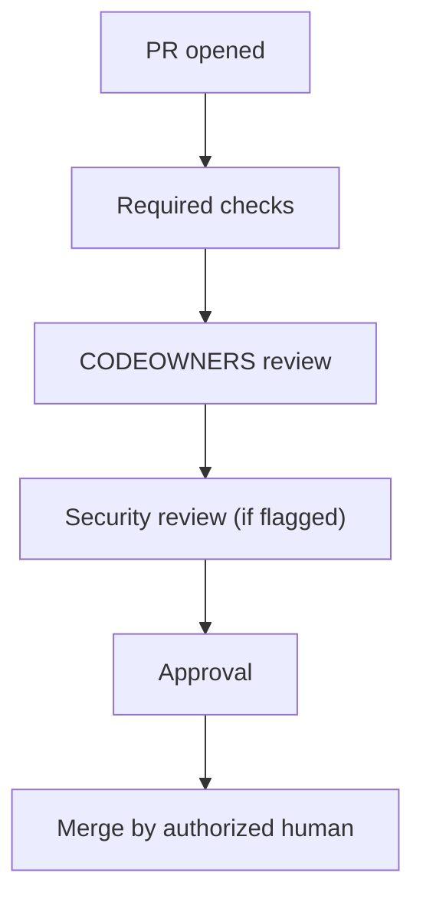

Protected branch settings to require:

- [ ] Pull request before merging
- [ ] At least one approval (two for critical paths)
- [ ] CODEOWNERS review
- [ ] Required status checks (tests, SAST, SCA)
- [ ] Conversation resolution
- [ ] No force pushes
- [ ] No deletions
- [ ] Linear history (if that is the team convention)

---

## 11. What must never be committed

| Category | Examples |
| --- | --- |
| Secrets | `.env`, private keys, tokens, connection strings |
| Local config | IDE settings that are personal, `.DS_Store` |
| Generated artifacts | `dist/`, `build/`, `target/`, coverage reports |
| Dependency caches | `node_modules/`, `.venv/`, `__pycache__/` |
| Large binaries | Datasets, dumps, videos (use artifact storage) |
| Tool-local state | `.worktrees/`, agent scratch files |

```bash
# Pre-commit sanity (read-only checks)
git diff --cached --name-only | grep -Ei '\.(env|pem|key|p12)$' && echo "SECRET RISK"
git diff --cached --name-only | grep -Ei '(^|/)(node_modules|dist|build|target)/' && echo "GENERATED"
```

---

## 12. Verification of Git conduct

| Check | Command | Expected |
| --- | --- | --- |
| Mode respected | `git log origin/main..HEAD` | Empty in Modes 1–2 |
| No pushes in Mode 2/3 | `git rev-parse @{u}` vs `origin` | No upstream changes |
| Commit style | `git log --format='%s' -20` | Conventional format |
| Atomicity | `git show --stat <sha>` | One concern |
| No secrets | scanner output | Clean |
| Branch name | `git branch --show-current` | Matches convention |
| Working tree preserved | `git status --short` | Unrelated changes intact |

---

## 13. Common mistakes

| Mistake | Consequence | Fix |
| --- | --- | --- |
| Undeclared mode | Agent guesses wrong | Declare mode in instructions |
| `git add -A` | Commits unrelated user work | Stage explicit paths |
| One huge commit | Unrevertible, unbisectable | Split by concern |
| Force-pushing a shared branch | Others lose work | Never; use revert |
| Amending someone else's commit | History corruption | Only own unpushed commits |
| Committing generated files | Noise, conflicts | `.gitignore` |
| Mixing refactor and feature | Review cannot distinguish risk | Separate PRs |
| Merging own PR | No independence | Require another approver |

---

## 14. Troubleshooting

| Symptom | Cause | Action |
| --- | --- | --- |
| Agent cannot commit | Mode 1/2 | Expected; report diff instead |
| `pre-commit` hook fails | Real issue or auto-fix | Fix; never `--no-verify` silently |
| Detached HEAD after checkout | Wrong command | `git switch <branch>` |
| Merge conflict | Parallel work | Resolve with the owner; never guess |
| Commit contains wrong files | `git add -A` | `git reset --soft HEAD~1`, re-stage explicitly |
| Secret in history | Past commit | Rotate first, then plan history rewrite |
| Worktree locked | Stale process | `git worktree prune` |

---

## 15. References

- [Chapter 02 — Engineering lifecycle](./02-engineering-lifecycle.md)
- [Chapter 03 — Repository discovery](./03-repository-discovery.md)
- [Chapter 24 — Multi-agent engineering](./24-multi-agent-engineering.md)
- [templates/pull-request-template.md](./templates/pull-request-template.md)
- Conventional Commits — <https://www.conventionalcommits.org/>
- Git documentation — <https://git-scm.com/docs>
- `git worktree` — <https://git-scm.com/docs/git-worktree>
- GitHub CODEOWNERS — <https://docs.github.com/en/repositories/managing-your-repositorys-settings-and-features/customizing-your-repository/about-code-owners>
- GitHub protected branches — <https://docs.github.com/en/repositories/configuring-branches-and-merges-in-your-repository/managing-protected-branches>

---

**Previous:** [21 — Security review](./21-security-review.md) ·
**Next:** [23 — Hallucination prevention](./23-hallucination-prevention.md)
