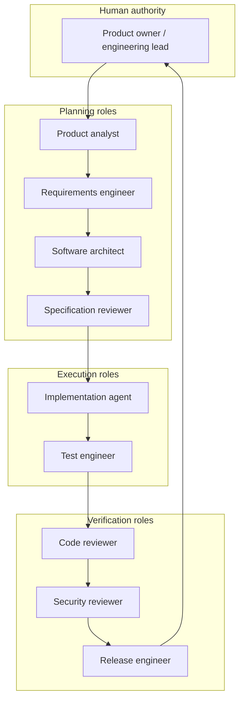
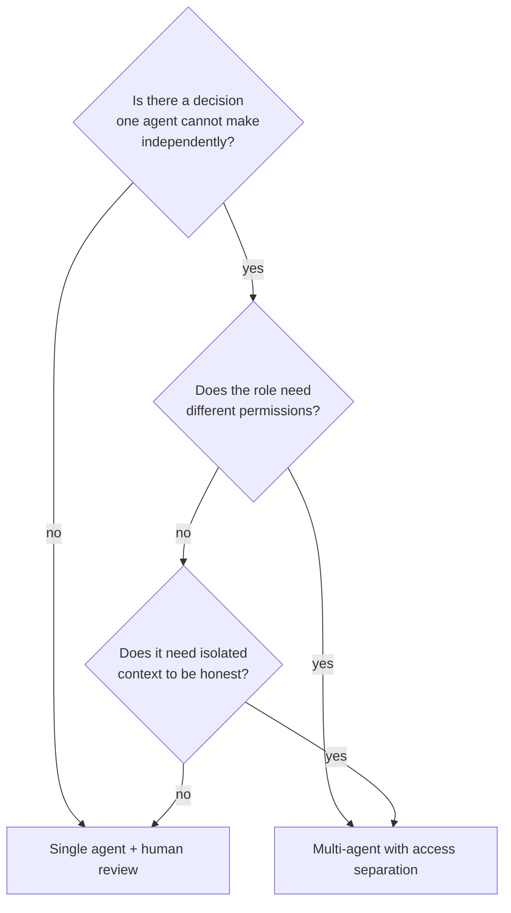
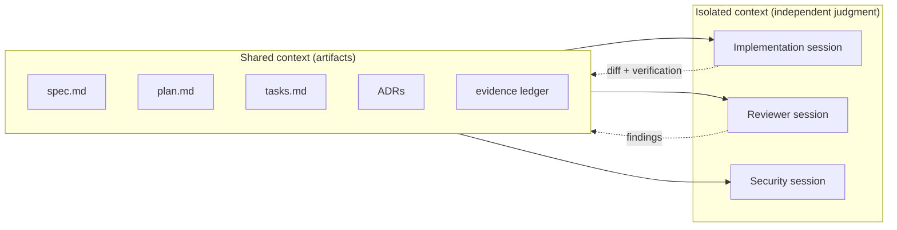
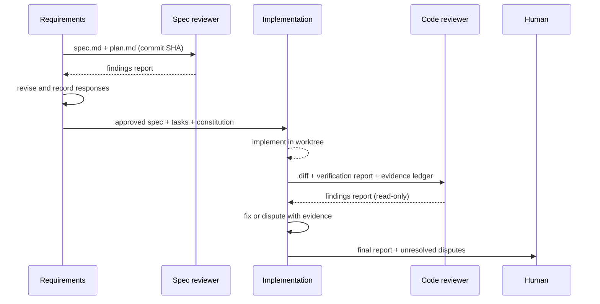
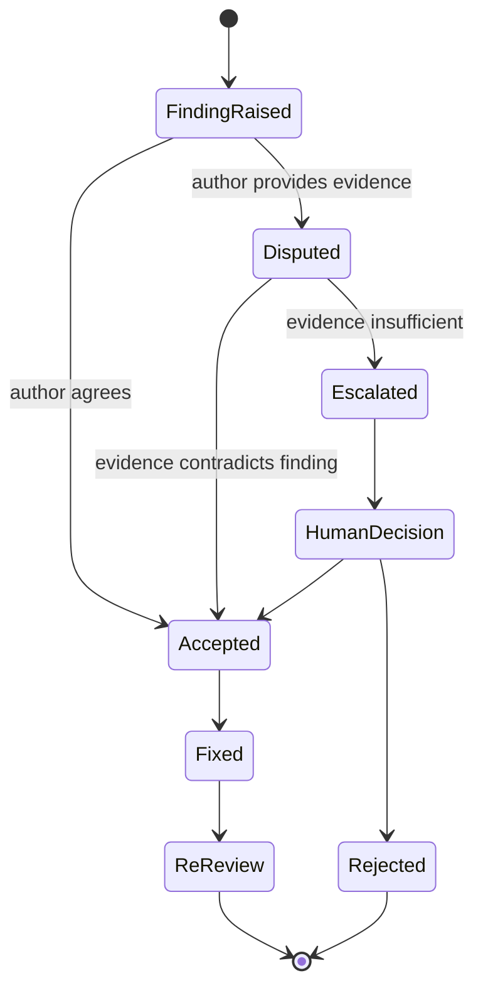
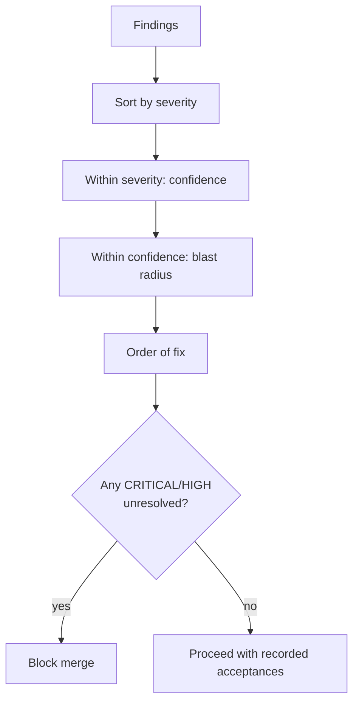
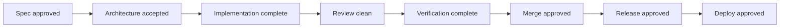
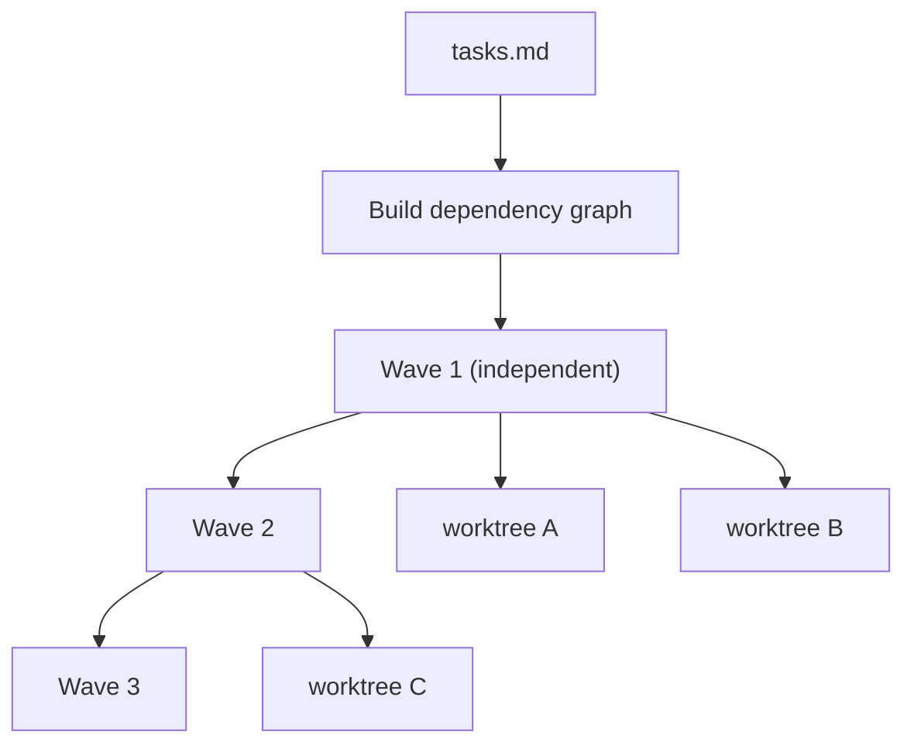

# 24 — Multi-Agent Engineering

> More agents is not more quality. It is more context, more coordination cost, and more places
> for a claim to go unverified. Add a role only when it owns a distinct decision.

---

## 1. Purpose

Define a role-based architecture for agents working under SDD: who decides what, who shares
context, who must be isolated, and where human gates sit.



---

## 2. When to use multi-agent (and when not to)

| Use multi-agent | Use a single agent |
| --- | --- |
| Independent review is required | Small, low-risk change |
| Specialist knowledge (security, DB) | One module, one developer |
| Parallel work packages with no overlap | Sequential work in one file |
| Regulated audit trail | Prototype |
| High blast radius | Documentation edit |



### Trade-offs

| Dimension | Single agent | Multi-agent |
| --- | --- | --- |
| Cost | Lower | Higher (context, tokens, coordination) |
| Latency | Lower | Higher |
| Independence | Weak (self-review) | Strong (separate context) |
| Context fidelity | High (one thread) | Lower (handoffs lose nuance) |
| Auditability | Lower | Higher (artifacts per role) |
| Failure modes | Rationalization | Handoff drift, duplicated work, conflicting edits |

> **Default:** one implementation agent + one independent reviewer. That single split captures
> most of the benefit at a fraction of the coordination cost.

---

## 3. Role definitions

| Role | Owns | Must not | Access |
| --- | --- | --- | --- |
| **Product analyst** | Problem statement, users, success metrics | Specify implementation | Read + product docs |
| **Requirements engineer** | `spec.md`, acceptance criteria | Choose architecture | Read + spec write |
| **Software architect** | `plan.md`, ADRs, task breakdown | Implement | Read + plan write |
| **Specification reviewer** | Spec finding report | Edit the spec | **Read-only** |
| **Implementation agent** | Code + tests within scope | Approve own work, change architecture silently | Read/write in worktree |
| **Test engineer** | Test design, coverage mapping | Weaken tests to pass | Read/write tests |
| **Security reviewer** | Threat model, security findings | Apply fixes | **Read-only** + scanners |
| **Code reviewer** | Diff findings, verdict | Edit files | **Read-only** |
| **Release engineer** | Branch, PR, CI, release notes | Merge without approval | Git write to agent branch |

### Access matrix

| Artifact | PA | RE | AR | SpecRev | Impl | Test | SecRev | CodeRev | Rel |
| --- | --- | --- | --- | --- | --- | --- | --- | --- | --- |
| Intake | W | R | R | R | R | R | R | R | R |
| `spec.md` | R | **W** | R | **R-only** | R | R | R | R | R |
| `plan.md` | R | R | **W** | **R-only** | R | R | R | R | R |
| Source code | — | — | R | **R-only** | **W** | R | **R-only** | **R-only** | R |
| Tests | — | — | R | R | **W** | **W** | R | R | R |
| ADRs | — | R | **W** | R | R | R | R | R | R |
| Review reports | — | R | R | **W** | R | R | **W** | **W** | R |

`W` = may write · `R` = may read · `R-only` = read but must not modify · `—` = no access needed

---

## 4. Context sharing vs isolation



| Context | Share? | Why |
| --- | --- | --- |
| Specification | **Yes** | It is the contract |
| Plan and ADRs | **Yes** | Decisions must be consistent |
| Evidence ledger | **Yes** | Prevents duplicate verification |
| Implementation chat history | **No** | Reviewer independence |
| Reviewer's reasoning chain | **No** | Author must respond to findings, not vibes |
| Security findings | **Partial** | Share remediation requirements, not exploit detail |
| Personal preferences | **No** | Not policy |

> **Handoff rule:** pass **artifacts**, not conversation. If a role needs the chat transcript to
> do its job, the artifacts are incomplete.

---

## 5. Artifact-based handoff



### Handoff contract

| Sender | Must provide | Receiver must not need |
| --- | --- | --- |
| Requirements → Spec reviewer | Spec, plan, constitution, discovery note | Chat history |
| Spec reviewer → Author | Findings with severity, evidence, requirement | Verbal discussion |
| Author → Implementation | Approved spec, tasks, ADRs, non-goals | Design intent in someone's head |
| Implementation → Code reviewer | Diff range, verification report, ledger, spec | Author's explanation |
| Code reviewer → Author | Findings with file:line, evidence, remediation | Reviewer's reasoning chain |
| Author → Human | Completion report, deviations, unverified items | Hope |

---

## 6. Resolving disagreements



| Rule | Reason |
| --- | --- |
| Disputes are resolved with **evidence**, not insistence | Prevents "I'm right" loops |
| The implementer **cannot close its own finding** | Independence |
| Escalation is a human decision with a recorded rationale | Audit trail |
| A rejected finding stays in the report with the reason | Learning, audit |
| Re-review covers only changed items unless the change is large | Efficiency |

### Dispute template

```markdown
## Dispute — C-01 (IDOR on export)

**Reviewer claim:** `visible_to()` filters by project only; record ACL ignored.
**Author response:** `OrderQuery.visible_to_user` already joins `RecordAcl` at `repo.py:118`.
**Evidence provided:** `repo.py:112-140`; test `test_acl_matrix::test_viewer_without_acl`.
**Reviewer resolution:** ACCEPTED — finding withdrawn. Confidence was 6/10 (based on
`service.py` without reading the query builder).
**Process note:** reviewer should have followed the call chain into the repository.
```

> A withdrawn finding is a **success** of the evidence process, not an embarrassment.

---

## 7. Prioritizing findings



| Priority | Severity | Confidence | Action |
| --- | --- | --- | --- |
| 1 | CRITICAL | ≥ 7 | Fix before anything else |
| 2 | HIGH | ≥ 7 | Fix before merge |
| 3 | CRITICAL/HIGH | < 7 | Verify first, then fix or dismiss with evidence |
| 4 | MEDIUM | any | Fix or record acceptance with owner |
| 5 | LOW/INFO | any | Follow-up ticket |

---

## 8. Human approval gates



| Gate | Human must see | Cannot be delegated to |
| --- | --- | --- |
| Spec approval | Problem, goals, non-goals, criteria | Implementation agent |
| Architecture | Trade-offs, rollback, failure modes | Same agent that designed it |
| Merge | Review report, verification, deviations | Implementer |
| Release | Changelog, risk, rollback plan | CI alone |
| Deploy | Environment, blast radius, window | The agent that wrote the code |

> **Never** let the implementation agent mark its own review findings as approved, even if it
> "ran the same checks". Independence is the control.

---

## 9. Parallel execution



| Rule | Reason |
| --- | --- |
| Parallel tasks must not touch the same files | Merge conflicts and lost work |
| Each parallel task gets its own worktree | Isolation |
| Foundational tasks are serialized | Everything depends on them |
| A coordinator owns the merge order | Prevents races |
| Integration test after each wave | Detects cross-task breakage early |

> Kiro calls these dependency **waves**; Spec Kitty uses **work packages** with worktrees; Spec Kit
> marks parallel tasks in `tasks.md`. The concept is the same: independence must be **declared**,
> not assumed.

---

## 10. Anti-patterns

| Anti-pattern | Problem | Fix |
| --- | --- | --- |
| Agent swarm on one file | Conflicting edits | One owner per file |
| Reviewer with write access | Silent fixes | Read-only + report |
| Handoff via chat summary | Loses nuance, invites invention | Artifact-only handoff |
| Same model instance for author and reviewer | Rationalization | Separate context |
| Nine roles for a one-line fix | Overhead | Default two-role split |
| Voting between agents | No ground truth | Evidence + human decision |
| Agent approving its own findings | No independence | Structural separation |

---

## 11. Cost control

| Lever | Effect |
| --- | --- |
| Two-role default | Captures most value |
| Artifact handoff (no transcripts) | Fewer tokens |
| Re-review only changed items | Less duplication |
| Specialist roles only when triggered (security for sensitive diffs) | Avoid idle agents |
| Cap parallel waves by file ownership | Avoid merge churn |
| Cache verification evidence in the ledger | Avoid re-running everything |

---

## 12. Verification

| Check | How | Expected |
| --- | --- | --- |
| Reviewer independence | Different session/agent, no shared transcript | Confirmed |
| Read-only enforced | Tool config or FS mount | Confirmed |
| Handoff completeness | Receiver can act from artifacts alone | Yes |
| No self-approval | Finding closure requires reviewer/human | Yes |
| Parallel safety | File ownership disjoint | Yes |
| Audit trail | Spec, review, verification, approval recorded | Present |

---

## 13. References

- [Chapter 02 — Engineering lifecycle](./02-engineering-lifecycle.md)
- [Chapter 17 — Review without implementation](./17-specification-review.md)
- [Chapter 22 — Git and commit policy](./22-git-and-commit-policy.md)
- [templates/agent-role-definition.md](./templates/agent-role-definition.md)
- [prompts/](./prompts/)
- Spec Kitty multi-agent architecture — <https://github.com/spec-kitty/spec-kitty/blob/main/docs/architecture/multi-agent-orchestration.md>
- BMAD multi-agent discussions — <https://docs.bmad-method.org/customize/run-multi-agent-discussions/>
- Superpowers subagent-driven development — <https://github.com/obra/superpowers>

---

**Previous:** [23 — Hallucination prevention](./23-hallucination-prevention.md) ·
**Next:** [25 — CI/CD integration](./25-ci-cd-integration.md)
