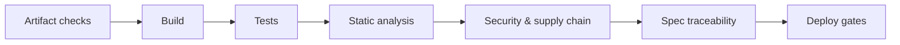
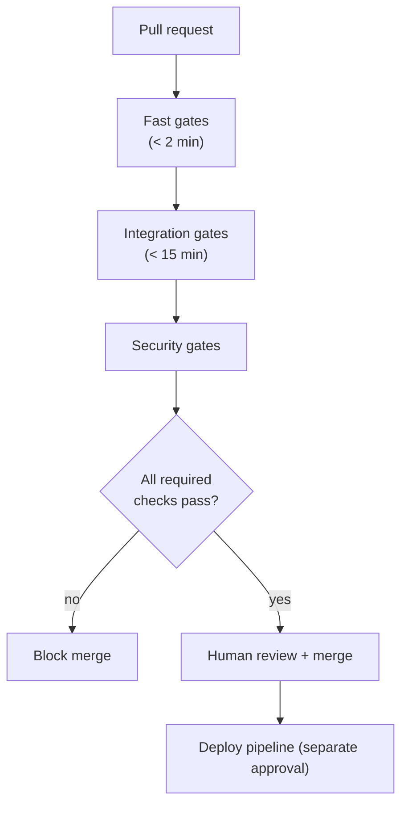
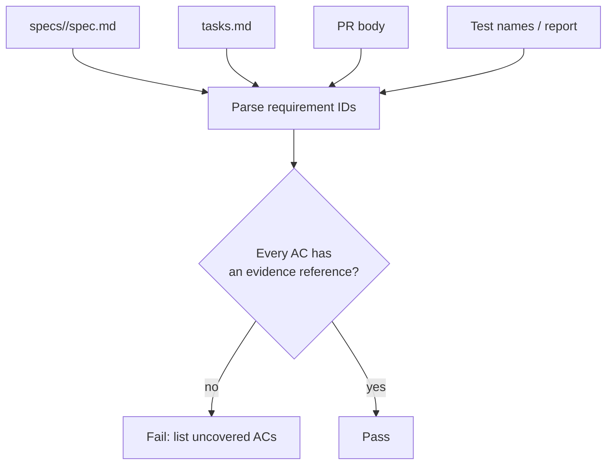
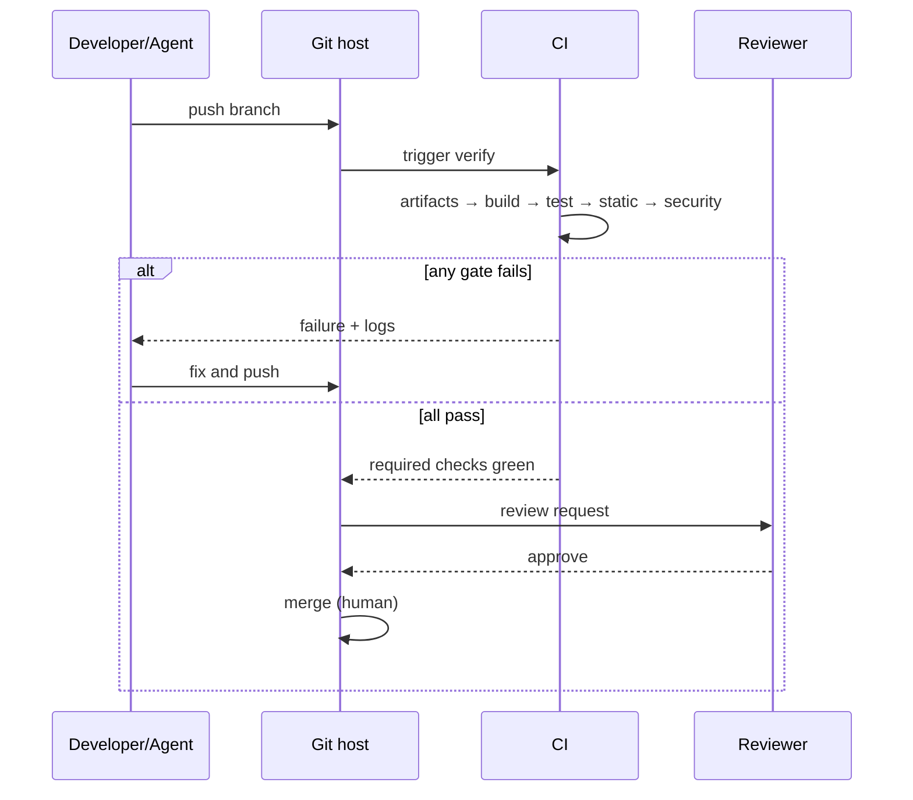
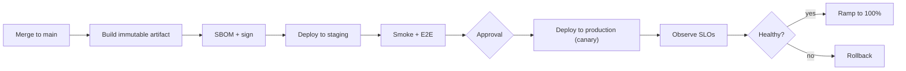
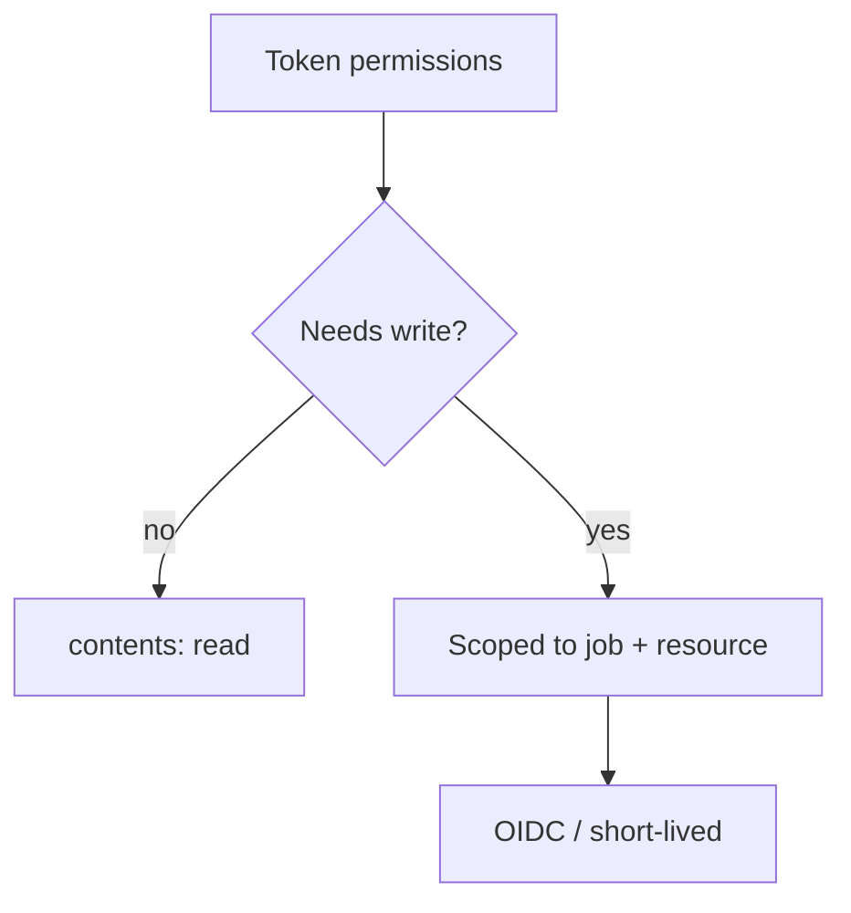

# 25 — CI/CD Integration

> CI is where SDD stops being a promise and becomes a gate. If a rule is not enforced by a
> required check, assume it will decay.

---

## 1. Purpose

Design pipelines that verify specification compliance, code quality, security, and artifact
consistency — and that **fail the build** when the process is bypassed.



---

## 2. Gate design principles

| Principle | Implementation |
| --- | --- |
| Fast feedback first | Lint/type check before integration tests |
| Fail closed | Missing required evidence = failure, not warning |
| Deterministic | Pinned tool versions and images |
| Cacheable | Dependencies and build caches |
| Read-only by default | No pipeline step mutates the repo |
| Auditable | Artifacts retained (reports, SBOM, logs) |
| Least privilege | Scoped tokens, OIDC, no long-lived secrets |



---

## 3. Stage catalog

| Stage | Checks | Typical duration | Blocking |
| --- | --- | --- | --- |
| **Artifact** | Spec exists, links resolve, YAML/JSON valid, Mermaid renders | < 1 min | Yes |
| **Build** | Compile, type check | 1–5 min | Yes |
| **Unit** | Fast tests | 1–5 min | Yes |
| **Static** | Lint, formatters in check mode, analyzers | 1–3 min | Yes |
| **Integration** | Real dependencies (Testcontainers) | 5–20 min | Yes |
| **Contract** | OpenAPI/Pact compatibility | 1–5 min | Yes |
| **Security** | SAST, SCA, secret scan | 2–10 min | Yes (severity threshold) |
| **Supply chain** | SBOM, image scan, provenance | 2–10 min | Yes for critical |
| **E2E** | Critical journeys | 10–30 min | Yes for main, optional for PR |
| **Performance** | NFR verification | 10–60 min | Scheduled/nightly, blocking for release |
| **Spec traceability** | Every AC has evidence | < 1 min | Yes |
| **Deploy** | Environment approval | — | Separate gate |

---

## 4. Spec traceability in CI

This is the check most teams skip, and it is the one that makes SDD real.



### Minimal implementation (no external dependency)

```python
# tools/check_spec_traceability.py — illustrative
import re, sys, pathlib

spec = pathlib.Path(sys.argv[1]).read_text(encoding="utf-8")
pr_body = pathlib.Path(sys.argv[2]).read_text(encoding="utf-8")

acs = set(re.findall(r"\bAC-\d+\.\d+\b", spec))
missing = sorted(ac for ac in acs if ac not in pr_body)

if missing:
    print("Uncovered acceptance criteria:")
    for ac in missing:
        print(" -", ac)
    sys.exit(1)
print(f"All {len(acs)} acceptance criteria referenced in the PR.")
```

> This checks **reference**, not correctness. Correctness comes from the verification report and
> review. Both are needed.

### Policy: waivers

| Situation | Allowed | Requirement |
| --- | --- | --- |
| AC cannot be verified in CI (perf env) | Yes | PR states `UNVERIFIED` + owner + date |
| Security exception | Yes | Issue link + expiry |
| Flaky test quarantine | Yes | Owner + ticket + max duration |
| Skipping a required check | **No** | Must be fixed or the check removed by policy |

---

## 5. Pipeline examples

### GitHub Actions — polyglot baseline

```yaml
# .github/workflows/verify.yml — illustrative structure
name: verify
on:
  pull_request:
  push:
    branches: [main]

permissions:
  contents: read

jobs:
  artifacts:
    runs-on: ubuntu-latest
    steps:
      - uses: actions/checkout@v4
      - uses: actions/setup-python@v5
        with: { python-version: '3.13' }
      - run: python tools/validate_docs.py
      - run: python tools/check_spec_traceability.py specs/*/spec.md pr-body.md

  build-test:
    runs-on: ubuntu-latest
    needs: artifacts
    steps:
      - uses: actions/checkout@v4
      # language-specific setup omitted for brevity
      - run: make verify   # thin wrapper around the project's real commands

  security:
    runs-on: ubuntu-latest
    needs: artifacts
    steps:
      - uses: actions/checkout@v4
      - name: SAST
        run: semgrep ci
      - name: Filesystem scan
        run: trivy fs --exit-code 1 --severity HIGH,CRITICAL .
```

> Replace `make verify` with the project's documented command. Do not invent a wrapper that hides
> what actually runs.



---

## 6. Deployment gates



| Gate | Evidence |
| --- | --- |
| Artifact promotion | Same digest from staging to production |
| Smoke | Health endpoint + 3 critical requests |
| Canary | Error rate and latency within SLO for N minutes |
| Rollback | Previous artifact available and tested |
| Change record | Spec link + verification report |

> **Never rebuild for production.** Promote the exact artifact you tested.

---

## 7. Caching and performance

| Cache | Key | Invalidation |
| --- | --- | --- |
| Dependencies | Lockfile hash | Lockfile change |
| Build output | Source hash + toolchain | Any source change |
| Test containers | Image digest | Image tag change |
| Static analysis | Source hash | Source change |

> Caching **must not** cache test results across different code. It is a correctness bug.

---

## 8. Security of the pipeline

| Risk | Control |
| --- | --- |
| Secret exfiltration via PR | No secrets on `pull_request` from forks |
| Untrusted code execution | Use `pull_request_target` carefully; avoid checking out PR code with secrets |
| Over-privileged token | `permissions: contents: read` by default |
| Long-lived cloud keys | OIDC federation |
| Supply-chain attack via action | Pin actions to commit SHA |
| Artifact tampering | Sign artifacts; verify digest |
| Log leakage | Mask secrets; no `set -x` with tokens |



---

## 9. CI for documentation (this repository)

```bash
python3 tools/validate_docs.py
```

Checks performed:

| Check | What it does |
| --- | --- |
| Link check | Verifies relative Markdown links resolve |
| Fence check | Balanced code fences, language tags present |
| YAML check | Parses fenced `yaml` blocks where the file is a standalone example |
| JSON check | Parses fenced `json` blocks |
| Mermaid structure | Known diagram type + balanced subgraph/end |
| Anchor check | Heading anchors referenced by links exist |

> See [tools/validate_docs.py](./tools/validate_docs.py) for the actual implementation and its
> limitations.

---

## 10. Metrics that tell you if CI is working

| Metric | Target | Signal |
| --- | --- | --- |
| PR pipeline duration (p50) | < 10 min | Developer experience |
| Flake rate | < 1% | Test reliability |
| Required-check bypass count | 0 | Process integrity |
| Mean time to fix failed main | < 30 min | Health |
| Security findings open > 30 days | 0 high/critical | Debt |
| Spec traceability failures | 0 | Process adoption |

---

## 11. Common mistakes

| Mistake | Consequence | Fix |
| --- | --- | --- |
| Advisory-only checks | Rules ignored | Make them required |
| One mega-job | Slow, unclear failures | Split by concern |
| Unpinned actions/images | Non-reproducible, supply-chain risk | Pin to SHA/digest |
| Running E2E on every PR | 40-minute feedback loop | Gate on main or label |
| Caching test results | False green | Cache inputs only |
| Secrets available to fork PRs | Exfiltration | Restrict |
| Rebuilding for production | Untested artifact shipped | Promote the digest |

---

## 12. Troubleshooting

| Symptom | Cause | Action |
| --- | --- | --- |
| Pipeline passes locally, fails in CI | Env/version drift | Pin toolchains; use containers |
| Intermittent failures | Flaky tests or network | Quarantine + retries for infra only |
| Container tests time out | Docker unavailable/slow | Service containers or larger runner |
| Security gate blocks on old finding | No baseline | Add baseline with expiry |
| Traceability check fails | PR body missing AC table | Use the template |
| Deploy fails after green CI | Environment drift | Test the promoted artifact in staging |

---

## 13. References

- [Chapter 20 — Testing and verification](./20-testing-and-verification.md)
- [Chapter 21 — Security review](./21-security-review.md)
- [Chapter 22 — Git and commit policy](./22-git-and-commit-policy.md)
- [templates/pull-request-template.md](./templates/pull-request-template.md)
- GitHub Actions security hardening — <https://docs.github.com/en/actions/security-for-github-actions/security-guides/security-hardening-for-github-actions>
- OpenID Connect in GitHub Actions — <https://docs.github.com/en/actions/deployment/security-hardening-your-deployments/about-security-hardening-with-openid-connect>
- SLSA — <https://slsa.dev/>
- Sigstore cosign — <https://docs.sigstore.dev/>
- Trivy — <https://trivy.dev/>
- Semgrep CI — <https://semgrep.dev/docs/semgrep-ci/overview>

---

**Previous:** [24 — Multi-agent engineering](./24-multi-agent-engineering.md) ·
**Next:** [26 — Enterprise reference workflow](./26-enterprise-reference-workflow.md)
