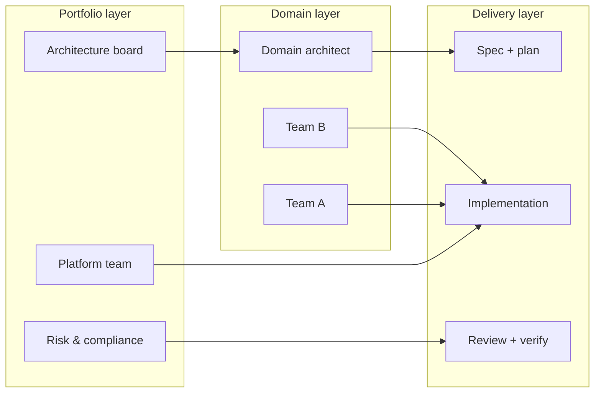
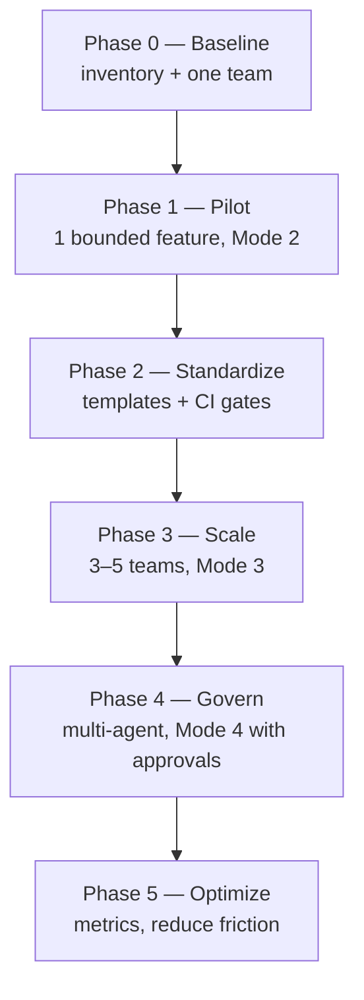
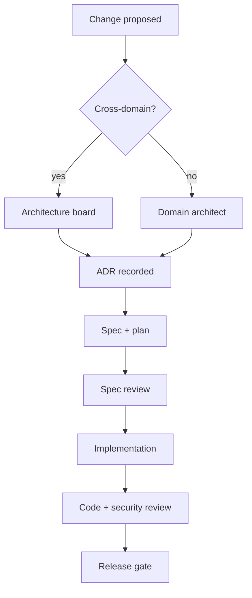
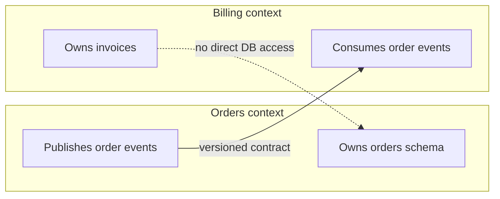
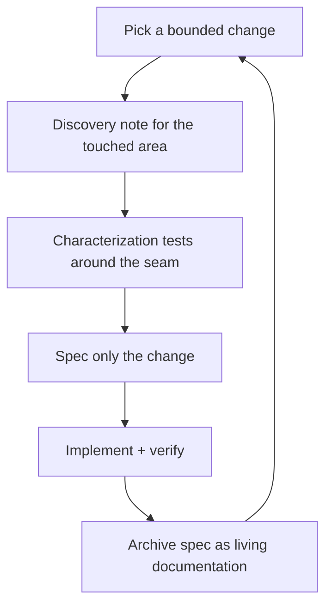
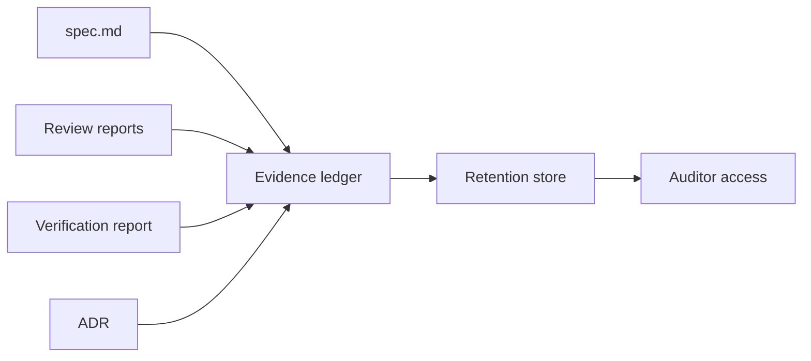
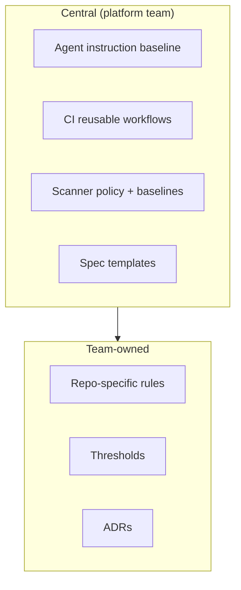
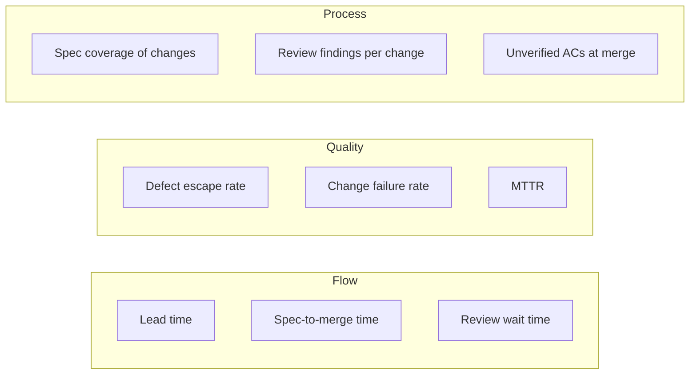
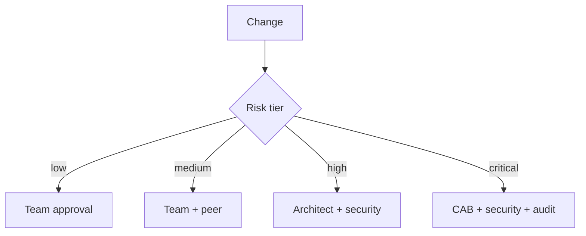

# 26 — Enterprise Reference Workflow

> Regulated, multi-team, brownfield reality: many systems, slow approvals, audit requirements,
> and no permission to stop delivering.

---

## 1. Purpose

A reference operating model for organizations adopting SDD at scale without a big-bang
transformation.

---

## 2. Adoption sequence

| Phase | Duration | Exit criteria |
| --- | --- | --- |
| 0 Baseline | 2 weeks | Repository inventory, one willing team, success metric |
| 1 Pilot | 4–6 weeks | One feature shipped with spec + review + evidence |
| 2 Standardize | 4 weeks | Templates, CI gates, review roles defined |
| 3 Scale | 2–3 months | 3–5 teams, consistent artifacts, metrics collected |
| 4 Govern | 3–6 months | Multi-agent roles, approval gates, audit trail |
| 5 Optimize | ongoing | Cycle time down, defect escape rate down |

> **Do not start with tooling.** Start with one team and one real feature. Tool choice follows
> what the pilot actually struggled with.

---

## 3. Governance structure

| Body | Owns | Cadence |
| --- | --- | --- |
| **Architecture board** | ADR approval, cross-domain decisions, tech radar | Biweekly |
| **Platform team** | CI templates, agent configuration, tooling, golden paths | Continuous |
| **Security** | Threat models, scanner policy, exception approval | Weekly triage |
| **Domain architects** | Bounded contexts, contracts, data ownership | Per change |
| **Team leads** | Spec quality, review assignment, delivery | Continuous |
| **Compliance** | Evidence retention, audit access, control mapping | Quarterly |

---

## 4. Bounded-context adoption

| Rule | Reason |
| --- | --- |
| Each context owns its data | Prevents coupling |
| Contracts are versioned artifacts | Consumers can plan |
| Cross-context changes need a coordination spec | Otherwise one team blocks another |
| Shared libraries are versioned and owned | Avoid "copy the util" proliferation |
| No shared database without an ADR | Irreversible coupling |

---

## 5. Brownfield entry

You cannot spec an entire legacy system. Adopt incrementally.

| Artifact | Scope |
| --- | --- |
| Discovery note | Only the touched area |
| Spec | Only the change, not the system |
| ADR | Only decisions the change forces |
| Characterization tests | Only the seam |
| Architecture doc | Created lazily, when a second team needs it |

> Spec Kit's guidance is explicit: `spec.md` defines the change you intend to make, not a
> retroactive specification of every existing behavior.

---

## 6. Compliance and audit

| Control | Evidence artifact | Retention |
| --- | --- | --- |
| Change authorization | Approved spec + PR approval | Per policy (often 7 years) |
| Segregation of duties | Independent review report | Same |
| Security review | Threat model + findings | Same |
| Test evidence | Verification report + CI logs | 1–3 years |
| Architecture decisions | ADR | Life of system + N years |
| Access control changes | IAM change record | Per policy |

**Mapping to common frameworks (informative, not certification):**

| Framework | SDD evidence that helps |
| --- | --- |
| ISO/IEC 27001 (change management) | Spec approval, review record, test evidence |
| SOC 2 (change management CC8) | Approved change, testing, segregation of duties |
| PCI DSS (secure SDLC) | Threat model, code review, dependency scanning |
| NIST SSDF | Spec + design review + verification |
| IEC 62304 (medical) | Requirements traceability, verification records |

> This is a mapping aid, not a compliance claim. Validate with your auditor.

---

## 7. Tooling at scale

| Layer | Owns | Change control |
| --- | --- | --- |
| Organization | Instruction baseline, security policy | Architecture board |
| Platform | CI workflows, scanner config, golden paths | Platform review |
| Repository | Rules, thresholds, ADRs | Team review |
| Task | Mode, scope, approvals | Prompt/task record |

> **Do not fork the central baseline per team.** Extend it with team-local overrides. Forks drift
> and lose security fixes.

---

## 8. Metrics

| Metric | Definition | Target direction |
| --- | --- | --- |
| Spec coverage | % of production changes with an approved spec | Up |
| Unverified ACs at merge | Count of `UNVERIFIED` criteria shipped | **Zero** |
| Defect escape rate | Defects found in production / total | Down |
| Change failure rate | Deployments causing degradation | Down |
| MTTR | Mean time to restore | Down |
| Review turnaround | Time from review request to first verdict | Down |
| Rework rate | Changes returned for findings | Down over time |

> **Do not optimize for artifact count.** A team producing 40 specs per month with no verification
> is worse than a team producing 4 with evidence.

---

## 9. Approval design at scale

| Risk tier | Examples | Approval |
| --- | --- | --- |
| **Low** | Docs, internal tooling, non-prod | Team lead |
| **Medium** | Internal service change | Team lead + peer review |
| **High** | Customer-facing API, data model | Team lead + domain architect + security |
| **Critical** | Auth, payments, PII, infra | Change advisory board + security + audit record |

Risk tier should be **derived from the diff**, not self-declared: paths touched, data classified,
contracts changed.

---

## 10. Exception handling

| Exception | Approval | Expiry | Record |
| --- | --- | --- | --- |
| Unverified AC shipped | Product + engineering | Date | PR + ledger |
| Security finding accepted | Security | ≤ 90 days | Tracker |
| Deprecated dependency retained | Architect | Date | ADR |
| Check bypassed | Engineering lead | Same day | Incident |
| Agent exceeded mode | Engineering lead | Immediate review | Incident |

> **Every exception has an owner and an expiry.** Permanent exceptions are policy changes in
> disguise.

---

## 11. Anti-patterns at enterprise scale

| Anti-pattern | Consequence | Fix |
| --- | --- | --- |
| Central team mandates 60 templates | Nothing is used | Start from 5 |
| Every team forks CI | Security drift | Reusable workflows |
| Agent allowed to merge in prod | Uncontrolled risk | Human gate |
| Specs stored in a wiki | No review, no versioning | Specs in the repo |
| "AI review" counted as independent | False assurance | Different context + evidence |
| Audit evidence collected after the fact | Reconstructed fiction | Emit during the process |
| One model instance for all roles | Rationalization | Isolation |

---

## 12. Verification

| Check | How | Expected |
| --- | --- | --- |
| Every production change has a spec link | CI traceability check | 100% |
| Every merge has a review report | PR template + required check | 100% |
| Every high-risk change has security review | Risk-tier automation | 100% |
| Exceptions have expiry | Tracker query | 0 expired open |
| Evidence retained | Retention store query | Per policy |

---

## 13. References

- [Chapter 02 — Engineering lifecycle](./02-engineering-lifecycle.md)
- [Chapter 21 — Security review](./21-security-review.md)
- [Chapter 24 — Multi-agent engineering](./24-multi-agent-engineering.md)
- [Chapter 25 — CI/CD integration](./25-ci-cd-integration.md)
- NIST SSDF — <https://csrc.nist.gov/projects/ssdf>
- ISO/IEC 27001 — <https://www.iso.org/standard/27001>
- OWASP SAMM — <https://owaspsamm.org/>
- Google SRE Workbook — <https://sre.google/workbook/table-of-contents/>
- *Accelerate* (Forsgren, Humble, Kim) — delivery metrics

---

**Previous:** [25 — CI/CD integration](./25-ci-cd-integration.md) ·
**Next:** [27 — Troubleshooting](./27-troubleshooting.md)
