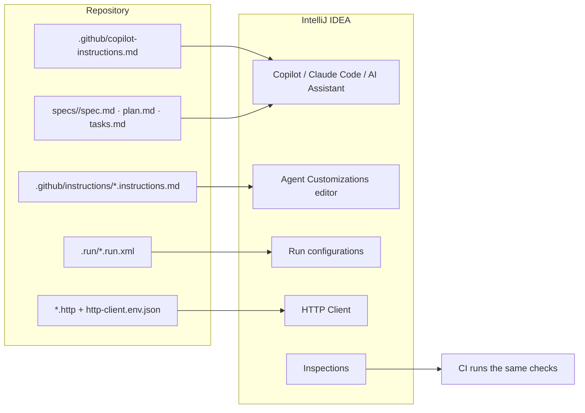
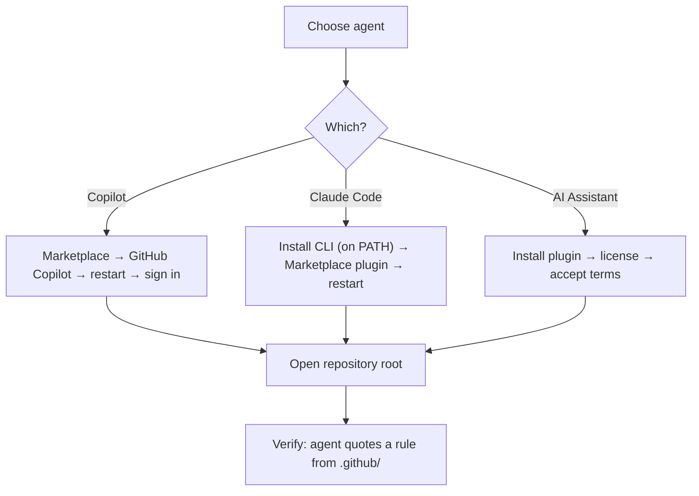
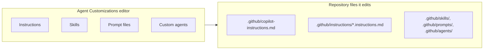
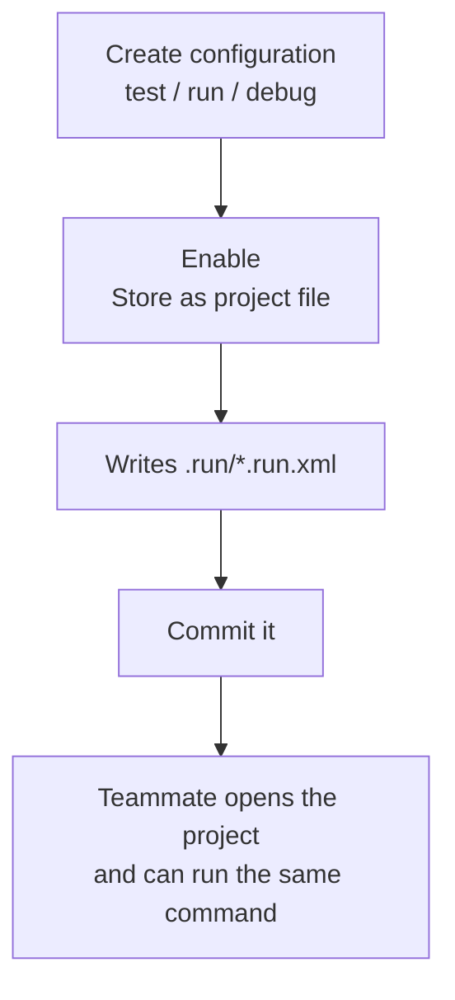
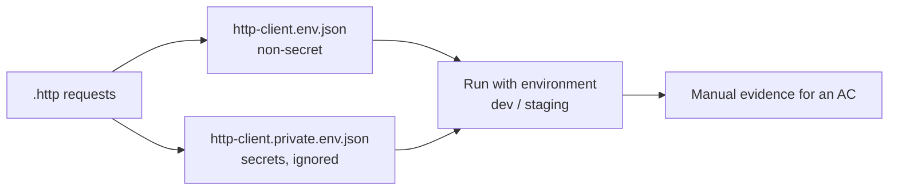
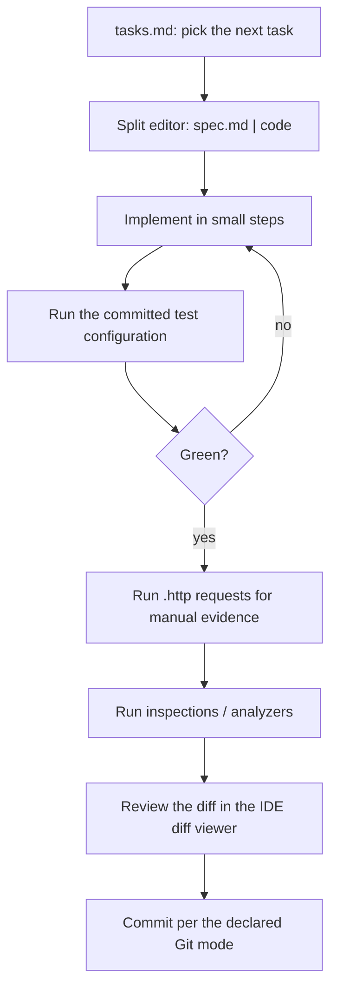

# 30 — IntelliJ IDEA Setup for SDD

> Verified against JetBrains documentation and GitHub Copilot's custom-instructions support
> reference on **2026-11-02**. Applies to IntelliJ IDEA, PyCharm, WebStorm, PhpStorm, GoLand,
> and Android Studio.

---

## 1. Purpose

A complete, verifiable IntelliJ IDEA setup for Spec-Driven Development: the agent reads your
repository rules, the run configurations are shared with the team, and the artifact flow is visible
while you code.



---

## 2. Prerequisites

| Requirement | Notes |
| --- | --- |
| IntelliJ IDEA (or another JetBrains IDE) | Recent version; menu names below are current at time of writing |
| Git | Project must be opened at the repository root |
| A signed-in agent | Copilot subscription, Claude Code CLI + plugin, or JetBrains AI license |
| Project SDK/wrapper | Maven or Gradle wrapper committed (`./mvnw`, `./gradlew`) |

---

## 3. Install the agent

### 3.1 GitHub Copilot

1. **Settings → Plugins → Marketplace**
2. Search **GitHub Copilot**
3. **Install**, then restart the IDE
4. Sign in with a GitHub account that has Copilot access

### 3.2 Claude Code (verified behavior)

Two separate installations are required:

1. Install the **Claude Code CLI** so `claude` is on `PATH`.
2. Install the **Claude Code** plugin from JetBrains Marketplace, then restart the IDE.

If the plugin shows **"Cannot launch Claude Code"**, the CLI is not discoverable — set the full
path in the plugin's **Claude command** setting.

Upstream lists support for IntelliJ IDEA, PyCharm, Android Studio, WebStorm, PhpStorm, and GoLand.

| Claude Code feature | SDD use |
| --- | --- |
| Quick launch (`Cmd+Esc` / `Ctrl+Esc`) | Open the agent without leaving the editor |
| Diff viewing in the IDE | Review findings against the real diff |
| Selection context sharing | Point the agent at the exact spec section |
| Read deny rules | Keep review sessions away from sensitive files |

### 3.3 JetBrains AI Assistant

Not bundled and not enabled by default. Install the plugin, obtain a JetBrains AI Service license,
and accept the terms — AI Assistant has no access to your code until then.



---

## 4. What IntelliJ Copilot reads (verified)

| File | Support in JetBrains IDEs |
| --- | --- |
| `.github/copilot-instructions.md` | ✅ Repository-wide instructions |
| `.github/instructions/**/*.instructions.md` | ✅ Path-specific instructions |
| Personal instructions | ✅ |
| `.github/skills/`, prompts, custom agents | ✅ via the Agent Customizations editor |

Manage them from the **Agent Customizations** editor: in the Copilot Chat panel, click the settings
icon (top-right), then **Customizations**. It lets you view and edit custom agents, skills, prompt
files, and instructions — for the current project (workspace) or personally across projects.



> **Consequence for teams:** the editor can write those repository files. Treat changes to
> `.github/**` as a reviewed code change and route them through CODEOWNERS.

### 4.1 The files to create

`.github/copilot-instructions.md` (all three IDEs read this):

```markdown
# Repository rules

## Non-negotiables
- Never commit secrets. Use `.env.example` for documented variables.
- Read the relevant `specs/<id>/spec.md` before changing behavior.
- Every behavior change needs a test that fails before and passes after.
- Do not add a dependency without an ADR.

## Commands
- Build: `./mvnw -q -DskipTests package`
- Test: `./mvnw -q verify`
- Static analysis: `./mvnw -q spotbugs:check checkstyle:check pmd:check`

## Boundaries
- Handlers in `src/main/java/**/api` must not import `infrastructure`.
- Domain types in `src/main/java/**/domain` have no framework imports.
```

`.github/instructions/tests.instructions.md`:

```markdown
---
applyTo: "src/test/**"
---
# Test rules
- One behavior per test; name it after the acceptance criterion where possible.
- Use Testcontainers for integration tests; never H2 for query behavior.
- No `Thread.sleep`; use Awaitility or a latch.
- A new test must fail on the base commit.
```

---

## 5. Run configurations: share them with the team

IntelliJ stores run/debug configurations either in the workspace (`.idea/`) or as **project files**
you can commit.

1. **Run → Edit Configurations…**
2. Select the configuration (test, application, static analysis)
3. Enable **Store as project file**, choose a location
4. Commit the resulting `.run/*.run.xml`



If `.idea/` is ignored, share only run configurations:

```gitignore
/.idea/*
!/.idea/runConfigurations/
```

With `Store as project file`, the configuration is not submitted automatically — you must check the
file in.

### 5.1 Recommended configurations

| Configuration | Purpose | Evidence it produces |
| --- | --- | --- |
| `test-unit` | `./mvnw -q test` | Unit test results |
| `test-integration` | `./mvnw -q verify` | Integration results (Failsafe) |
| `static-analysis` | SpotBugs + Checkstyle + PMD | Static findings |
| `app-local` | Spring Boot run profile | Manual API checks |
| `perf-export` | k6/Gatling script | NFR numbers |

> Keep one configuration per verification command named in your spec. That is what makes the
> evidence reproducible for a teammate on a fresh clone.

---

## 6. HTTP Client: executable API evidence

IntelliJ's HTTP Client runs `.http` and `.rest` files with completion, folding, and environment
variables; completion works for endpoints defined via OpenAPI.

`specs/SDD-142/orders.http`:

```http
### AC-1.1 authorized export returns CSV
GET {{host}}/projects/{{projectId}}/orders/export
Authorization: Bearer {{viewerToken}}

### AC-1.2 forbidden export writes no CSV bytes
GET {{host}}/projects/{{otherProjectId}}/orders/export
Authorization: Bearer {{viewerToken}}
```

`http-client.env.json` (commit — no secrets):

```json
{
  "dev": {
    "host": "http://localhost:8080",
    "projectId": "11111111-1111-1111-1111-111111111111",
    "otherProjectId": "22222222-2222-2222-2222-222222222222"
  },
  "staging": {
    "host": "https://staging.example.com"
  }
}
```

`http-client.private.env.json` (**never commit**):

```json
{
  "dev": { "viewerToken": "<local token>" }
}
```



> HTTP files are **manual verification**. Keep automated assertions in the test suite
> ([chapter 20](./20-testing-and-verification.md)).

---

## 7. Project setup per stack

### 7.1 Java / Kotlin (Maven or Gradle)

| Setting | Where | Why |
| --- | --- | --- |
| Project SDK | Project Structure → Project | Must match the spec's runtime |
| Build tool wrapper | Settings → Build Tools → Maven/Gradle | Use `./mvnw`/`./gradlew`, not a bundled distribution |
| Code style | Settings → Editor → Code Style | Match `.editorconfig` |
| Inspections | Settings → Editor → Inspections | Surface static findings before review |
| Compiler | Settings → Build → Compiler | Consistent warnings policy with CI |

Verify the wrapper is the source of truth:

```bash
./mvnw -version
./mvnw -q -DskipTests compile
```

> If IntelliJ uses its bundled Maven instead of the wrapper, the agent can compile against a
> different plugin set than CI. Set **Maven → Maven home path** to the wrapper.

### 7.2 Python

| Setting | Value |
| --- | --- |
| Interpreter | The `uv`-managed virtual environment (`.venv`) |
| Test runner | pytest, with the project's `pyproject.toml` |
| Type checker | mypy or Pyright-plugin, matching CI strictness |

```bash
uv sync --frozen --all-groups
uv run pytest -q
```

> Do not let the IDE create a second virtualenv. Point the interpreter at the one the project uses.

### 7.3 Node / TypeScript

| Setting | Value |
| --- | --- |
| Node interpreter | Project Node from `.nvmrc`/`engines` |
| Package manager | pnpm/npm/yarn — the one with the committed lockfile |
| ESLint | Automatic configuration |
| Prettier | Automatic, matching `.prettierrc` |

### 7.4 Go

| Setting | Value |
| --- | --- |
| GOROOT | Leave to the IDE; verify `go version` matches `go.mod` |
| Vendoring | Honor `vendor/` if present |
| Linter | `staticcheck`/`golangci-lint` integration |

---

## 8. Working the SDD loop inside the IDE



| Artifact | Where to keep it visible in IntelliJ |
| --- | --- |
| `spec.md` | Editor tab pinned next to the code |
| `tasks.md` | Second editor split |
| `plan.md` / ADR | Bookmark or scratch reference |
| `.http` files | Run window |
| Verification report | Commit as `specs/<id>/verification.md` |

> **Local History is not a backup.** It can recover an accidental edit, but it is not a reviewed,
> shared record. Commit per your declared mode.

---

## 9. Verification

```text
In Copilot Chat (or Claude Code), ask:
1. "Which instruction files apply to src/test/java?"
2. "What is the test command, and where is it defined?"
3. "Summarize the acceptance criteria for SDD-142."
4. "Which files does task T-04 expect to touch?"
```

| Expected | Verdict |
| --- | --- |
| Names `.github/instructions/tests.instructions.md` and quotes it | ✅ |
| Quotes `./mvnw -q verify` from the instruction file or run configuration | ✅ |
| Lists AC-1.1 … AC-4.2 from `spec.md` | ✅ |
| Gives generic advice | ❌ Rules not loaded |
| Cannot find `specs/` | ❌ Project opened at a subdirectory |

Also confirm the shared configuration works from a clean clone:

```bash
git clone <repo> /tmp/sdd-check
cd /tmp/sdd-check
./mvnw -q verify
```

---

## 10. Troubleshooting

| Symptom | Cause | Fix |
| --- | --- | --- |
| Agent ignores repository rules | Project opened below the repo root | Open the folder containing `.github/` |
| Rules apply to everything | Wrong `applyTo` glob | Test the pattern against real paths |
| Claude Code: "Cannot launch Claude Code" | `claude` not on `PATH` | Set the full path in the plugin's Claude command setting |
| Run configuration missing for a teammate | Not stored as project file | Enable **Store as project file**, commit `.run/` |
| `.idea/` churn in diffs | Ignore rules incomplete | `/.idea/*` + `!/.idea/runConfigurations/` |
| HTTP request fails only in the IDE | Environment not selected | Pick `dev`/`staging` in the `.http` editor |
| Secret committed | Private env file not used | Move to `http-client.private.env.json`, rotate the secret |
| Maven builds use a different version than CI | IDE bundled Maven | Point Maven home at the wrapper |
| Inspections differ from CI | Different profile | Move the authoritative rules into CI config |

---

## 11. Security considerations

| Risk | Control |
| --- | --- |
| Tokens in `http-client.env.json` or run configurations | Use the private env file; never commit |
| Agent rewrites `.github/**` rules | CODEOWNERS review; protect the branch |
| Plugin from an unverified publisher | Install from JetBrains Marketplace, verify publisher |
| MCP server with write access | Grant per role; read-only for review |
| Workspace trust prompt ignored | Only open trusted repositories |
| Local History mistaken for audit | Use commits and review reports |

---

## 12. Official references

- Copilot custom instructions support by environment — <https://docs.github.com/en/copilot/reference/custom-instructions-support>
- IntelliJ IDEA: run/debug configurations and sharing — <https://www.jetbrains.com/help/idea/run-debug-configuration.html>
- IntelliJ IDEA: HTTP client — <https://www.jetbrains.com/help/idea/http-client-in-product-code-editor.html>
- JetBrains AI Assistant — <https://www.jetbrains.com/help/idea/ai-assistant.html>
- Claude Code in JetBrains IDEs — <https://docs.claude.com/en/docs/claude-code/jetbrains>
- JetBrains Marketplace: GitHub Copilot — <https://plugins.jetbrains.com/plugin/17718-github-copilot>
- IntelliJ IDEA: Maven wrapper and build tools — <https://www.jetbrains.com/help/idea/maven-support.html>

---

**Previous:** [29 — IDE setup overview](./29-ide-setup.md) ·
**Next:** [31 — VS Code](./31-ide-vscode.md)
