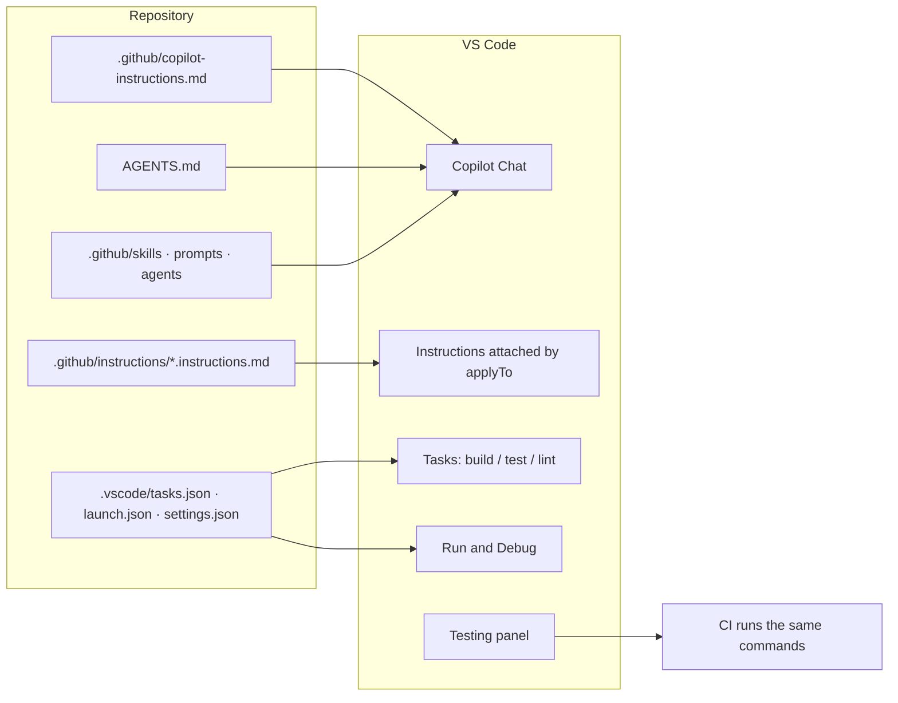
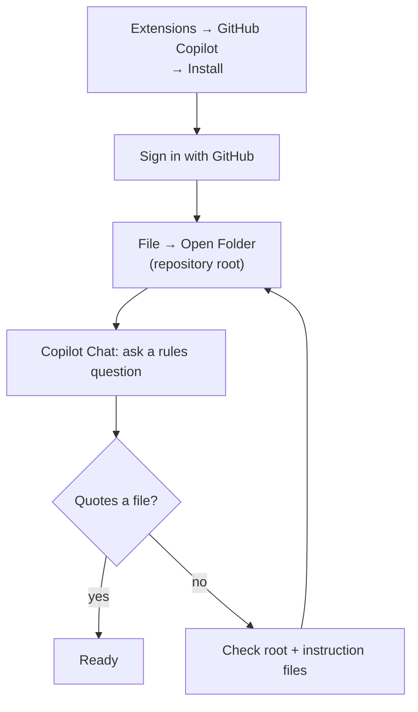
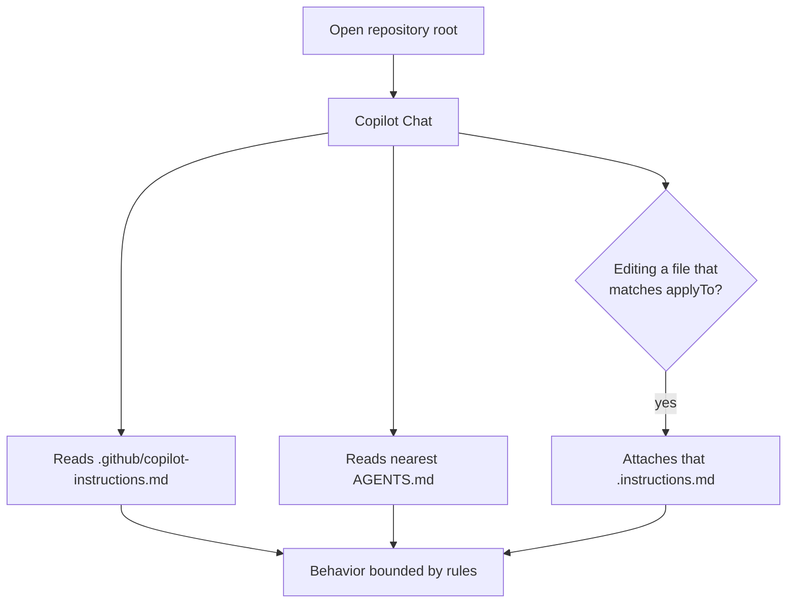
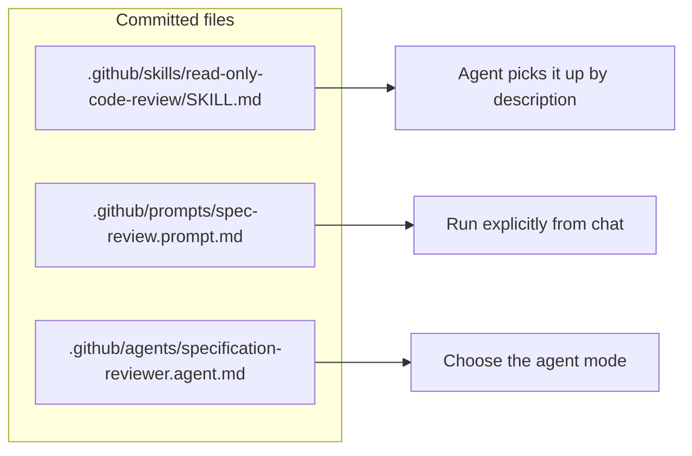
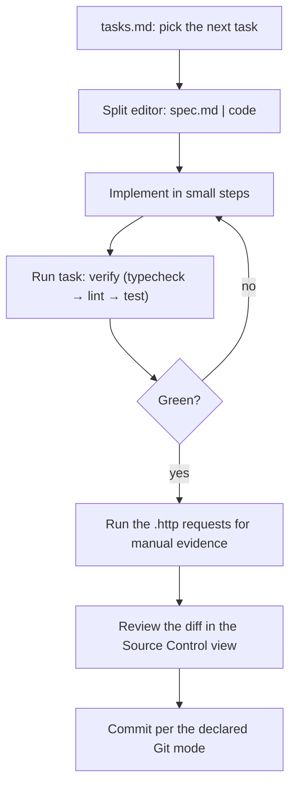

# 31 — Visual Studio Code Setup for SDD

> Verified against VS Code and GitHub Copilot documentation on **2026-11-02**. Menu labels change
> between releases; the file paths and front-matter keys in this chapter are the durable contract.

---

## 1. Purpose

A complete, verifiable VS Code setup for Spec-Driven Development: the agent reads your repository
rules, the workspace tasks reproduce the spec's commands, and the artifact flow stays visible while
you code.



---

## 2. Prerequisites

| Requirement | Notes |
| --- | --- |
| VS Code | Current stable |
| GitHub Copilot extension | Signed in with a Copilot-enabled account |
| Git | Workspace opened at the repository root |
| Project toolchain | Node/Python/JDK/.NET/Go as required by the repository |

---

## 3. Install and sign in

1. Open the **Extensions** view (`Cmd/Ctrl+Shift+X`).
2. Install **GitHub Copilot**.
3. Sign in when prompted (or **Accounts** → sign in with GitHub).
4. Open the **repository root**: **File → Open Folder**.



> **Open the repository root.** If you open a package inside a monorepo, root-level instruction
> files may not resolve.

---

## 4. What Copilot reads in VS Code (verified)

| File | Scope | Support |
| --- | --- | --- |
| `.github/copilot-instructions.md` | Repository-wide | Copilot Chat ✅ |
| `.github/instructions/**/*.instructions.md` | Path-scoped via `applyTo` front matter | Copilot Chat ✅ |
| `AGENTS.md` | Agent instructions | Copilot Chat ✅ (nearest file wins) |
| `CLAUDE.md`, `GEMINI.md` | Agent instructions | Documented in some harness configurations |
| `.github/skills/<name>/SKILL.md` | Reusable procedure | Documented by VS Code ✅ |
| `.github/prompts/*.prompt.md` | Reusable prompt | Documented by VS Code ✅ |
| `.github/agents/*.agent.md` | Custom agent | Documented by VS Code ✅ |



### 4.1 The files to create

`.github/copilot-instructions.md`:

```markdown
# Repository rules

## Non-negotiables
- Never commit secrets. `.env*` is gitignored; document variables in `.env.example`.
- Read `specs/<id>/spec.md` before changing behavior.
- Every behavior change needs a test that fails before and passes after.
- Authorization is enforced server-side; UI checks are UX only.

## Commands
- Install: `pnpm install --frozen-lockfile`
- Test: `pnpm run test`
- Type check: `pnpm run typecheck`
- Lint: `pnpm run lint`

## Evidence
- Quote command output when reporting results.
- Mark unverified claims UNVERIFIED.
```

`.github/instructions/tests.instructions.md`:

```markdown
---
applyTo: "**/*.test.ts,**/*.test.tsx,tests/**"
---
# Test rules
- Assert roles, text, and network behavior — not implementation details.
- One behavior per test.
- No `sleep`; use `findBy*`/`waitFor`.
- A new test must fail before the change.
```

`.github/instructions/api.instructions.md`:

```markdown
---
applyTo: "src/api/**"
---
# API rules
- Validate input with the shared zod schema.
- Map domain errors to status codes in one place.
- No `any`; use `unknown` and narrow.
```

> `applyTo` accepts a glob; multiple patterns can be comma-separated. Verify the pattern by asking
> the agent which instructions it used for a specific file.

---

## 5. Workspace configuration to commit

### 5.1 `settings.json`

Keep it small and team-relevant:

```json
{
  "files.exclude": {
    "**/.git": true,
    "**/node_modules": true,
    "**/dist": true
  },
  "search.exclude": {
    "**/node_modules": true,
    "**/dist": true,
    "**/coverage": true
  },
  "editor.formatOnSave": true,
  "editor.codeActionsOnSave": { "source.fixAll.eslint": "explicit" },
  "typescript.tsdk": "node_modules/typescript/lib"
}
```

> `typescript.tsdk` makes the editor use the project's TypeScript, so the agent and CI agree on
> type errors.

### 5.2 `tasks.json` — the exact commands your spec references

```json
{
  "version": "2.0.0",
  "tasks": [
    {
      "label": "test",
      "type": "shell",
      "command": "pnpm run test",
      "group": { "kind": "test", "isDefault": true },
      "problemMatcher": []
    },
    {
      "label": "typecheck",
      "type": "shell",
      "command": "pnpm run typecheck",
      "problemMatcher": ["$tsc"]
    },
    {
      "label": "lint",
      "type": "shell",
      "command": "pnpm run lint",
      "problemMatcher": ["$eslint-stylish"]
    },
    {
      "label": "verify",
      "dependsOrder": "sequence",
      "dependsOn": ["typecheck", "lint", "test"],
      "group": "build"
    }
  ]
}
```

Run with `Cmd/Ctrl+Shift+B` or **Terminal → Run Task**.

> Replace the commands with the ones that actually work in your repository. A task that fails on a
> clean clone is worse than no task.

### 5.3 `launch.json` — reproducible debugging

```json
{
  "version": "0.2.0",
  "configurations": [
    {
      "name": "api: debug",
      "type": "node",
      "request": "launch",
      "runtimeExecutable": "pnpm",
      "runtimeArgs": ["run", "dev"],
      "console": "integratedTerminal",
      "skipFiles": ["<node_internals>/**"]
    },
    {
      "name": "vitest: current file",
      "type": "node",
      "request": "launch",
      "runtimeExecutable": "pnpm",
      "runtimeArgs": ["exec", "vitest", "run", "${relativeFile}"],
      "console": "integratedTerminal"
    }
  ]
}
```

### 5.4 Java, Python, .NET, Go

| Stack | Extension | What to commit |
| --- | --- | --- |
| Java | Extension Pack for Java | `.vscode/settings.json` with `java.configuration.updateBuildConfiguration` |
| Python | Python + Pylance + Ruff | Interpreter path documented in `CONTRIBUTING.md`; test discovery settings |
| .NET | C# Dev Kit | `tasks.json` using `dotnet`, `launch.json` using the `coreclr` type |
| Go | Go | `gopls` settings; `tasks.json` using `go test ./...` |

> Extension **recommendations** go in `.vscode/extensions.json`; extension **state** does not belong
> in the repository.

---

## 6. Skills, prompts, and custom agents

VS Code documents three reusable file types. Use them to package the handbook's procedures:

| Type | Path | When the agent uses it |
| --- | --- | --- |
| Skill | `.github/skills/<name>/SKILL.md` | Matched from its `description` |
| Prompt | `.github/prompts/<name>.prompt.md` | Invoked explicitly |
| Custom agent | `.github/agents/<name>.agent.md` | Selected as a mode |



Example skill front matter (content from [`prompts/read-only-code-reviewer.md`](./prompts/read-only-code-reviewer.md)):

```markdown
---
name: read-only-code-review
description: Review a git diff without modifying files. Use when asked to review code, a branch, a commit, or a pull request.
---

# Read-only code review

- Do not edit files, run `--fix`, commit, or push.
- Read the diff **and** every caller of the changed symbols.
- Report severity, confidence, `file:line`, evidence, impact, remediation, verification.
- State what you did not verify.
```

> A skill cannot grant permissions. If the host allows writes, "read-only" is advisory
> ([chapter 19](./19-read-only-code-review.md)).

---

## 7. Executable API evidence

VS Code has no built-in `.http` runner, but the REST Client extension executes the same `.http`
format used by IntelliJ and Visual Studio — so the files stay portable.

`specs/SDD-142/orders.http`:

```http
@host = http://localhost:8080

### AC-1.1 authorized export
GET {{host}}/projects/{{projectId}}/orders/export
Authorization: Bearer {{viewerToken}}

### AC-1.2 forbidden export
GET {{host}}/projects/{{projectId}}/orders/export
Authorization: Bearer {{otherToken}}
```

Keep secrets in `.env` (gitignored) or VS Code's settings, never in the `.http` file.

---

## 8. Working the SDD loop inside VS Code



| Artifact | Where to keep it visible |
| --- | --- |
| `spec.md` | Pinned editor tab beside the code |
| `tasks.md` | Second editor group |
| `plan.md` / ADR | Preview tab |
| `.http` files | REST Client output pane |
| Verification | `specs/<id>/verification.md` committed |

### Useful workspace features for SDD

| Feature | Use |
| --- | --- |
| **Search with regex** | Find every consumer of a symbol you are about to change ([chapter 19 §10](./19-read-only-code-review.md)) |
| **Source Control diff** | Review before commit; don't rely on the agent's summary |
| **Timeline view** | Local file history for accidental edits (not a reviewed record) |
| **Problems panel** | Static findings before review |
| **Testing panel** | Run the exact test named as evidence |
| **Dev Containers** | Reproducible toolchain; useful for read-only review sessions |

---

## 9. Verification

```text
In Copilot Chat:
1. "Which instruction files apply to src/api/orders.ts?"
2. "What is the test command, and where is it defined?"
3. "Summarize the acceptance criteria for SDD-142."
4. "Which files does task T-04 expect to touch?"
```

| Expected | Verdict |
| --- | --- |
| Names `.github/instructions/api.instructions.md` and quotes it | ✅ |
| Quotes `pnpm run test` from `tasks.json` or the instruction file | ✅ |
| Lists AC IDs from `spec.md` | ✅ |
| Generic advice | ❌ Rules not loaded |
| Cannot find `specs/` | ❌ Workspace opened below the root |

Confirm the tasks work on a clean clone:

```bash
git clone <repo> /tmp/sdd-vscode && cd /tmp/sdd-vscode
pnpm install --frozen-lockfile
pnpm run verify
```

---

## 10. Troubleshooting

| Symptom | Cause | Fix |
| --- | --- | --- |
| Rules ignored | Workspace opened at a subfolder | Open the repository root |
| Scoped rules apply everywhere | `applyTo` glob too broad | Narrow it; test with a real path |
| Two agents give different answers | Rules duplicated and divergent | One canonical file ([chapter 12](./12-coding-agent-integration.md)) |
| `Tasks: Run Task` missing | No `tasks.json` | Create `.vscode/tasks.json` and commit |
| Type errors differ from CI | Editor uses a bundled TypeScript | Set `typescript.tsdk` |
| Agent edits files during review | No technical enforcement | Use a read-only tool profile |
| Extension prompts for trust | Workspace not trusted | Review the workspace, then trust |
| REST Client not found | Extension not installed | Install REST Client (or keep `.http` for the CI tool) |

---

## 11. Security considerations

| Risk | Control |
| --- | --- |
| Tokens in `settings.json`, `launch.json`, `.http` | Use env vars and a secret store; never commit |
| Workspace trust ignored | Only open trusted folders; restrict tasks |
| Extension from an unverified publisher | Verify publisher and reviews |
| MCP server with write access | Grant per role; read-only for review |
| Agent edits `.github/**` | CODEOWNERS + branch protection |
| Dev Container with repo secrets | Scope secrets to the container, not the image |

---

## 12. Official references

- VS Code: custom instructions — <https://code.visualstudio.com/docs/copilot/customization/custom-instructions>
- VS Code: agent skills — <https://code.visualstudio.com/docs/copilot/customization/agent-skills>
- VS Code: custom agents — <https://code.visualstudio.com/docs/copilot/customization/custom-agents>
- VS Code: tasks — <https://code.visualstudio.com/docs/editor/tasks>
- VS Code: debugging — <https://code.visualstudio.com/docs/debugtest/debugging>
- VS Code: testing — <https://code.visualstudio.com/docs/debugtest/testing>
- VS Code: dev containers — <https://code.visualstudio.com/docs/devcontainers/containers>
- Copilot custom instructions support by environment — <https://docs.github.com/en/copilot/reference/custom-instructions-support>
- REST Client extension — <https://marketplace.visualstudio.com/items?itemName=humao.rest-client>

---

**Previous:** [30 — IntelliJ IDEA](./30-ide-intellij.md) ·
**Next:** [32 — Visual Studio](./32-ide-visual-studio.md)
