# 34 — Simple Project Examples: Six Ways to Run SDD

> Six complete, comparable implementations of **the same small feature** under SDD. They differ in
> tooling and autonomy, not in discipline. Commands are illustrative of the documented tool
> interfaces; the artifact shapes are what matters.

---

## 1. The product

One small, honest feature so the approaches are comparable:

```text
"Build a small expense tracker: add an expense (amount, category, note, date),
list expenses for a month, and show the monthly total."
```

That is small enough to finish in a day and large enough to have real requirements: validation,
money rounding, time zones, empty months, and an authorization story if more than one user exists.

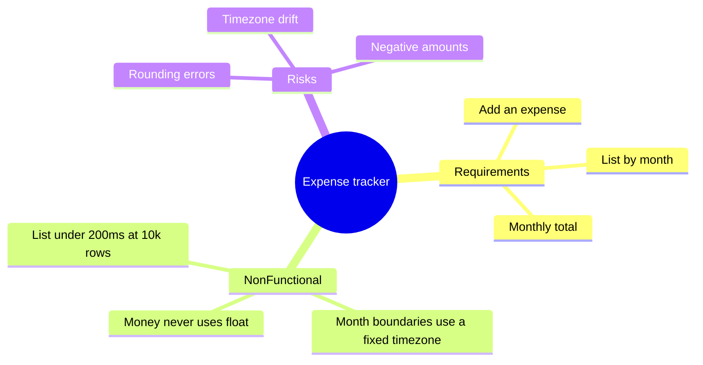

### The shared specification (used by every approach)

```markdown
## FR-1 Add an expense
Given amount (integer cents > 0), category (enum), note (≤ 200 chars), date (ISO 8601),
when the user submits, then an expense is stored and returned with an id.

AC-1.1 Amounts are stored as integer cents; the API never accepts or returns floats.
AC-1.2 amount ≤ 0 → 422 with the offending field.
AC-1.3 note > 200 chars → 422.
AC-1.4 date in the future by more than 1 day → 422.

## FR-2 List a month
GET /expenses?month=2026-11 returns expenses in that month, ordered by date then id.

AC-2.1 Month boundaries are computed in the configured timezone (default UTC).
AC-2.2 An empty month returns 200 with an empty list.

## FR-3 Monthly total
AC-3.1 total = sum of amounts in the month, returned as integer cents.
AC-3.2 total for an empty month is 0.

## NFR-1
p95 list latency < 200 ms at 10,000 expenses, measured with the committed benchmark.
```

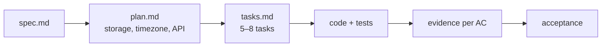

---

## 2. Choosing an approach

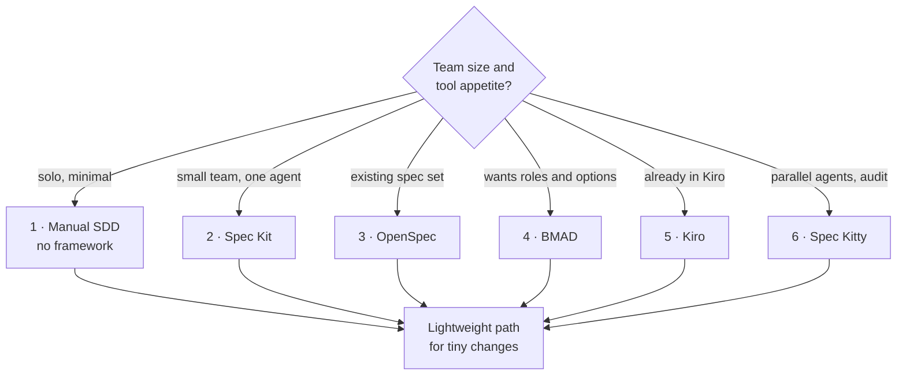

| # | Approach | Setup cost | Artifact overhead | Best for |
| --- | --- | --- | --- | --- |
| 1 | **Manual SDD** | None | You write every file | Learning the discipline; teams avoiding new tooling |
| 2 | **Spec Kit** | `uv` + CLI | Constitution + 5 artifacts | Teams that want gates and multi-agent support |
| 3 | **OpenSpec** | Node or install script | Change folder + delta spec | Evolving an existing spec set |
| 4 | **BMAD** | Node + `uv` | Right-sized planning docs | Teams wanting role-based planning |
| 5 | **Kiro** | Product install | 3 files per spec | Teams already standardized on Kiro |
| 6 | **Spec Kitty** | Python CLI + Git | Missions + work packages | Parallel agents and named audit trails |

> **All six produce the same three things:** a testable spec, a task list traceable to it, and
> evidence per acceptance criterion. Everything else is ergonomics.

---

## 3. Approach 1 — Manual SDD (no framework)

**Best for:** learning SDD, or a team that refuses new dependencies. This is the baseline every
other approach adds tooling on top of.

### 3.1 Layout

```text
expense-tracker/
├── AGENTS.md
├── docs/adr/0001-integer-cents.md
├── specs/EXP-1/
│   ├── spec.md
│   ├── plan.md
│   ├── tasks.md
│   └── verification.md
├── src/
└── tests/
```

### 3.2 Steps

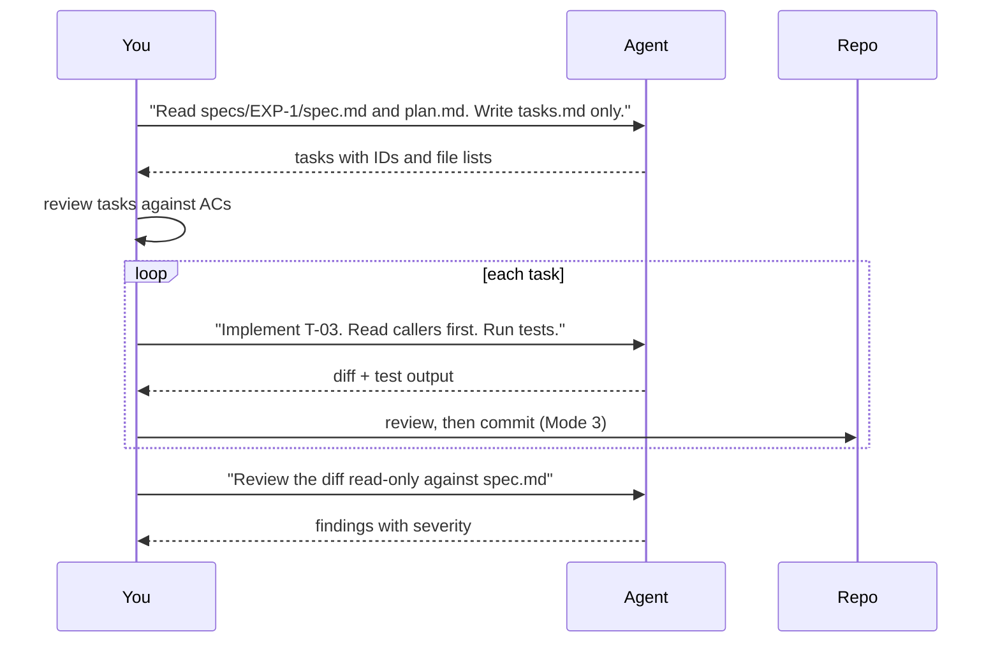

```bash
# 1. Write the artifacts yourself (or with the agent), review them, then:
git switch -c feat/EXP-1-expense-tracker

# 2. Implement one task at a time
#    Prompt: "Implement T-02 (money type + validation). Files: src/money.py, tests/test_money.py.
#             Read the existing validation module first. Run pytest -q and paste the summary."

# 3. Verify
uv run pytest -q
uv run ruff check . && uv run mypy src

# 4. Read-only review
#    Prompt: "Use prompts/read-only-code-reviewer.md against origin/main...HEAD."
```

### 3.3 Agent rules (the minimum that works)

`AGENTS.md`:

```markdown
## Rules
- Money is integer cents. Never float, never `Decimal` in the API.
- Month boundaries use the configured timezone; never `date.today()` in domain code.
- Every endpoint test asserts status and body.
- Do not commit or push. Leave the diff for review.
- Evidence or it did not happen: paste the command and its summary line.
```

### 3.4 What you get

| Artifact | Value |
| --- | --- |
| `spec.md` | The contract; readable by anyone |
| `tasks.md` | Small steps, each mapped to FR/AC |
| `verification.md` | AC → evidence table |
| Review report | Severity-ranked findings |

**Cost:** ~4–6 hours of your own writing and review.
**Risk:** you carry the discipline yourself; nothing enforces it.

---

## 4. Approach 2 — GitHub Spec Kit

**Best for:** teams that want a structured pipeline with optional quality gates and support for
many agents.

### 4.1 Setup

```bash
uv tool install specify-cli
specify init expense-tracker --integration copilot
cd expense-tracker
specify version
```

### 4.2 Pipeline

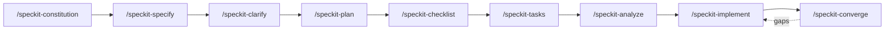

### 4.3 The actual prompts

```text
/speckit-constitution Money is always integer cents. Month boundaries use a configured
timezone. Every endpoint test asserts status and body. Prefer the standard library.

/speckit-specify Build a small expense tracker: add an expense (amount, category, note, date),
list expenses for a month, and show the monthly total. Single user, no authentication.

/speckit-clarify Focus on: month boundary timezone, maximum note length, and whether
zero or negative amounts are allowed.

/speckit-plan Python 3.12 with FastAPI and SQLite via SQLAlchemy 2.0. Integer cents everywhere.
No new dependencies beyond the ones already present. Include a benchmark for NFR-1.

/speckit-checklist Focus on money handling, timezone boundaries, and empty-month behavior.

/speckit-tasks
/speckit-analyze
/speckit-implement Implement only the Setup and Foundational phases first.
/speckit-converge
```

### 4.4 Artifacts produced

```text
expense-tracker/
├── .specify/
│   ├── memory/constitution.md
│   ├── templates/
│   ├── scripts/
│   └── feature.json
└── specs/001-expense-tracker/
    ├── spec.md
    ├── plan.md
    ├── tasks.md
    ├── research.md
    └── checklists/requirements.md
```

| Gate | What it catches in this project |
| --- | --- |
| `/speckit-clarify` | "Month" means what in the user's timezone? |
| `/speckit-checklist` | Missing AC for negative amounts |
| `/speckit-analyze` | A task with no matching requirement |
| `/speckit-converge` | The benchmark for NFR-1 was never run |

**Cost:** ~1 hour setup + the writing you would do anyway.
**Risk:** generated command files must not be hand-edited; use presets/overrides.

---

## 5. Approach 3 — OpenSpec (brownfield delta)

**Best for:** a project that already has behavior and specs, where a change should be a *delta*.

### 5.1 Setup

```bash
cd expense-tracker
openspec init
openspec validate --all
```

### 5.2 The delta workflow

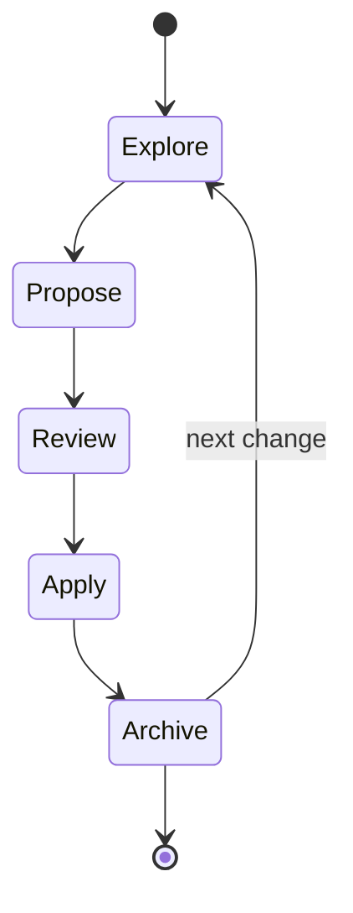

```text
# 1. Explore (no code)
Help me explore how monthly totals should handle a timezone change mid-year.

# 2. Propose
Propose a change to add monthly totals to the expense tracker.

# 3. Review the generated folder
openspec/changes/add-monthly-totals/
├── proposal.md
├── specs/          # ADDED/MODIFIED requirements
├── design.md
└── tasks.md

# 4. Apply in a fresh session
Apply the add-monthly-totals change.

# 5. Verify and archive
openspec validate add-monthly-totals --strict
openspec archive add-monthly-totals
```

### 5.3 What the delta looks like

```markdown
## ADDED Requirements

### Requirement: Monthly total
The API SHALL return the sum of expense amounts for a requested month as integer cents.

#### Scenario: Month with expenses
- **WHEN** the user requests `GET /expenses?month=2026-11`
- **THEN** the response includes `totalCents` equal to the sum of that month's amounts

#### Scenario: Empty month
- **WHEN** the month has no expenses
- **THEN** `totalCents` is `0` and the list is empty
```

**Why this approach shines here:** the first change (add/list) is archived into `openspec/specs/`.
The second change (totals) is a delta against real, current truth — not a rewrite.

**Cost:** ~15 minutes setup.
**Risk:** stores/worksets are beta; keep multi-repo adoption in a pilot.

---

## 6. Approach 4 — BMAD Method (right-sized planning)

**Best for:** teams that want product/architecture/QA roles and a choice of planning depth.

### 6.1 Setup

```bash
npx bmad-method install
```

Then, in the agent:

```text
bmad-help I want to build a small expense tracker as an exercise. What is the smallest safe path?
```

### 6.2 Path selection

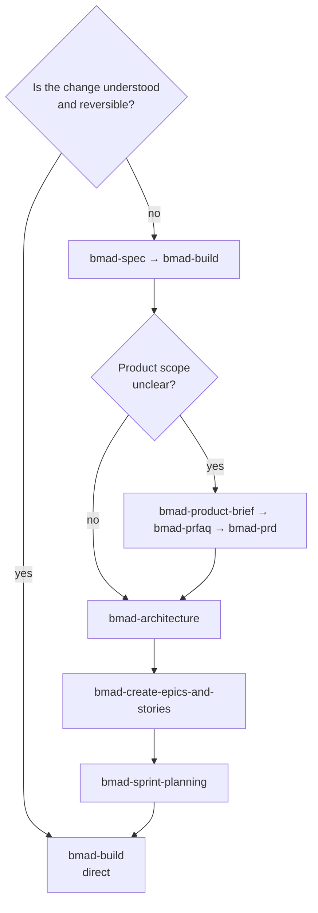

### 6.3 The shallow path (what this project needs)

```text
bmad-spec Add an expense (integer cents), list by month, monthly total.
           Timezone-aware month boundaries. FastAPI + SQLite.

bmad-build Implement the spec. Read the existing repository first.

bmad-code-review
bmad-walkthrough
```

### 6.4 The deeper path (if it were a real product)

```text
bmad-product-brief  Finance-adjacent users need quick expense capture with monthly summaries.
bmad-prd
bmad-architecture   Single service, SQLite, integer cents, timezone config.
bmad-create-epics-and-stories
bmad-sprint-planning
bmad-build
bmad-retrospective
```

**Cost:** shallow path ~30 minutes; deep path adds a day of planning.
**Risk:** v7 is preview alpha; use v6.12.x for audited work.

---

## 7. Approach 5 — Kiro (integrated specs)

**Best for:** teams already working in Kiro, who want specs, steering, and hooks in one product.

### 7.1 Setup

1. Open the repository in Kiro.
2. Generate steering documents: `product.md`, `tech.md`, `structure.md` in `.kiro/steering/`.
3. Review the generated steering against the actual code — it is a draft, not a fact.

### 7.2 Flow


### 7.3 Example requirement block

```markdown
### Requirement 2 — Monthly total
**User story:** As a user, I want a monthly total so I can see what I spent.

#### Acceptance criteria
1. WHEN I request a month, THE system SHALL return `totalCents` as an integer.
2. WHEN the month is empty, THE system SHALL return `0`.
3. WHEN the month crosses a timezone boundary, THE system SHALL use the configured timezone.
```

### 7.4 A hook that enforces the discipline

`.kiro/hooks/lint-on-save.json`:

```json
{
  "version": "v1",
  "hooks": [
    {
      "name": "Lint Python on save",
      "trigger": "PostFileSave",
      "matcher": "\\.py$",
      "action": { "type": "command", "command": "uv run ruff check --fix" }
    }
  ]
}
```

**Cost:** minutes if you already use Kiro.
**Risk:** proprietary; surface capabilities differ (e.g. correctness analysis is IDE-only).

---

## 8. Approach 6 — Spec Kitty (parallel work packages)

**Best for:** several agents or developers working at once, with an auditable acceptance trail.

### 8.1 Setup

```bash
pipx install spec-kitty-cli
spec-kitty init expense-tracker --ai claude
cd expense-tracker
spec-kitty verify-setup
```

### 8.2 The mission

```text
/spec-kitty.charter
/spec-kitty.specify Build a small expense tracker with integer cents and monthly totals.
/spec-kitty.plan
/spec-kitty.tasks
```

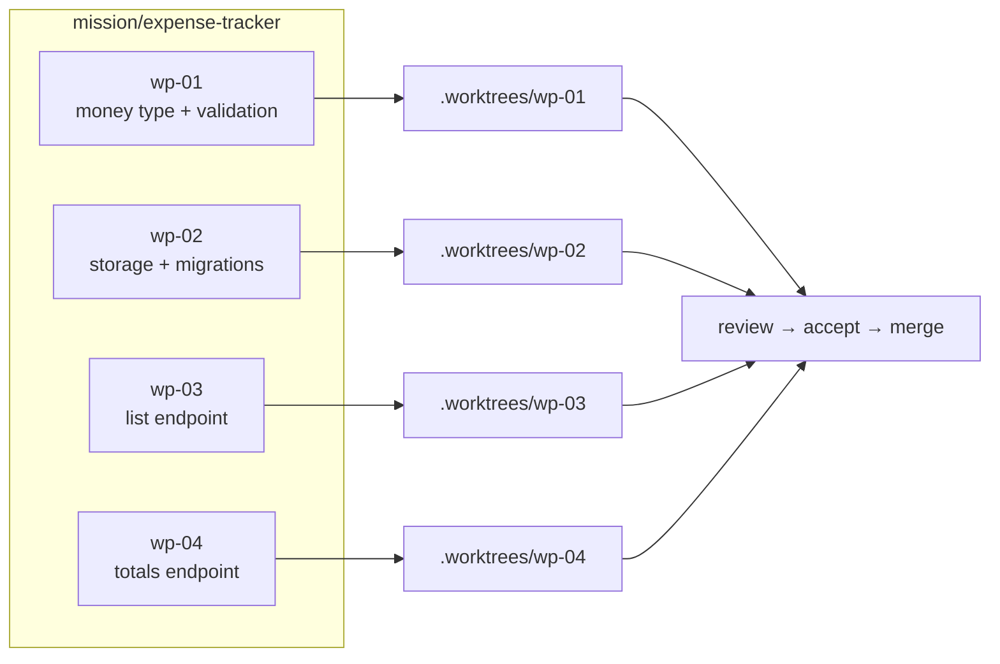

```bash
spec-kitty next --agent claude --mission expense-tracker
spec-kitty agent tasks status
spec-kitty agent tasks status --json
```

```text
/spec-kitty.review
/spec-kitty.accept
/spec-kitty.merge --push
/spec-kitty-mission-review
```

### 8.3 Which work packages can run in parallel

| Work package | Depends on | Files |
| --- | --- | --- |
| `wp-01` money + validation | — | `src/money.py`, `tests/test_money.py` |
| `wp-02` storage + migration | — | `src/store.py`, `migrations/` |
| `wp-03` list endpoint | wp-01, wp-02 | `src/api.py`, `tests/test_list.py` |
| `wp-04` totals endpoint | wp-01, wp-02 | `src/api.py`, `tests/test_totals.py` |

> `wp-03` and `wp-04` both touch `src/api.py`. Either give them disjoint files, or serialize them.
> Parallelism is only safe when file ownership is disjoint ([chapter 24 §9](./24-multi-agent-engineering.md)).

**Cost:** highest setup; needs Git worktrees and disk.
**Risk:** overkill for a one-day project — this is the "governed factory" option.

---

## 9. The lightweight path: when you should not do any of the above

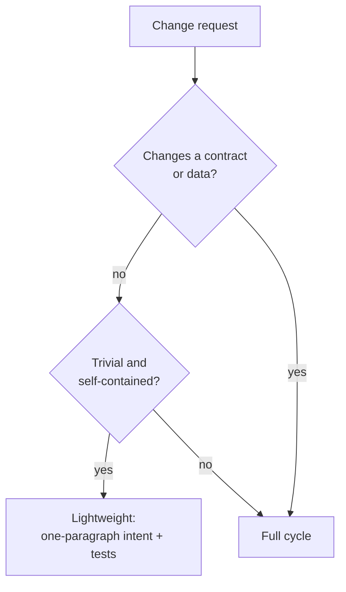

A one-line bug fix does not need a constitution:

```markdown
# Fix: monthly total ignores negative adjustments

Repro: add -500 and 1000 in one month → total shows 1000, expected 500.
Cause (verified): `sum()` over `amounts` filters `amount > 0` (src/totals.py:31).
Fix: remove the filter; add a regression test asserting -500 + 1000 = 500.
Evidence: `pytest tests/test_totals.py::test_negative_adjustment` fails before, passes after.
```

That is a complete specification for a defect: symptom, reproduction, cause, fix, evidence.

---

## 10. Comparing the six on the same project

| Dimension | Manual | Spec Kit | OpenSpec | BMAD | Kiro | Spec Kitty |
| --- | --- | --- | --- | --- | --- | --- |
| Time to first artifact | 15 min | ~1 h | 30 min | 30 min | 20 min | 1–2 h |
| Files added to repo | ~5 | ~10 + `.specify/` | ~6 + `openspec/` | ~8 | ~6 | ~10 + worktrees |
| Enforces a spec exists | ❌ | ⚠️ advisory | ⚠️ advisory | ❌ | ⚠️ UI gate | ✅ lanes |
| Read-only analysis built in | ❌ | ✅ analyze | ✅ validate | ⚠️ review skill | ✅ requirements analysis | ✅ review lane |
| Change-history model | Git only | Feature dirs | Delta + archive | Epics/stories | Spec versions | Missions |
| Parallel agents | Manual | Marked tasks | Manual | `bmad-loop` module | Waves | Worktrees |
| Best for this project | Learning | Team adoption | Existing specs | Role clarity | Kiro users | Audited parallel work |

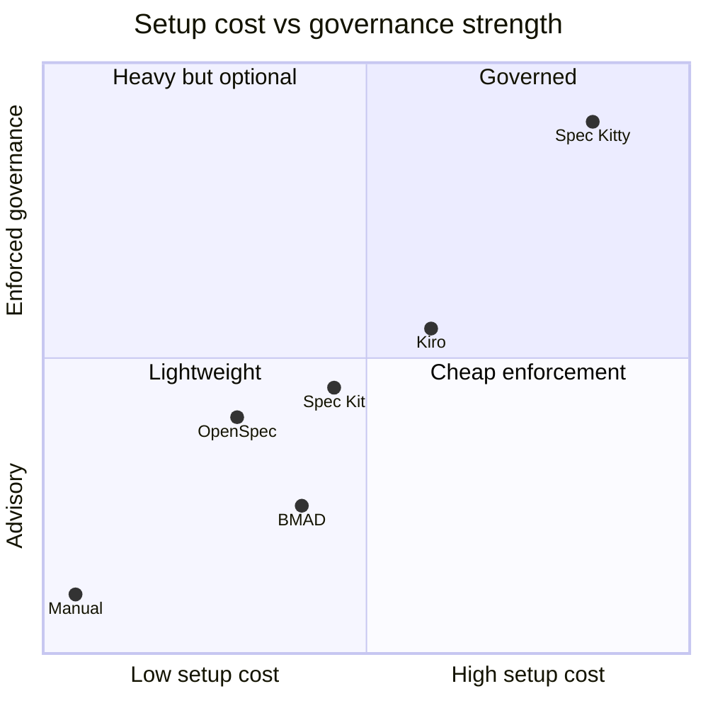

Coordinates are an author assessment for orientation, not measured data.

---

## 11. What every approach must still do

The tool does not remove any of these obligations.

| Obligation | Why it survives every approach |
| --- | --- |
| Acceptance criteria are testable | No tool can infer your definition of done |
| Money is integer cents | A tool cannot know your domain's failure modes |
| Timezone is explicit | Ambiguity here is a production defect |
| Tests run and output is quoted | Evidence is not a document |
| Review is independent | Self-review rationalizes |
| Deviations are recorded | Silent changes destroy trust |
| Unverified items are labelled | Otherwise the report is fiction |

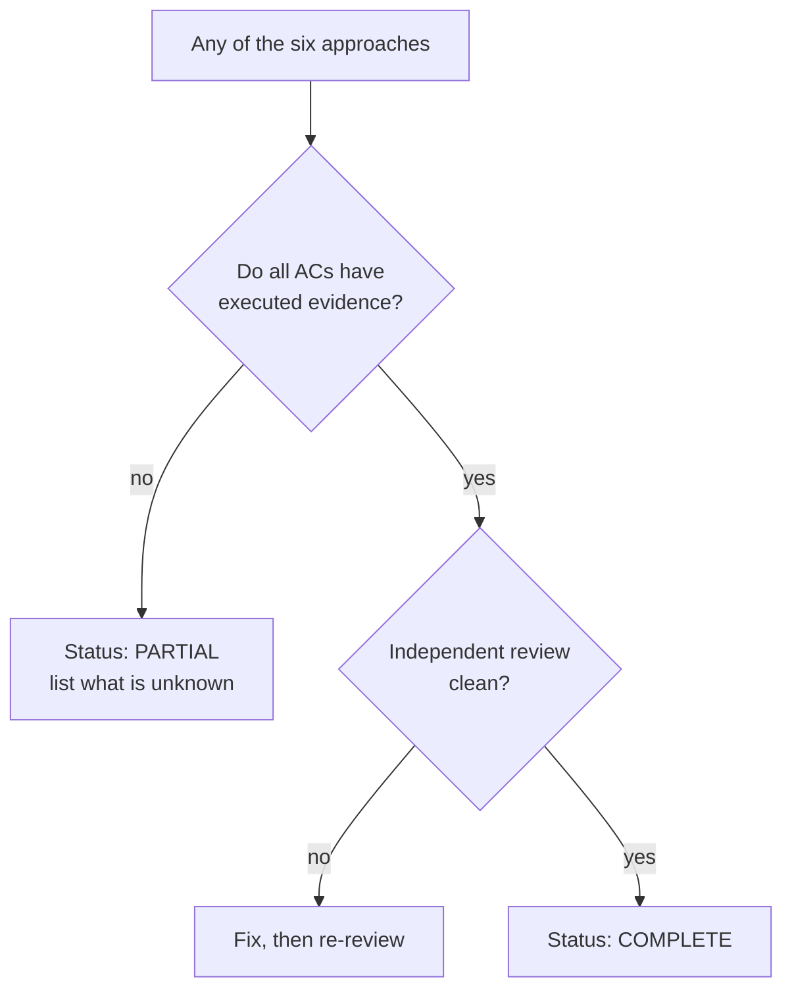

---

## 12. Recommended progression

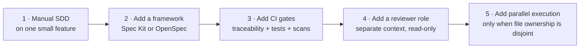

| Step | Trigger to move on |
| --- | --- |
| Manual → framework | You repeat the same artifact structure by hand |
| Framework → CI gates | A change merges without evidence |
| CI gates → reviewer role | Review findings are shallow or self-approved |
| Reviewer role → parallel | Work is blocked on a single agent's throughput |

---

## 13. Official references

- [Chapter 14 — Feature development](./14-feature-development.md)
- [Chapter 30 — IntelliJ IDEA](./30-ide-intellij.md) · [31 — VS Code](./31-ide-vscode.md) · [32 — Visual Studio](./32-ide-visual-studio.md)
- [Chapter 33 — End-to-end walkthrough](./33-end-to-end-walkthrough.md)
- [05 Spec Kit](./05-github-spec-kit.md) · [06 OpenSpec](./06-openspec.md) · [07 Kiro](./07-aws-kiro.md) · [08 BMAD](./08-bmad-method.md) · [09 Spec Kitty](./09-spec-kitty.md)
- [templates/feature-spec.md](./templates/feature-spec.md) · [templates/verification-report.md](./templates/verification-report.md)

---

**Previous:** [33 — End-to-end walkthrough](./33-end-to-end-walkthrough.md) ·
**Next:** [35 — Confluence publishing](./35-confluence-publishing.md)
