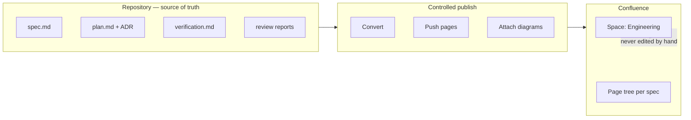
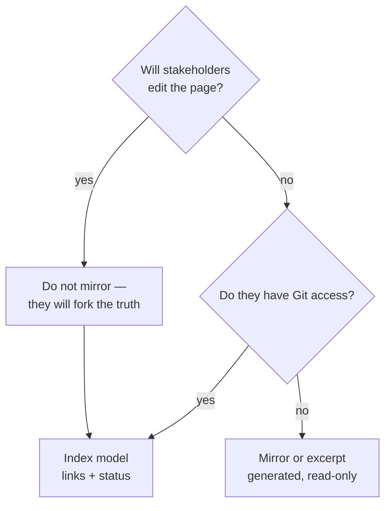
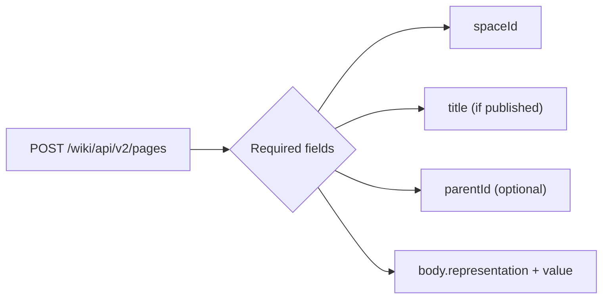
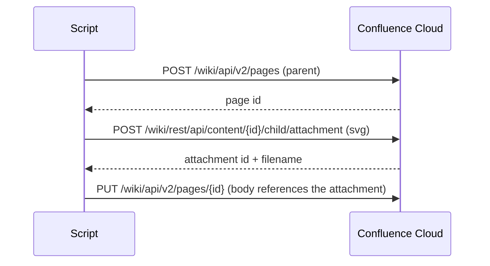
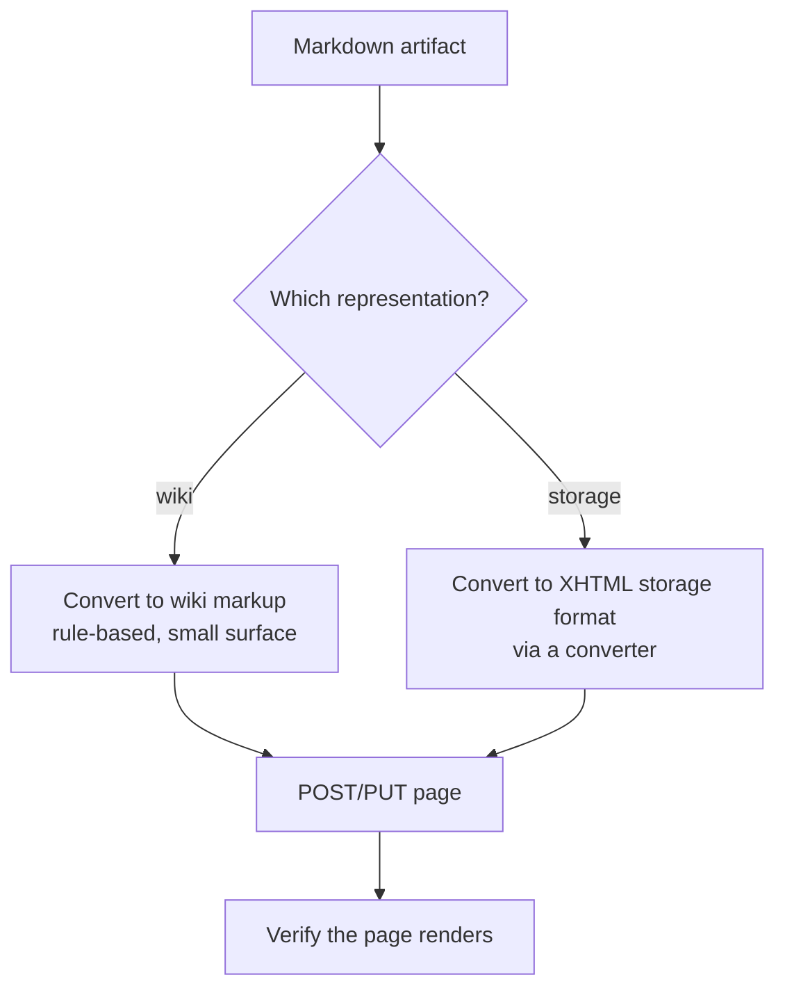
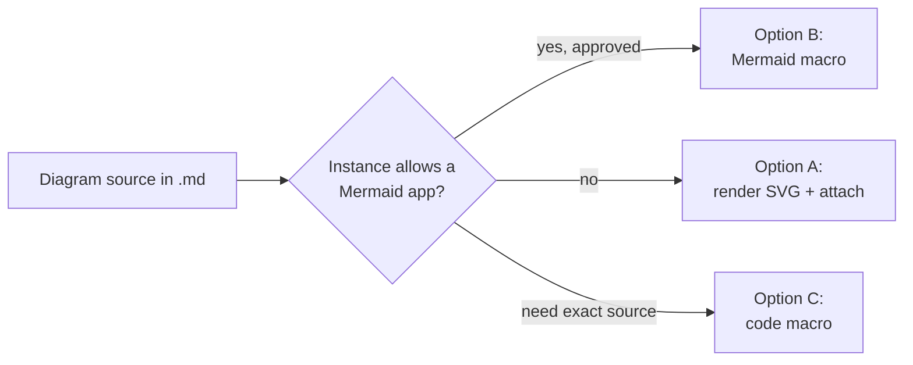
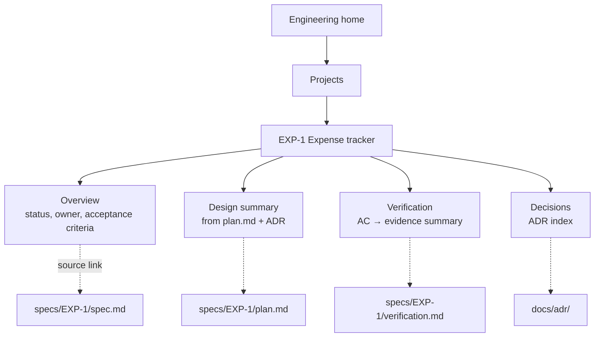
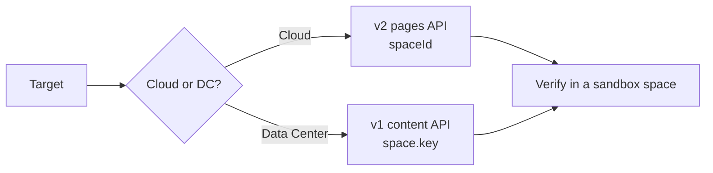
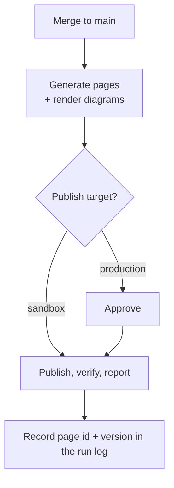
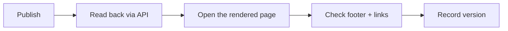

# 35 — Publishing SDD Documentation to Confluence

> Verified against the **Confluence Cloud REST API v2** OpenAPI specification
> (`developer.atlassian.com/cloud/confluence/openapi-v2.json`) and the **v1** specification, on
> **2026-11-02**. Confluence Server/Data Center differs in URL shape and authentication — see
> [§9](#9-confluence-server-data-center-differences).

---

## 1. Purpose

SDD lives in the repository. Stakeholders live in Confluence. This chapter defines how to publish
the **right subset** of artifacts to Confluence without creating a second, divergent source of truth.



---

## 2. Decide first: mirror, index, or excerpt

Three models. Pick one explicitly; mixing them creates drift.

| Model | What goes to Confluence | Best for | Drift risk |
| --- | --- | --- | --- |
| **Mirror** | Full artifact text, generated from the repo | Stakeholders who will not open Git | High unless publishing is automated |
| **Index** | Title, owner, status, links to the repo | Engineering-adjacent stakeholders | Low |
| **Excerpt** | Problem statement, goals, AC table, status | Product and management reporting | Medium |



> **Rule:** Confluence is a **publication target**, never the authoritative source. If a page and
> the repository disagree, the repository wins and the page is regenerated.

---

## 3. What to publish and what to keep in Git

| Artifact | Publish? | Why |
| --- | --- | --- |
| `spec.md` — problem, goals, AC | **Yes** (excerpt or mirror) | Stakeholders review acceptance criteria |
| `plan.md` — architecture, rollback | **Excerpt** | Useful summary; full detail is for engineers |
| ADRs | **Yes** (index + summary) | Durable decisions are organizational knowledge |
| `verification.md` | **Yes** (summary + evidence links) | Answers "is it done and how do we know" |
| Code review findings | **Summary only** | Full findings may include exploit details |
| Security review | **Never** (or restricted space) | Attack detail in a wiki is a liability |
| Full source diffs | **No** | Link to the PR instead |
| Secrets, tokens, customer data | **Never** | Obvious, and still the most common leak |

---

## 4. The verified API surface

### 4.1 Create a page (v2)

`POST /wiki/api/v2/pages`

Request body fields (from the OpenAPI spec):

| Field | Required | Type | Notes |
| --- | --- | --- | --- |
| `spaceId` | **Yes** | string | Space **ID**, not the key |
| `title` | Conditional | string | Required when `status` is not `draft` |
| `parentId` | No | string | Parent page ID; omit for space homepage |
| `status` | No | enum `current` \| `draft` | Defaults to current |
| `body.representation` | No | enum `storage` \| `atlas_doc_format` \| `wiki` | Format of `body.value` |
| `body.value` | No | string | The page body in that representation |



### 4.2 Update a page (v2)

`PUT /wiki/api/v2/pages/{id}` — required fields (from the spec): `id`, `status`, `title`, `body`,
and `version`. `version.number` must be the **current version + 1** (or `1` when moving to draft).

> Getting the version wrong is the most common 409. Read the page first, then increment.

### 4.3 Attach a rendered diagram (v1)

`POST /wiki/rest/api/content/{id}/child/attachment` — multipart upload, used for Mermaid SVGs and
generated images.



### 4.4 Authentication (Cloud)

Confluence Cloud accepts an API token with Basic authentication over HTTPS
(`email:api-token`), and OAuth 2.0 for apps. Use an API token scoped to the minimum permissions.

```bash
# Never echo the token; load it from the environment or a secret manager
export CONFLUENCE_BASE_URL="https://your-domain.atlassian.net"
export CONFLUENCE_EMAIL="you@example.com"
export CONFLUENCE_API_TOKEN="…"   # from a secret store, not a file in the repo
```

> Verify the exact scopes required for your instance in the Atlassian developer console. Do not
> assume a token that works for one space works for another.

---

## 5. Markdown → Confluence conversion

Confluence does **not** render Markdown from the API. You must send `storage` (XHTML) or `wiki`
(wiki markup). Two practical options:



### 5.1 Markdown → wiki markup mapping

| Markdown | Wiki markup |
| --- | --- |
| `# Heading 1` | `h1. Heading 1` |
| `## Heading 2` | `h2. Heading 2` |
| `**bold**` | `*bold*` |
| `*italic*` | `_italic_` |
| `` `code` `` | `{{code}}` |
| ```` ```python ... ``` ```` | `{code:language=python}...{code}` |
| `- item` | `* item` |
| `1. item` | `# item` |
| `[text](url)` | `[text\|url]` |
| `> quote` | `{quote}quote{quote}` |
| Table | `\|\|Header\|\|Header\|\|` then `\|cell\|cell\|` |
| `---` | `----` |

> **Escaping matters.** A literal `|` inside a table cell must be escaped as `\|`; unescaped pipes
> silently break the table on the page.

### 5.2 A minimal converter

```python
"""Illustrative: convert a subset of Markdown to Confluence wiki markup.

It handles headings, bold, inline code, links, bullet lists, and fenced code.
It deliberately does NOT handle nested lists, tables, or HTML — extend as needed,
and always eyeball the rendered page.
"""
import re

HEADING = re.compile(r"^(#{1,6})\s+(.*)$")


def markdown_to_wiki(md: str) -> str:
    out: list[str] = []
    in_code = False
    code_lang = ""
    code_lines: list[str] = []

    for line in md.splitlines():
        fence = re.match(r"^```(\w*)", line)
        if fence:
            if not in_code:
                in_code = True
                code_lang = fence.group(1)
                code_lines = []
            else:
                macro = f"{{code:language={code_lang}}}" if code_lang else "{code}"
                out.append(macro)
                out.extend(code_lines)
                out.append("{code}")
                in_code = False
            continue

        if in_code:
            code_lines.append(line)
            continue

        heading = HEADING.match(line)
        if heading:
            level = len(heading.group(1))
            out.append(f"h{level}. {heading.group(2)}")
            continue

        text = line
        text = re.sub(r"\*\*(.+?)\*\*", r"*\1*", text)
        text = re.sub(r"`([^`]+)`", r"{{\1}}", text)
        text = re.sub(r"\[([^\]]+)\]\(([^)]+)\)", r"[\1|\2]", text)
        text = re.sub(r"^\s*[-*]\s+", "* ", text)
        text = re.sub(r"^\s*(\d+)\.\s+", r"# ", text)
        out.append(text)

    return "\n".join(out)
```

> This is a **starting point**, not a converter you should trust blindly. Confluence syntax has
> many more constructs; verify the rendered page.

### 5.3 Generating the page body for a spec

Because stakeholders mostly need the problem, the criteria, and the status, publish an **excerpt**
rather than the whole file:

```python
"""Illustrative: extract the publishable excerpt from spec.md."""
import re
from pathlib import Path

def excerpt(spec_path: Path) -> str:
    text = spec_path.read_text(encoding="utf-8")
    keep = []
    capture = False
    for line in text.splitlines():
        if re.match(r"^##\s+(1\.\s+Problem|2\.\s+Goals|3\.\s+Non-goals|5\.\s+Functional)", line):
            capture = True
        elif re.match(r"^##\s+", line) and capture:
            capture = False
        if capture:
            keep.append(line)
    return "\n".join(keep)
```

---

## 6. Mermaid diagrams in Confluence

Three options. Choose based on what your instance allows.

| Option | How | Trade-off |
| --- | --- | --- |
| **A. Render to SVG, attach** | Use `@mermaid-js/mermaid-cli` locally or in CI; upload as an attachment; reference it in the page body | Always works; diagram is a static image, not editable in Confluence |
| **B. Marketplace Mermaid app** | Install an app that renders `mermaid` code blocks | Interactive/editable, but requires app approval, budget, and a vendor review |
| **C. Code block** | Paste the Mermaid source into a `{code}` macro | Accurate source, no rendering |



**Do not assume a Mermaid app is installed.** Verify in your space before promising rendered
diagrams.

### 6.1 Rendering SVGs in CI

```bash
# Illustrative; pin the CLI version in your pipeline
npx -y @mermaid-js/mermaid-cli \
  -i specs/EXP-1/diagrams/flow.md \
  -o build/diagrams/flow.svg \
  -b transparent
```

Then upload with the v1 attachment endpoint and reference it in the page body.

---

## 7. A complete publishing script

```python
#!/usr/bin/env python3
"""Illustrative publisher: markdown artifact -> Confluence page.

Reads credentials from the environment. Never hard-code them.

Usage:
    python3 tools/publish_confluence.py specs/EXP-1/spec.md --space-id 123456 \
        --parent-id 789012 --title "EXP-1 Expense tracker"

Behaviour:
  * converts Markdown to wiki markup (subset)
  * creates the page if it does not exist, otherwise updates it
  * increments the version correctly on update
"""
from __future__ import annotations

import argparse
import base64
import os
import sys
import urllib.error
import urllib.parse
import urllib.request
import json
from pathlib import Path

BASE = os.environ["CONFLUENCE_BASE_URL"].rstrip("/")
EMAIL = os.environ["CONFLUENCE_EMAIL"]
TOKEN = os.environ["CONFLUENCE_API_TOKEN"]

AUTH = base64.b64encode(f"{EMAIL}:{TOKEN}".encode()).decode()


def call(method: str, path: str, payload: dict | None = None) -> dict:
    url = f"{BASE}/wiki/api/v2{path}"
    data = json.dumps(payload).encode() if payload else None
    req = urllib.request.Request(url, data=data, method=method)
    req.add_header("Authorization", f"Basic {AUTH}")
    req.add_header("Content-Type", "application/json")
    req.add_header("Accept", "application/json")
    try:
        with urllib.request.urlopen(req, timeout=30) as resp:
            return json.loads(resp.read() or b"{}")
    except urllib.error.HTTPError as exc:
        print(exc.read().decode(), file=sys.stderr)
        raise


def find_page(space_id: str, title: str) -> dict | None:
    query = urllib.parse.urlencode(
        {"space-id": space_id, "title": title, "limit": 1,
         "body-format": "storage"}
    )
    result = call("GET", f"/pages?{query}")
    results = result.get("results", [])
    return results[0] if results else None


def upsert(space_id: str, parent_id: str | None, title: str, body: str) -> dict:
    existing = find_page(space_id, title)
    if existing:
        version = existing["version"]["number"] + 1
        return call("PUT", f"/pages/{existing['id']}", {
            "id": existing["id"],
            "status": "current",
            "title": title,
            "body": {"representation": "wiki", "value": body},
            "version": {"number": version, "message": "Published from repository"},
        })
    payload = {
        "spaceId": space_id,
        "status": "current",
        "title": title,
        "body": {"representation": "wiki", "value": body},
    }
    if parent_id:
        payload["parentId"] = parent_id
    return call("POST", "/pages", payload)


def main() -> int:
    parser = argparse.ArgumentParser()
    parser.add_argument("markdown")
    parser.add_argument("--space-id", required=True)
    parser.add_argument("--parent-id")
    parser.add_argument("--title", required=True)
    args = parser.parse_args()

    md = Path(args.markdown).read_text(encoding="utf-8")
    body = markdown_to_wiki(md)  # from §5.2
    page = upsert(args.space_id, args.parent_id, args.title, body)
    print(f"published: {page.get('id')} v{page.get('version', {}).get('number')}")
    return 0


if __name__ == "__main__":
    raise SystemExit(main())
```

> **Illustrative code.** It was written against the verified request schemas but has not been run
> against a live Confluence instance from this repository. Test in a sandbox space first.

---

## 8. Page structure that mirrors the repository



| Page | Content | Generated from |
| --- | --- | --- |
| **Overview** | Problem, goals, AC table, status | `spec.md` excerpt |
| **Design summary** | Components, data, rollback | `plan.md` excerpt |
| **Verification** | AC status, commands run, date | `verification.md` |
| **Decisions** | ADR index with one-line summaries | `docs/adr/*.md` |

Every page carries a footer:

```text
Generated from <repository> at <commit> on <date>.
Do not edit this page — changes will be overwritten.
Edit the source: specs/EXP-1/spec.md
```

> **That footer is the whole control.** Without it, someone edits the page, and you now have two
> specifications.

---

## 9. Confluence Server / Data Center differences

| Aspect | Cloud (verified here) | Server / Data Center |
| --- | --- | --- |
| Base path | `/wiki/api/v2/...` | `/rest/api/content` (v1 style) |
| Create page | `POST /wiki/api/v2/pages` with `spaceId` | `POST /rest/api/content` with `space.key`, `type: page`, `body.storage.value` |
| Auth | API token (Basic) or OAuth 2.0 | Personal access token or Basic, depending on version and configuration |
| Attachment | `POST /wiki/rest/api/content/{id}/child/attachment` | `POST /rest/api/content/{id}/child/attachment` |
| Mermaid | Depends on apps | Depends on apps |



> This handbook does not claim Data Center API parity. Confirm against your instance's REST API
> documentation before writing an integration.

---

## 10. Automating the publish (CI)



```yaml
# .github/workflows/publish-confluence.yml — illustrative skeleton
name: publish-confluence
on:
  push:
    branches: [main]
    paths: ["specs/**", "docs/adr/**"]

jobs:
  publish:
    runs-on: ubuntu-latest
    environment: confluence-production   # requires manual approval if configured
    steps:
      - uses: actions/checkout@v4
      - uses: actions/setup-python@v5
        with: { python-version: "3.13" }
      - name: Publish
        env:
          CONFLUENCE_BASE_URL: ${{ vars.CONFLUENCE_BASE_URL }}
          CONFLUENCE_EMAIL: ${{ vars.CONFLUENCE_EMAIL }}
          CONFLUENCE_API_TOKEN: ${{ secrets.CONFLUENCE_API_TOKEN }}
        run: python3 tools/publish_confluence.py specs/EXP-1/spec.md \
               --space-id "${{ vars.CONFLUENCE_SPACE_ID }}" \
               --title "EXP-1 Expense tracker"
```

| Rule | Reason |
| --- | --- |
| Test in a sandbox space first | A bad converter can overwrite a real page |
| Pin the converter version | Reproducible output |
| Never publish from a pull request branch | Draft content leaks early |
| Record page ID and version | Enables rollback to a prior version |
| Fail the job on a non-2xx response | Silent publish failures are worse than none |

---

## 11. Verification

| Check | How | Expected |
| --- | --- | --- |
| Page exists | `GET /wiki/api/v2/pages?space-id=…&title=…` | One result |
| Content rendered | Open the page; check headings, table, code block | No raw Markdown visible |
| Version incremented | Page → **Page information** | Monotonic version |
| Footer present | Search the page for "Generated from" | Present |
| Diagram visible | Attachment listed and image renders | Visible |
| No secrets | Search the page for tokens, emails, internal hosts | None |



---

## 12. Common mistakes

| Mistake | Consequence | Fix |
| --- | --- | --- |
| Mirroring without a footer | Someone edits the page; two truths | Add the generated-from footer |
| Publishing full security findings | Attack detail in a wiki | Summary only, or restricted space |
| Using the space **key** where the API wants `spaceId` | 400 errors | Resolve the numeric space ID |
| Forgetting `version.number` + 1 | 409 conflict | Read the page, increment |
| Sending Markdown as `wiki` | Raw asterisks and hashes on the page | Convert first |
| Assuming a Mermaid app exists | Broken diagram placeholders | Render to SVG and attach |
| Publishing from a PR branch | Draft content visible early | Publish from `main` only |
| Hard-coding the API token | Credential leak in Git | Environment/secret store |

---

## 13. Security considerations

| Risk | Control |
| --- | --- |
| API token with broad scope | Minimum-scope token; rotate regularly |
| Token in CI logs | Never `echo`; use secrets, mask variables |
| Publishing internal architecture to a wide space | Restrict page permissions; review the excerpt |
| Customer data in examples | Use synthetic data in published artifacts |
| Attachment upload | Validate file type and size; no executables |
| Stale published page after a spec change | Fail the pipeline when publish is skipped |

---

## 14. Official references

- Confluence Cloud REST API v2 — <https://developer.atlassian.com/cloud/confluence/rest/v2/>
- Confluence Cloud REST API v2: pages — <https://developer.atlassian.com/cloud/confluence/rest/v2/api-group-page/>
- Confluence Cloud REST API (v1) — <https://developer.atlassian.com/cloud/confluence/rest/v1/>
- Confluence Cloud OpenAPI v2 specification — <https://developer.atlassian.com/cloud/confluence/openapi-v2.json>
- Confluence storage format — <https://confluence.atlassian.com/doc/confluence-storage-format-169546849.html>
- Confluence wiki markup — <https://confluence.atlassian.com/doc/confluence-wiki-markup-251003035.html>
- Atlassian API tokens — <https://support.atlassian.com/atlassian-account/docs/manage-api-tokens-for-your-atlassian-account/>
- Mermaid CLI — <https://github.com/mermaid-js/mermaid-cli>

---

**Previous:** [34 — Simple project examples](./34-simple-project-examples.md) ·
**Back to index:** [00-index.md](./00-index.md)
