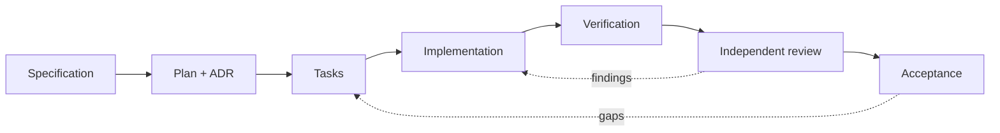

# Spec-Driven Development (SDD)

A production-oriented engineering playbook for building software with AI coding agents under
specification control: specifications first, evidence-based implementation, independent read-only
review, and verifiable acceptance.

**Start here → [docs/sdd/README.md](docs/sdd/README.md)**

---

## What is in this repository

| Area | Contents |
| --- | --- |
| **Methodology** | Fundamentals, the A–H lifecycle, repository discovery, evidence rules |
| **Frameworks** | GitHub Spec Kit, OpenSpec, AWS Kiro, BMAD Method, Spec Kitty, Ponytail, Superpowers |
| **Agent integration** | GitHub Copilot, Claude Code, Codex, Cursor, Gemini CLI, Kiro |
| **Languages** | Java, Python, .NET/C#, JavaScript/TypeScript, Go, Rust, Kotlin, PHP, SQL, IaC |
| **Workflows** | Feature delivery, bug fixing, refactoring, reviews, testing, security, Git, CI/CD |
| **Assets** | Templates, role prompts, configuration examples, documentation validators |



## Quick start

1. Read [Fundamentals](docs/sdd/01-fundamentals.md) and the
   [Engineering lifecycle](docs/sdd/02-engineering-lifecycle.md).
2. Run [Repository discovery](docs/sdd/03-repository-discovery.md) on your own project.
3. Declare a Git mode in [Git and commit policy](docs/sdd/22-git-and-commit-policy.md).
   **Start with Mode 2** (implement, do not commit).
4. Copy the evidence rules from
   [Hallucination prevention](docs/sdd/23-hallucination-prevention.md) into your agent
   instructions.
5. Adopt one framework from [Tool comparison](docs/sdd/04-tool-comparison.md) — not three.

## Validate the documentation

```bash
python3 docs/sdd/tools/validate_docs.py
```

Checks relative links, anchors, code fences, JSON, YAML, and Mermaid structure. See
[tools/README.md](docs/sdd/tools/README.md) for the optional real Mermaid parser check.

## Repository status

This repository contains **documentation and examples only** — no application code and no
installed SDD framework. Tool versions are verified snapshots (see the version table in
[docs/sdd/README.md](docs/sdd/README.md#6-verified-sources-and-research-date)); re-verify before
installing.

## License

[MIT](LICENSE). Third-party tool names and documentation remain the property of their respective
owners.
