# Spec-Driven Development (SDD)

**A complete engineering playbook for building software with AI coding agents — specifications
first, evidence-based implementation, independent read-only review, and verifiable acceptance.**

> Documentation and reusable assets only. No application code, no installed framework, and nothing
> executed against your repository. Validation state and known limitations are recorded in
> [docs/00-index.md § 8](docs/00-index.md#8-validation-status).

| At a glance | |
| --- | --- |
| **What it is** | A production-oriented methodology plus reference implementations for 7 SDD tools |
| **Who it is for** | Engineers, architects, tech leads, platform teams, and security reviewers using AI agents |
| **Languages covered** | Java, Python, .NET/C#, JavaScript/TypeScript, Go, Rust, Kotlin, PHP, SQL, Infrastructure as Code |
| **Agents covered** | GitHub Copilot, Claude Code, Codex, Cursor, Gemini CLI, AWS Kiro |
| **Size** | 36 chapters (01–37; chapter 13 is the `language-guides/` directory) · 10 language guides · 10 templates · 15 prompts (+ a review pack) · 422 diagrams |
| **Start here** | [docs/00-index.md](docs/00-index.md) |

---

## Table of contents

1. [What is Spec-Driven Development?](#1-what-is-spec-driven-development)
2. [Why SDD instead of just prompting?](#2-why-sdd-instead-of-just-prompting)
3. [The artifact model](#3-the-artifact-model)
4. [The engineering lifecycle](#4-the-engineering-lifecycle)
5. [What this repository does](#5-what-this-repository-does)
6. [What this repository does not do](#6-what-this-repository-does-not-do)
7. [Language coverage](#7-language-coverage)
8. [Framework and agent coverage](#8-framework-and-agent-coverage)
9. [Learning paths](#9-learning-paths)
10. [Quick start](#10-quick-start)
11. [Where SDD runs: IDE setup](#11-where-sdd-runs-ide-setup)
12. [One ticket, one full cycle](#12-one-ticket-one-full-cycle)
13. [Six ways to build the same thing](#13-six-ways-to-build-the-same-thing)
14. [Publishing to Confluence](#14-publishing-to-confluence)
15. [Driving the agent without drift](#15-driving-the-agent-without-drift)
16. [Repository map](#16-repository-map)
17. [Contributing](#17-contributing)
18. [License](#18-license)

---

## 1. What is Spec-Driven Development?

Spec-Driven Development is an engineering discipline in which **an explicit, reviewable
specification is produced and approved before implementation begins**, and in which **completion is
decided by evidence against that specification** — not by the implementer's confidence.

The word *driven* is the important one. The specification is not documentation written afterwards to
describe what happened. It is:

- the **input** that controls what gets built,
- the **contract** that reviewers check against,
- the **instrument** that decides whether the work is finished.

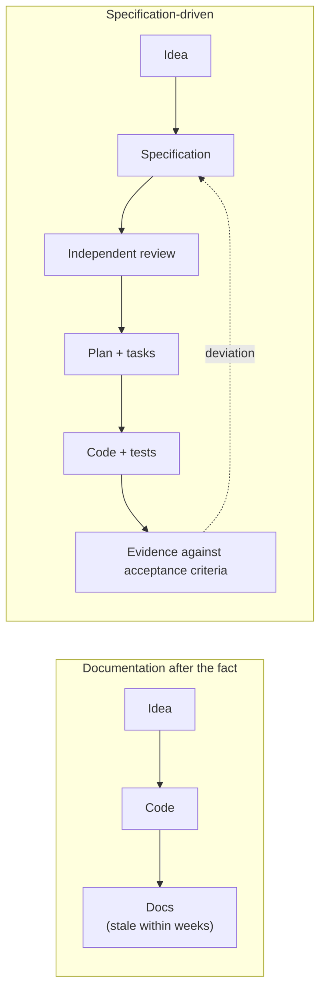

### The shift in who decides

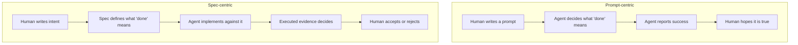

In a prompt-centric workflow, the definition of done lives inside the model's judgment and
disappears when the session ends. In SDD it lives in a file the whole team can read, review, and
check — and the model cannot silently redefine it.

### SDD is not

| Misconception | Why it fails |
| --- | --- |
| "Write one big design document at the start" | It goes stale, is not testable, and nothing verifies against it |
| "Prompt engineering with more words" | Prompts are ephemeral; specifications are versioned, reviewed, and traceable |
| "Let the agent write the spec too" | An unreviewed machine-authored spec launders assumptions into authority |
| "Specs replace tests" | Specs state intent; tests produce evidence. Both are required |
| "Strict waterfall" | SDD is iterative: clarify, plan, implement, and converge loops are expected |
| "A tool you install" | Tooling helps; the discipline is the specification + evidence + independent review |

---

## 2. Why SDD instead of just prompting?

Prompting is an **interface**, not a process. It is an excellent way to express intent and a poor
way to guarantee outcomes. Three gaps explain why.

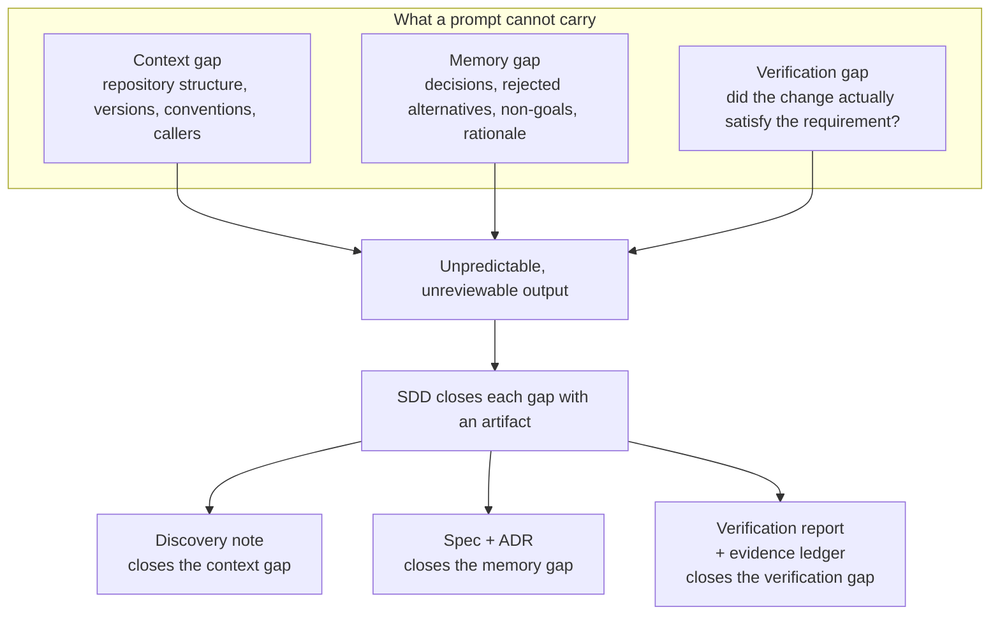

### 2.1 The context gap

The same prompt produces different results in different sessions because the model reconstructs
context by guessing.

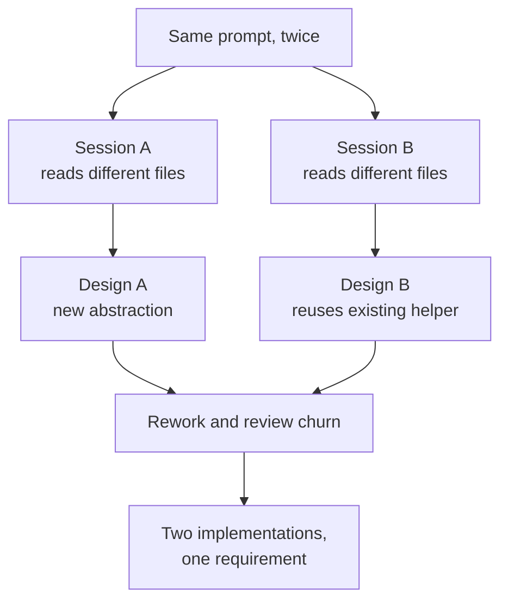

**SDD answer:** a discovery note that records facts, assumptions, unknowns, and the existing
implementations to reuse — established *before* anyone proposes code.

### 2.2 The memory gap

Prompts do not persist decisions. Six weeks later nobody remembers why a table was denormalized, why
a library was rejected, or what was explicitly out of scope.

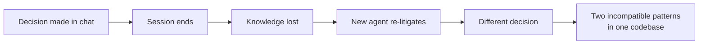

**SDD answer:** an ADR for every expensive-to-reverse decision, and explicit non-goals in every
spec.

### 2.3 The verification gap

This is the most expensive gap. An agent that says "done" and an agent that *is* done look identical
from the outside.

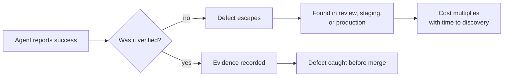

**SDD answer:** every acceptance criterion maps to executed evidence, and unverified items are
labelled `UNVERIFIED` instead of being presented as complete.

### 2.4 Side-by-side comparison

| Dimension | Prompt-only | Spec-driven |
| --- | --- | --- |
| Definition of done | Model's judgment | Written acceptance criteria |
| Context | Reconstructed per session | Discovery note + repository inspection |
| Decisions | Implicit, lost | ADRs, versioned |
| Scope | Drifts silently | Non-goals + task traceability |
| Output variance | High | Bounded by the spec |
| Reviewability | Review the code only | Review the intent, then the code, then the evidence |
| Failure detection | After merge or in production | Before merge, at gates |
| Audit trail | Chat logs, if kept | Spec → task → commit → test → evidence |
| Onboarding | Re-explain everything | Read the artifacts |
| Agent autonomy | Risky | Safe to increase, rung by rung |

### 2.5 The economics

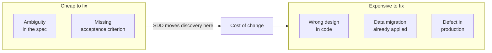

A clarification question costs minutes. Rewriting an implemented design costs days. Recovering from a
production data defect costs weeks and trust. SDD is, at its core, a strategy for **moving
discovery earlier** while it is still cheap.

### 2.6 The autonomy ladder

SDD does not ask you to trust agents more. It gives you a ladder so you can trust them **safely**.

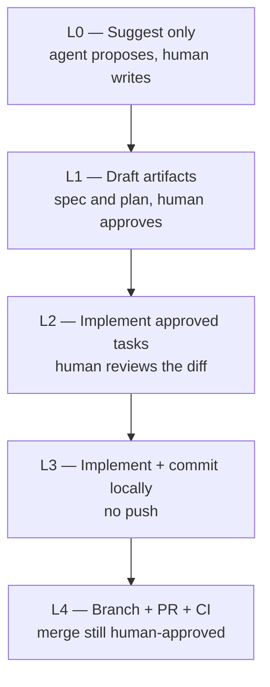

| Rung | Agent may | Agent must not | Move up when |
| --- | --- | --- | --- |
| L0 | Read, analyze, suggest | Edit files | First week in a new repo |
| L1 | Write specs and plans | Change source | Specs are consistently useful |
| L2 | Implement approved tasks, run tests | Commit or push | Diffs are consistently reviewable |
| L3 | Commit verified changes on a branch | Push | Commit hygiene is consistently good |
| L4 | Push a branch, open a PR, wait for CI | Merge or deploy | CI is trustworthy and required |

> **Recommended starting rung: L2.** It produces the highest information per unit of risk while a
> team learns the practice.

---

## 3. The artifact model

Six artifact families. They are not interchangeable, and each one closes a specific gap.

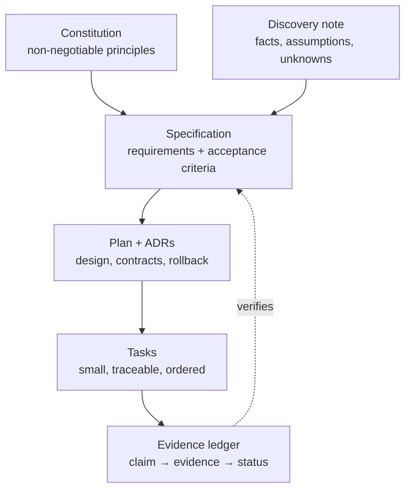

| Artifact | Answers | Owner | Must be reviewable without code |
| --- | --- | --- | --- |
| **Constitution** | What principles are non-negotiable? | Tech leadership | Yes |
| **Discovery note** | What exists, what is assumed, what is unknown? | Whoever investigates | Yes |
| **Specification** | What problem, what outcome, how do we know it is done? | Requirements engineer | Yes |
| **Plan / ADR** | How will it work, what did we reject, how do we roll back? | Architect | Yes |
| **Tasks** | What are the smallest verifiable steps? | Architect + implementer | Yes |
| **Evidence ledger** | What do we actually know, and how do we know it? | Whoever claims | Yes |

### Traceability is the point

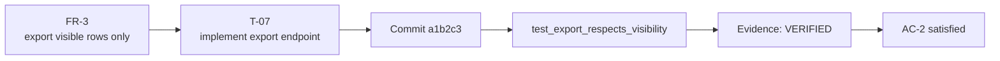

Every task references a requirement. Every requirement is satisfied by at least one verified test or
inspection. If you cannot draw this line, you have untraceable work.

### Evidence statuses

| Status | Meaning | Allowed in a completion report? |
| --- | --- | --- |
| `VERIFIED` | Observed directly (executed test, build output, `file:line`, official doc for the exact version) | Yes |
| `PARTIALLY VERIFIED` | Some evidence exists; scope is limited | Yes, with the limit stated |
| `UNVERIFIED` | No evidence yet | Yes, but never as "done" |
| `CONTRADICTED` | Evidence contradicts the claim | Yes — as a blocker |

---

## 4. The engineering lifecycle

Phases A–H. Each phase has an entry condition, a required artifact, and an exit gate. Skipping a gate
is a decision that must be recorded, not an accident.

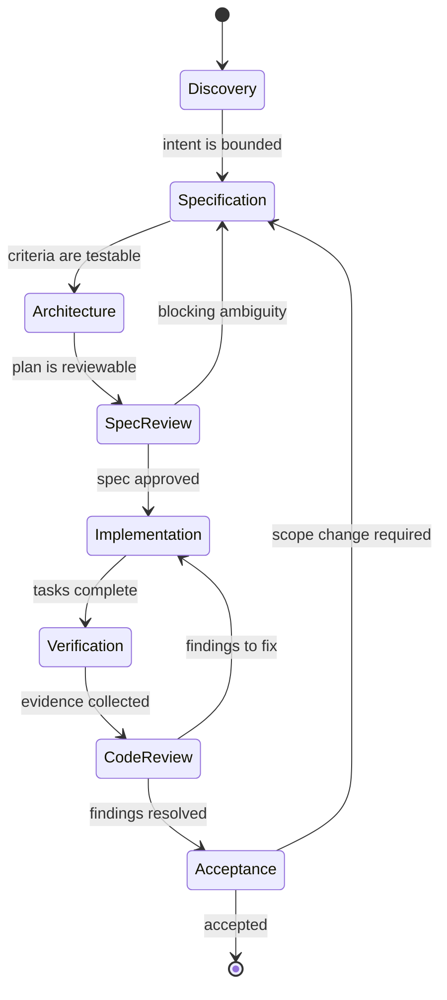

| Phase | Question answered | Primary artifact | Gate |
| --- | --- | --- | --- |
| **A — Discovery** | What is being asked, and what exists already? | Discovery note | Facts separated from assumptions |
| **B — Specification** | What outcome, measured how? | `spec.md` | Acceptance criteria testable |
| **C — Architecture & planning** | How will it work and how will we undo it? | `plan.md`, ADRs | Design reviewable without code |
| **D — Specification review** | Is the spec complete, consistent, buildable? | Review report | No open critical findings |
| **E — Implementation** | Build exactly the approved scope | Code + tests | Tasks done, tests written |
| **F — Verification** | Does evidence satisfy every criterion? | Verification report | Every AC has evidence |
| **G — Independent code review** | Is the diff correct, safe, maintainable? | Review report | No unresolved critical/high |
| **H — Final acceptance** | Did we deliver what we promised? | Completion report | Deviations accepted by a human |

### Separation of duties

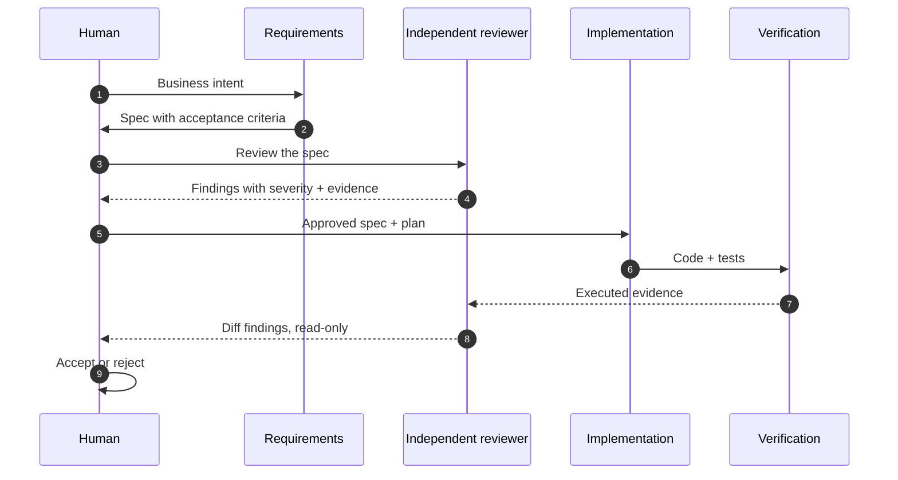

The implementer never approves its own work, and the reviewer never edits the artifact under review.

### The nine rules that make everything else work

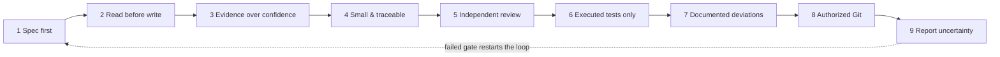

| # | Rule |
| --- | --- |
| 1 | No specification, no implementation |
| 2 | Read the real repository before proposing changes |
| 3 | Every claim carries a status: `VERIFIED`, `PARTIALLY VERIFIED`, `UNVERIFIED`, `CONTRADICTED` |
| 4 | Every change maps to a requirement or a reported defect |
| 5 | Review is independent and read-only |
| 6 | A test is evidence only when it was executed |
| 7 | Deviations are documented, never silent |
| 8 | Git operations require authorization, by declared mode |
| 9 | Uncertainty is reported, not filled with invented specifics |

---

## 5. What this repository does

This is a **reference handbook**, not a library. It gives an engineer or an AI agent everything needed
to run SDD on a real project: the process, the tool comparisons, language-specific guidance, reusable
templates, role prompts, and validators for the documentation itself.

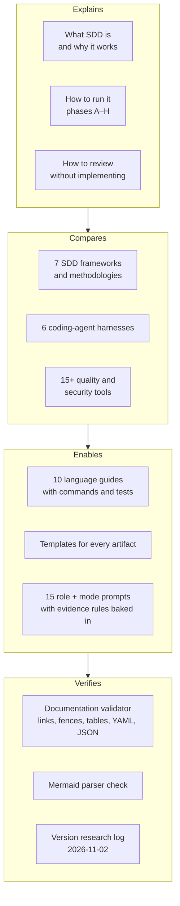

### The five things you can take from it

| Take | Where |
| --- | --- |
| **A process you can adopt on Monday** | [Lifecycle](docs/02-engineering-lifecycle.md) + [Feature development](docs/14-feature-development.md) |
| **A Git policy you can declare** | [Git and commit policy](docs/22-git-and-commit-policy.md) — four modes, explicit permissions |
| **Evidence rules that stop hallucinations** | [Evidence-based AI engineering](docs/23-hallucination-prevention.md) |
| **Language-specific commands and failure modes** | [Language guides](language-guides/README.md) |
| **Copy-paste artifacts** | [Templates](templates/README.md) + [Prompts](prompts/README.md) |

---

## 6. What this repository does not do

Stated plainly, because a playbook that overclaims is worse than none.

| It does not | Why |
| --- | --- |
| Install an SDD framework for you | Installation writes files and depends on your agent; that is a separate reviewed decision |
| Run against your codebase | There is no application here to verify against |
| Guarantee output quality | It increases the probability of correct, reviewable work — it does not replace engineering judgment |
| Replace tests, scanners, or code review | It *coordinates* them; the tools still do the work |
| Certify compliance | The [enterprise chapter](docs/26-enterprise-reference-workflow.md) maps evidence to frameworks as an aid, not a certification |
| Keep versions current forever | Tool versions are a snapshot; re-verify before installing |

> **Version drift is real.** Every version in this repository was checked on **2026-11-02** against
> primary sources. AI tooling releases weekly. Treat the numbers as a starting point, not a promise.

---

## 7. Language coverage

The **process** is language-independent. What changes per language is how you express requirements,
which commands produce evidence, which static analysis is mandatory, and which failure modes matter.

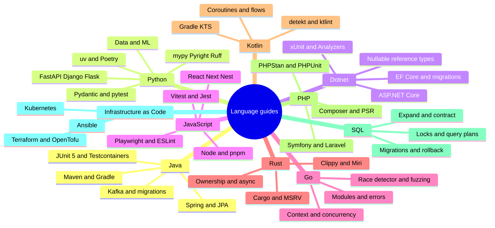

### Guide index

| Language | Runtime focus | Verified in the guide |
| --- | --- | --- |
| [**Java**](language-guides/java.md) | 8, 11, 17, 21, 25 LTS; Maven and Gradle | Spring Boot, Spring Security, JPA, Kafka, Flyway/Liquibase, JUnit 5, Mockito, Testcontainers |
| [**Python**](language-guides/python.md) | 3.11–3.15 | uv/Poetry, FastAPI/Django/Flask, Pydantic, pytest, mypy/Pyright, Ruff, data and ML |
| [**.NET / C#**](language-guides/dotnet-csharp.md) | .NET 10 LTS and 8 | ASP.NET Core, EF Core, xUnit/NUnit, nullable reference types, Roslyn analyzers |
| [**JavaScript / TypeScript**](language-guides/javascript-typescript.md) | Node 26 LTS, 24, 22 | React, Next.js, NestJS, Express, Jest/Vitest, Playwright, ESLint |
| [**Go**](language-guides/go.md) | 1.27, 1.26 | Modules, error wrapping, context, concurrency, race detector, fuzzing, govulncheck |
| [**Rust**](language-guides/rust.md) | Rolling stable (1.99) | Cargo workspaces, MSRV, ownership, async, Clippy, Miri, cargo-audit/deny |
| [**Kotlin**](language-guides/kotlin.md) | 2.4 | Coroutines, flows, Ktor, Spring, JUnit 5/Kotest, detekt, ktlint |
| [**PHP**](language-guides/php.md) | 8.5, 8.4, 8.3 | Composer, PSR, Symfony/Laravel, PHPUnit, PHPStan, Psalm, PHP-CS-Fixer |
| [**SQL**](language-guides/sql.md) | PostgreSQL, MySQL, SQL Server, Oracle | Migrations, locking, query plans, backfills, expand/contract, rollback |
| [**Infrastructure as Code**](language-guides/infrastructure-as-code.md) | Terraform/OpenTofu, Ansible, Kubernetes | Plan analysis, drift, blast radius, policy-as-code, promotion |

Every guide answers the same eight questions, so you can read the one that applies to your stack and
skip the rest:

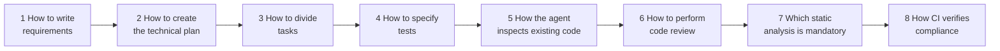

### What actually differs per language

| Aspect | Language-independent | Language-specific |
| --- | --- | --- |
| Spec structure | ✅ | |
| Acceptance criteria format | ✅ | |
| Evidence ledger | ✅ | |
| Review severity model | ✅ | |
| Contract representation | | OpenAPI, protobuf, Kotlin types, Rust traits |
| Test command | | `mvn verify`, `uv run pytest`, `dotnet test`, `go test -race` |
| Mandatory static analysis | | PMD, Ruff, Roslyn analyzers, Clippy, detekt, PHPStan |
| Characteristic failure modes | | JPA N+1, async event-loop blocking, `DbContext` lifetime, goroutine leaks, data races |

> The handbook deliberately **does not invent** language-specific differences where the process is
> genuinely the same. Where a guide adds a rule, it is because that language has a distinct failure
> mode or a distinct verification tool.

---

## 8. Framework and agent coverage

### SDD frameworks and methodologies

| Tool | Version verified | What it is best at |
| --- | --- | --- |
| [**GitHub Spec Kit**](docs/05-github-spec-kit.md) | 1.2.5 | Structured artifact pipeline across many agents; constitution and optional gates |
| [**OpenSpec**](docs/06-openspec.md) | 1.16.0 | Brownfield delta specs that evolve an existing spec set; tool-agnostic |
| [**AWS Kiro**](docs/07-aws-kiro.md) | product docs | Integrated specs, steering, hooks, and parallel task waves |
| [**BMAD Method**](docs/08-bmad-method.md) | 6.12.4 (7.0 alpha) | Right-sized planning paths and named product/architecture/QA roles |
| [**Spec Kitty**](docs/09-spec-kitty.md) | CLI 3.2.7 | Governed multi-agent delivery with worktrees, lanes, and audit trail |
| [**Ponytail**](docs/10-ponytail.md) | 5.3.3 | Anti-over-engineering discipline and diff/repo review commands |
| [**Superpowers**](docs/11-superpowers.md) | 7.0.1 | TDD-first methodology with subagent-driven implementation |

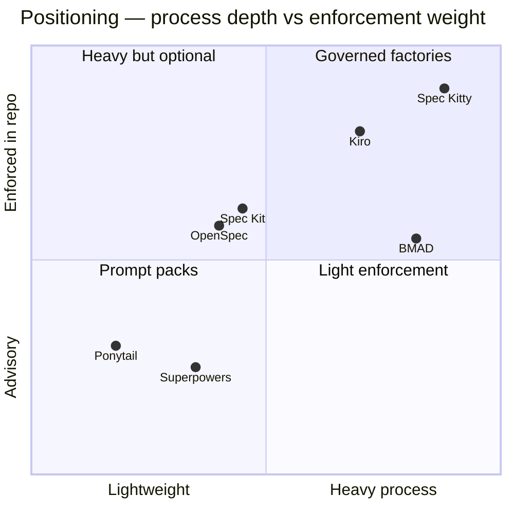

Coordinates are an author assessment for orientation, not measured data. Compare tools on the
dimensions in the [tool comparison chapter](docs/04-tool-comparison.md), not on a chart.

### Coding-agent harnesses

```mermaid
flowchart LR
    subgraph Rules["Always-on rules"]
        R1["AGENTS.md"]
        R2["CLAUDE.md"]
        R3[".github/copilot-instructions.md"]
        R4["GEMINI.md"]
        R5[".cursor/rules/*.mdc"]
        R6[".kiro/steering/*.md"]
    end
    subgraph Scoped["Path-scoped rules"]
        S1[".github/instructions/*.instructions.md"]
        S2[".claude/rules/*.md"]
        S3["AGENTS.md in subfolders"]
        S4["globs in .mdc"]
        S5["inclusion: fileMatch"]
    end
    subgraph Reusable["Reusable procedures"]
        P1["skills / prompts / agents"]
        P2["commands"]
        P3["extensions / plugins"]
    end
    Rules --> Scoped --> Reusable
```

| Harness | Documented in |
| --- | --- |
| GitHub Copilot (VS Code) | [Agent integration](docs/12-coding-agent-integration.md) |
| Claude Code | [Agent integration](docs/12-coding-agent-integration.md) |
| OpenAI Codex | [Agent integration](docs/12-coding-agent-integration.md) |
| Cursor | [Agent integration](docs/12-coding-agent-integration.md) |
| Gemini CLI | [Agent integration](docs/12-coding-agent-integration.md) |
| AWS Kiro | [Kiro chapter](docs/07-aws-kiro.md) |

### Quality and security tooling referenced

| Category | Tools |
| --- | --- |
| Static analysis | SonarQube/SonarCloud, Semgrep, CodeQL, language linters (Ruff, ESLint, Clippy, detekt, PHPStan, PMD) |
| Supply chain | Trivy, OWASP Dependency-Check, Dependabot, `pip-audit`, `npm audit`, `govulncheck`, `cargo audit` |
| Testing | JUnit 5, Testcontainers, pytest, xUnit, Playwright, Pact |
| CI/CD | GitHub Actions (with examples), required checks, policy gates |

---

## 9. Learning paths

Read straight through, or pick the track that matches your role.

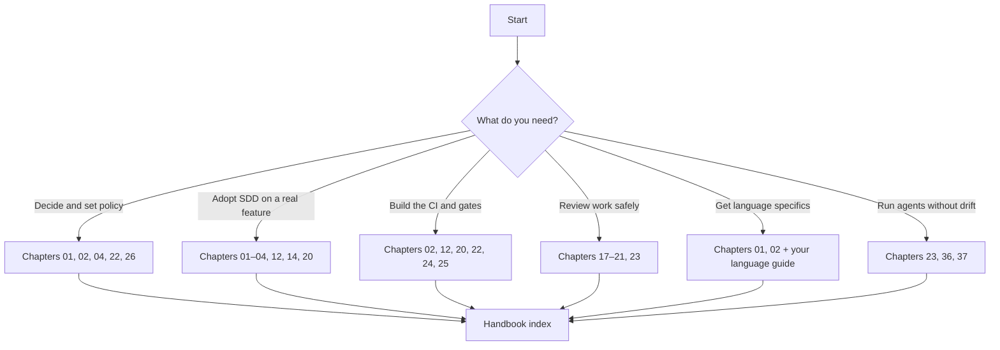

| Track | Chapters | Time | Outcome |
| --- | --- | --- | --- |
| **Decision maker** — choose a framework, set policy | 01, 02, 04, 22, 26 | ~2 h | A defensible tool choice and a declared Git mode |
| **Engineer adopting SDD** — full loop on a real feature | 01–04, 12, 14, 20 | ~4 h | One feature shipped with spec, review, and evidence |
| **Platform / DevOps** — gates and enforcement | 02, 12, 20, 22, 24, 25 | ~3 h | CI gates that fail closed |
| **Reviewer** — read-only review and evidence | 17–21, 23 | ~2.5 h | Review reports that find real defects |
| **Language specialist** — pick your guide | 01, 02 + your guide | ~2 h | Commands, tests, and failure modes for your stack |
| **Agent operator** — plan/implement/verify without fabrication | 23, 36, 37 | ~2.5 h | Prompts that hold their shape and an agent that reports honestly |

### Maturity model

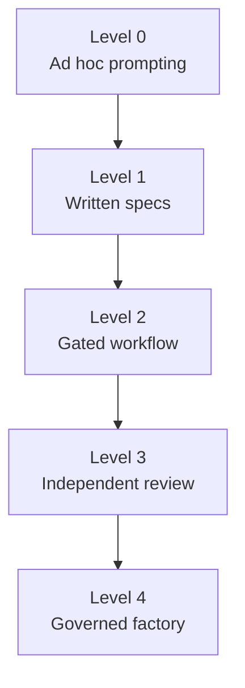

| Level | Characteristics | Exit criteria |
| --- | --- | --- |
| 0 | Work starts from chat prompts; requirements live in people's heads | A spec template is used for one real feature |
| 1 | Specs written and stored; implementation loosely checked | Acceptance criteria are testable and reviewed before coding |
| 2 | Spec review gate + verification report; one agent | An independent reviewer runs on every change |
| 3 | Reviewer has separate context and read-only access; CI enforces checks | Multiple roles, policy in CI, audit trail |
| 4 | Role-based agents, worktrees, convergence reports, release gates | Continuous improvement; no fixed exit |

Do not jump to Level 4 because it sounds better. Each level depends on the one below.

---

## 10. Quick start

```mermaid
sequenceDiagram
    participant You
    participant Repo as Your repository
    participant Agent
    participant CI

    You->>You: Read 01 Fundamentals + 02 Lifecycle
    You->>Repo: Run discovery (chapter 03)
    You->>Repo: Declare a Git mode in agent instructions (chapter 22)
    You->>Agent: Paste the evidence rules (chapter 23)
    You->>Agent: Write a spec for ONE bounded change
    Agent-->>You: spec.md with acceptance criteria
    You->>Agent: Independent spec review (chapter 17)
    Agent-->>You: Findings, severity-ranked
    You->>Agent: Implement approved tasks (chapter 14)
    Agent-->>You: Diff + tests + evidence
    You->>CI: Add the traceability gate (chapter 25)
    CI-->>You: Pass or fail, with reasons
```

**Five steps, in order:**

1. Read [Fundamentals](docs/01-fundamentals.md) and the
   [Engineering lifecycle](docs/02-engineering-lifecycle.md).
2. Run [Repository discovery](docs/03-repository-discovery.md) on your own project — never let an
   agent assume your stack.
3. Declare a Git mode in [Git and commit policy](docs/22-git-and-commit-policy.md).
   **Start with Mode 2** (implement, do not commit).
4. Copy the evidence rules from
   [Evidence-based AI engineering](docs/23-hallucination-prevention.md) into your agent
   instructions.
5. Adopt **one** framework from [Tool comparison](docs/04-tool-comparison.md) — not three.

### The four Git modes

```mermaid
flowchart TD
    M1["Mode 1<br/>Documentation only<br/>no source edits, no commits"]
    M2["Mode 2<br/>Implement, no commits<br/>recommended default"]
    M3["Mode 3<br/>Verified local commits<br/>no push"]
    M4["Mode 4<br/>Branch + PR + CI<br/>merge human-approved"]
    M1 --> M2 --> M3 --> M4
```

| Mode | Edits source | Commits | Pushes | Typical use |
| --- | --- | --- | --- | --- |
| **1** | No | No | No | Planning, reviews, this repository |
| **2** | Yes | No | No | New installations, regulated environments |
| **3** | Yes | Verified only | No | Teams with mature review |
| **4** | Yes | Yes | Own branch | Teams with required CI checks |

---

## 11. Where SDD runs: IDE setup

The repository supplies the contract files; the IDE supplies the ergonomics. Chapter 29 is the
overview; chapters 30–32 are dedicated, step-by-step guides.

| IDE | Deep-dive chapter | Covers |
| --- | --- | --- |
| **IntelliJ IDEA** | [Chapter 30](docs/30-ide-intellij.md) | Copilot, Claude Code, AI Assistant, run configs, HTTP client |
| **VS Code** | [Chapter 31](docs/31-ide-vscode.md) | Extensions, `applyTo`, tasks/launch, skills, prompts, agents |
| **Visual Studio** | [Chapter 32](docs/32-ide-visual-studio.md) | 17.10+ install, `AGENTS.md` limitation, Test Explorer, `.http` |

```mermaid
flowchart LR
    subgraph Contract["Repository contract (committed)"]
        C1["AGENTS.md"]
        C2[".github/copilot-instructions.md"]
        C3[".github/instructions/*.instructions.md"]
        C4["specs/ + docs/adr/"]
    end
    subgraph IDE["IDE (local)"]
        I1["VS Code"]
        I2["IntelliJ IDEA"]
        I3["Visual Studio"]
    end
    Contract --> IDE
    IDE --> V["Agent reads the same rules<br/>in every editor"]
```

| IDE | Repository-wide rules | Path-scoped rules | `AGENTS.md` |
| --- | --- | --- | --- |
| **VS Code** | `.github/copilot-instructions.md` | `.github/instructions/*.instructions.md` | ✅ |
| **IntelliJ IDEA** | same files, managed from the Agent Customizations editor | same | via agent customizations |
| **Visual Studio** | `.github/copilot-instructions.md` | `.github/instructions/*.instructions.md` | ❌ not listed |

> **The one rule that prevents the most confusion:** always maintain
> `.github/copilot-instructions.md`. It is the only repository-wide file all three IDEs read.

## 12. One ticket, one full cycle

[Chapter 33](docs/33-end-to-end-walkthrough.md) walks a single Jira ticket — *"add an order
export endpoint"* — from triage to release, showing every artifact.

```mermaid
flowchart TD
    J["Jira ticket"] --> T["Triage<br/>spec needed?"]
    T --> I["Intake<br/>problem vs proposed solution"]
    I --> D["Discovery<br/>facts / assumptions / unknowns"]
    D --> S["Spec<br/>FR, NFR, AC, edge, failure"]
    S --> SR["Independent spec review"]
    SR -->|findings| S
    SR --> P["Plan + ADR"]
    P --> TK["Tasks with requirement IDs"]
    TK --> IM["Implement in small steps"]
    IM --> V["Verification<br/>AC → evidence"]
    V --> CR["Independent code review"]
    CR -->|findings| IM
    CR --> CV["Convergence"]
    CV --> PR["PR + CI + human merge"]
    PR --> REL["Release + flag"]
    REL --> JD["Jira Done<br/>with evidence links"]
```

| Step | Artifact produced |
| --- | --- |
| Triage | Risk tier, required reviews, Git mode |
| Intake | `intake.md` — what was said vs what was assumed |
| Discovery | Discovery note — facts with `file:line` |
| Specification | `spec.md` — requirements, acceptance criteria, NFRs |
| Spec review | Findings report — severity + evidence |
| Plan | `plan.md` + ADR |
| Tasks | `tasks.md` — each maps to a requirement |
| Implementation | Code + tests + evidence ledger rows |
| Verification | `verification.md` — per-AC status |
| Code review | Findings report — read-only |
| Convergence | Appended tasks until spec and code align |
| Release | PR, CI, merge, flag, Jira close-out |

---

## 13. Six ways to build the same thing

[Chapter 34](docs/34-simple-project-examples.md) implements one small feature — an expense tracker with
integer-cent money, timezone-aware months, and a monthly total — six different ways, so you can
compare real setup cost against real governance.

```mermaid
flowchart TD
    Q1{"Team size and<br/>tool appetite?"}
    Q1 -->|solo, minimal| A["1 · Manual SDD<br/>no framework"]
    Q1 -->|small team, one agent| B["2 · Spec Kit"]
    Q1 -->|existing spec set| C["3 · OpenSpec"]
    Q1 -->|wants roles and options| D["4 · BMAD"]
    Q1 -->|already in Kiro| E["5 · Kiro"]
    Q1 -->|parallel agents, audit| F["6 · Spec Kitty"]
    A --> L["Lightweight path<br/>for tiny changes"]
    B --> L
    C --> L
    D --> L
    E --> L
    F --> L
```

| # | Approach | Setup | Best for |
| --- | --- | --- | --- |
| 1 | Manual SDD | none | Learning the discipline; no new tooling |
| 2 | Spec Kit | ~1 h | Teams wanting gates and multi-agent support |
| 3 | OpenSpec | ~30 min | Evolving an existing spec set (delta specs) |
| 4 | BMAD | ~30 min | Role-based planning at the right depth |
| 5 | Kiro | minutes if already adopted | Integrated specs, steering, hooks |
| 6 | Spec Kitty | 1–2 h | Parallel agents with lanes and an audit trail |

> **All six produce the same three things:** a testable spec, a task list traceable to it, and
> evidence per acceptance criterion. Everything else is ergonomics.

## 14. Publishing to Confluence

[Chapter 35](docs/35-confluence-publishing.md) covers publishing the *right subset* of artifacts to a
wiki without creating a second source of truth.

```mermaid
flowchart LR
    subgraph Repo["Repository — source of truth"]
        R1["spec.md"]
        R2["plan.md + ADR"]
        R3["verification.md"]
    end
    subgraph Sync["Controlled publish"]
        S1["Convert"]
        S2["Push pages"]
        S3["Attach diagrams"]
    end
    subgraph Conf["Confluence"]
        C1["Space page tree"]
    end
    Repo --> Sync --> Conf
    Conf -.->|"generated mirror<br/>never edited by hand"| C1
```

| Model | What goes to the wiki | Drift risk |
| --- | --- | --- |
| **Mirror** | Full artifact text, generated | High unless automated |
| **Index** | Title, owner, status, links to the repo | Low |
| **Excerpt** | Problem, goals, AC table, status | Medium |

Verified API surface: `POST /wiki/api/v2/pages` (requires `spaceId`; body representation
`storage`, `atlas_doc_format`, or `wiki`), `PUT /wiki/api/v2/pages/{id}` (requires `version.number`
= current + 1), and v1 attachment upload for rendered Mermaid SVGs. See the chapter for the
conversion rules and a complete script.

---

## 15. Driving the agent without drift

Chapters [36](docs/36-agent-prompt-playbook.md) and [37](docs/37-agent-anti-hallucination.md) are a
matched pair: 36 is the *operator's* manual (what to type), 37 is the *agent's* manual (what it must
do instead of inventing). Neither works alone — a precise prompt cannot rescue an agent that will
fabricate a test result, and a disciplined agent cannot rescue a request that never said what
"done" means.

### The four ingredients of a request that survives contact with an agent

```mermaid
flowchart LR
    subgraph In["Every request carries"]
        A["Scope<br/>files, modules, tickets"]
        B["Constraints<br/>patterns, rules, limits"]
        C["Evidence<br/>what must be produced"]
        D["Stop condition<br/>when to halt and ask"]
    end
    In --> OUT["Predictable diff<br/>+ verifiable report"]
```

An agent asked to "plan the endpoint" without those four will produce a plausible plan for a
different endpoint. The playbook gives three complete prompts — one per mode — with the exact
phrasing, the good/bad transcript next to each, and the acceptance gate that decides whether the
output is allowed to move to the next phase.

### Plan, implement, verify are three different contracts

```mermaid
flowchart TD
    P["PLAN<br/>read-only<br/>output: spec deltas + risks"] --> G1{"Gate<br/>[NEEDS CLARIFICATION] = 0?"}
    G1 -->|No| PQ["Stop. Ask. Do not code."]
    G1 -->|Yes| I["IMPLEMENT<br/>write-scoped<br/>output: diff + tests"]
    I --> G2{"Gate<br/>commands actually run?"}
    G2 -->|No| IQ["Stop. Report unverified."]
    G2 -->|Yes| V["VERIFY<br/>independent context<br/>output: findings list"]
    V --> G3{"Gate<br/>every AC mapped to evidence?"}
    G3 -->|No| VQ["FAIL — do not merge"]
    G3 -->|Yes| DONE["Merge candidate"]
```

Mixing modes is the single most common cause of fabricated progress: an agent that is allowed to
write while still planning will resolve open questions by guessing, and an agent that verifies its
own implementation will confirm its own assumptions. Chapter 36 keeps them separate by prompt;
chapter 37 keeps them separate by contract.

### Five gates against fabrication

Chapter 37 names ten distinct fabrication classes (invented APIs, invented file contents, invented
command output, invented test results, invented approvals, stale-state claims, scope creep disguised
as completeness, silent requirement drops, unlabeled inference, and false completion) and answers
them with five gates. The gates are behavioural rules, not slogans — each one has a concrete
failure it prevents.

```mermaid
flowchart LR
    G1["GROUND<br/>read before you assert"] --> G2["CITE<br/>file:line or command"]
    G2 --> G3["EXECUTE<br/>run it, paste it"]
    G3 --> G4["LABEL<br/>fact / inference / unknown"]
    G4 --> G5["ESCALATE<br/>stop instead of guessing"]
```

| Gate | Prevents | Enforcement |
| --- | --- | --- |
| **GROUND** | Asserting file contents, APIs, or config that were never read | Any claim about a file must trace to a read in this session |
| **CITE** | Confident summaries with no addressable evidence | Every finding carries `path:line` or a command + output |
| **EXECUTE** | Reporting tests, builds, or lints that were never run | Verification text must be a pasted transcript, never a prediction |
| **LABEL** | Inference presented as fact | Unverified claims are prefixed `ASSUMPTION:` or `UNVERIFIED:` |
| **ESCALATE** | Inventing detail to fill a gap | A gap produces a question or a blocked item, never a fabrication |

### What a refusal looks like

The manual ships refusal scripts, not just prohibitions, because "don't hallucinate" is not an
instruction an agent can follow. The pattern is: state what is missing, state what would resolve it,
propose the smallest step that stays honest, and stop.

```mermaid
sequenceDiagram
    participant U as Operator
    participant A as Agent
    U->>A: Implement the retry logic in src/http/client.go
    A->>A: Attempt to read src/http/client.go
    A-->>U: BLOCKED: file does not exist. Nearest matches: src/http/client.ts, src/clients/http.go
    U->>A: Use src/http/client.ts
    A->>A: Read file, confirm retry helper absent
    A-->>U: Ready. Plan: add retryWithBackoff, wire into Send, 3 table tests. Proceed?
```

That exchange is the goal state: the agent found the gap, reported the evidence for it, and let the
human redirect — in two messages instead of forty lines of plausible TypeScript for a Go file that
never existed.

### Structural defences beat willpower

Prompts decay across a long session. The chapter therefore leans on structure that survives:

| Defence | Why it holds when a prompt does not |
| --- | --- |
| **Read-only plan mode** | A tool that cannot write cannot fabricate a write |
| **Fresh context for review** | A reviewer that never saw the implementation cannot rationalise it |
| **Acceptance criteria as test names** | A test named after an AC cannot be "covered" by a paragraph |
| **Required command transcripts** | A missing transcript is visible; a missing claim is not |
| **Short sessions, one change each** | Drift compounds with length; small sessions cap the blast radius |

Every prompt in [prompts/](prompts/README.md) embeds the corresponding gate, so the discipline
travels with the template instead of depending on whoever is typing.

---

## 16. Repository map

Chapters live in [`docs/`](docs/); reusable assets stay at the root so they are easy to find and
copy into your own repository.

```text
Spec-Driven-Development-SDD/
├── README.md                       ← you are here (orientation)
├── LICENSE                         MIT
│
├── docs/                           the handbook — 36 chapters
│   ├── README.md                   landing page for the folder
│   ├── 00-index.md                 index, learning path, validation log
│   ├── 01-fundamentals.md          05–11 frameworks        17–21 reviews
│   ├── 02-engineering-lifecycle.md 12 agent integration    22 git policy
│   ├── 03-repository-discovery.md  14 feature delivery     23 hallucination prevention
│   ├── 04-tool-comparison.md       15 bug fixing           24 multi-agent
│   │                               16 refactoring          25 CI/CD
│   │                                                       26 enterprise
│   │                                                       27 troubleshooting
│   │                                                       28 glossary
│   ├── 29-ide-setup.md             overview + parity matrix
│   ├── 30-ide-intellij.md          IntelliJ IDEA deep dive
│   ├── 31-ide-vscode.md            VS Code deep dive
│   ├── 32-ide-visual-studio.md     Visual Studio deep dive
│   ├── 33-end-to-end-walkthrough.md one Jira ticket, the whole cycle
│   ├── 34-simple-project-examples.md the same feature, six ways
│   ├── 35-confluence-publishing.md  publish to a wiki without forking the truth
│   ├── 36-agent-prompt-playbook.md  what to say for plan / implement / verify
│   └── 37-agent-anti-hallucination.md  five gates, refusal scripts, recovery
│
├── language-guides/                chapter 13 — 10 guides + index
├── templates/                      10 artifact templates + index
├── prompts/                        15 prompts + review pack + index
├── examples/                       non-active agent/CI examples
└── tools/                          validators and their documentation
```

```mermaid
flowchart TD
    ROOT["README.md<br/>orientation"]
    subgraph Docs["docs/ — the handbook"]
        IDX["00-index.md"]
        subgraph Core["Foundations 01–04"]
            C1["Fundamentals"] 
            C2["Lifecycle"]
            C3["Discovery"]
            C4["Tool comparison"]
        end
        subgraph Tools["Tools 05–12"]
            T1["Frameworks 05–11"]
            T2["Agent integration 12"]
        end
        subgraph Flow["Workflows 14–28"]
            W1["Feature · Bug · Refactor"]
            W2["Reviews 17–21"]
            W3["Git · Evidence · Multi-agent · CI"]
            W4["Enterprise · Troubleshooting · Glossary"]
        end
        subgraph Practice["Practice 29–37"]
            P1["IDE setup 29–32"]
            P2["Walkthrough 33"]
            P3["Examples 34"]
            P4["Confluence 35"]
            P5["Agent prompts 36–37"]
        end
    end
    subgraph Assets["Reusable assets (root)"]
        A1["language-guides/"]
        A2["templates/"]
        A3["prompts/"]
        A4["examples/"]
        A5["tools/"]
    end
    ROOT --> IDX
    IDX --> Core --> Tools --> Flow --> Practice
    Assets -.-> Docs
```

---

## 17. Contributing

- Follow the structure of the chapter you edit: purpose, when to use, body, references — plus a
  verification section whenever the chapter makes claims that can be checked (tool behaviour,
  versions, commands). Chapters that are purely workflow or reference material omit it rather
  than pad it.
- Run `python3 tools/validate_docs.py` before proposing a change — it checks links, anchors,
  fences, table columns, JSON, YAML, front matter, and Mermaid structure. What each check can
  and cannot prove is documented in [tools/README.md](tools/README.md).
- Never add a command you have not run or verified against official documentation. Label examples
  that are illustrative.
- Update the version table when you re-verify a tool.

## 18. License

[MIT](LICENSE). Third-party tool names and documentation remain the property of their respective
owners; links are provided for reference, not redistribution.
