# 02 — The Engineering Lifecycle

> Phases A–H. Each phase has an entry condition, a required artifact, and an exit gate.
> Skipping a gate is a decision that must be recorded, not an accident.

---

## 1. Purpose

This chapter defines the canonical SDD lifecycle and makes each gate explicit. Toolkits in
[chapters 05–11](./05-github-spec-kit.md) implement subsets of this lifecycle with different
names; the names differ, the obligations do not.

---

## 2. Lifecycle map

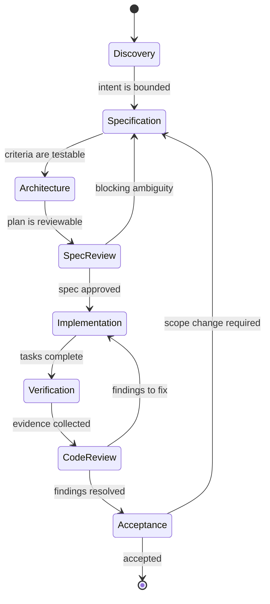

### Phase summary

| Phase | Question answered | Primary artifact | Gate |
| --- | --- | --- | --- |
| **A — Discovery** | What is actually being asked, and what exists already? | Discovery note | Facts separated from assumptions |
| **B — Specification** | What outcome, measured how? | `spec.md` | Acceptance criteria testable |
| **C — Architecture & planning** | How will it work and how will we undo it? | `plan.md`, ADRs | Design reviewable without code |
| **D — Specification review** | Is the spec complete, consistent, buildable? | Review report | No open critical findings |
| **E — Implementation** | Build exactly the approved scope | Code + tests | Tasks done, tests written |
| **F — Verification** | Does evidence satisfy every criterion? | Verification report | Every AC has evidence |
| **G — Independent code review** | Is the diff correct, safe, maintainable? | Review report | No unresolved critical/high |
| **H — Final acceptance** | Did we deliver what we promised? | Completion report | Deviations accepted by a human |

---

## 3. Phase A — Discovery

**Question:** what is actually being asked, and what already exists?

Discovery is not requirements gathering. It is establishing **ground truth** so that the
specification is written against reality instead of imagination.

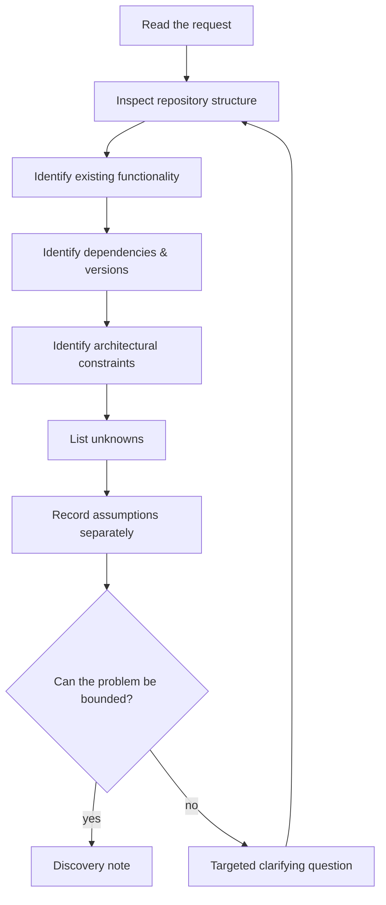

### Required output

```markdown
## Discovery — CSV export for orders (2026-11-02)

### Facts (verified)
- `GET /orders` exists in `src/api/orders.py:112`; pagination is offset-based.
- Authorization is enforced by `require_project_access` (`src/auth/decorators.py:44`).
- Python 3.12.4, FastAPI 0.115.x, SQLAlchemy 2.0.x (from `uv.lock`).
- No streaming response helper exists in the codebase.

### Assumptions (unverified)
- A1: Maximum export size is expected to stay under 100k rows.
- A2: Consumers can handle `text/csv` responses.

### Unknowns (blocking?)
- U1: Is export audited? (not blocking; default: follow existing audit middleware)
- U2: Does a downstream billing job consume this endpoint? (BLOCKING — must confirm)
```

### Exit criteria — Phase A (Discovery)

- [ ] The stack and versions are read from manifests, not guessed.
- [ ] Existing implementations that could be reused are listed with file:line.
- [ ] Every assumption is marked as an assumption.
- [ ] Blocking unknowns are resolved or explicitly accepted by a human.
- [ ] No implementation has started.

> **Anti-pattern:** "Discovery" that produces code. If source files changed in Phase A, the
> phase failed.

---

## 4. Phase B — Specification

**Question:** what outcome do we want, and how will we know it happened?

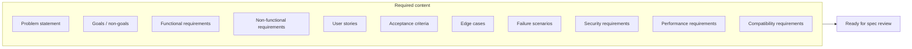

### Specification skeleton

```markdown
# Spec: <change-id>

## 1. Problem statement
<Who is affected, what is broken or missing, what it costs. No solution language.>

## 2. Goals
- G1 ...
- G2 ...

## 3. Non-goals
- NG1 ...

## 4. Users and scenarios
| Actor | Scenario | Value |
| --- | --- | --- |

## 5. Functional requirements
### FR-1 ...
**Acceptance criteria**
- AC-1.1 ...

## 6. Non-functional requirements
| ID | Category | Target | Condition | Verification |
| --- | --- | --- | --- | --- |

## 7. Edge cases
| Case | Expected behavior |
| --- | --- |

## 8. Failure scenarios
| Failure | Detection | Behavior | Recovery |
| --- | --- | --- | --- |

## 9. Security requirements
## 10. Compatibility requirements
## 11. Open questions
| ID | Question | Blocking | Owner | Status |
```

### Writing measurable acceptance criteria

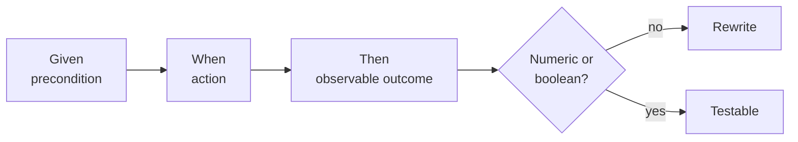

| Weak | Strong |
| --- | --- |
| "Login is secure" | "After 5 failed attempts in 10 minutes, the account is locked for 15 minutes and returns `429` with `Retry-After`" |
| "Export is fast" | "p95 first byte < 1.5 s at 100k rows and 20 concurrent exports" |
| "Handle errors" | "On upstream `503`, retry 3 times with exponential backoff (100/300/900 ms), then return `502` with correlation ID" |

### Exit criteria — Phase B (Specification)

- [ ] Every requirement has at least one acceptance criterion.
- [ ] Every NFR has a number, a condition, and a verification method.
- [ ] Non-goals exist and are specific.
- [ ] Failure and edge behavior are specified, not implied.
- [ ] Open questions are resolved or marked non-blocking with a default.

---

## 5. Phase C — Architecture and planning

**Question:** how will it work, what did we reject, and how do we reverse it?

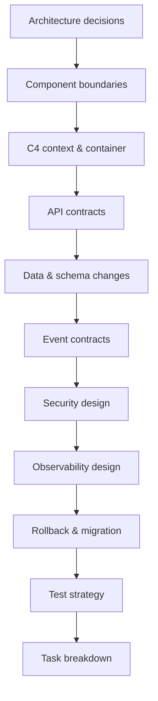

### C4 context (example)

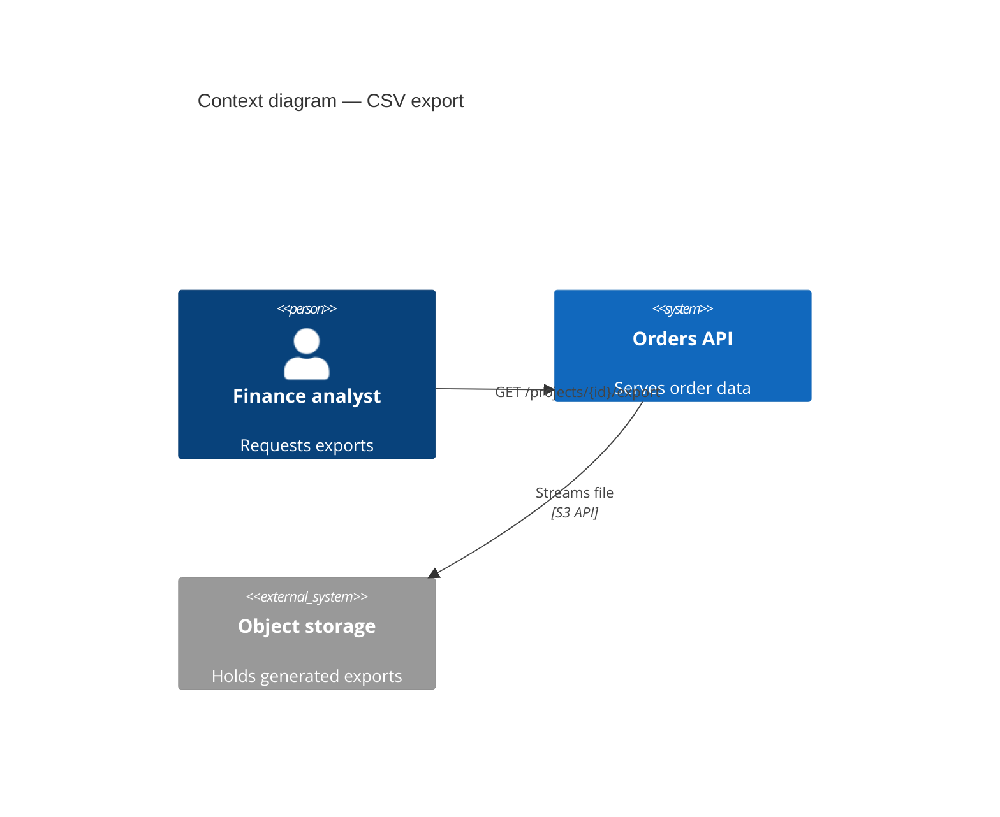

> `C4Context` requires Mermaid ≥ 9.4 with the C4 diagram pack enabled. If your renderer does
> not support it, use the flowchart version below — it is universally supported.

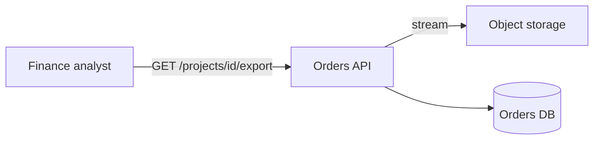

### Architecture decision record

See [`templates/architecture-decision-record.md`](../templates/architecture-decision-record.md).
An ADR is required when the decision is expensive to reverse, affects an external contract,
or constrains future work.

### Rollback strategy template

```markdown
## Rollback
| Artifact | Reversible? | Procedure | Time to roll back | Data loss |
| --- | --- | --- | --- | --- |
| App deploy | Yes | Redeploy previous image tag | < 5 min | None |
| DB migration 0042 | No (drop column) | Forward-fix only; backup restore in extreme case | 45 min | Rows created after deploy |
| Feature flag `export_v2` | Yes | Disable flag | < 1 min | None |
```

A migration without a rollback or forward-fix plan fails this phase.

### Test strategy

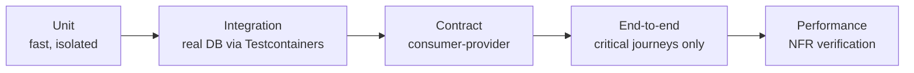

### Task breakdown rules

| Rule | Rationale |
| --- | --- |
| Each task references a requirement ID | Traceability |
| Each task has a definition of done | Removes "mostly done" |
| Each task lists files it expects to touch | Improves review scoping |
| Parallelizable tasks are marked | Enables multi-agent execution |
| Blocking tasks are explicit | Prevents false parallelism |

---

## 6. Phase D — Specification review

**Question:** is this specification complete, consistent, and buildable as written?

This phase is **read-only**. See [chapter 17](./17-specification-review.md) for the full
method and prompts.

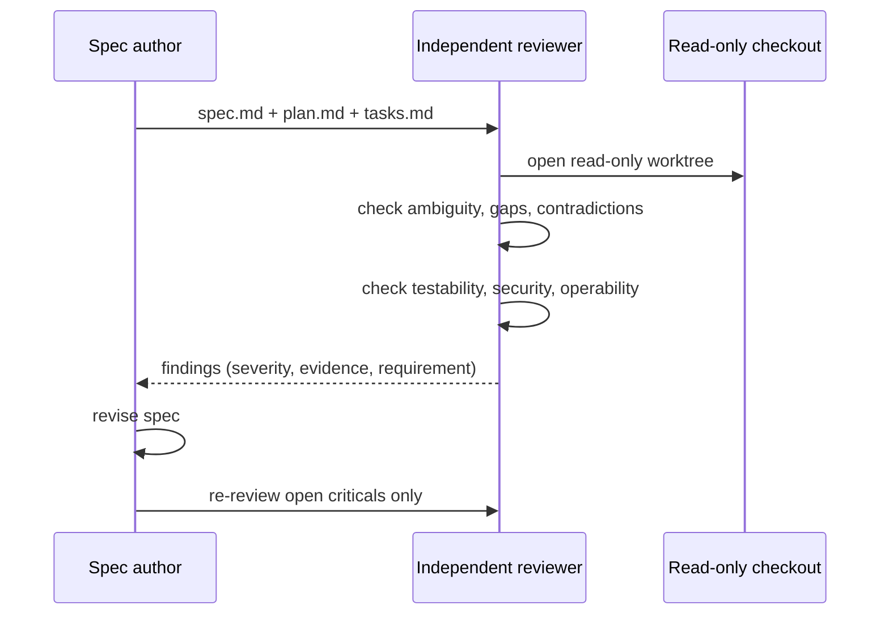

### Finding format

```markdown
| ID | Severity | Requirement | Finding | Evidence | Recommendation |
| --- | --- | --- | --- | --- | --- |
| S-01 | HIGH | FR-3 | Row-visibility rule conflicts with AC-3.2 | spec.md:88 vs spec.md:96 | Define precedence; add test for admin override |
```

### Exit criteria — Phase D (Specification review)

- [ ] No open `CRITICAL` or `HIGH` findings.
- [ ] Every finding has a requirement reference and evidence.
- [ ] Reviewer did not modify any file.
- [ ] Author responses are recorded, not silently applied.

---

## 7. Phase E — Implementation

**Question:** can we build exactly the approved scope, with tests?

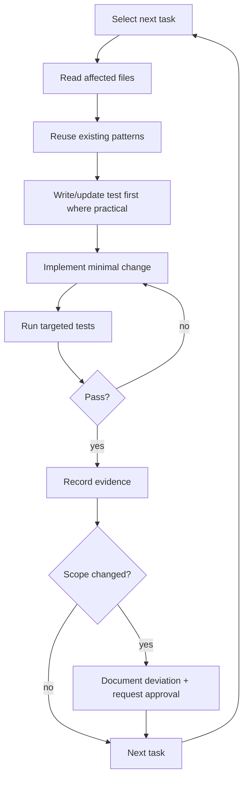

### Implementation obligations

| Obligation | Evidence produced |
| --- | --- |
| Follow the approved specification | Task ↔ requirement mapping |
| Inspect before adding | Search results / reused symbols listed |
| Reuse established patterns | Reference to existing implementation |
| Avoid unnecessary abstractions | Justification for each new abstraction |
| Small traceable changes | One commit or diff hunk group per task |
| Write or update tests | Test names mapped to ACs |
| Stay in scope | Diff file list vs planned file list |
| Document justified deviations | Deviation entry with approver |

### Deviation record

```markdown
## Deviation D-1 — added index on orders(project_id, created_at)
- **Trigger:** export query measured 4.2 s p95 at 100k rows (NFR-2 target 1.5 s).
- **Change from plan:** plan.md specified no schema change.
- **Reversible:** yes — index drop does not affect correctness.
- **Approved by:** @owner (2026-11-02)
- **Evidence:** `EXPLAIN ANALYZE` output in `evidence/export-query.txt`
```

---

## 8. Phase F — Verification

**Question:** does executed evidence satisfy every acceptance criterion?

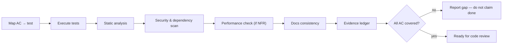

### Hard rules

1. **Never report a test as passed if it was not executed.** Include the command and the tail
   of its output.
2. **A skipped test is not a passing test.** Record skips with a reason.
3. **A test that cannot fail is not evidence.** Assert something observable.
4. **Flaky tests are `PARTIALLY VERIFIED` until stabilized.**
5. **Manual verification is acceptable if reproducible**, with steps and observed output.

### Verification report shape

See [`templates/verification-report.md`](../templates/verification-report.md).

---

## 9. Phase G — Independent code review

**Question:** is the diff correct, safe, and maintainable in the context of the whole system?

The reviewer is **read-only** and **independent**. Full method in
[chapter 19](./19-read-only-code-review.md).

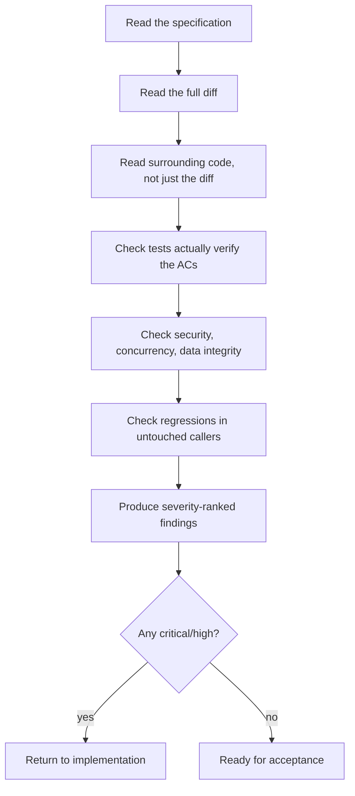

### What the reviewer must not do

- Edit source, tests, or formatting.
- Apply fixes "while reviewing".
- Re-run the author's convenience command and call it independent evidence.
- Approve based on the author's summary instead of the diff.

---

## 10. Phase H — Final acceptance

**Question:** did we deliver what we said, and what remains?

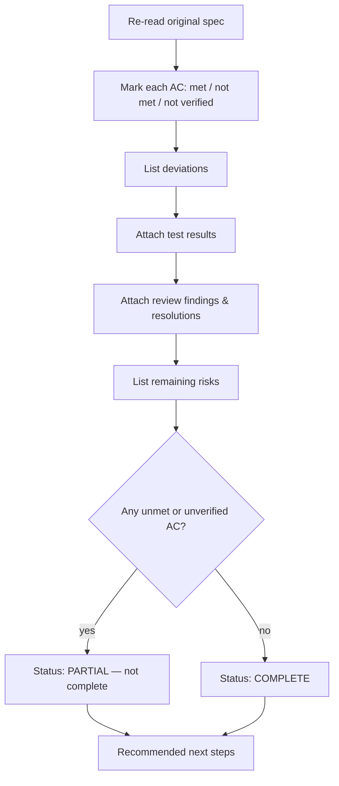

### Completion report template

```markdown
# Completion report — <change-id>

**Status:** COMPLETE | PARTIAL | BLOCKED
**Spec:** specs/<id>/spec.md @ <commit>
**Implementation range:** <base>..<head>

## Acceptance criteria
| AC | Status | Evidence |
| --- | --- | --- |
| AC-1.1 | VERIFIED | `pytest tests/test_export.py::test_visibility` — 1 passed |
| AC-2.1 | PARTIALLY VERIFIED | unit covered; load test not run (no perf env) |

## Deviations
| ID | Description | Approved by |
| --- | --- | --- |

## Review findings
| ID | Severity | Status |
| --- | --- | --- |

## Remaining risks
- R1: perf unverified in production-like environment.

## Recommended next steps
1. Run `perf/export_load_test.py` in staging.
2. Enable flag for 5% of accounts.
```

> **Never claim complete convergence while an acceptance criterion is `UNVERIFIED`.**

---

## 11. Gate matrix

| Gate | Blocking? | Owner | Waivable by |
| --- | --- | --- | --- |
| Spec approved | Yes | Product + engineering | Explicit recorded waiver |
| Spec review clean (no critical/high) | Yes | Independent reviewer | Engineering lead |
| Design/ADR recorded | Yes for architectural change | Architect | Engineering lead |
| Tests executed | Yes | Implementer | Nobody |
| Security review clean (security-relevant) | Yes | Security reviewer | Security lead |
| Code review clean | Yes | Independent reviewer | Engineering lead |
| Acceptance report | Yes | Product owner | Nobody |

---

## 12. Verification of this chapter

No executable commands. Gate definitions are consistent with
[chapter 22](./22-git-and-commit-policy.md) (Git authorization) and
[chapter 24](./24-multi-agent-engineering.md) (role separation).

---

## 13. References

- GitHub Spec Kit process reference — <https://github.github.io/spec-kit/reference/agentic-sdd.html>
- OpenSpec five-step loop — <https://openspec.dev/docs/quickstart>
- Kiro three-artifact model — <https://kiro.dev/docs/specs/>
- BMAD planning paths — <https://docs.bmad-method.org/plan/choose-a-planning-path/>
- ISO/IEC/IEEE 29148 (requirements engineering) — normative reference for requirement quality
- *Working Effectively with Legacy Code* (Feathers) — characterization tests used in chapter 16

---

**Previous:** [01 — Fundamentals](./01-fundamentals.md) ·
**Next:** [03 — Repository discovery](./03-repository-discovery.md) ·
**Back to index:** [00-index.md](00-index.md)
