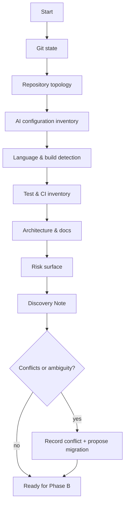
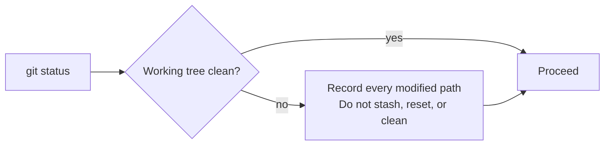
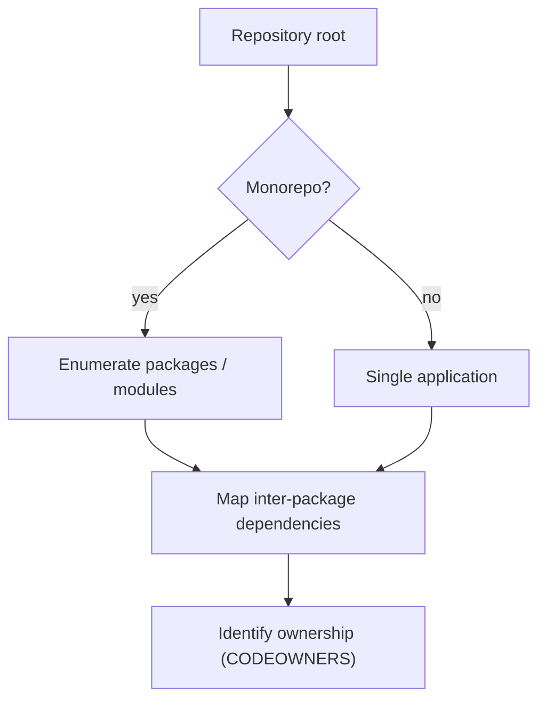
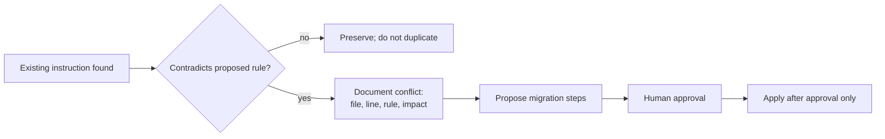
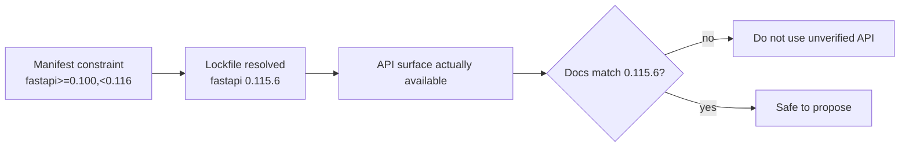
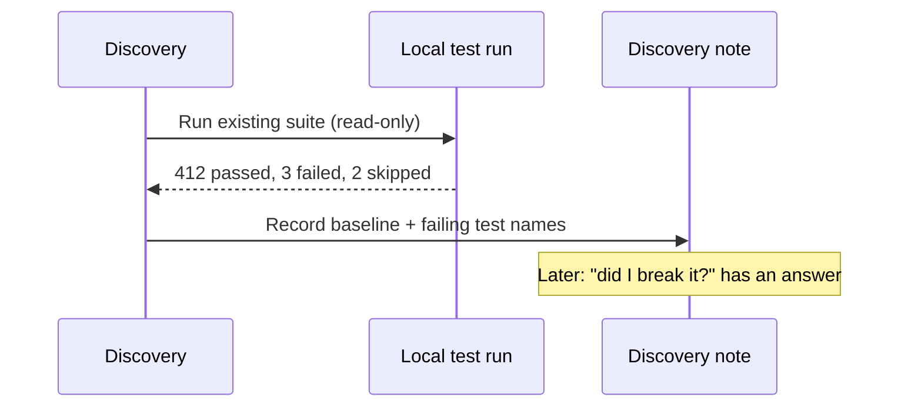
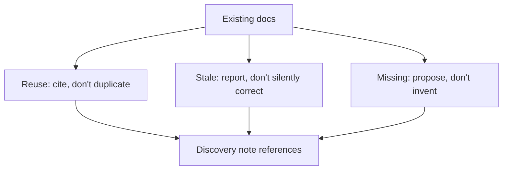
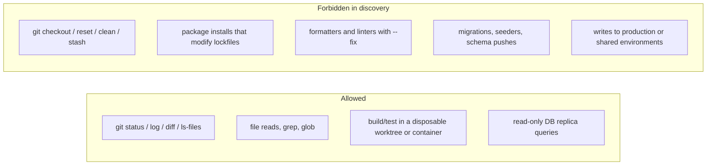

# 03 — Repository Discovery

> The single highest-leverage habit in agent engineering: **establish ground truth before
> proposing anything.** Most hallucinated changes start with an unverified assumption about
> the repository.

---

## 1. Purpose

This chapter defines a repeatable, read-only discovery procedure that an agent (or human)
runs before writing a specification, a plan, or code. It produces a **Discovery Note** that
later phases cite.

**Read-only by contract.** Every command in this chapter inspects state. None modifies files,
branches, or configuration.

---

## 2. When to use it

| Trigger | Minimum depth |
| --- | --- |
| First session in a repository | Full |
| New feature in an unfamiliar module | Full for that module |
| Bug fix in a known area | Targeted |
| Dependency upgrade | Full dependency + build + test depth |
| Security review | Full + exposure surface |
| Re-running after significant changes | Incremental (diff against last note) |

---

## 3. Discovery flow



---

## 4. Step 1 — Git state

**Never** start work without knowing what is already uncommitted. Destroying a user's
in-progress work is unrecoverable.

```bash
git --no-pager status --short --branch
git --no-pager branch -a
git --no-pager log --oneline -20
git --no-pager remote -v
git --no-pager stash list
git --no-pager diff --stat
git --no-pager diff --cached --stat
```



| Observation | Consequence for the agent |
| --- | --- |
| Uncommitted changes in files you must edit | Ask before proceeding; never discard |
| Detached HEAD | Do not create commits without confirmation |
| Branch behind remote | Do not rebase or force-push without authorization |
| Stash entries present | Leave them alone; they may be the user's only copy |
| Merge conflict markers | Stop; report; do not "fix" silently |

**PowerShell equivalents** (Windows):

```powershell
git --no-pager status --short --branch
git --no-pager branch -a
git --no-pager log --oneline -20
git --no-pager stash list
Get-ChildItem -Force                     # instead of ls -la
Get-ChildItem -Recurse -Filter *.md | Select-Object -First 40
```

> Use `git --no-pager` on Windows too; the default pager blocks non-interactive shells.

> **Prohibited without explicit authorization:** `git reset --hard`, `git clean -fd`,
> `git checkout -- <file>`, `git stash drop`, `git push --force`, `git commit --amend` on
> someone else's commit, `git rebase` of shared branches.

---

## 5. Step 2 — Repository topology

```bash
# Tracked files only — ignores build output and node_modules
git ls-files | head -200

# Directory shape
ls -la
find . -maxdepth 2 -type d -not -path './.git*' -not -path './node_modules*' | sort

# Size profile (which areas are large/complex)
git ls-files | awk -F/ '{print $1}' | sort | uniq -c | sort -rn | head -20
```



| Signal | What it tells you |
| --- | --- |
| Workspace file (`pnpm-workspace.yaml`, `settings.gradle(.kts)`, `*.sln`, `go.work`) | Monorepo / multi-module |
| Multiple lockfiles | Polyglot repo or migration in progress |
| `CODEOWNERS` | Who must review what |
| Vendored directories | Do not modify; find the upstream source |

---

## 6. Step 3 — AI configuration inventory

An agent must not overwrite or contradict existing instructions. Inventory them first.

```bash
ls -la AGENTS.md CLAUDE.md GEMINI.md .github/copilot-instructions.md 2>/dev/null
find . -maxdepth 3 \( -name 'AGENTS.md' -o -name 'CLAUDE.md' -o -name 'GEMINI.md' \
  -o -name '*.instructions.md' -o -name '*.prompt.md' -o -name '*.agent.md' \
  -o -name 'SKILL.md' -o -name '.cursorrules' -o -name '*.mdc' \) \
  -not -path './.git/*' -not -path './node_modules/*' | sort
ls -la .specify openspec _bmad .kiro .claude .cursor .agents 2>/dev/null
```

### Known instruction conventions (verified 2026-11-02)

| File / location | Consumed by | Notes |
| --- | --- | --- |
| `.github/copilot-instructions.md` | GitHub Copilot (VS Code) | Workspace-wide instructions |
| `.github/instructions/**/*.instructions.md` | GitHub Copilot | Front matter `applyTo` glob decides attachment |
| `.github/prompts/*.prompt.md` | GitHub Copilot | Reusable prompt files |
| `.github/agents/*.agent.md` | GitHub Copilot | Custom agent definitions |
| `.github/skills/<name>/SKILL.md` | GitHub Copilot | Agent skills |
| `AGENTS.md` | Codex, and cross-agent convention; also read by VS Code Copilot harnesses | Shared format when teams use multiple harnesses |
| `CLAUDE.md`, `.claude/rules/*.md` | Claude Code | Claude-specific; rules support `paths` front matter |
| `GEMINI.md` | Gemini CLI | Project context |
| `.cursor/rules/*.mdc` | Cursor | Rule files with globs |
| `.kiro/steering/*.md` | Kiro | Front matter `inclusion` mode |
| `.agents/skills/` | OpenSpec and other skill-aware tools | Shared skills folder |

> Precedence and support differ per harness. Do not assume that writing `AGENTS.md` covers
> every tool. [Chapter 12](./12-coding-agent-integration.md) documents the mapping.

### Conflict protocol



---

## 7. Step 4 — Language, build, and dependency detection

Detect by **manifest presence**, never by file extension alone.

| Manifest / file | Ecosystem | Tooling |
| --- | --- | --- |
| `pom.xml` | Java (Maven) | `mvn`, Surefire/Failsafe |
| `build.gradle`, `build.gradle.kts`, `settings.gradle*` | Java/Kotlin (Gradle) | `./gradlew` |
| `pyproject.toml`, `uv.lock`, `poetry.lock`, `requirements*.txt`, `Pipfile` | Python | `uv` / `poetry` / `pip` |
| `*.csproj`, `*.sln`, `global.json`, `Directory.Build.props` | .NET | `dotnet` |
| `package.json` + `pnpm-lock.yaml` / `package-lock.json` / `yarn.lock` | Node.js / TS | `pnpm` / `npm` / `yarn` |
| `go.mod`, `go.sum` | Go | `go` |
| `Cargo.toml`, `Cargo.lock` | Rust | `cargo` |
| `composer.json`, `composer.lock` | PHP | `composer` |
| `*.tf`, `*.tfstate` (never read state blindly) | Terraform | `terraform` |
| `Chart.yaml`, `kustomization.yaml`, `*.yaml` with `kind:` | Kubernetes | `kubectl`, `helm`, `kustomize` |
| `ansible.cfg`, `playbooks/` | Ansible | `ansible-playbook` |

### Read the *resolved* version, not the constraint

```bash
# Python (uv)
grep -A2 '^name = "fastapi"' uv.lock | head -5

# Node
node -p "require('./package-lock.json').packages['node_modules/express'].version"

# .NET
dotnet list package --include-transitive

# Java (Maven)
./mvnw -q dependency:list | head -40

# Go
go list -m all | head -40

# Rust
cargo tree --depth 1
```



> **Rule:** a version range tells you what *might* be installed. Only the lockfile (or the
> running environment) tells you what *is* installed. Cite the lockfile.

---

## 8. Step 5 — Tests and CI

```bash
# Test layout
git ls-files | grep -Ei '(^|/)(test|tests|spec|__tests__)/|(_test|\.test|\.spec|Tests)\.' | head -50

# CI pipelines
find . -maxdepth 3 \( -path './.github/workflows/*' -o -name '.gitlab-ci.yml' \
  -o -name 'Jenkinsfile' -o -name 'azure-pipelines.yml' -o -name '.circleci' \
  -o -name 'bitbucket-pipelines.yml' \) -not -path './.git/*'

# Build tool wrappers
ls -la mvnw gradlew 2>/dev/null
```

| Question | Why it matters |
| --- | --- |
| What command runs the tests? | Verification must use the project's real command |
| Are tests currently passing? | A red baseline invalidates "my change broke it" reasoning |
| Is there a flaky-test quarantine? | Prevents misattribution |
| What does CI require to merge? | Determines Mode 4 feasibility |
| Is coverage enforced? | Determines whether new code needs coverage |

**Baseline before change.** Run the existing suite once and record the result. Without a
baseline, you cannot distinguish your regression from a pre-existing failure.



> If the baseline is red, record it and state it in every subsequent report. Do not fix
> unrelated tests without authorization.

---

## 9. Step 6 — Architecture and documentation

```bash
git ls-files | grep -Ei '(^|/)(docs?|architecture|adr|rfcs?)/|README|CONTRIBUTING|CHANGELOG' | head -60
find . -maxdepth 2 -name '*.md' -not -path './.git/*' -not -path './node_modules/*'
```

Look for, in priority order:

1. `README.md` — setup, run, test commands.
2. `CONTRIBUTING.md` — conventions, commit rules, review expectations.
3. `docs/adr/` or `docs/decisions/` — why the system looks like this.
4. Architecture diagrams or `arc42` docs.
5. `CODEOWNERS` — review routing.
6. `CHANGELOG.md` — release conventions.
7. OpenAPI/AsyncAPI/protobuf contracts — external promises.



**Do not duplicate documentation.** If an architecture description exists, link to it. If it
is stale, report the discrepancy with evidence.

---

## 10. Step 7 — Risk surface

```bash
# Secrets-like files that should never be committed
git ls-files | grep -Ei '\.(env|pem|key|p12|pfx|jks|keystore)$|(^|/)id_rsa|credentials' | head -20

# Dangerous patterns worth reviewing (illustrative, not a security audit)
grep -rn --include='*.py' -E 'subprocess\.(call|run|Popen)\(.*shell\s*=\s*True' . | head
grep -rn --include='*.js' --include='*.ts' -E '\beval\(|dangerouslySetInnerHTML' src 2>/dev/null | head
```

| Risk area | Discovery question |
| --- | --- |
| Authentication / authorization | Where is the single enforcement point? |
| Secrets | How are they injected? Is anything committed? |
| Data classification | PII, payment, health data present? |
| External calls | Timeouts, retries, circuit breakers? |
| Migrations | Tool, ordering, reversibility |
| Concurrency | Shared mutable state, locks, idempotency keys |
| Blast radius | What breaks if this service is down? |

---

## 11. The Discovery Note template

````markdown
# Discovery Note — <topic> — <YYYY-MM-DD>

## 1. Repository
- Root: `<path>` | Default branch: `<name>` | HEAD: `<sha>`
- Working tree: clean | dirty (files: ...)
- Monorepo: yes/no — packages: ...

## 2. Existing AI configuration
| File | Tool | Effect | Conflict with proposed change |
| --- | --- | --- | --- |

## 3. Stack (verified from manifests)
| Layer | Technology | Version (source) |
| --- | --- | --- |

## 4. Build & test commands (verified)
| Purpose | Command | Baseline result |
| --- | --- | --- |

## 5. Existing implementation of the target area
| Concern | Location | Reuse? |
| --- | --- | --- |

## 6. CI & release
- Pipelines: ...
- Required checks: ...
- Release mechanism: ...

## 7. Architecture constraints
- ADRs: ...
- Contracts: ...

## 8. Facts
- F1 ...

## 9. Assumptions
- A1 ... (verification needed: ...)

## 10. Unknowns
| ID | Unknown | Blocking | Plan to resolve |
| --- | --- | --- | --- |

## 11. Risks
| ID | Risk | Likelihood | Impact | Mitigation |
| --- | --- | --- | --- | --- |
````

---

## 12. Read-only guarantees

Discovery must be incapable of changing state. Practical controls:



**Enforcement options, strongest first:**

1. Separate read-only worktree on a read-only filesystem mount.
2. Container with the repo mounted `:ro` and no network.
3. Agent tool allow-list that excludes write tools.
4. Instruction-only restriction (weakest — a model can still comply incorrectly).

> **Limitation to state explicitly:** an instruction-only "do not edit" rule is not a
> technical control. If the environment cannot enforce read-only access, say so in the review
> report and recommend a read-only checkout. See [chapter 19](./19-read-only-code-review.md).

---

## 13. Common mistakes

| Mistake | Consequence | Fix |
| --- | --- | --- |
| Reading only file extensions | Wrong toolchain assumptions | Detect from manifests |
| Trusting `package.json` range | Using APIs not present in the lockfile | Read lockfile / `go list` / `cargo tree` |
| Ignoring uncommitted changes | User work lost | `git status` first, always |
| Running the full suite after the change only | Misattributed failures | Baseline before change |
| Treating stale docs as truth | Implementing against obsolete architecture | Verify against code; report drift |
| Duplicating an existing instruction file | Contradictory agent behavior | Inventory then link |
| Assuming one agent harness | Broken instructions for half the team | Use shared formats; document per-tool |

---

## 14. Troubleshooting

| Symptom | Likely cause | Action |
| --- | --- | --- |
| `git ls-files` empty | Not a Git repo | Run `git rev-parse --is-inside-work-tree` |
| Huge output from `find` | `node_modules`/`target`/`bin` not excluded | Use `git ls-files` or explicit excludes |
| Lockfile missing | Not committed, or generated at install | Record as unknown; do not invent versions |
| Test command unknown | No docs, no CI | Search CI config; if absent, ask |
| Conflicting instruction files | Multiple tools onboarded independently | Document conflict; propose one source of truth |
| Very large monorepo | Full discovery too slow | Scope discovery to the affected package graph |

---

## 15. Verification of this chapter

The command set above uses standard Git and shell utilities. Commands marked as examples were
not executed against a target repository in this handbook (the repository is documentation-only),
so treat the flags as **illustrative but standard**; verify with `--help` in your environment.
Language-specific commands are documented per guide in
[`language-guides/`](../language-guides/README.md).

---

## 16. References

- Git documentation — <https://git-scm.com/docs>
- GitHub Spec Kit, adopting in an existing project — <https://github.github.io/spec-kit/guides/existing-projects.html>
- OpenSpec, set up your project — <https://openspec.dev/docs/setup>
- BMAD, starting in an existing codebase — <https://docs.bmad-method.org/existing-codebases/start-in-an-existing-codebase/>
- Kiro steering (project context files) — <https://kiro.dev/docs/steering/>
- VS Code Copilot custom instructions — <https://code.visualstudio.com/docs/copilot/customization/custom-instructions>

---

**Previous:** [02 — Engineering lifecycle](./02-engineering-lifecycle.md) ·
**Next:** [04 — Tool comparison](./04-tool-comparison.md)
