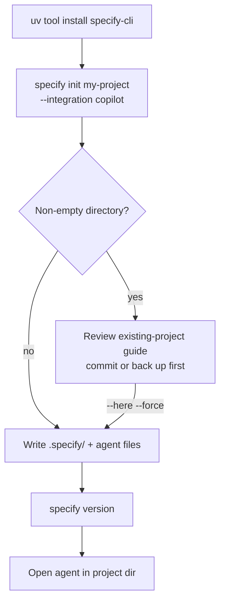
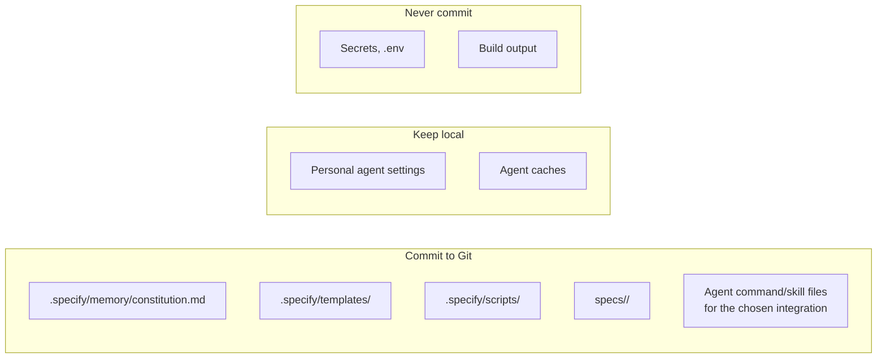
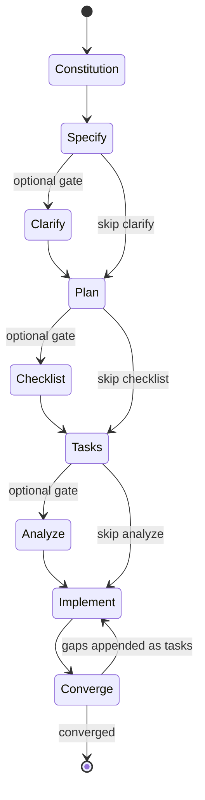
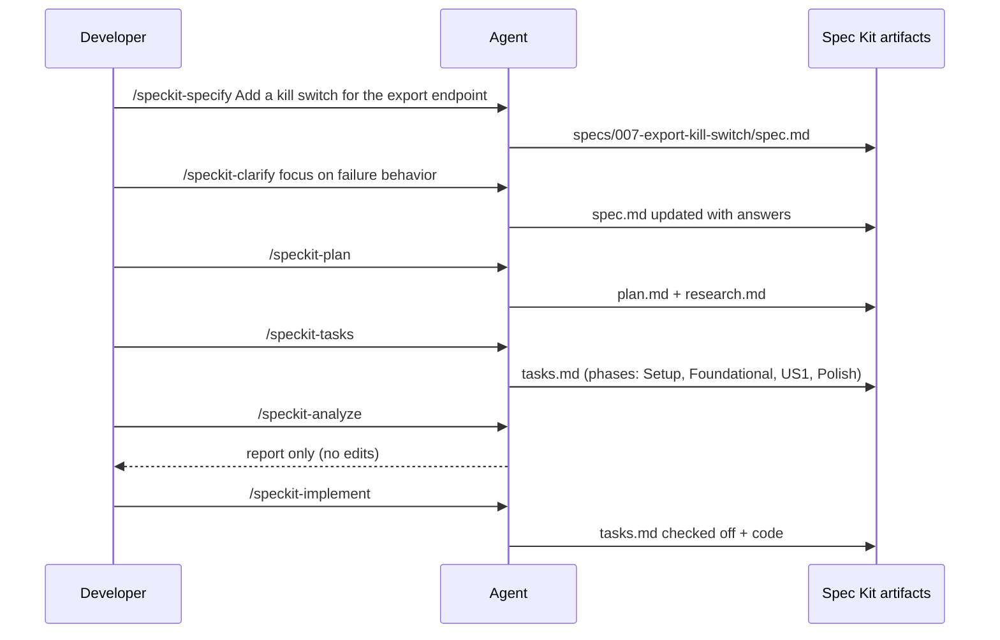
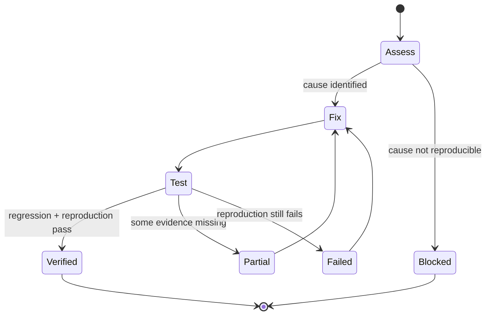
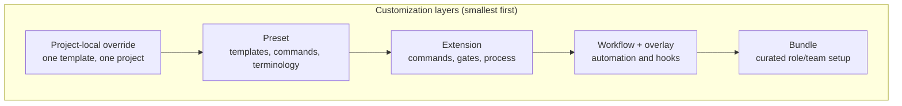
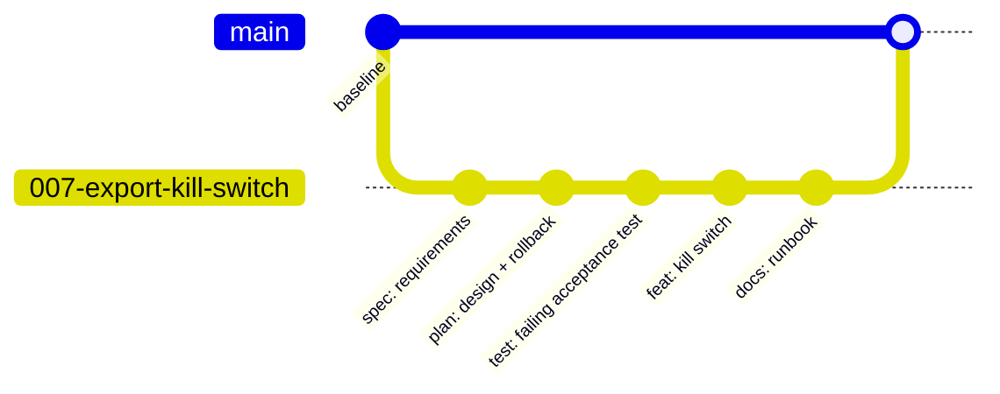
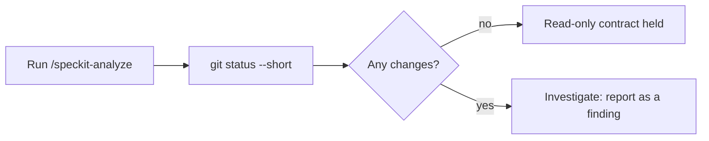

# 05 — GitHub Spec Kit

> Verified against `specify-cli` **1.2.5** (release 2026-10-28) and the official docs at
> <https://github.github.io/spec-kit/> on **2026-11-02**.

---

## 1. Purpose

Spec Kit is an open-source toolkit (MIT) that gives AI coding agents a structured process —
templates, commands/skills, a project constitution, and optional quality gates — and produces
reviewable Markdown artifacts instead of ephemeral chat.

It ships three independent entry points:

| Entry point | For | Output |
| --- | --- | --- |
| Spec-Driven Development (core) | Features and applications | spec → plan → tasks → implementation → convergence |
| Bug fixing (bundled extension) | Broken behavior | assessed cause, scoped fix, recorded verification |
| Idea assessment (bundled extension) | Go/no-go decisions | evidence-backed decision record |

---

## 2. When to use it

| Use Spec Kit when | Avoid it when |
| --- | --- |
| You want a vendor-neutral, file-based SDD loop | You need zero new files in the repo |
| Multiple agents/harnesses must share one process | You cannot install Python tooling |
| You want optional gates (clarify, checklist, analyze) | The work is a one-line fix |
| You want read-only cross-artifact analysis | You already run a different spec system for the same artifacts |

---

## 3. Prerequisites

| Requirement | Detail |
| --- | --- |
| Python | 3.11+ |
| Package runner | [`uv`](https://docs.astral.sh/uv/) (recommended by upstream) |
| Agent | A supported coding agent with skills or commands support |
| OS | Linux, macOS, Windows |
| Git | Optional for core; required for the `git` extension workflow |

---

## 4. Installation

```bash
# Install the CLI (uv)
uv tool install specify-cli

# Verify
specify version

# Check for a newer release (read-only)
specify self check
```

Initialize a project:

```bash
specify init my-project --integration copilot
cd my-project
```

Initialize in an existing repository:

```bash
# Run from the repository root; review the diff afterwards
specify init --here --force --non-interactive --integration claude
```

| Flag | Meaning |
| --- | --- |
| `--integration <key>` | Select the agent integration (see table below) |
| `--here` | Initialize the current directory instead of creating one |
| `--force` | Acknowledge the merge warning for a non-empty directory |
| `--non-interactive` | Never wait on an arrow-key picker (CI / agent harness) |
| `--ignore-agent-tools` | Skip the agent executable check |
| `--script sh\|ps\|py` | Choose the helper script variant |
| `--integration-options="--skills"` | Enable skills mode where the integration supports both |



### Verified integration keys (partial list)

Keys observed in the official integrations table on 2026-11-02:

`copilot`, `claude`, `codex`, `cursor-agent`, `gemini`, `cline`, `amp`, `goose`, `droid`, `devin`,
`auggie`, `agy`, `codebuddy`, `command-code`, `dsh`, `docker-agent`, `firebender`, `forge`, `grok`,
`hermes`, `alquimia`, `none`.

> The full list changes between releases and the table above is truncated by the page layout. Confirm
> the current keys with `specify integration --help` or the official integrations page before
> scripting `--integration` in CI. `none` produces an agent-neutral project.

### Managing integrations in an existing project

```bash
specify integration install <key>     # add another agent
specify integration use <key>         # switch the default
specify integration switch <key>      # replace the installed integration
specify integration uninstall <key>   # remove Spec Kit's files for that agent
specify integration status            # show installed + default
```

**Team pattern:** initialize with `--integration none`, let each developer
`specify integration switch <key>` locally, then switch back to `none` before committing.
This keeps agent-specific files out of the shared baseline.

---

## 5. Configuration and generated structure

```text
my-project/
├── .specify/
│   ├── memory/
│   │   └── constitution.md          # project principles
│   ├── templates/
│   │   ├── spec-template.md
│   │   ├── plan-template.md
│   │   ├── tasks-template.md
│   │   └── checklist-template.md
│   ├── scripts/
│   │   └── bash|powershell|python/  # helper scripts (prereqs, feature creation)
│   └── feature.json                 # active feature pointer
├── specs/
│   └── 001-<feature-name>/
│       ├── spec.md
│       ├── plan.md
│       ├── tasks.md
│       ├── research.md              # when generated
│       └── checklists/
│           ├── requirements.md      # built-in spec-quality checklist
│           └── <custom>.md          # from /speckit-checklist
└── <your source code, untouched>
```



**Active feature resolution.** Spec Kit tracks the active feature via
`.specify/feature.json`, overridable with `SPECIFY_FEATURE_DIRECTORY`. It does **not** resolve
from the Git branch. The opt-in `git` extension adds numbered branches
(`001-feature-name`) for organization, but `git checkout` alone does not change the active
feature.

---

## 6. The workflow



### Command / skill reference (verified)

| Command form | Skill form | Purpose |
| --- | --- | --- |
| `/speckit.constitution` | `speckit-constitution` | Establish or update principles |
| `/speckit.specify` | `speckit-specify` | Define requirements and user stories |
| `/speckit.clarify` | `speckit-clarify` | Resolve ambiguity before planning |
| `/speckit.plan` | `speckit-plan` | Technical implementation plan |
| `/speckit.checklist` | `speckit-checklist` | Requirements-quality checklists |
| `/speckit.tasks` | `speckit-tasks` | Dependency-ordered task list |
| `/speckit.analyze` | `speckit-analyze` | **Read-only** cross-artifact analysis |
| `/speckit.implement` | `speckit-implement` | Execute tasks |
| `/speckit.converge` | `speckit-converge` | Assess implementation vs artifacts, append remaining work |

> **Invocation differs per agent.** Copilot uses skills by default (`/speckit-specify`).
> Codex-style hosts may use `$speckit-*`, Kimi `/skill:speckit-*`. See
> <https://github.github.io/spec-kit/integrations/cli.html#command-invocation>.

### Step-by-step with examples

```text
# 1 — once per project
/speckit-constitution Preserve public API compatibility. Every database migration must
include a rollback plan. Run the repository's established unit and integration suites.

# 2 — per feature
/speckit-specify Add CSV export to the existing orders page. Preserve current filters and
authorization behavior. Export only rows visible to the signed-in user. Do not change the
existing JSON API response.

# 3 — resolve ambiguity (repeatable, optional)
/speckit-clarify Focus on authorization precedence for admins and the maximum export size.

# 4 — technical plan
/speckit-plan Use the existing FastAPI stack and SQLAlchemy session. Stream the response;
do not buffer the whole result set. No new dependencies.

# 5 — optional requirements-quality gate
/speckit-checklist Focus on authorization, empty results, and large datasets.

# 6 — tasks
/speckit-tasks

# 7 — optional consistency gate (read-only)
/speckit-analyze

# 8 — implement
/speckit-implement Implement only the Setup and Foundational phases. Stop before the
user-story features.

# 9 — converge
/speckit-converge
```

> **Important:** these are **agent skills/commands, not shell commands.** Only installation and
> project setup run in a terminal.

### Checklist semantics

`/speckit-checklist` generates *requirements-quality* checklists ("unit tests for your
requirements"). For custom checklists, `[x]` means **a reviewer determined the criterion is
satisfied** — not that implementation is complete. `/speckit-implement` reads checkbox state
as a gate but **must not modify the markers**.

---

## 7. Complete examples

### 7.1 Feature: feature-flag rollout



### 7.2 Bug fixing (bundled `bug` extension)

```bash
specify extension add bug
```

```text
/speckit-bug-assess "Submitting an empty password crashes the login form." slug=login-crash
/speckit-bug-fix slug=login-crash
/speckit-bug-test slug=login-crash
```

Artifacts land in `.specify/bugs/login-crash/`. The verdict is `verified`, `partial`, or
`failed` — **only `verified` confirms a successful fix.**



### 7.3 Idea assessment (bundled `assess` extension)

```bash
specify extension add assess
```

```text
/speckit-assess-intake "Let users work offline and sync when they reconnect." slug=offline-mode
/speckit-assess-research slug=offline-mode
/speckit-assess-define slug=offline-mode
/speckit-assess-shape slug=offline-mode
/speckit-assess-decide slug=offline-mode
```

Artifacts go to `.specify/assessments/offline-mode/`. Decision values: `go`,
`needs-clarification`, `kill`. On `go`, pass the handoff summary from `decision.md` to
`/speckit-specify`.

---

## 8. Extensions, presets, workflows, bundles



| Layer | Use for | Discovery command |
| --- | --- | --- |
| Project-local override | One-off template change | — |
| Preset | Org standards, regulatory traceability | `specify preset search` |
| Extension | New commands, gates, external tool bridging | `specify extension search` |
| Workflow / step | Automating prompts, commands, shell tasks | `specify workflow search` |
| Bundle | Role-based setup for a team | `specify bundle search` |

```bash
specify extension add git      # optional Git workflow (branches, init)
specify extension add github   # GitHub issues integration
specify extension add bug      # bug-fixing process
specify extension add assess   # idea assessment process
```

> **Do not hand-edit generated agent command/skill files.** Upstream states this explicitly:
> maintain customizations in reviewed presets or project-local overrides.

> **Catalog trust:** community catalog listings are not audits or endorsements. Review source
> before installing.

---

## 9. Git and commit policy

| Question | Answer (verified behavior) |
| --- | --- |
| Does core Spec Kit create commits? | No; Git is not required for core |
| Does it create branches? | Not by default; the `git` extension adds numbered feature branches |
| What should be committed? | `.specify/` (constitution, templates, scripts, feature.json), `specs/<feature>/`, and the agent files for the team's integration |
| What about mixed-agent teams? | Commit an agent-neutral baseline (`--integration none`) |
| Before committing with multiple integrations | `specify integration status`, then switch to `none` |

Recommended commit sequence (Mode 3 in [chapter 22](./22-git-and-commit-policy.md)):

```bash
git switch -c 007-export-kill-switch
# ... agent works, you review ...
git add .specify specs/007-export-kill-switch src tests
git commit -m "feat(export): add kill switch for CSV export"
```



---

## 10. Verification

| Check | Command | Expected |
| --- | --- | --- |
| CLI installed | `specify version` | prints a version |
| Update available | `specify self check` | read-only report |
| Integrations | `specify integration status` | lists installed/default |
| Artifacts exist | `ls specs/*/spec.md specs/*/plan.md specs/*/tasks.md` | one set per feature |
| Read-only analysis | run `/speckit-analyze` | reports only; no file changes (`git status` clean) |



---

## 11. Common mistakes

| Mistake | Effect | Fix |
| --- | --- | --- |
| Typing `/speckit-*` in a terminal | Nothing happens | These are agent chat commands |
| Running `/speckit-plan` before `/speckit-clarify` | Design built on ambiguity | Clarify first (repeatable) |
| Skipping the constitution | Every plan re-litigates principles | Run it once, update when principles change |
| Writing the tech stack into `/speckit-specify` | Spec becomes a design doc | Put stack decisions in `/speckit-plan` |
| Hand-editing generated command files | Lost on upgrade | Use presets/overrides |
| Checking checklist boxes as implementer | Self-approval of requirements quality | Reviewer owns custom checklists |
| Treating `git checkout` as feature switching | Commands operate on the wrong feature | Update `.specify/feature.json` or `SPECIFY_FEATURE_DIRECTORY` |
| Running with `--force` on a dirty tree | Merge surprises | Commit/back up first |

---

## 12. Troubleshooting

| Symptom | Likely cause | Action |
| --- | --- | --- |
| `specify: command not found` | `uv` tool bin not on `PATH` | `uv tool update-shell`, restart shell |
| Agent does not show `/speckit-*` | Integration files missing or wrong harness | `specify integration status`, reinstall integration |
| Commands act on an unexpected feature | `feature.json` points elsewhere | Edit `.specify/feature.json` or set `SPECIFY_FEATURE_DIRECTORY` |
| `init` hangs in CI | Interactive picker | Add `--non-interactive` |
| `init` refuses non-empty dir | Safety check | Review existing-project guide; use `--force` after backup |
| Scripts not executable | Wrong script variant | Re-run with `--script sh` (or `ps`/`py`) |
| `/speckit-implement` asks about unchecked items | Checklist gate | Review/complete the checklist as the reviewer |

---

## 13. Security considerations

| Risk | Control |
| --- | --- |
| Community extensions/presets execute instructions | Review source; pin versions; prefer internal catalogs |
| Specs may contain sensitive data | Treat `specs/` as code: review before commit |
| Agent may implement beyond approved scope | Review diff against `tasks.md` and `spec.md` |
| Generated scripts run in your environment | Inspect `.specify/scripts/` before first run |
| `--force` on existing repos | Back up; review diff; never blind-merge |
| Air-gapped constraints | Use the upstream air-gapped install guide with wheel bundles |

---

## 14. Maintenance: update and uninstall

| Action | Command | Notes |
| --- | --- | --- |
| Check for updates | `specify self check` | Read-only; never modifies the installation |
| Update the CLI | `uv tool install --upgrade specify-cli` | Standard `uv` usage; see the upstream Upgrade Guide |
| Refresh an integration | `specify integration switch <key>` | Regenerates that agent's files |
| Remove one agent integration | `specify integration uninstall <key>` | Removes Spec Kit's files for that agent, not the agent |
| Uninstall the CLI | `uv tool uninstall specify-cli` | Standard `uv` usage |
| Remove the project scaffolding | Delete `.specify/` and `specs/` | Destroys artifact history — back up or archive first |

**Preserving customizations:** keep changes in presets or project-local overrides. Generated
command/skill files are replaced on upgrade, which is exactly why upstream says not to edit them.

> Package-manager commands (`uv tool ...`) are standard tooling, not Spec Kit commands. Verify with
> `uv tool --help` in your environment.

## 15. Official references

- Repository — <https://github.com/github/spec-kit>
- Docs home — <https://github.github.io/spec-kit/>
- Installation — <https://github.github.io/spec-kit/installation.html>
- Quickstart — <https://github.github.io/spec-kit/quickstart.html>
- SDD command reference — <https://github.github.io/spec-kit/reference/agentic-sdd.html>
- Bug-fix reference — <https://github.github.io/spec-kit/reference/agentic-bugfix.html>
- Assessment reference — <https://github.github.io/spec-kit/reference/agentic-assessment.html>
- Existing projects — <https://github.github.io/spec-kit/guides/existing-projects.html>
- Customization — <https://github.github.io/spec-kit/guides/customization.html>
- Extensions — <https://github.github.io/spec-kit/reference/extensions.html>
- Presets — <https://github.github.io/spec-kit/reference/presets.html>
- Workflows — <https://github.github.io/spec-kit/reference/workflows.html>
- Bundles — <https://github.github.io/spec-kit/reference/bundles.html>

---

**Previous:** [04 — Tool comparison](./04-tool-comparison.md) ·
**Next:** [06 — OpenSpec](./06-openspec.md) ·
**Back to index:** [00-index.md](00-index.md)
