# 07 — AWS Kiro

> Verified against <https://kiro.dev/docs/> on **2026-11-02**. Kiro is a proprietary AWS
> product; it does not publish a public semantic version for the IDE. Treat product docs as the
> source of truth and re-check after upgrades.

---

## 1. Purpose

Kiro is an agentic development environment (IDE, CLI, web, mobile surfaces) with **specs** as a
first-class artifact type. It turns an intent into three files — requirements, design, tasks —
and provides **steering** for persistent project knowledge and **hooks** for event-driven
automation.

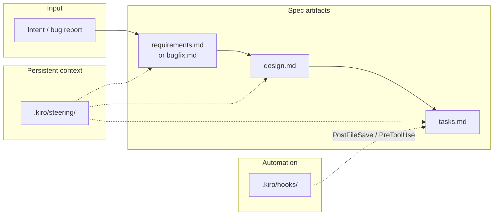

---

## 2. When to use it

| Use Kiro when | Avoid it when |
| --- | --- |
| You want specs, steering, and hooks in one integrated product | You require a vendor-neutral or offline-only toolchain |
| Your team is standardizing on AWS tooling | You cannot accept proprietary licensing |
| You want property-based correctness analysis on requirements | You need that analysis on every surface (IDE-only) |
| You need parallel task execution with dependency waves | Your tasks are inherently sequential |

---

## 3. Prerequisites

| Requirement | Detail |
| --- | --- |
| Account | AWS/Kiro account (sign-in required) |
| Product surface | Kiro IDE, Kiro CLI, or Kiro Web (feature availability differs by surface) |
| Repository | Git strongly recommended (specs and steering are files) |
| OS | Per the Kiro download page for your surface |

> **Surface matrix matters.** Kiro's docs mark capability support per surface. Example verified
> from the specs page: **Feature/Bugfix/Quick Spec and parallel task execution are supported in
> IDE, CLI, and Web; Correctness (property-based testing) is IDE-only; Mobile has none of
> these.** Do not assume parity.

---

## 4. Installation

Kiro is distributed by AWS. Installation is product-specific and changes over time, so this
handbook intentionally does **not** publish install commands it cannot verify for your surface.

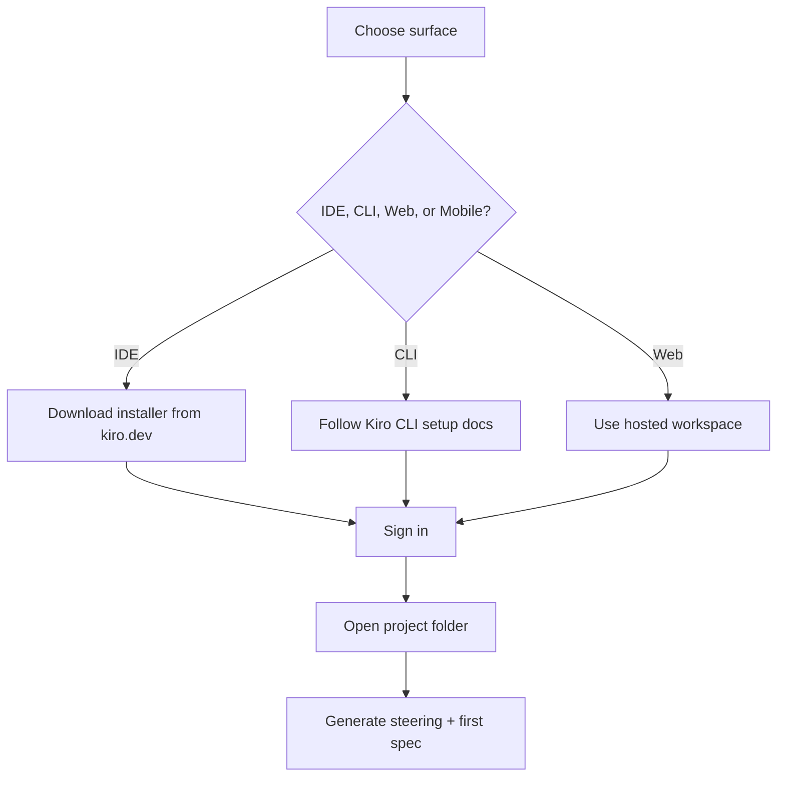

**Verification step:** after installation, open a project and confirm that `.kiro/` is created
when you generate steering documents. That is the observable proof that the workspace is
initialized.

---

## 5. Configuration: specs, steering, hooks

### 5.1 Directory layout

```text
your-project/
├── .kiro/
│   ├── specs/
│   │   └── <spec-name>/
│   │       ├── requirements.md      # feature spec
│   │       ├── design.md
│   │       └── tasks.md
│   ├── steering/
│   │   ├── product.md               # generated foundation steering
│   │   ├── tech.md
│   │   ├── structure.md
│   │   └── <custom>.md
│   └── hooks/
│       └── lint-on-save.json
└── <source code>
```

Global (user-level) equivalents live under `~/.kiro/steering/` and (for Kiro CLI V3)
`~/.kiro/hooks/`. **Conflict rule (verified):** workspace steering wins over global steering.

### 5.2 Steering files

Steering gives Kiro persistent project knowledge so conventions do not have to be restated in
every chat. Three foundation files are generated:

| File | Content |
| --- | --- |
| `product.md` | What the product is, who uses it, goals |
| `tech.md` | Stack, libraries, versions, constraints |
| `structure.md` | Repository/directory conventions, where things belong |

Custom steering files support four **inclusion modes** set in YAML front matter. Front matter
must be the **first content** in the file — no blank line before `---`.

```markdown
---
inclusion: always
---
# Security policy
All user input must be validated at the boundary.
Secrets must never be read from source files.
```

```markdown
---
inclusion: fileMatch
fileMatchPattern: ["**/*.ts", "**/*.tsx", "**/tsconfig.*.json"]
---
# TypeScript conventions
Prefer discriminated unions over boolean flags.
```

```markdown
---
inclusion: manual
---
# Migration runbook
Use only when performing a schema migration.
```

```markdown
---
inclusion: auto
name: api-design
description: REST API design patterns and conventions. Use when creating or modifying API endpoints.
---
# API design
```

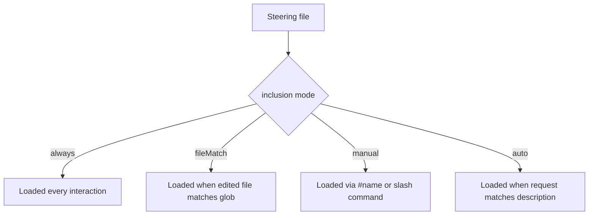

| Mode | Use for | Cost |
| --- | --- | --- |
| `always` | Stack, conventions, security policy | Highest context cost |
| `fileMatch` | Domain rules for specific file types | Low, targeted |
| `manual` | Runbooks, migration procedures | Zero until invoked |
| `auto` | Context-heavy domain knowledge | Model-decided relevance |

> **`AGENTS.md` compatibility (verified):** Kiro picks up `AGENTS.md` from the workspace root or
> from `~/.kiro/steering/`. However, **`AGENTS.md` files do not support inclusion modes** — they
> are always loaded. If you need conditional loading, use `.kiro/steering/*.md` with front matter.

### 5.3 Hooks

Hooks are JSON files in `.kiro/hooks/<id>.json`. Schema version is `"v1"`.

```json
{
  "version": "v1",
  "hooks": [
    {
      "name": "Lint on save",
      "trigger": "PostFileSave",
      "matcher": "\\.(ts|tsx)$",
      "action": {
        "type": "command",
        "command": "npx eslint --fix"
      }
    }
  ]
}
```

| Field | Required | Description |
| --- | --- | --- |
| `version` | Yes | `"v1"` |
| `hooks` | Yes | Array of hook definitions |
| `hooks[].name` | Yes | Human-readable identifier |
| `hooks[].description` | No | Documentation only |
| `hooks[].trigger` | Yes | PascalCase event name (e.g. `PostFileSave`, `PreToolUse`, `PostToolUse`) |
| `hooks[].matcher` | No | Regex on file path (file events) or tool selector/regex (tool events) |
| `hooks[].action.type` | Yes | `"command"` or `"agent"` |
| `hooks[].action.command` | Cond. | Shell command when `type` is `command` |
| `hooks[].action.prompt` | Cond. | Prompt injected when `type` is `agent` |

Command actions run in the **project root** and receive session context as JSON on **STDIN**.

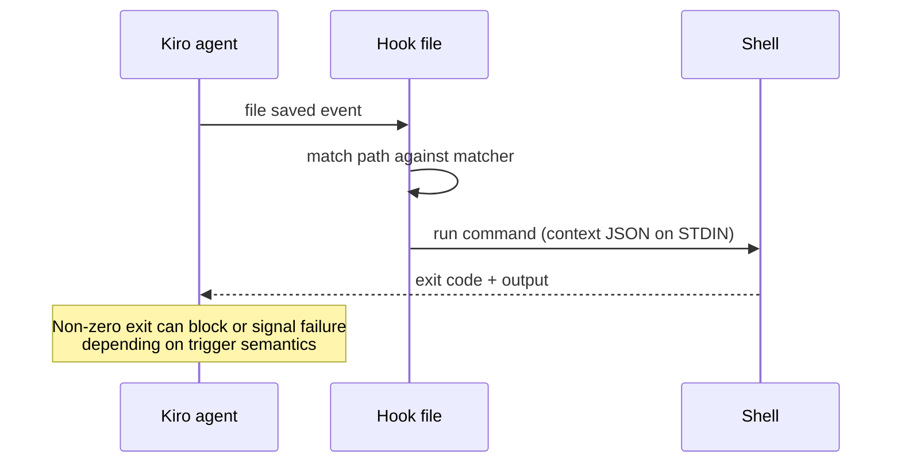

> **Hook trigger list is authoritative in the docs.** Do not invent trigger names. See
> <https://kiro.dev/docs/hooks/> and the Hook types page.

**Global hooks:** Kiro CLI V3 also loads `~/.kiro/hooks/`; global and workspace hooks run
alongside each other.

---

## 6. The spec workflow

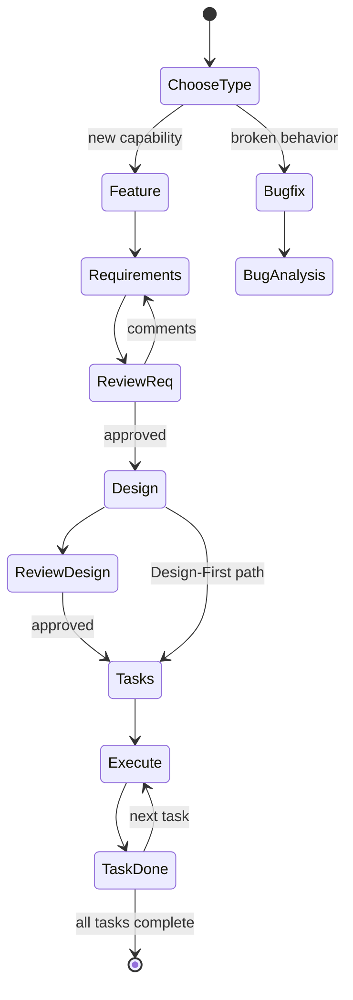

### 6.1 Feature specs

| Workflow | Order | When |
| --- | --- | --- |
| **Requirements-First** | requirements → design → tasks | Default; requirements drive design |
| **Design-First** | design → requirements → tasks | You know the architecture and need to bound scope |
| **Quick Spec** | all three generated in one pass | Well-understood, low-risk features; **no approval gates** |

Quick Spec is the risk: it removes the review gates that make specs valuable. Reserve it for
small, reversible work.

### 6.2 Bugfix specs

Bugfix specs use `bugfix.md` instead of `requirements.md`, and capture:

- **Current behavior** (observed, with reproduction)
- **Expected behavior**
- **Unchanged behavior** (the regression boundary)

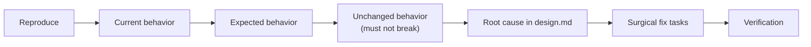

### 6.3 Analyze Requirements

A pre-design quality gate that finds inconsistencies, ambiguities, and gaps. Run it **before**
design; it is cheaper to fix words than architecture.

### 6.4 Parallel task execution

When running all tasks, Kiro builds a dependency graph and groups independent tasks into
**waves**:

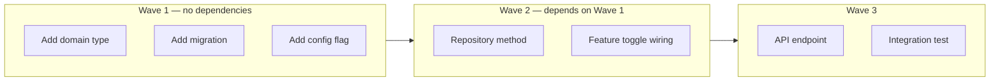

Waves execute **sequentially**; tasks **within** a wave execute concurrently. This is why task
granularity matters: a monolithic task cannot be parallelized, and a missing dependency
declaration causes conflicting edits.

> **Caution:** parallel execution assumes disjoint file ownership. If two tasks edit the same
> file, the dependency graph may not save you. Encode that dependency explicitly.

### 6.5 Correctness (IDE only)

Property-based testing analysis is available in the IDE surface only (verified in the specs
capability matrix). Do not plan around it for CLI or web workflows.

---

### 6.6 Adopting Kiro in an existing repository

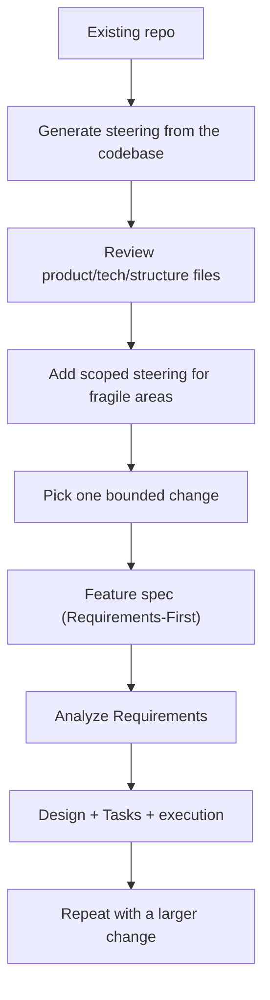

Rules:

- **Do not attempt to spec the entire legacy system.** Spec one bounded change.
- Generate steering first; it is what makes later specs consistent with the existing code.
- Verify generated steering against the code — it is a draft, not a fact.
- Add `fileMatch` steering for the areas where contributors most often get it wrong.
- **Know which scope you are editing.** Steering and configuration can live at more than
  one scope, and the narrower scope wins on conflict. Commit team rules at the workspace
  scope so they are reviewed with the code; keep personal preferences out of the repository.
- Keep hooks out of the first adoption; add them after the workflow is stable.

---

## 7. Complete example

```text
1. Open the spec panel → + → choose Feature → Requirements-First.
2. Describe: "Add CSV export to the orders page; preserve filters and authorization;
   export only rows the signed-in user can see."
3. Review requirements.md. Use Markdown Review to comment on exact passages.
4. Run Analyze Requirements. Fix ambiguities, especially authorization precedence.
5. Approve → design.md generated. Verify rollback and test strategy sections.
6. Approve → tasks.md generated.
7. Run tasks individually, or run all (wave-parallel).
8. Verify: run the repository's test suite, then review the diff.
```

### Requirements artifact shape

```markdown
# Requirements — CSV export

## Introduction
Finance analysts need to extract order data for reconciliation.

## Requirements

### Requirement 1 — Authorized export
**User story:** As a finance analyst, I want to export the orders I can see,
so that I can reconcile without requesting database access.

#### Acceptance criteria
1. WHEN the user requests an export, THE system SHALL include only rows the user can read.
2. WHEN the user lacks project access, THE system SHALL return 403 with no rows.
3. WHEN the result set is empty, THE system SHALL return a CSV header only.
```

### Design artifact shape

````markdown
# Design — CSV export

## Overview
Streaming CSV response from the existing orders query, reusing `require_project_access`.

## Architecture

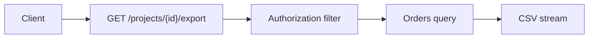

## Sequence
(request → authorize → stream → audit)

## Error handling
| Condition | Response |
| --- | --- |
| No access | 403 |
| Unknown project | 404 |
| Upstream timeout | 504 |

## Testing strategy
- Unit: CSV formatting, empty set
- Integration: authorization matrix
- Performance: 100k rows, 20 concurrent
````

---

## 8. Git and commit policy

| What | Commit? | Rationale |
| --- | --- | --- |
| `.kiro/specs/**` | Yes | Reviewable plan and history |
| `.kiro/steering/**` | Yes | Team conventions are shared policy |
| `.kiro/hooks/**` | Yes, after review | Hooks execute shell commands — review like CI config |
| `~/.kiro/**` | No | Personal/global configuration |
| Secrets in steering | **Never** | Steering is plain text in the repo |

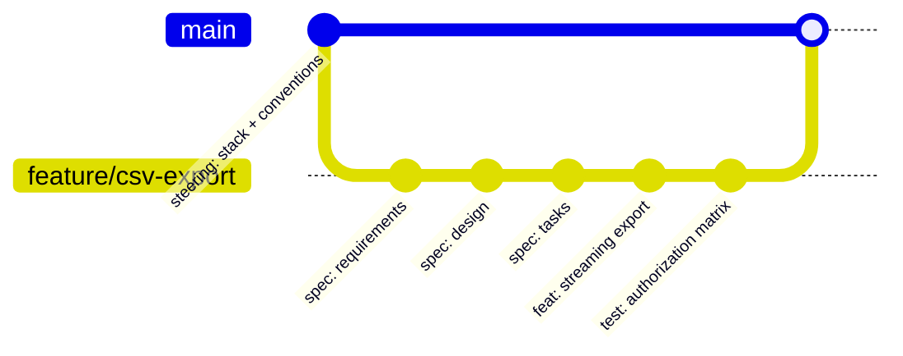

> **Hooks are executable policy.** A hook that runs `npx eslint --fix` mutates files after the
> agent saves them. Review hook changes with the same scrutiny as a CI workflow file, and never
> add a hook that reads or transmits secrets.

---

## 9. Verification

| Check | How | Expected |
| --- | --- | --- |
| Workspace initialized | `.kiro/` exists with `specs/` and `steering/` | Present |
| Steering loaded | Ask the agent to restate a project convention | Correct, cites steering |
| Inclusion mode effective | Save a matching file and observe behavior | Rule applies only where intended |
| Hook fires | Save a file matching `matcher` | Command runs; expected output |
| Spec completeness | `requirements.md` has acceptance criteria per requirement | Yes |
| Task execution | Run a single task before running all | One task's diff is reviewable |
| Correctness analysis | IDE-only; confirm surface | Skipped on CLI/Web |

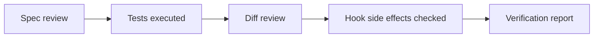

---

## 10. Common mistakes

| Mistake | Effect | Fix |
| --- | --- | --- |
| Using Quick Spec for risky work | No approval gates; design decided silently | Use Requirements-First for anything non-trivial |
| `always` inclusion for everything | Context bloat, ignored rules | Use `fileMatch`/`auto` |
| Front matter not first line | Inclusion mode ignored | Put `---` at byte 0 |
| Assuming surface parity | Features missing on CLI/Web/Mobile | Check the capability table |
| Monolithic tasks | No parallelism, long review cycles | Split by file ownership and dependency |
| Hooks with `--fix` and no review | Unreviewed file mutation | Treat hooks as CI configuration |
| Committing `~/.kiro` content | Personal config leaks into repo | Keep global steering personal |
| Treating steering as documentation | Stale rules silently applied | Review steering on architecture changes |

---

## 11. Troubleshooting

| Symptom | Cause | Action |
| --- | --- | --- |
| Steering rule ignored | `inclusion: fileMatch` pattern does not match | Verify glob against the file path |
| `#steering-name` does nothing | File not `manual`, or name typo | Check front matter `inclusion: manual` |
| Hook never runs | `matcher` regex wrong, or trigger unavailable on this surface | Test matcher; check surface support |
| Hook runs but changes nothing | Command missing in PATH; runs from project root | Use absolute or repo-local binary |
| Custom agent ignores steering | Custom agents must explicitly include steering files | Add `file://.kiro/steering/**/*.md` to the agent's resources |
| Global and workspace rules conflict | — | Workspace wins; remove the duplicate |
| Requirements rejected repeatedly | Vague acceptance criteria | Add WHEN/THEN statements with observable outcomes |

---

## 12. Security considerations

| Risk | Control |
| --- | --- |
| Hooks execute arbitrary shell commands | Review hooks as code; restrict to repo-local tooling |
| `PreToolUse` gating can be bypassed by user approval | Do not treat hooks as a security boundary |
| Steering may contain internal architecture | Repo access controls; no secrets in steering |
| Global steering from MDM | Validate centrally distributed files; they apply to every workspace |
| Agent-generated designs may include outdated AWS APIs | Verify against installed SDK version (see [chapter 23](./23-hallucination-prevention.md)) |
| Cloud sessions read global steering only if uploaded | Do not assume local global steering applies in cloud |

---

## 13. Maintenance: update and uninstall

Kiro is distributed as a product; this handbook does not publish installer or updater commands it
cannot verify for your surface. Use the product's own update mechanism.

| Action | Guidance |
| --- | --- |
| Update | Use the update path for your surface (IDE/CLI); check the changelog before upgrading |
| Workspace content | `.kiro/specs/`, `.kiro/steering/`, `.kiro/hooks/` are ordinary files you own and can migrate |
| Uninstall | Use the OS/product uninstaller; remove `.kiro/` from repositories only after review |
| Remove a hook | Delete its JSON file; verify no other hook depends on it |
| Remove steering | Delete the file, or change `inclusion` to `manual` to keep it on demand |

**Preserving customizations:** keep custom steering and hooks in the repository (versioned) rather
than only in `~/.kiro/`, so a reinstall does not lose team knowledge.

## 14. Official references

- Kiro docs — <https://kiro.dev/docs/>
- Specs — <https://kiro.dev/docs/specs/>
- Steering — <https://kiro.dev/docs/steering/>
- Hooks — <https://kiro.dev/docs/hooks/>
- Agent skills — <https://kiro.dev/docs/skills/>
- Custom agents — <https://kiro.dev/docs/custom-agents/>
- Permissions — <https://kiro.dev/docs/permissions/>
- Configuration scopes (workspace / user / global precedence) — <https://kiro.dev/docs/configuration/>

---

**Previous:** [06 — OpenSpec](./06-openspec.md) ·
**Next:** [08 — BMAD Method](./08-bmad-method.md) ·
**Back to index:** [00-index.md](00-index.md)
