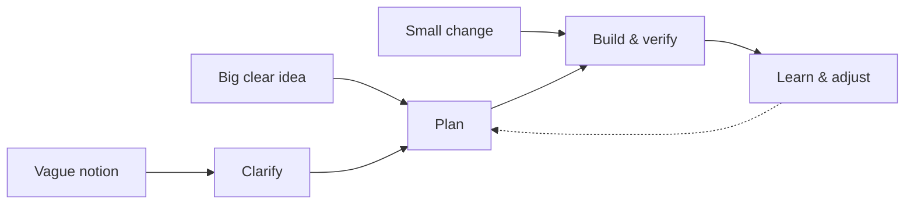
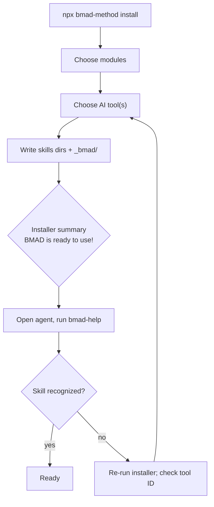
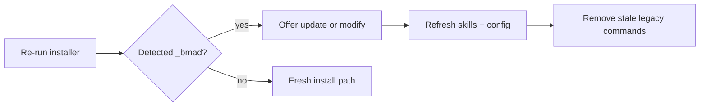
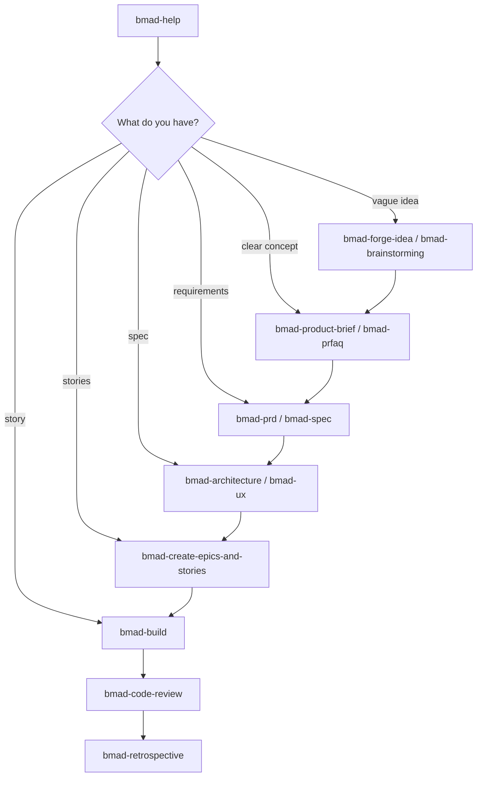
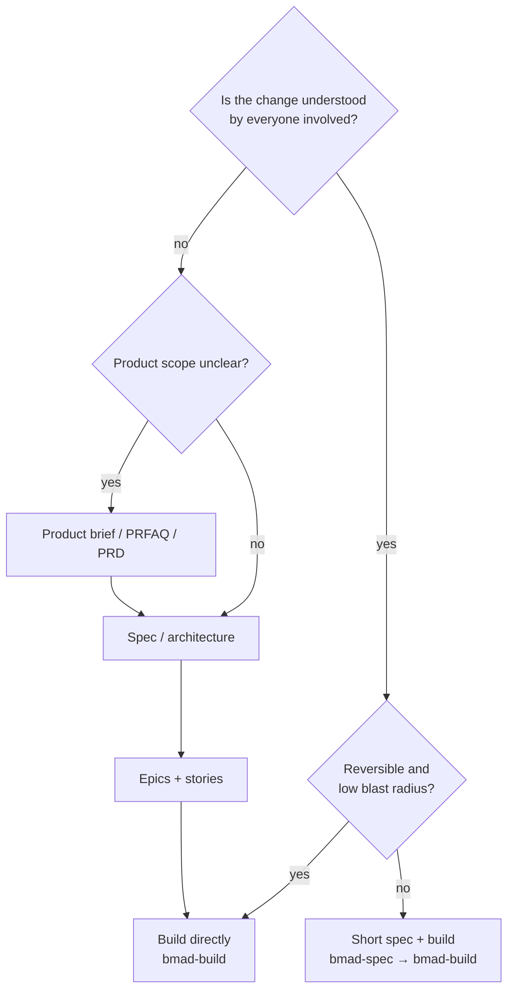
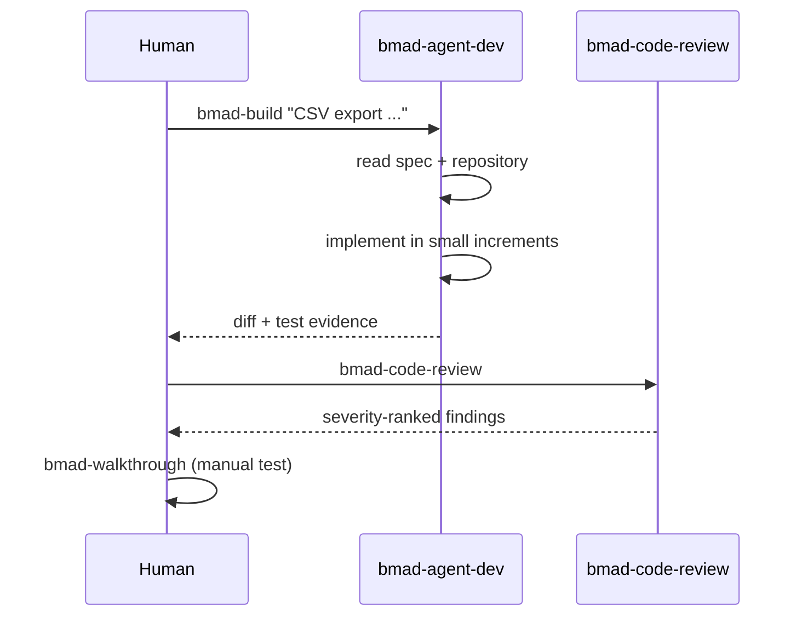
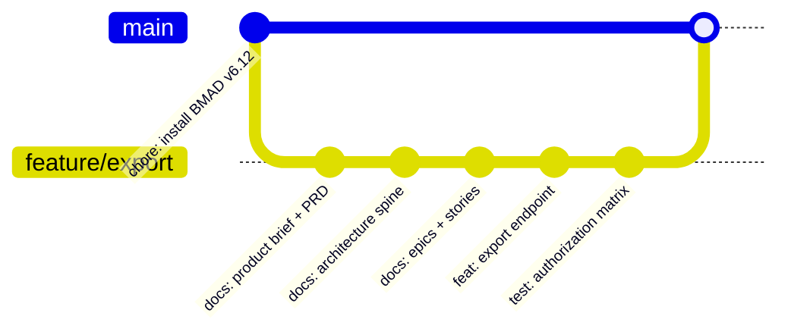

# 08 — BMAD Method

> Verified against the **V6.12** branch (`bmad-method` npm **6.12.4**, published 2026-10-14) and
> the **v7 preview alpha** line on `main`, on **2026-11-02**. Docs:
> <https://docs.bmad-method.org/>.

---

## 1. Purpose

BMAD (BMad Method) is an agile, role-based method for AI-driven development. Instead of a single
"spec step", it provides **right-sized planning paths**: a small change can go straight to build,
while a complex initiative gets product briefs, PRDs, architecture, epics, stories, and review.

It ships as **skills** installed into your agent's skills directory, plus a shared `_bmad`
project directory containing configuration and supporting scripts.



> The delivery loop above is from the upstream README: start anywhere, use BMad end-to-end, or
> carry its briefs/specs/architecture into an existing delivery workflow.

---

## 2. When to use it

| Use BMAD when | Avoid it when |
| --- | --- |
| Work ranges from weekend prototypes to multi-year systems | Your team wants one fixed process for everything |
| You want explicit product/architecture/QA roles | You only need a task list from a known spec |
| You need help choosing how much planning is enough | You already have a PM/architect process and no gap |
| You want a skills-first install in many IDEs | Your agent does not support skills |

---

## 3. Prerequisites

| Requirement | Version |
| --- | --- |
| Node.js | 20.12+ (installer) |
| Python | 3.10+ (per upstream README) |
| `uv` | Required by skills that render/run Python (`bmad-build`, `bmad-build-auto`); installer warns but continues without it |
| Git | Only for external/custom modules from Git |
| Agent | A skills-capable coding tool (`npx bmad-method install --list-tools` prints valid IDs) |

---

## 4. Installation

### Stable v6.12 (recommended for stability)

```bash
cd your-project
npx bmad-method install
```

Headless/CI:

```bash
npx bmad-method install --yes --modules bmm --tools claude-code
```



### Prerelease

```bash
npx bmad-method@next install
```

### v7 preview alpha (skills-first)

```bash
# Skills CLI — installs the full method and asks which tools to target
npx skills add bmad-code-org/BMAD-METHOD --skill '*'
```

```text
# Claude Code plugin marketplace
/plugin marketplace add bmad-code-org/bmad-plugins
```

```bash
# Codex plugin marketplace
codex plugin marketplace add bmad-code-org/bmad-plugins
```

> **Version policy:** v7 is explicitly an alpha with breaking changes between updates; the v7
> release ETA stated upstream is mid-November 2026. Do not standardize on it for audited work
> until it stabilizes. v6.12 is frozen except bug fixes.

---

## 5. Configuration and generated structure

```text
your-project/
├── _bmad/                       # shared config + supporting scripts
│   ├── config.yaml              # module/tool configuration
│   └── ...
├── .claude/skills/              # Claude Code
│   ├── bmad-help/SKILL.md
│   ├── bmad-build/SKILL.md
│   └── ...
├── .agents/skills/              # Cursor, Windsurf, Codex, Auggie, Amp, most others
│   └── ...
└── <source code>
```

### Skills directory by tool (verified table)

| Tool | Skills directory |
| --- | --- |
| Claude Code | `.claude/skills/` |
| Cursor, Windsurf, Codex, Auggie, Amp, most others | `.agents/skills/` |
| Cline | `.cline/skills/` |
| Antigravity | `.agent/skills/` |
| IBM Bob | `.bob/skills/` |
| AdaL | `.adal/skills/` |

The installer output names the exact path for the tool you selected. **The installed directories
are the canonical list of skills** — read them rather than trusting a blog post.

### Update and reconfigure

```bash
# From the project containing _bmad/
npx bmad-method install
```

The installer detects the existing installation and offers **update** (refresh) or
**modification** (change modules/tools/config). Coming from an older version, it warns about
stale `bmad-*` entries in legacy command directories — remove them to avoid duplicate commands
in your tool.



---

## 6. The workflow

BMAD offers two invocation mechanisms. Understanding the difference prevents a lot of confusion.

| Mechanism | How | Behavior |
| --- | --- | --- |
| **Skill** | Type the skill name (e.g. `bmad-help`) | Directly loads an agent, runs a workflow, or runs a task |
| **Agent menu trigger** | Load an agent, then type a code (e.g. `BD`) | Runs the matching workflow while staying in character |



### Core skills (every installation)

| Skill | Purpose |
| --- | --- |
| `bmad-help` | Answers BMad questions; inspects artifacts and recommends next steps in priority order |
| `bmad-advanced-elicitation` | Deep questioning to surface hidden requirements |
| `bmad-review` | Structured review |
| `bmad-customize` | Customize agents/workflows |
| `bmad-brainstorming` | Divergent ideation |
| `bmad-deep-recon` | Deep repository/context reconnaissance |
| `bmad-forge-idea` | Shape a raw idea |
| `bmad-party-mode` | Multi-agent discussion |

### Planning and delivery skills (BMM module, verified names)

| Phase | Skills |
| --- | --- |
| Define | `bmad-product-brief`, `bmad-prfaq`, `bmad-prd`, `bmad-spec` |
| Design | `bmad-ux` (produces `DESIGN.md`, `EXPERIENCE.md`), `bmad-architecture` |
| Break down | `bmad-create-epics-and-stories`, `bmad-sprint-planning`, `bmad-correct-course`, `bmad-project-context` |
| Build | `bmad-build`, `bmad-build-auto` |
| Review/test | `bmad-code-review`, `bmad-walkthrough`, `bmad-qa-generate-e2e-tests` |
| Finish | `bmad-retrospective` |

### Named agents (BMM module)

| Agent | Skill ID | Menu codes (selection) |
| --- | --- | --- |
| Analyst (Mary) | `bmad-agent-analyst` | `BP` brainstorm, `MR`/`DR`/`TR` research, `TS` tech selection, `CR` competitive teardown, `UV` user-voice, `CB` product brief, `WB` PRFAQ, `PC` project context |
| Product Manager (John) | `bmad-agent-pm` | `PRD`, `CE` epics/stories, `IR` implementation readiness, `CC` correct course |
| Architect (Winston) | `bmad-agent-architect` | `CA` architecture spine, `IR` implementation readiness |
| Developer (Amelia) | `bmad-agent-dev` | `BD` build, `QA` E2E test generation, `CR` code review, `SP` sprint plan, `ER` epic retrospective |
| UX Designer (Sally) | `bmad-agent-ux-designer` | `CU` UX design |

> Codes are scoped to the agent showing them: `CR` is *competitive teardown* for the Analyst and
> *code review* for the Developer.

### Modules

| Module | Purpose |
| --- | --- |
| **BMad Method** (BMM) | Plan and deliver software |
| **BMad Builder** | Build skills, workflows, agents |
| **Creative Intelligence Suite** | Creative thinking partners |
| **Test Architect** | Enterprise testing add-on |
| **BMad Loop** | Unattended epic delivery with verification and retro |
| **Game Dev Studio** | Game ideation/design/build |

---

## 7. Choosing how much planning



| Path | Artifacts | Typical duration |
| --- | --- | --- |
| Direct build | Work item only | Hours |
| Spec build | Short spec, tasks | 1–3 days |
| Standard | Product brief, PRD or spec, architecture | 1–2 weeks |
| Full | PRD, UX (`DESIGN.md`, `EXPERIENCE.md`), architecture, epics/stories, sprint plan | Multi-week |

---

## 8. Complete example — small change, direct build

```text
# 1. Orient
bmad-help I need to add a CSV export to the orders page. What is the smallest safe path?

# 2. Build
bmad-build Add CSV export to the orders page. Preserve current filters and authorization.
Export only rows the signed-in user can see. Do not change the JSON API.

# 3. Review (independent)
bmad-code-review

# 4. Walkthrough (human verification aid)
bmad-walkthrough
```



### Example — larger initiative

```text
bmad-product-brief  "Finance analysts need self-service order exports."
bmad-prd            # validates and formalizes requirements
bmad-architecture   # records decisions that keep parts consistent
bmad-create-epics-and-stories
bmad-sprint-planning
bmad-build          # per story
bmad-code-review
bmad-retrospective
```

---

## 9. Git and commit policy

| What | Commit? | Rationale |
| --- | --- | --- |
| `_bmad/**` | Yes | Shared config and scripts; deterministic installer output |
| Skills directories (`.claude/skills/`, `.agents/skills/`, …) | Yes, per team decision | Reviewable text; enables teammates without re-install |
| Planning artifacts (briefs, PRD, `DESIGN.md`, `EXPERIENCE.md`, sprint status) | Yes | These are the durable context |
| Global/personal installs | No | Machine-local |
| Installer caches | No | Regenerated |



> **Do not commit an installation mid-upgrade.** Re-run the installer to completion, verify
> `bmad-help` works, then commit the resulting diff as one reviewable change.

---

## 10. Verification

| Check | Command / action | Expected |
| --- | --- | --- |
| Installer completed | `npx bmad-method install` summary | "BMAD is ready to use!" |
| Tool integration | Open agent, run `bmad-help` | Skill recognized and answers |
| Modules present | Inspect skills directory | One directory per skill, each with `SKILL.md` |
| `uv` available | `uv --version` | Present if using `bmad-build` |
| Headless flags | `npx bmad-method install --help` | Current flags |
| Tool IDs | `npx bmad-method install --list-tools` | Valid IDs for your agent |
| Update health | Re-run installer | Detects existing `_bmad`, offers update |

---

## 11. Common mistakes

| Mistake | Effect | Fix |
| --- | --- | --- |
| Installing v7 alpha for audited work | Breaking changes mid-delivery | Use v6.12.x stable |
| Running `bmad-build` without `uv` | Build skill cannot run Python steps | Install `uv` |
| Committing without reviewing skills | Unreviewed prompt surface | Review generated `SKILL.md` files once |
| Duplicate legacy commands after upgrade | Agent shows two `bmad-*` entries | Remove stale entries as installer warns |
| Confusing `CR` codes across agents | Wrong workflow runs | Codes are agent-scoped |
| Skipping `bmad-help` | Wrong planning depth | It inspects artifacts and recommends next steps |
| Treating the PRD as the spec | Missing acceptance criteria | Use `bmad-spec` to condense into buildable form |
| Global install committed | Personal environment in repo | Keep global installs out of Git |

---

## 12. Troubleshooting

| Symptom | Cause | Action |
| --- | --- | --- |
| Skill not found by agent | Wrong frontmatter/permalink for that harness | Check `SKILL.md` front matter; reinstall with correct tool ID |
| `bmad-build` fails on Python step | `uv` missing | `uv` install, then retry |
| Installer cannot find project | Wrong working directory | `cd` to the project root first |
| Headless install hangs | Interactive prompts | Add `--yes` and explicit `--modules`/`--tools` |
| Old commands still appear | Legacy command dirs | Remove stale `bmad-*` entries |
| v7 skills conflict with v6 | Both installed | Uninstall one; keep one method per repo |
| Agent ignores project context | Context file missing/stale | Run `bmad-project-context` |

---

## 13. Security considerations

| Risk | Control |
| --- | --- |
| Skills are executable instructions | Review `SKILL.md` files before first use and on upgrade |
| Skills shell out to Python via `uv` | Pin versions; run in a container in CI |
| Third-party modules | Install only from trusted sources; Git modules execute code |
| Planning artifacts contain internal detail | Treat as source; apply access controls |
| `bmad-build-auto` autonomy | Require worktree isolation and a hard verification gate |
| Plugin marketplaces | Use official marketplaces; verify publisher |

---

## 14. Maintenance: update and uninstall

| Action | Command | Notes |
| --- | --- | --- |
| Update | `npx bmad-method install` | Detects `_bmad` and offers update/modify |
| Prerelease update | `npx bmad-method@next install` | Breaking changes are expected |
| Cleanup after upgrade | Remove stale `bmad-*` entries the installer reports | Prevents duplicate commands in your tool |
| Uninstall | Delete `_bmad/` and the installed skill directories for your tool | Keep planning artifacts if you still need them |
| Switch v6 → v7 | Uninstall one before installing the other | Running both causes duplicate skills |

**Preserving customizations:** agent and workflow customizations live in module config and custom
skills. Re-running the installer refreshes installed skills, so keep local changes in your own
module or in customized copies you control.

## 15. Official references

- Repository (stable V6.12 branch) — <https://github.com/bmad-code-org/BMAD-METHOD/tree/V6.12>
- Documentation — <https://docs.bmad-method.org/>
- Installation guide — <https://docs.bmad-method.org/start/install-bmad/>
- Skills and agents reference — <https://docs.bmad-method.org/reference/skills-and-agents/>
- Choose a planning path — <https://docs.bmad-method.org/plan/choose-a-planning-path/>
- Existing codebases — <https://docs.bmad-method.org/existing-codebases/start-in-an-existing-codebase/>
- Autonomous loops — <https://docs.bmad-method.org/build/autonomous-development-loops/>

---

**Previous:** [07 — AWS Kiro](./07-aws-kiro.md) ·
**Next:** [09 — Spec Kitty](./09-spec-kitty.md) ·
**Back to index:** [00-index.md](00-index.md)
