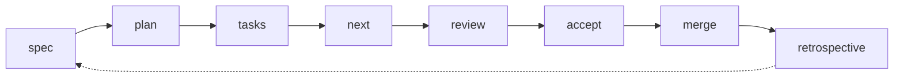
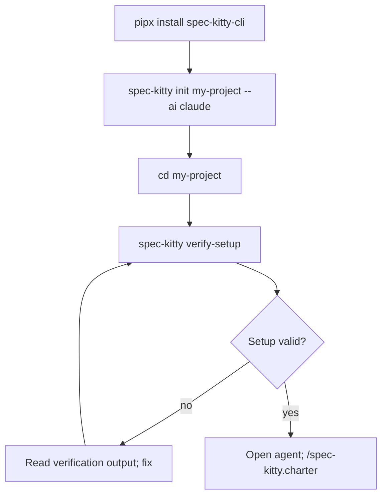
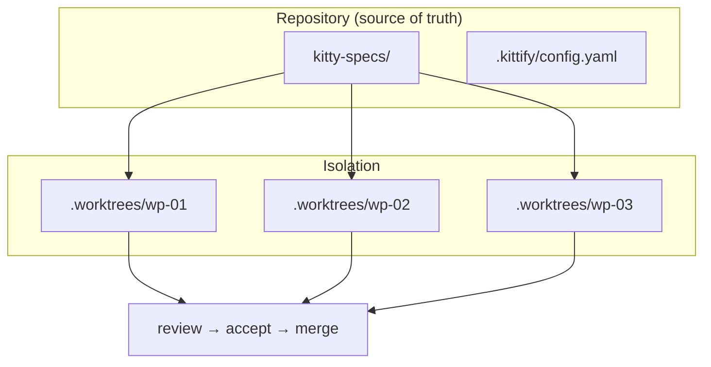
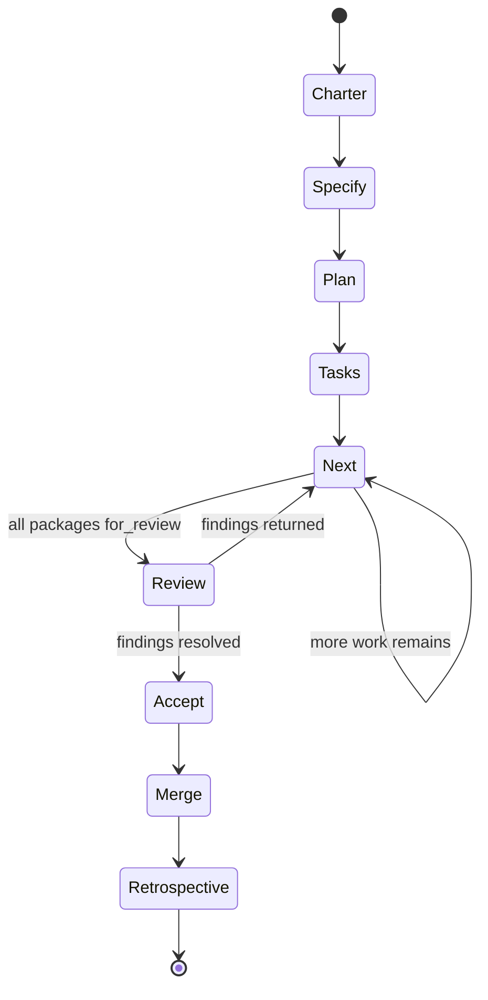
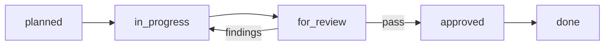
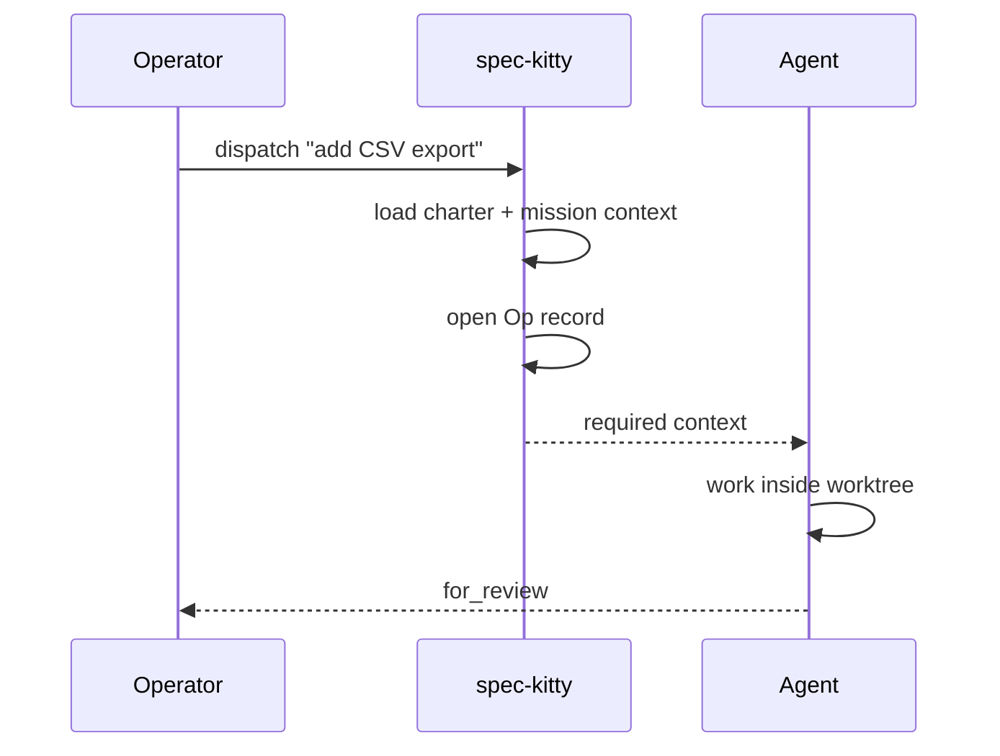
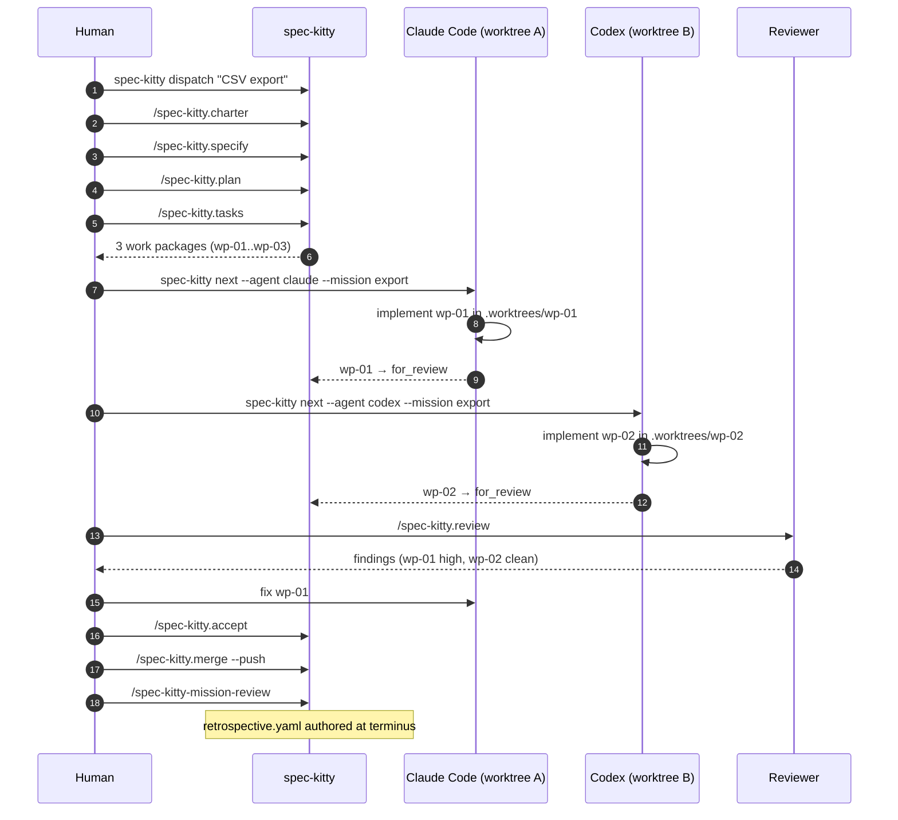
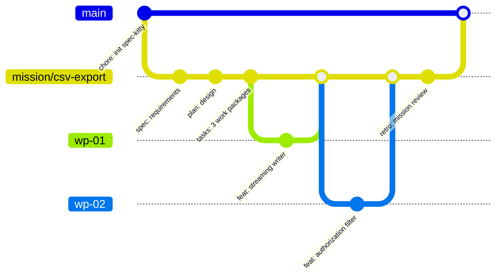
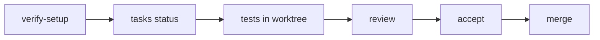

# 09 — Spec Kitty

> Verified against `spec-kitty-cli` **3.2.7** (stable, PyPI) and the 4.0.0rc2 prerelease line
> documented on `main`, on **2026-11-02**. Repository:
> <https://github.com/spec-kitty/spec-kitty> (MIT, Python 3.11+).

---

## 1. Purpose

Spec Kitty is a repository-native **governance layer** for AI coding agents. Where other
frameworks stop at "write a spec and a task list", Spec Kitty adds:

- **Missions** with work packages and lifecycle lanes
- **Git worktree isolation** so parallel agents cannot collide
- **Review → accept → merge** gates with an audit trail
- **Governance dispatch** that forces agents to load context before acting
- **Retrospectives** generated per completed mission



---

## 2. When to use it

| Use Spec Kitty when | Avoid it when |
| --- | --- |
| Multiple agents or developers work in parallel | One-off edits or tiny scripts |
| You need auditable acceptance and merge decisions | Your team does not use Git |
| Specs, work packages, and review state must live in the repo | You want a zero-structure prompt pack |
| You want worktree isolation by default | You cannot allocate disk for worktrees |

---

## 3. Prerequisites

| Requirement | Detail |
| --- | --- |
| Python | 3.11+ |
| Installer | `pipx` (preferred upstream), `uv tool`, or `pip` in a venv |
| Git | Required — worktree isolation is core |
| Agent | Claude Code, Codex, Cursor, Gemini, Copilot, OpenCode, Qwen, Windsurf, Kiro, Vibe, Pi, Letta, Antigravity |

---

## 4. Installation

```bash
# Preferred: isolated environment
pipx install spec-kitty-cli

# Alternatives
uv tool install spec-kitty-cli
python -m pip install spec-kitty-cli   # inside an activated venv
```



### Prerelease (qualification only)

```bash
uv tool install 'spec-kitty-cli==4.0.0rc2'
```

> 4.x is a release-candidate line; stable acceptance remains pending upstream. Pin the exact
> version and do not mix RC and stable projects.

---

## 5. Initialization and verification

```bash
# New project
spec-kitty init my-project --ai claude
cd my-project
spec-kitty verify-setup

# Add to an existing repository
spec-kitty init . --ai codex
spec-kitty verify-setup
```

| Agent key (examples) | Notes |
| --- | --- |
| `claude`, `codex`, `cursor`, `gemini`, `copilot`, `opencode`, `qwen`, `windsurf`, `kiro`, `vibe`, `pi`, `letta`, `antigravity` | See upstream *Supported Agents* for the authoritative list |

**Verification is mandatory.** `spec-kitty verify-setup` checks local installation and project
wiring. Skipping it is the most common cause of "commands do nothing".

---

## 6. Generated structure

```text
your-project/
├── kitty-specs/
│   └── <mission-slug>/
│       ├── spec.md              # requirements
│       ├── plan.md              # technical plan
│       ├── tasks.md             # work packages with lanes
│       └── retrospective.yaml   # written at mission terminus
├── .worktrees/                  # isolated git worktrees per work package
├── .kittify/
│   └── config.yaml              # runtime config (e.g. retrospective behavior)
└── <source code>
```



---

## 7. The workflow

### 7.1 Core commands

```text
/spec-kitty.charter
/spec-kitty.specify Build a small task list app.
/spec-kitty.plan
/spec-kitty.tasks
```

Then let the runtime choose the next action:

```bash
spec-kitty next --agent claude --mission <mission-slug>
```

```text
/spec-kitty.review
/spec-kitty.accept
/spec-kitty.merge --push
```

After merge:

```text
/spec-kitty-mission-review
```



> **Skill-name invocation differs by agent.** Agents that load Spec Kitty as Agent Skills
> (Codex, Vibe, Pi, Letta, Antigravity) use `spec-kitty-<command>` (e.g. `$spec-kitty-specify`
> in Codex, `/skill:spec-kitty-specify` in Pi).

### 7.2 Work-package lanes

| Lane | Meaning | Who moves it |
| --- | --- | --- |
| `planned` | Defined, not started | Planner |
| `in_progress` | Agent working in an isolated worktree | Implementer |
| `for_review` | Implementation complete, awaiting review | Implementer |
| `approved` | Review passed | Reviewer |
| `done` | Merged / accepted | Release engineer |



Status inspection:

```bash
spec-kitty agent tasks status
spec-kitty agent tasks status --json    # for tooling/CI
```

### 7.3 Governance dispatch

```bash
spec-kitty dispatch "<request>"
```

This loads governance context, opens an **Op record**, and returns the context the agent must
use before doing the work. It is the recommended entry point for any non-trivial request
because it makes the governing constraints explicit before action.



### 7.4 Retrospectives

Every completed mission generates a retrospective by default. Behavior is configurable via
`.kittify/config.yaml#retrospective` or the charter.

```bash
spec-kitty retrospect summary
spec-kitty agent retrospect synthesize --mission <mission-slug>   # dry-run by default
spec-kitty agent retrospect synthesize --mission <mission-slug> --apply
```

> `merge` does **not** author `retrospective.yaml`; the runtime terminus (human-in-charge prompt
> or autonomous facilitator) does. Plan your acceptance checklist accordingly.

---

## 8. Complete example



```bash
# Observe state at any point
spec-kitty agent tasks status
spec-kitty agent tasks status --json | jq '.work_packages[] | {id, lane}'
```

---

## 9. Git and commit policy

| What | Commit? | Rationale |
| --- | --- | --- |
| `kitty-specs/**` | Yes | Mission state is the audit trail |
| `.kittify/config.yaml` | Yes | Shared runtime policy |
| `.worktrees/**` | **No** | Add to `.gitignore`; worktrees are transient |
| `.worktrees` metadata | No | Local execution state |
| Retrospective YAML | Yes | Durable learning record |



> **Worktree hygiene:** do not commit `.worktrees/`. Do not run two agents in the same worktree.
> Merging is a human-authorized action unless a documented automation policy says otherwise.

---

## 10. Verification

| Check | Command | Expected |
| --- | --- | --- |
| CLI present | `spec-kitty --help` | Command list |
| Project wiring | `spec-kitty verify-setup` | Passes |
| Mission state | `spec-kitty agent tasks status` | Lanes listed |
| Machine-readable | `spec-kitty agent tasks status --json` | Valid JSON |
| Next action | `spec-kitty next --agent <agent> --mission <slug>` | Names the next work package |
| Upgrade after CLI update | `spec-kitty upgrade` | Project files refreshed |
| Retrospective exists | `ls kitty-specs/<slug>/retrospective.yaml` | Present after terminus |



---

## 11. Common mistakes

| Mistake | Effect | Fix |
| --- | --- | --- |
| Skipping `verify-setup` | Commands appear broken | Run it first |
| Running agents in the same worktree | Conflicting edits | One work package per worktree |
| Manually moving lanes | Audit trail broken | Use `next`/`review`/`accept` commands |
| Expecting `merge` to write the retrospective | Missing retro | Run mission review at terminus |
| Committing `.worktrees/` | Repository bloat, broken clones | `.gitignore` |
| Using 4.x RC on stable projects | Unexpected breaking changes | Pin 3.2.7 for production |
| Treating merge as autonomous | Unauthorized production change | Human/automation policy gate |

---

## 12. Troubleshooting

| Symptom | Cause | Action |
| --- | --- | --- |
| `spec-kitty: command not found` | pipx bin dir not on PATH | `pipx ensurepath`, restart shell |
| `verify-setup` fails | Wrong agent key or missing Git | Check `--ai` value; confirm `git rev-parse` works |
| `next` returns nothing | No planned work packages | Re-run `/spec-kitty.tasks` |
| Worktree creation fails | Disk space, dirty main worktree, or path collision | Clean state; free space; remove stale worktrees |
| Review cannot find the diff | Agent worked outside its worktree | Recreate work package; enforce worktree usage |
| `spec-kitty upgrade` needed | CLI updated but project files stale | Run it, then re-verify |
| Duplicate command names | Multiple frameworks installed | One SDD system per repo |

---

## 13. Security considerations

| Risk | Control |
| --- | --- |
| Parallel agents with shell access | Isolate with worktrees + container sandbox |
| `--push` in merge | Require branch protection and explicit authorization |
| Dispatch loads repo context | Ensure no secrets are committed in `kitty-specs/` |
| Retrospective content | May include incident details; review before commit |
| Hosted flows removed from open-core | Do not assume SaaS sync exists in OSS builds |
| Prerelease CLI | Pin versions; review changelog before RC upgrades |

---

## 14. Maintenance: update and uninstall

| Action | Command | Notes |
| --- | --- | --- |
| Upgrade the CLI | `pipx upgrade spec-kitty-cli` (or `uv tool upgrade spec-kitty-cli`) | Standard package-manager usage |
| Refresh project files after a CLI upgrade | `spec-kitty upgrade` | Verified project-level command |
| Verify | `spec-kitty verify-setup` | Re-run after any upgrade |
| Uninstall the CLI | `pipx uninstall spec-kitty-cli` | Standard tooling |
| Remove from a repo | Delete `.kittify/` and `.worktrees/`; archive `kitty-specs/` first | Mission state is the audit trail |

**Preserving customizations:** charter and `.kittify/config.yaml` are versioned project files.
Worktrees are disposable; mission artifacts are not.

## 15. Official references

- Repository — <https://github.com/spec-kitty/spec-kitty>
- PyPI — <https://pypi.org/project/spec-kitty-cli/>
- Getting started — <https://github.com/spec-kitty/spec-kitty/blob/main/docs/guides/tutorials/getting-started.md>
- Your first mission — <https://github.com/spec-kitty/spec-kitty/blob/main/docs/guides/tutorials/your-first-mission.md>
- CLI command reference — <https://github.com/spec-kitty/spec-kitty/blob/main/docs/api/cli-commands.md>
- Slash commands — <https://github.com/spec-kitty/spec-kitty/blob/main/docs/api/slash-commands.md>
- Git worktrees — <https://github.com/spec-kitty/spec-kitty/blob/main/docs/architecture/git-worktrees.md>
- Multi-agent orchestration — <https://github.com/spec-kitty/spec-kitty/blob/main/docs/architecture/multi-agent-orchestration.md>

---

**Previous:** [08 — BMAD Method](./08-bmad-method.md) ·
**Next:** [10 — Ponytail](./10-ponytail.md) ·
**Back to index:** [00-index.md](00-index.md)
