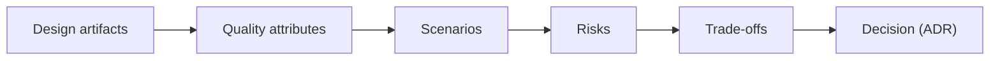
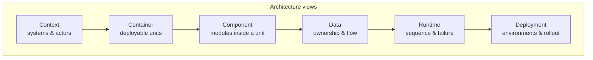
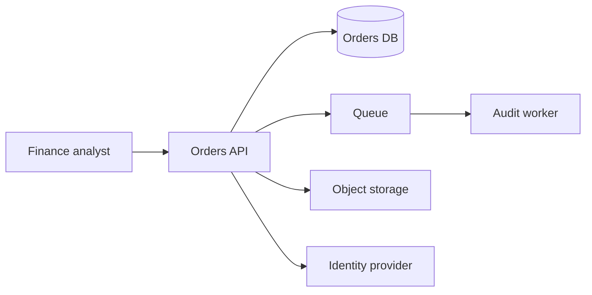
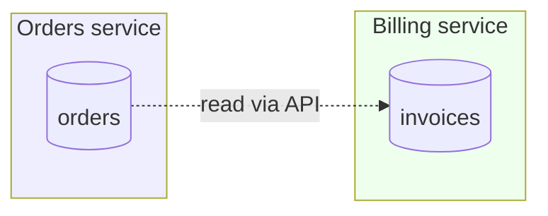
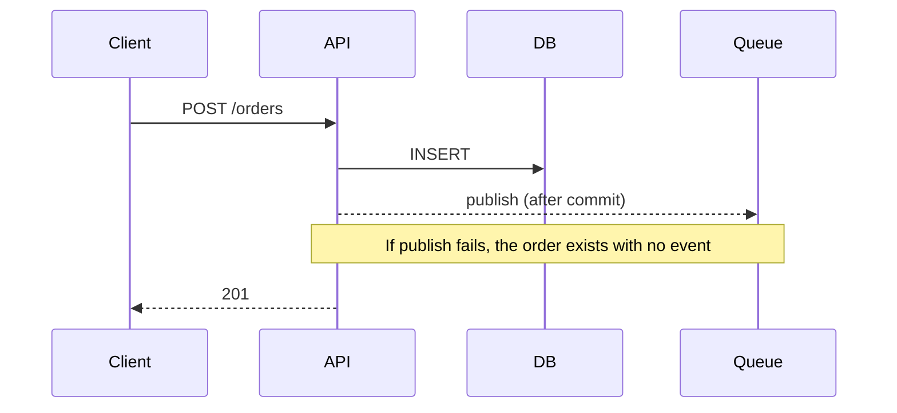
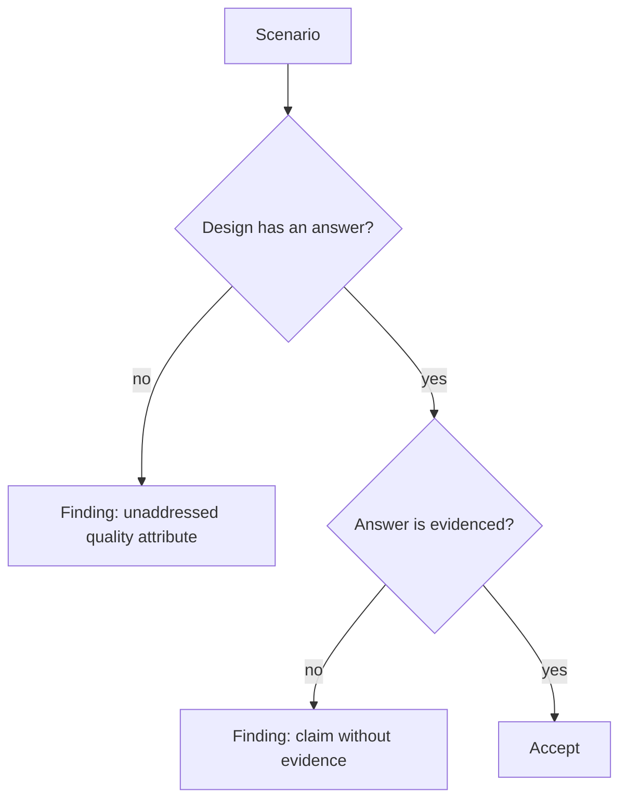
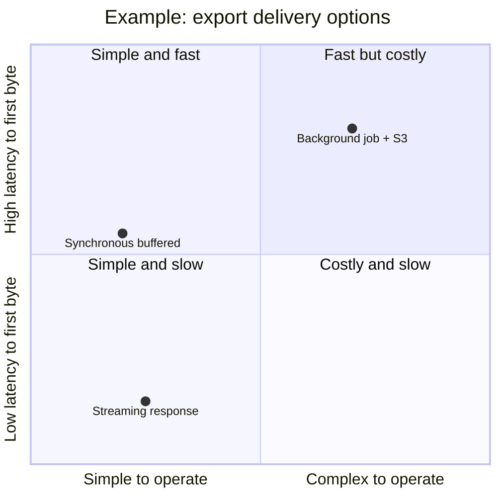

# 18 — Architecture Review

> An architecture review asks one question: **will this design hold when reality arrives** —
> at 10× load, with a dependency down, during a partial deploy, and three years from now?

---

## 1. Purpose

Review architectural decisions **before** implementation, using evidence and explicit
trade-offs, so that expensive-to-reverse choices are made deliberately.



---

## 2. When to use it

| Trigger | Depth |
| --- | --- |
| New service/module boundary | Full |
| External contract change | Full (contract section) |
| New datastore or cache | Full (data + consistency) |
| Cross-team dependency | Full (ownership + failure modes) |
| Irreversible decision | Full + ADR |
| Internal refactor within a boundary | Light (code review suffices) |

---

## 3. Inputs

| Input | Required? |
| --- | --- |
| `spec.md` with NFRs | Yes |
| `plan.md` | Yes |
| C4 context/container diagrams | Recommended |
| ADRs for prior decisions | Yes, if they exist |
| Current architecture docs | Yes, or state that none exist |
| SLOs and error budget | Yes for production systems |
| Deployment topology | Yes |

> If architecture docs exist but are stale, **report the drift** rather than silently designing
> against them. See [chapter 03 §9](./03-repository-discovery.md).

---

## 4. Views to review



### 4.1 Context and container



Review questions:

- What is the trust boundary? Where does authentication end and authorization begin?
- Which dependencies are hard (request-path) vs soft (async)?
- What happens when each external system is slow, down, or returns garbage?

### 4.2 Data ownership



| Rule | Reason |
| --- | --- |
| One writer per table | Prevents conflicting invariants |
| Cross-service reads go through APIs or replicated views | Ownership stays clear |
| Shared databases are a finding, not a pattern | Coupling and lock contention |

### 4.3 Runtime and failure modes



| Failure | Required design answer |
| --- | --- |
| DB unavailable | Fail fast, bounded retry, clear status code |
| Queue unavailable | Outbox pattern or accepted inconsistency |
| Duplicate delivery | Idempotent consumer |
| Partial deploy (two versions) | Backward/forward compatible contract |
| Region loss | Stated RTO/RPO and measured restore |

---

## 5. Quality attribute scenarios

A quality attribute is only reviewable as a **scenario**: source, stimulus, artifact, response,
response measure.

| Attribute | Scenario |
| --- | --- |
| Performance | 200 concurrent analysts export 100k rows; p95 TTFB < 1.5 s |
| Availability | DB primary fails; API returns 503 within 5 s; recovery < 60 s |
| Scalability | 10× order volume; p95 write latency stays < 200 ms |
| Security | Attacker with a valid low-privilege token requests another tenant's export; denied and audited |
| Operability | On-call can identify the failing dependency from dashboards in < 2 min |
| Modifiability | Adding a new export format touches ≤ 2 files and requires no schema change |
| Recoverability | Restore a deleted project from backup in < 30 min with zero cross-tenant leakage |



---

## 6. Trade-off analysis

Every significant decision trades something. Make it explicit.



| Option | Benefit | Cost | Reversibility |
| --- | --- | --- | --- |
| Streaming | Low latency, no storage | Long-lived connections, harder retries | Easy |
| Background + S3 | Retries, large files | Storage, job infra, notification | Medium |
| Buffered sync | Simplest code | Memory, timeout risk | Easy |

**Decision rule:** if the option with the best operational profile fails an NFR, say so explicitly
and record the ADR.

---

## 7. Review checklist

### Boundaries and coupling

- [ ] Each component has one reason to change
- [ ] Dependencies point in one direction (no cycles)
- [ ] Cross-boundary calls are explicit and versioned
- [ ] Shared libraries do not carry domain logic across teams

### Data

- [ ] Single writer per table
- [ ] Transaction boundaries match invariants
- [ ] Idempotency strategy for every retryable operation
- [ ] Migration and rollback plan
- [ ] Retention and deletion policy

### Failure and resilience

- [ ] Timeouts on every I/O
- [ ] Retry policy with backoff and jitter; retry budget
- [ ] Circuit breaking or bulkheads where needed
- [ ] Graceful degradation defined
- [ ] Poison message handling

### Security

- [ ] Trust boundaries drawn
- [ ] Authorization enforced server-side at one place per resource
- [ ] Secrets management
- [ ] Data classification and encryption
- [ ] Audit trail for sensitive operations

### Operability

- [ ] Metrics, logs, traces with correlation IDs
- [ ] SLOs and alerts with runbooks
- [ ] Dashboards answer "is it broken and where"
- [ ] Rollback and feature-flag strategy

### Evolution

- [ ] Contract versioning
- [ ] Deprecation policy
- [ ] Migration path for existing data
- [ ] Ownership and on-call

---

## 8. Findings that commonly matter

| Finding | Severity | Why |
| --- | --- | --- |
| Distributed transaction assumed atomic | CRITICAL | Silent data divergence |
| No idempotency on a retried write | HIGH | Duplicate records |
| Authorization enforced in the UI only | CRITICAL | Data exposure |
| Unbounded query in a request path | HIGH | Outage under load |
| Shared table between services | HIGH | Coupling, lock contention |
| No rollback for an irreversible migration | CRITICAL | Cannot recover |
| Missing timeout on an external call | HIGH | Thread/connection exhaustion |
| Logging PII/tokens | HIGH | Compliance breach |
| Single point of failure without detection | MEDIUM | Longer outages |
| No correlation ID | MEDIUM | Slow incident diagnosis |

---

## 9. ADR output

Every architectural review that changes a decision produces or updates an ADR:

```markdown
# ADR-0007: Stream CSV exports instead of background jobs

**Status:** Accepted (2026-11-02)
**Context:** Finance needs 100k-row exports with p95 TTFB < 1.5 s; no object storage
integration exists; team size is 2.
**Decision:** Stream the response from a server-side cursor.
**Alternatives considered**
- Background job + S3: rejected — new infra, notification channel, and > 30 s TTFB.
- Buffered sync: rejected — memory risk at 100k rows.
**Consequences**
- Long-lived connections must be supported by the load balancer (idle timeout 120 s).
- Client retries create duplicate audit entries unless idempotency key is used.
**Review date:** 2027-05-01
```

See [`templates/architecture-decision-record.md`](../templates/architecture-decision-record.md).

---

## 10. Verification

| Check | How |
| --- | --- |
| Review was read-only | `git status` before/after |
| Every NFR has a design answer | Trace NFR → design section |
| Every failure mode has a behavior | Trace failure table → design |
| Every decision has an ADR | Cross-reference |
| Findings have evidence | File/section citations |

---

## 11. Common mistakes

| Mistake | Consequence | Fix |
| --- | --- | --- |
| Reviewing diagrams only | Misses data and failure semantics | Require runtime + data views |
| Accepting "it will scale" | No evidence | Demand a measurement plan |
| Ignoring two-version deploys | Rollout breaks | Compatibility section required |
| Treating ADRs as bureaucracy | Decisions re-litigated | ADR only for irreversible choices |
| No ownership | Nobody fixes incidents | Name an owner per component |
| Review after implementation | Change is expensive | Review the plan |

---

## 12. Troubleshooting

| Symptom | Cause | Action |
| --- | --- | --- |
| Review becomes a design session | No prepared artifacts | Require `plan.md` first |
| Everyone agrees too fast | No scenarios | Introduce failure/load scenarios |
| Endless debate | No decision owner | Assign architect + ADR |
| Findings are generic | No knowledge of the system | Read code and run discovery first |
| Design is fine but delivery fails | Missing operability | Add SLO/runbook gate |

---

## 13. References

- [Chapter 02 — Engineering lifecycle](./02-engineering-lifecycle.md)
- [Chapter 17 — Review without implementation](./17-specification-review.md)
- [Chapter 21 — Security review](./21-security-review.md)
- [templates/architecture-decision-record.md](../templates/architecture-decision-record.md)
- [prompts/architecture-reviewer.md](../prompts/architecture-reviewer.md)
- C4 model — <https://c4model.com/>
- arc42 — <https://arc42.org/>
- *Software Architecture in Practice* (Bass, Clements, Kazman)
- ATAM (Architecture Tradeoff Analysis Method) — SEI
- Google SRE Workbook, *Implementing SLOs* — <https://sre.google/workbook/implementing-slos/>

---

**Previous:** [17 — Review without implementation](./17-specification-review.md) ·
**Next:** [19 — Read-only code review](./19-read-only-code-review.md)
