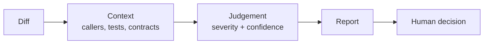
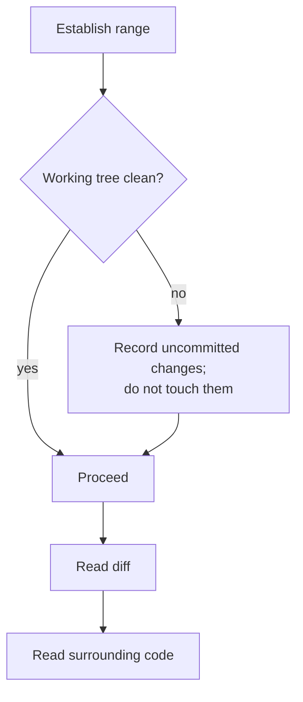
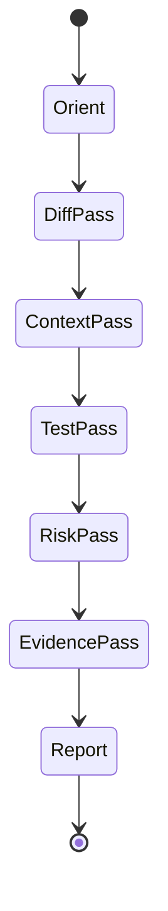
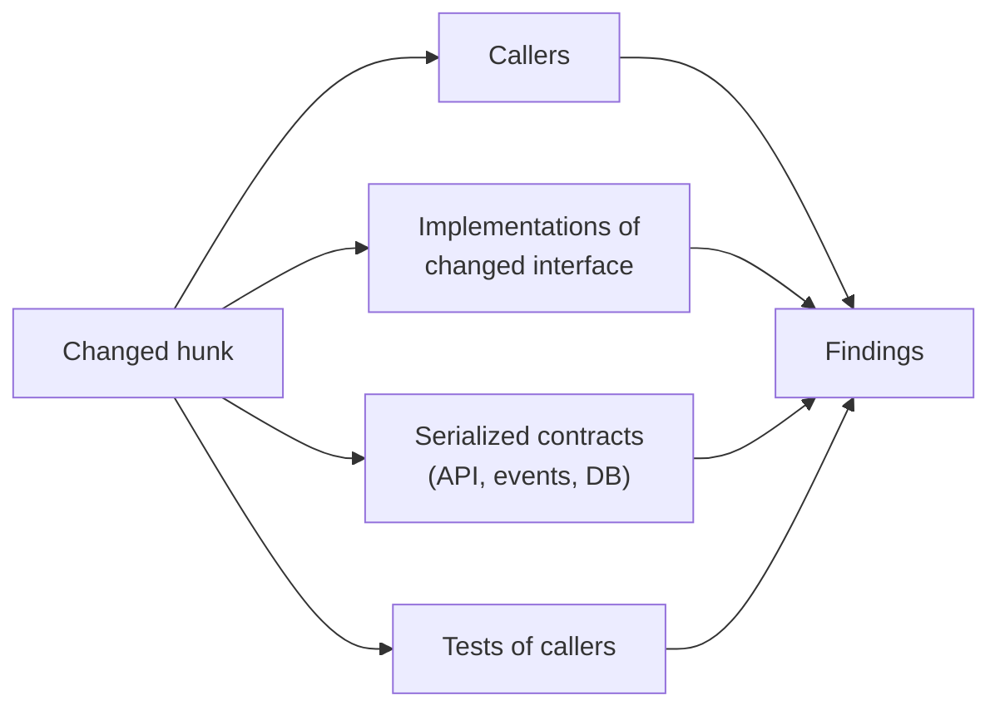
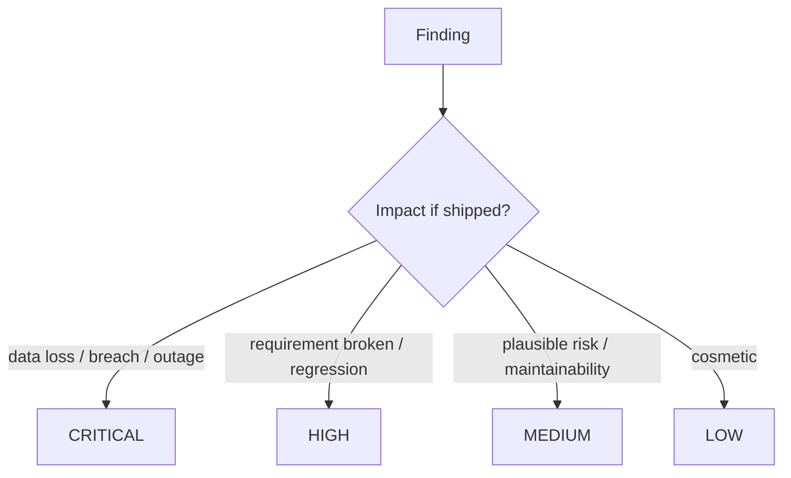
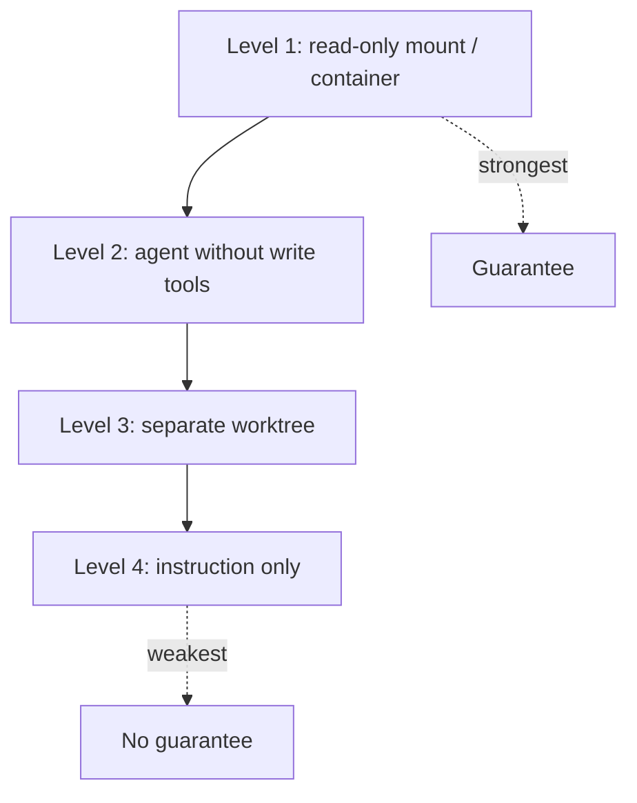

# 19 — Read-Only Code Review

> Review the **diff**, but judge the **system**. Most expensive defects live in the code the diff
> touches, not in the lines it changes.

---

## 1. Purpose

An independent, read-only review that finds correctness, security, and regression risks with
evidence — and never modifies the code under review.



---

## 2. When to use it

| Change | Review depth |
| --- | --- |
| Any production code change | Standard |
| Auth, crypto, payments, PII | Deep + security review |
| Data migrations | Deep + DB review |
| Concurrency-sensitive | Deep + race evidence |
| Dependency addition | Standard + supply-chain check |
| Documentation only | Light |

---

## 3. Pre-review setup

```bash
# 1. Confirm read-only baseline
git --no-pager status --short

# 2. Identify the review range
git --no-pager log --oneline -5
git --no-pager diff --stat origin/main...HEAD

# 3. Read the full diff
git --no-pager diff origin/main...HEAD

# 4. Read the artifacts it claims to implement
ls specs/*/spec.md specs/*/plan.md 2>/dev/null
```



> If the working tree is dirty, say so. Review the committed range and explicitly exclude
> uncommitted work, or ask which state to review.

---

## 4. The review procedure



### 4.1 Orient (2 minutes)

- What requirement does this claim to implement?
- What is the blast radius (module, service, data, contract)?
- What is the smallest thing that could be catastrophically wrong?

### 4.2 Diff pass

Read every hunk. For each:

| Question | Why |
| --- | --- |
| What changed semantically? | Formatting noise hides logic changes |
| What is now impossible/impossible to express? | Removed validation, narrowed types |
| What error paths were added/removed? | Swallowed exceptions |
| What assumptions does this code make about callers? | Contract drift |

### 4.3 Context pass — the highest-value step



```bash
# Who calls the changed function?
grep -rn "functionName(" --include='*.ts' src | head -30

# Who implements the changed interface?
grep -rn "implements InterfaceName" --include='*.java' .

# Who consumes the changed field?
grep -rn "total_cents" --include='*.py' --include='*.ts' --include='*.cs' . | head -30
```

### 4.4 Test pass

| Check | Failure signal |
| --- | --- |
| Tests exist for new behavior | No diff under `tests/` |
| Tests assert behavior | Only mocks asserted |
| Tests fail without the change | Not verified |
| Boundaries covered | No empty/max/denied case |
| No tests weakened | Assertions removed or loosened |

### 4.5 Risk pass

Run the checklists in §5 for each risk area touched.

### 4.6 Evidence pass

For every finding, attach:

- Exact location (`file:line`)
- Quoted code or output
- The failure it causes
- How to verify the fix

---

## 5. Risk checklists

### Correctness

- [ ] Off-by-one and boundary conditions
- [ ] Null/undefined/`None` handling
- [ ] Integer overflow / float precision
- [ ] Timezone and date boundaries
- [ ] Unicode and encoding
- [ ] Ordering assumptions
- [ ] Error propagation preserved

### Concurrency

- [ ] Shared mutable state
- [ ] Lock ordering
- [ ] Atomic read-modify-write
- [ ] Idempotency for retries
- [ ] Transaction scope vs I/O
- [ ] Cancellation/timeout handling

### Data

- [ ] Schema change is backward compatible
- [ ] Migration reversible
- [ ] Queries bounded
- [ ] Index supports the access pattern
- [ ] No unintended data deletion

### Security

- [ ] Authorization on every new entry point
- [ ] Input validation at boundaries
- [ ] No injection (SQL, command, template, log)
- [ ] No secrets in code or logs
- [ ] Safe deserialization
- [ ] Rate limiting where needed

### API and contracts

- [ ] Additive changes only, or versioned
- [ ] Error model consistent
- [ ] Timeouts and retries documented
- [ ] Consumers updated

### Operability

- [ ] Logs have correlation IDs and no PII
- [ ] Metrics for new failure modes
- [ ] Alerts/runbook if a new failure can page
- [ ] Feature flag / rollback path

### Maintainability

- [ ] No unnecessary abstraction
- [ ] Names reflect domain
- [ ] Duplication is intentional and documented
- [ ] Complexity acceptable in the touched functions

---

## 6. Finding severity in code review

| Severity | Code examples |
| --- | --- |
| **CRITICAL** | Missing authorization; SQL injection; data loss on rollback; unbounded memory in a request path |
| **HIGH** | Broken requirement; regression in an untouched caller; swallowed exception hiding failure; missing transaction around a multi-write invariant |
| **MEDIUM** | Missing edge-case test; N+1 in a warm path; duplicated logic that will drift; weak error message |
| **LOW** | Naming, dead code, minor duplication |
| **INFO** | Question or alternative approach |



---

## 7. Report template

```markdown
# Code review — <branch / PR> @ <head-sha>

**Range:** `origin/main...HEAD` (23 files, +840 / −210)
**Specification:** `specs/007-export/spec.md`
**Independent:** yes (no shared implementation context)
**Read-only enforcement:** tool-level (no edit tool) — verified `git status` clean before/after

## Verdict
REQUEST CHANGES — 1 CRITICAL, 2 HIGH, 3 MEDIUM, 2 LOW

## Findings

### C-01 — Export ignores record-level authorization
- **Severity:** CRITICAL · **Confidence:** 9/10 (executed proof)
- **Location:** `src/export/service.py:64`
- **Requirement:** FR-3 / AC-3.2
- **Evidence:** `visible_to()` filters by project only; `RecordAcl` is never consulted.
  Reproduced with fixture `viewer_without_record_acl`: export returns 42 rows, UI shows 0.
- **Impact:** Any project viewer can extract rows they cannot see in the UI.
- **Remediation:** Compose `visible_to().join(RecordAcl)` or reuse `OrderQuery.visible_to_user`.
- **Verification:** Add the fixture to the authorization matrix test; assert 0 rows.

### H-01 — Renamed field breaks the Atom feed
- **Severity:** HIGH · **Confidence:** 10/10 (static certainty)
- **Location:** `src/routes/feed.js:88` (not in the diff)
- **Evidence:** reads `order.total_cents`; rename in this diff removes the field.
- **Impact:** every `/feed.atom` request returns 500.
- **Remediation:** update the reference, or keep a computed alias for one release.
- **Verification:** `curl /feed.atom` returns 200 with well-formed XML.

## Coverage notes
- Reviewed: diff, callers of `OrderService.export`, migration, tests.
- Not reviewed: frontend bundle output (generated).
- Not executed: load test (no perf environment) → NFR-2 remains UNVERIFIED.
```

---

## 8. What "read-only" must mean operationally



| Level | Evidence to include in the report |
| --- | --- |
| 1 | Filesystem mount flags |
| 2 | Tool configuration used |
| 3 | Path of the worktree |
| 4 | Explicit statement that enforcement was advisory |

**Self-check before submitting:**

```bash
git --no-pager status --short
# must be identical to the pre-review snapshot
```

---

## 9. Reviewing generated/large diffs

| Situation | Technique |
| --- | --- |
| Lockfile churn | Exclude; review the manifest change only |
| Formatting-only commit | Verify with `git diff -w` and confirm no semantic change |
| Generated code | Review the generator/template, not the output |
| Huge refactor | Review commit by commit, and confirm behavior tests unchanged |
| Vendored dependency | Review provenance and version, not the code |

```bash
# Semantic diff only
git --no-pager diff -w --stat origin/main...HEAD
```

---

## 10. Regression hunting

The most valuable findings are outside the diff. Systematically check:

1. **Renamed/removed symbols** — search the entire repo.
2. **Changed serialization** — search for the old field name in consumers.
3. **Changed default values** — search for callers relying on the old default.
4. **Changed error types** — search for `catch`/`except` on the old type.
5. **Changed ordering** — search for code assuming order.
6. **Changed timing** — search for code assuming synchronous completion.

```bash
# All references to a removed symbol
grep -rn "old_symbol" . --exclude-dir=.git --exclude-dir=node_modules
```

---

## 11. Common mistakes

| Mistake | Consequence | Fix |
| --- | --- | --- |
| Reviewing only changed lines | Misses broken callers | Context pass |
| Accepting "tests pass" without evidence | Unverified | Require output |
| Style nitpicking first | Buries critical findings | Severity order |
| Reviewer edits a file | Independence lost | Report instead |
| Reviewing generated files | Wasted effort | Review source |
| No verdict | Author guesses | Explicit APPROVE/REQUEST CHANGES/BLOCK |
| Ignoring "not executed" limits | False confidence | List unverified NFRs |

---

## 12. Troubleshooting

| Symptom | Cause | Action |
| --- | --- | --- |
| Diff too large to review | Scope creep | Request split; review critical paths first |
| Cannot reproduce a finding | Environment difference | Lower confidence; state the limitation |
| Author disputes severity | No shared model | Apply §6 definitions |
| Review finds only nits | Reviewer stopped at diff | Force the context pass |
| Tests fail in review environment | Missing deps | Record; do not "fix" |

---

## 13. References

- [Chapter 17 — Review without implementation](./17-specification-review.md)
- [Chapter 20 — Testing and verification](./20-testing-and-verification.md)
- [Chapter 23 — Hallucination prevention](./23-hallucination-prevention.md)
- [templates/code-review-report.md](../templates/code-review-report.md)
- [prompts/read-only-code-reviewer.md](../prompts/read-only-code-reviewer.md)
- Google *Code Review Developer Guide* — <https://google.github.io/eng-practices/review/>

---

**Previous:** [18 — Architecture review](./18-architecture-review.md) ·
**Next:** [20 — Testing and verification](./20-testing-and-verification.md)
