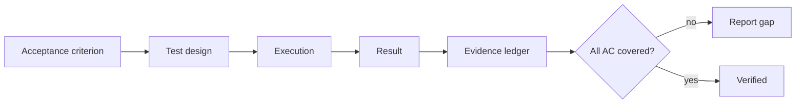
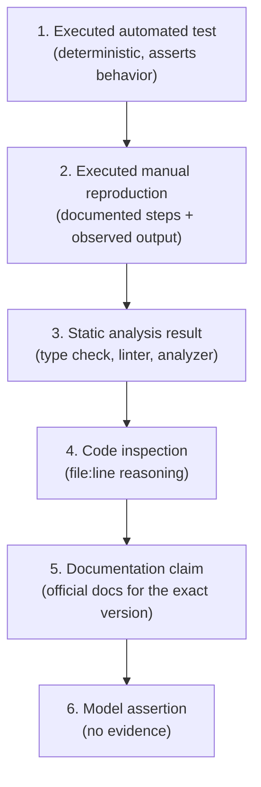
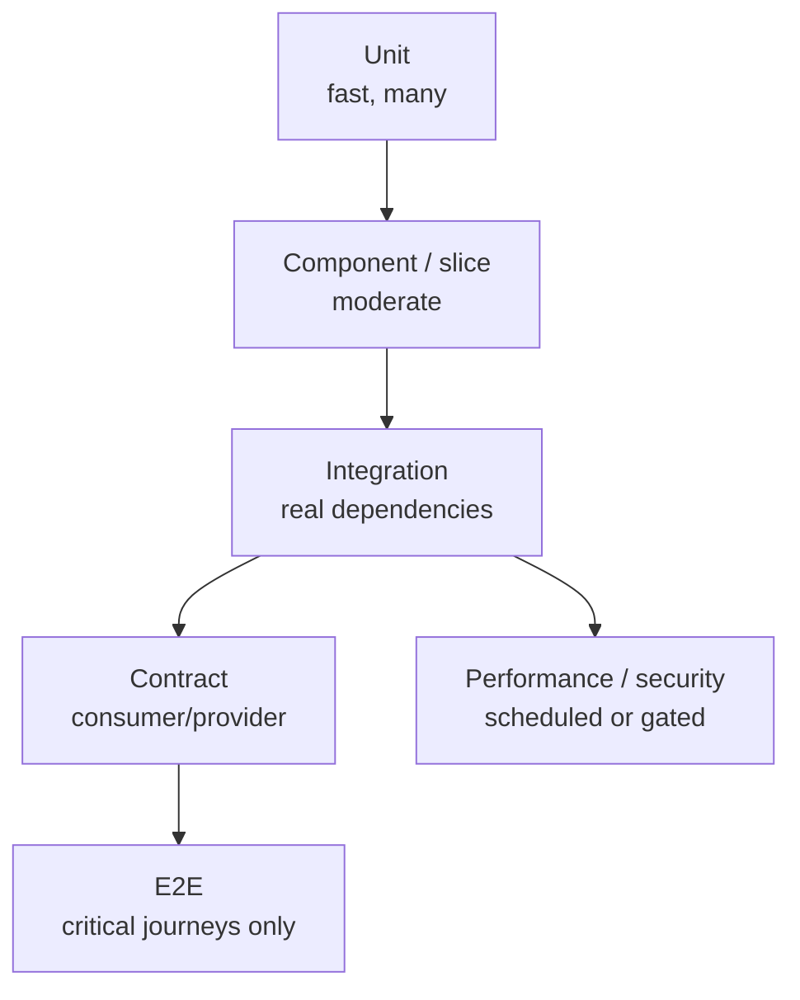
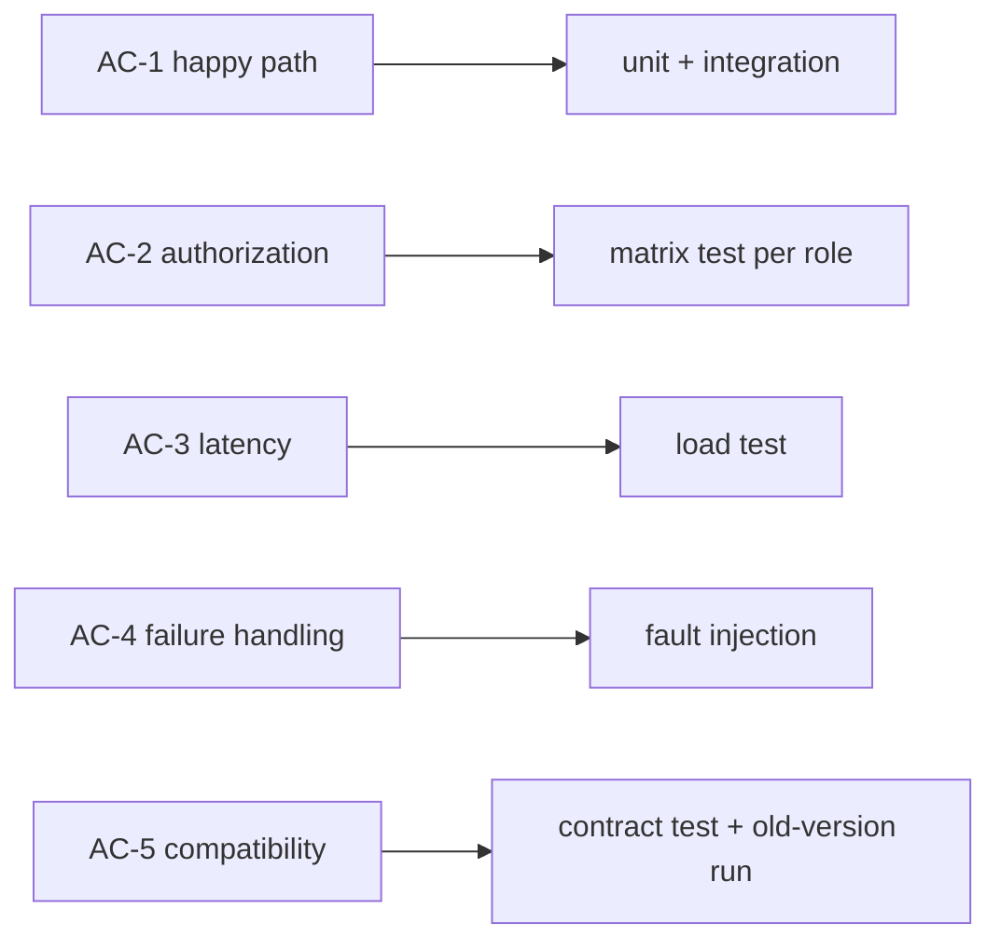
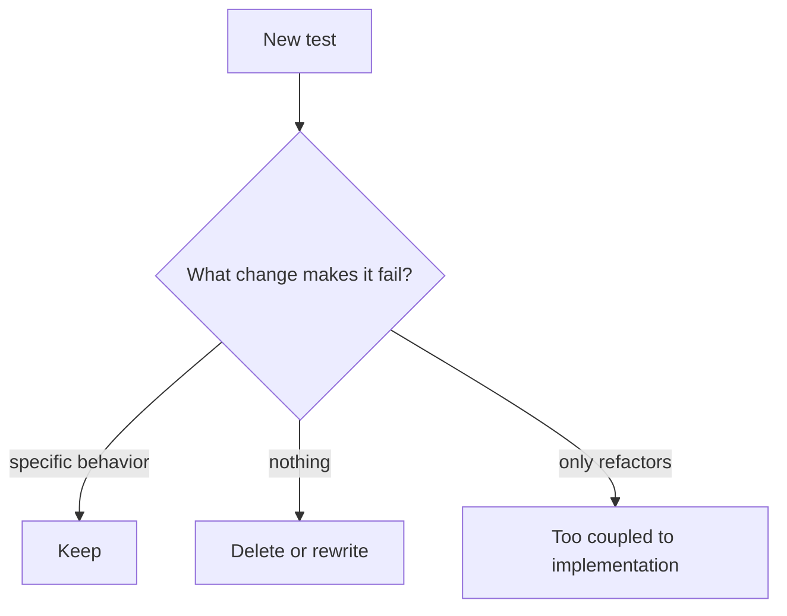
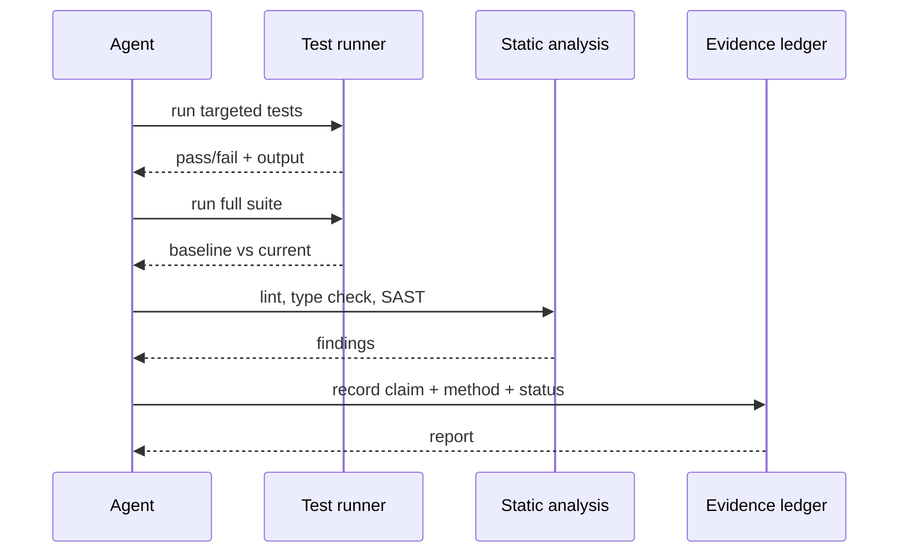
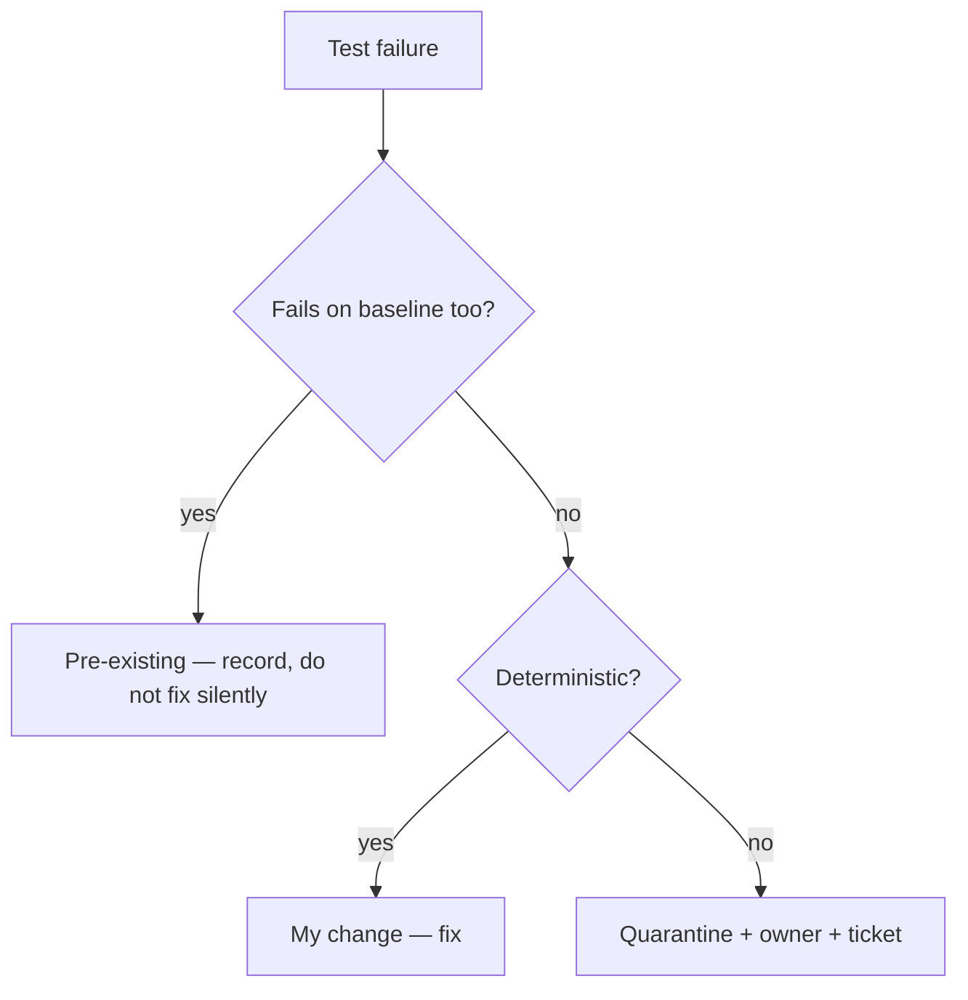
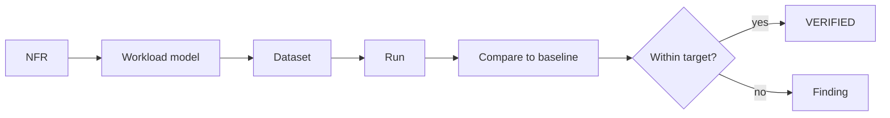

# 20 — Testing and Verification

> A test that was not executed is not evidence. A test that cannot fail is not a test.

---

## 1. Purpose

Define how to produce **defensible evidence** that an implementation satisfies its specification,
and how to report it honestly — including what was not verified.



---

## 2. The evidence hierarchy

Not all evidence is equal. Prefer the strongest available.



| Evidence level | Status it can support |
| --- | --- |
| 1 | `VERIFIED` |
| 2 | `VERIFIED` (if reproducible) or `PARTIALLY VERIFIED` |
| 3 | `PARTIALLY VERIFIED` |
| 4 | `PARTIALLY VERIFIED` |
| 5 | `PARTIALLY VERIFIED` for behavior claims |
| 6 | `UNVERIFIED` — never present as fact |

---

## 3. The test pyramid, adapted for agents



| Layer | Speed | What it proves | What it cannot prove |
| --- | --- | --- | --- |
| Unit | ms | Logic, boundaries | Wiring, serialization |
| Component | 100 ms | Framework integration | Real DB behavior |
| Integration | seconds | Real dependency behavior | Production topology |
| Contract | seconds | Compatibility | Runtime correctness |
| E2E | minutes | User journey | Root cause |
| Perf/security | minutes–hours | NFRs | Functional correctness |

> **Do not use E2E to compensate for missing unit tests.** E2E failures are expensive to diagnose.

---

## 4. Mapping acceptance criteria to evidence



```markdown
| AC | Evidence | Level | Status |
| --- | --- | --- | --- |
| AC-3.1 | `pytest tests/test_export.py::test_visible_rows` → 1 passed | 1 | VERIFIED |
| AC-3.2 | `pytest tests/test_authz.py -k export` → 5 passed | 1 | VERIFIED |
| AC-3.3 | not executed (no perf env) | — | UNVERIFIED |
| AC-3.4 | `EXPLAIN` shows index scan; `test_export_empty` passed | 1, 3 | VERIFIED |
```

---

## 5. Test design rules

| Rule | Rationale |
| --- | --- |
| One behavior per test | Failure messages become diagnostic |
| Name tests after the requirement | Traceability |
| Arrange–Act–Assert visible | Reviewability |
| No sleeps; use deterministic synchronization | Flake prevention |
| Fixed clock and seed | Reproducibility |
| Independent tests | Order must not matter |
| Assert observable outcomes | Implementation-agnostic |
| One logical assertion per test | Clear failure attribution |

### The "would it fail?" check

For every new test, ask: **what code change would make this test fail?**

If the answer is "nothing realistic", the test does not protect anything.



---

## 6. Verification workflow



### Commands must be the project's own

Never invent a test command. Read it from:

1. `README.md`
2. `CONTRIBUTING.md`
3. CI configuration
4. Package manifest scripts

> If no command exists, that is a finding: the repository lacks a documented verification path.

---

## 7. Handling failures and flakes

| Situation | Correct action |
| --- | --- |
| New test fails | Fix the code or the test — do not skip |
| Pre-existing test fails | Record the baseline; do not "fix" unrelated tests |
| Flaky test | Quarantine with an owner and ticket; never add sleeps |
| Environment failure | Record as `UNVERIFIED`, not "passed" |
| Timeout | Investigate; do not raise the timeout blindly |
| Order-dependent failure | Fix isolation; do not shuffle-disabled |



---

## 8. Performance verification



Requirements for credible performance evidence:

| Element | Must be recorded |
| --- | --- |
| Hardware | CPU, memory, disk, network |
| Dataset | Row counts, distribution |
| Load | Concurrency, ramp, duration |
| Percentiles | p50, p95, p99 (not average only) |
| Baseline | Previous run or budget |
| Script | Committed and reproducible |

---

## 9. Security verification

| Check | Evidence |
| --- | --- |
| Dependency CVEs | Scanner output with severity list |
| Secrets | Secret scan result |
| SAST | Findings with rule IDs |
| Authorization | Matrix test results |
| Input validation | Negative tests per field |
| TLS/config | Config inspection or scanner |

See [chapter 21](./21-security-review.md) for the review procedure.

---

## 10. The verification report

```markdown
# Verification report — <change-id>

**Commit:** `abc1234`
**Environment:** CI ubuntu-24.04, Python 3.13.4, PostgreSQL 17.2 container
**Executed at:** 2026-11-02T09:14Z

## Commands executed
| Command | Exit | Summary |
| --- | --- | --- |
| `uv run pytest -q` | 0 | 412 passed, 3 skipped |
| `uv run mypy src` | 0 | no issues |
| `uv run ruff check .` | 0 | clean |
| `trivy fs .` | 0 | 0 HIGH, 0 CRITICAL |

## Acceptance criteria
| AC | Status | Evidence |
| --- | --- | --- |
| AC-3.1 | VERIFIED | `test_visible_rows` passed |
| AC-3.2 | VERIFIED | matrix test: 5 passed |
| AC-3.3 | UNVERIFIED | perf environment unavailable |
| AC-3.4 | VERIFIED | index scan confirmed |

## Not performed
- Load test (AC-3.3)
- Cross-browser E2E (not applicable to API change)

## Limitations
- Unit tests use the same fixture as the bug report; independent data not used.
```

---

## 11. What not to claim

| Claim | Why it is unsafe |
| --- | --- |
| "All tests pass" when some were skipped | Skips are not passes |
| "Coverage is 90%, so it is safe" | Coverage measures execution, not assertions |
| "The build succeeded" without output | Unverifiable |
| "No vulnerabilities" from one scanner | Scope is limited |
| "Performance improved" without a baseline | Not measurable |
| "Backward compatible" without an old-version test | Assumption |

---

## 12. CI gates that make this real

| Gate | Enforcement |
| --- | --- |
| Tests must run | CI required check |
| No new skips | Diff check on `skip` markers |
| Coverage floor per package | Coverage tool threshold |
| Static analysis | Lint/type check required |
| Evidence in PR | Template requires AC table |
| No unverified completion | Review checklist item |

---

## 13. Common mistakes

| Mistake | Consequence | Fix |
| --- | --- | --- |
| Testing implementation, not behavior | Refactor breaks tests; bugs pass | Assert outcomes |
| Mocking the thing under test | Test cannot fail | Use real policy/objects |
| One giant integration test | Slow, undiagnosable | Layer the tests |
| No negative cases | Authz/validation bugs ship | Matrix + invalid input tests |
| Ignoring baseline failures | Blame ambiguity | Record baseline first |
| Reporting without commands | Unverifiable | Paste command + output |

---

## 14. Troubleshooting

| Symptom | Cause | Action |
| --- | --- | --- |
| Tests pass locally, fail in CI | Environment/version | Pin versions; run in container |
| Coverage high but bugs ship | No assertions | Mutation testing / review tests |
| Slow suite | DB per test | Session-scoped fixtures + transactions |
| Flaky suite | Time/network/order | Deterministic fixtures |
| Cannot test a class | Too many dependencies | Refactor for seams ([16](./16-refactoring.md)) |

---

## 15. References

- [Chapter 15 — Bug fixing](./15-bug-fixing.md)
- [Chapter 17 §10 — Test review](./17-specification-review.md)
- [templates/verification-report.md](../templates/verification-report.md)
- [templates/evidence-ledger.md](../templates/evidence-ledger.md)
- [prompts/test-verification-agent.md](../prompts/test-verification-agent.md)
- Test Pyramid — <https://martinfowler.com/articles/practical-test-pyramid.html>
- *xUnit Test Patterns* (Meszaros)
- *Property-Based Testing with PropEr, Erlang, and Elixir* (Hébert) — property-testing mindset
- Google Testing Blog — <https://testing.googleblog.com/>

---

**Previous:** [19 — Read-only code review](./19-read-only-code-review.md) ·
**Next:** [21 — Security review](./21-security-review.md)
