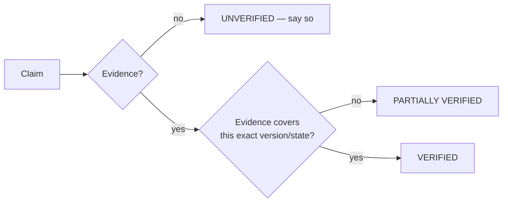
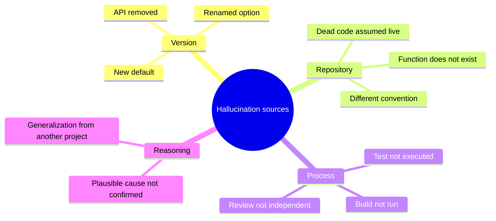
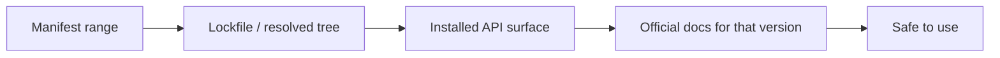
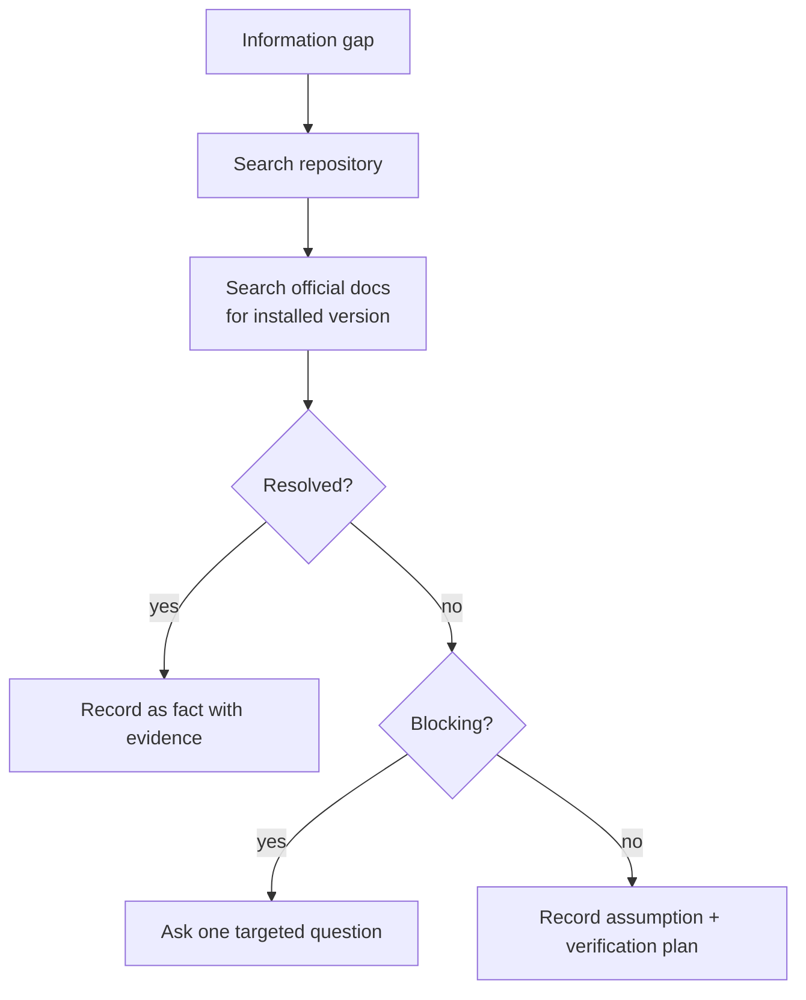
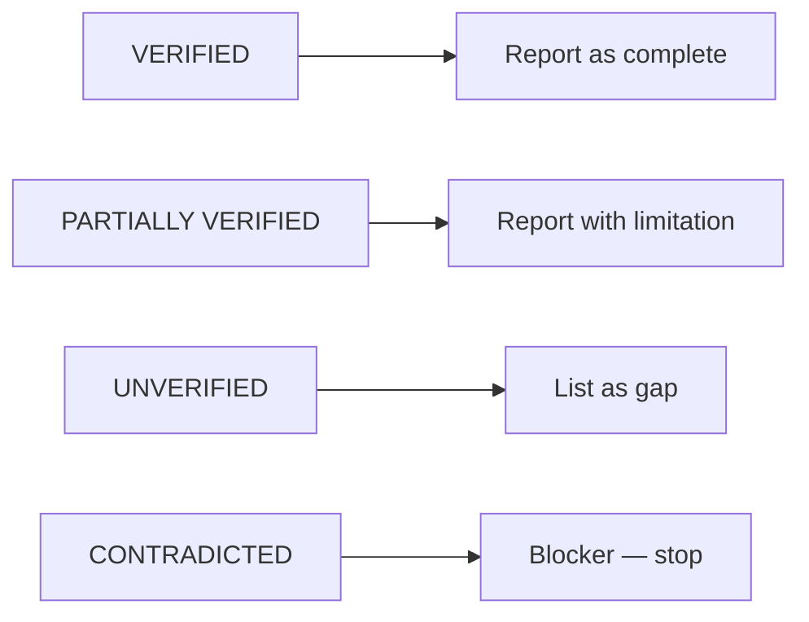
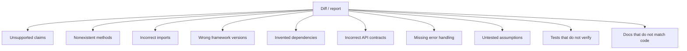
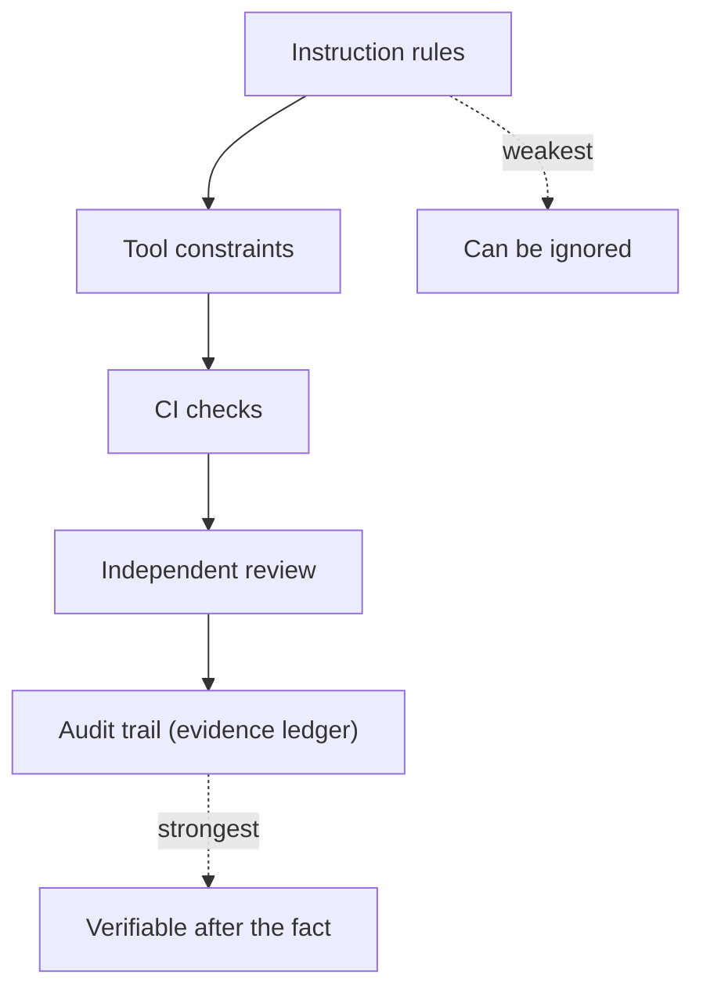
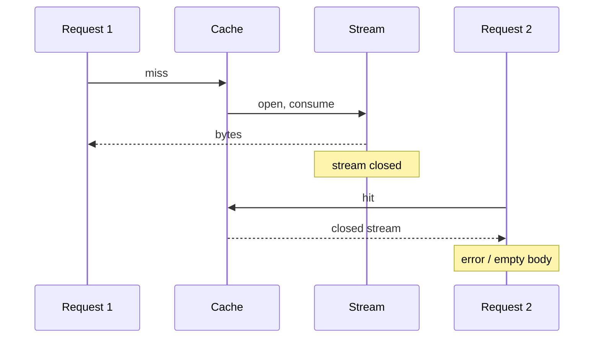

# 23 — Evidence-Based AI Engineering: Preventing Hallucinations and Unsupported Changes

> The failure mode is not "the model writes bad code". It is "the model writes *confident* code
> for a system that does not exist".

---

## 1. Purpose

Define enforceable rules that prevent an agent from asserting things it has not verified, and
give reviewers a way to detect unsupported claims before they reach production.



---

## 2. Why agents hallucinate in engineering contexts

| Cause | Manifestation |
| --- | --- |
| **Version drift** | Using an API from a newer/older library version than installed |
| **Pattern completion** | Inventing a plausible method name that does not exist |
| **Stale training data** | Recommending deprecated configuration keys |
| **Overgeneralization** | Applying a framework convention that this project does not follow |
| **Optimistic completion** | Reporting tests as passed without running them |
| **Context gaps** | Missing that a caller depends on the changed behavior |
| **Helpfulness pressure** | Filling unknown values with invented specifics |



---

## 3. The evidence rules (normative)

These are binding for every agent operating under this handbook.

### E-1 — Never invent APIs, methods, configuration properties, dependencies, or commands

If you have not seen it in the repository or in official documentation for the **installed
version**, do not use it.

### E-2 — Inspect the actual repository before making assumptions

Read files. Do not infer structure from a project's name.

### E-3 — Read the relevant source files before proposing changes

Reading the diff target is not enough; read its callers and tests.

### E-4 — Check actual dependency versions before using APIs

The manifest range is a constraint; the lockfile is reality.



### E-5 — Verify framework behavior against the installed version

Framework defaults change. "In Spring Boot 3.2 the default was X" is not a statement about 3.5.

### E-6 — Prefer official documentation and source code

Blog posts and AI-generated comparisons are not evidence.

### E-7 — Use executable tests as evidence

A test that ran and passed is evidence. A test that exists is not.

### E-8 — Distinguish facts, assumptions, and hypotheses

Every non-trivial statement is labelled.

### E-9 — Provide file paths and line references for repository claims

"The service handles authorization" is not verifiable. `src/auth/service.py:44` is.

### E-10 — Cite external documentation for version-sensitive claims

Include the version and date checked.

### E-11 — Never fabricate test results

Include the command and its output, or say it was not run.

### E-12 — Never claim a build succeeded without executing it

Same standard as tests.

### E-13 — Never claim a security issue is fixed without verification

Re-run the scanner or the exploit; show the result.

### E-14 — Never claim complete specification compliance without checking every acceptance criterion

Partial compliance is a valid, useful outcome. False completeness is not.

---

## 4. Uncertainty handling

When information is missing, the correct behavior is a **short, specific unknown**, not a
plausible invention.



### Unknown statement template

```markdown
**Unknown U-2:** Whether the billing service consumes `GET /orders/export`.
- **Why it matters:** if it does, changing the response is a breaking change.
- **Searched:** repository (`grep -rn "orders/export"`), OpenAPI consumers, CI config.
- **Not searched:** external service catalog (no access).
- **Blocking:** yes.
- **Needed:** confirmation from the billing team, or a service-dependency export.
```

### Forbidden filler

| Do not write | Write instead |
| --- | --- |
| "The default timeout is 30 seconds" (unverified) | "Timeout is not configured in this repository; framework default must be confirmed for version X" |
| "This is safe because the ORM escapes input" | "Parameterized query at `repo.py:88`; escaping verified by test `test_sql_injection`" |
| "All tests pass" | "`pytest -q` → 412 passed, 3 skipped (see output)" |
| "This API was removed in v2" | "Not present in installed v2.3.1 (`pip show`); removed in v2.0 per changelog link" |

---

## 5. The evidence ledger

For any significant change, maintain a table. It is the single artifact that makes a completion
report auditable.

```markdown
# Evidence ledger — <change-id>

| # | Claim | Evidence | Method | Status | Confidence |
| --- | --- | --- | --- | --- | --- |
| 1 | `OrderQuery.visible_to_user` filters by record ACL | `repo.py:112-140`; test `test_acl_matrix` | inspection + test | VERIFIED | 9/10 |
| 2 | Export streams without buffering | `export.py:60` yields per row; `test_streaming` asserts incremental | test | VERIFIED | 9/10 |
| 3 | p95 TTFB < 1.5 s at 100k rows | not executed | — | UNVERIFIED | — |
| 4 | Migration is backward compatible | expand-only DDL; old code path unchanged | inspection | PARTIALLY VERIFIED | 7/10 |
| 5 | Retry is idempotent | duplicate `Idempotency-Key` test | test | VERIFIED | 8/10 |
| 6 | No N+1 introduced | query count assertion in `test_query_count` | test | VERIFIED | 8/10 |
| 7 | Dropping the old column is safe | consumer inventory incomplete | inspection | CONTRADICTED | 6/10 |
```

### Statuses

| Status | Definition | May be reported as done? |
| --- | --- | --- |
| `VERIFIED` | Direct evidence for this exact claim and version | Yes |
| `PARTIALLY VERIFIED` | Evidence exists but scope is limited | Yes, with the limit stated |
| `UNVERIFIED` | No evidence | **No** |
| `CONTRADICTED` | Evidence contradicts the claim | **No — blocker** |



> **Contradicted is the most valuable status.** It means the review worked.

---

## 6. Anti-hallucination review

The reviewer must actively look for these signals.



| # | Signal | How to check |
| --- | --- | --- |
| 1 | Unsupported claims | Every "because/ensures/guarantees" has a reference |
| 2 | Nonexistent methods | Search the definition or the dependency source |
| 3 | Incorrect imports | Resolve the module path; check the package exports |
| 4 | Wrong framework version | Compare the lockfile version with the API used |
| 5 | Invented dependencies | `git diff` on manifests; check the registry |
| 6 | Incorrect API contracts | Compare with OpenAPI/schema; run contract tests |
| 7 | Missing error handling | Enumerate failure paths for each new call |
| 8 | Untested assumptions | Look for "should", "likely", "probably" |
| 9 | Tests that do not verify | Would the test fail if the code were wrong? |
| 10 | Docs that do not match | Run the documented command; check flags |

### Vocabulary that signals risk

| Phrase | Likely problem |
| --- | --- |
| "should work" | Not verified |
| "typically" | Generalization, not this repo |
| "the framework handles" | Unverified default |
| "this is standard" | Appeal to convention |
| "presumably" | Guess |
| "I've added tests" | May not have run them |
| "all set" | No evidence |

---

## 7. Enforcement techniques

Instructions alone are weak. Combine them with structural controls.



| Control | What it prevents |
| --- | --- |
| Tool allow-list (no shell) | Invented commands executed blindly |
| Lockfile committed + CI `--frozen` | Version drift |
| `tsc --noEmit` / `mypy` / compile | Nonexistent methods |
| Contract tests | Invented API shapes |
| Required evidence table in PR | "Tests pass" without proof |
| Read-only review | Self-approval |
| Deterministic reproduction required | Invented causes |

---

## 8. Worked example — catching a plausible but wrong change

```markdown
**Agent claim:** "Added `@Cacheable` to the export method; Spring will cache the stream."

**Review findings:**
- C-01 (HIGH): `@Cacheable` on a method returning `StreamingResponseBody` caches a
  single-use stream. Second request receives a closed stream.
  Evidence: `export.py:71`; Spring docs for caching return values.
- C-02 (MEDIUM): Cache has no eviction configured; unbounded memory growth.
- C-03 (INFO): Claim "Spring will cache the stream" is an assumption. No test.
```



The fix is not "add a TTL". It is "do not cache streams" — which the reviewer found by reasoning
about the artifact's lifecycle, not by trusting the annotation's name.

---

## 9. Prompt fragment to embed everywhere

```text
## Evidence rules (non-negotiable)

1. Never invent APIs, methods, configuration properties, dependencies, or commands.
2. Inspect the repository before assuming structure or conventions.
3. Read the affected files and their callers before proposing changes.
4. Read resolved dependency versions from the lockfile, not the manifest range.
5. Verify framework behavior against the installed version's official docs.
6. Cite file:line for every repository claim; cite version + URL for external claims.
7. Never state that a test, build, or scan passed unless you executed it and can quote the result.
8. Label every non-trivial claim: VERIFIED, PARTIALLY VERIFIED, UNVERIFIED, or CONTRADICTED.
9. When information is missing: search first, then state the unknown, then ask one targeted
   question if it blocks progress. Do not fill gaps with invented specifics.
10. Output an evidence ledger for any change larger than a trivial fix.
```

---

## 10. Verification of this chapter

This chapter is process-only. Its rules are reflected in:

- Every file under [`prompts/`](../prompts/)
- [`templates/evidence-ledger.md`](../templates/evidence-ledger.md)
- [Chapter 20 §10](./20-testing-and-verification.md) — verification report format
- [Chapter 19 §4.6](./19-read-only-code-review.md) — evidence pass

---

## 11. Common mistakes

| Mistake | Consequence | Fix |
| --- | --- | --- |
| Asking "are you sure?" | Produces more confident prose, not evidence | Require a command or citation |
| Accepting code that compiles | Compilation proves syntax, not behavior | Run tests |
| Trusting a summary of a diff | Hides omissions | Read the diff |
| Allowing "should work" | Unverified change ships | Require execution |
| Skipping the ledger for "small" changes | Small changes cause large incidents | Ledger for any behavior change |
| Penalizing "unknown" | Encourages invention | Reward explicit uncertainty |

---

## 12. References

- [Chapter 19 — Read-only code review](./19-read-only-code-review.md)
- [Chapter 20 — Testing and verification](./20-testing-and-verification.md)
- [Chapter 24 — Multi-agent engineering](./24-multi-agent-engineering.md)
- [templates/evidence-ledger.md](../templates/evidence-ledger.md)
- [prompts/master-sdd-agent.md](../prompts/master-sdd-agent.md)
- NIST AI Risk Management Framework — <https://www.nist.gov/itl/ai-risk-management-framework>
- ISO/IEC/IEEE 29148 (requirements quality)
- Google SRE Book, *Postmortem Culture* — <https://sre.google/sre-book/postmortem-culture/>

---

**Previous:** [22 — Git and commit policy](./22-git-and-commit-policy.md) ·
**Next:** [24 — Multi-agent engineering](./24-multi-agent-engineering.md)
