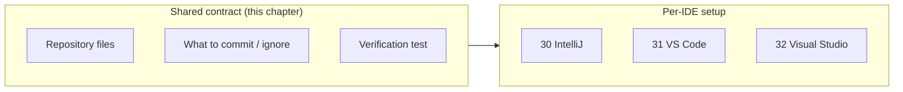
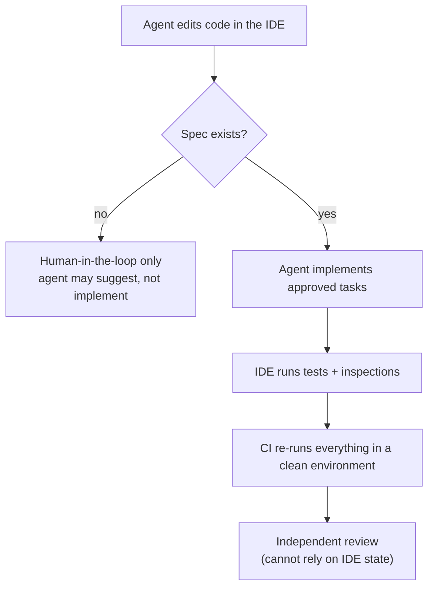
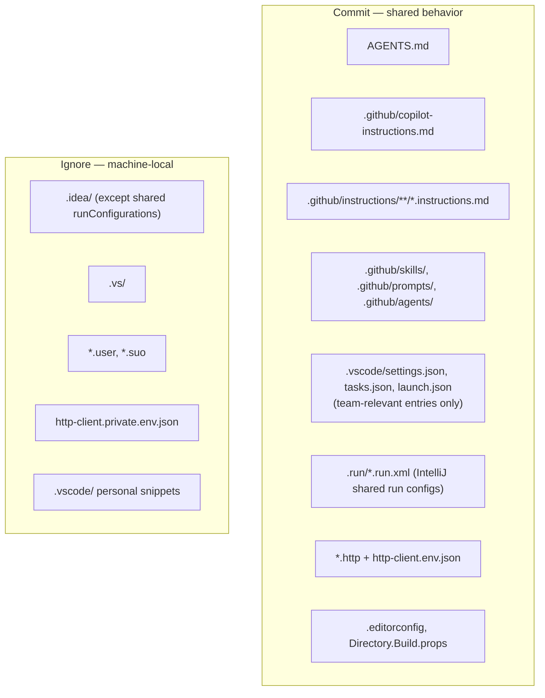
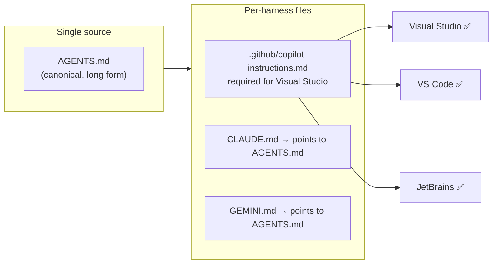
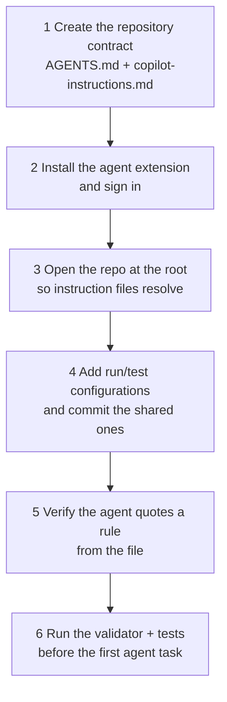
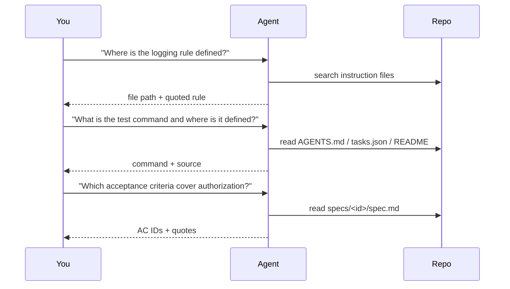
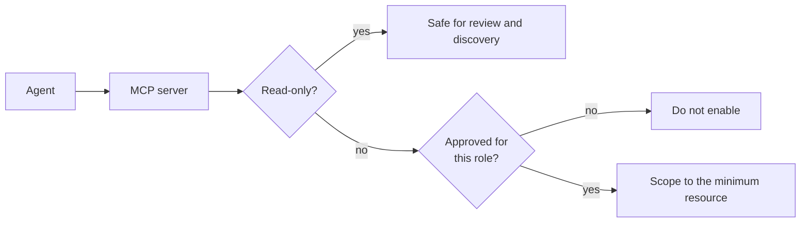
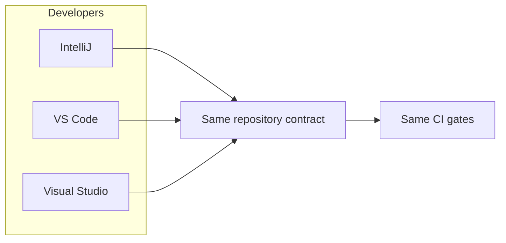

# 29 — IDE Setup: Overview and Comparison

> Verified against GitHub Copilot's custom-instructions support reference, Visual Studio, JetBrains,
> and Claude Code documentation on **2026-11-02**. Deep setup for each IDE is in chapters 30–32.

---

## 1. Purpose

The IDE is where the specification meets the code. This chapter is the **router**: it explains what
is shared, what differs per IDE, and what to commit. Each IDE then has its own chapter.

| IDE | Dedicated chapter |
| --- | --- |
| IntelliJ IDEA (and PyCharm, WebStorm, PhpStorm, GoLand, Android Studio) | [Chapter 30 — IntelliJ IDEA](./30-ide-intellij.md) |
| Visual Studio Code | [Chapter 31 — VS Code](./31-ide-vscode.md) |
| Visual Studio | [Chapter 32 — Visual Studio](./32-ide-visual-studio.md) |



---

## 2. What the IDE can and cannot do for SDD

| The IDE is good at | The IDE cannot |
| --- | --- |
| Making artifacts visible while coding | Enforce that a spec exists |
| Running the agent with project context | Guarantee the agent read the spec |
| Running tests, debuggers, profilers | Prove acceptance criteria are met |
| Surfacing inspections and analyzers | Replace independent review |
| Storing reviewable run/HTTP/test configuration | Prevent an agent from editing files |

> **Rule:** the IDE improves **ergonomics**. Enforcement lives in CI and in read-only review
> ([chapter 25](./25-ci-cd-integration.md), [chapter 19](./19-read-only-code-review.md)).



---

## 3. The repository contract: what to commit

Set this up **once**, before installing anything per developer. It is what makes the IDE
interchangeable.



| Path | Commit? | Why |
| --- | --- | --- |
| `AGENTS.md` | **Yes** | Cross-agent rules; nearest file wins |
| `.github/copilot-instructions.md` | **Yes** | Repository-wide Copilot rules in all three IDEs |
| `.github/instructions/*.instructions.md` | **Yes** | Path-scoped rules (`applyTo` front matter) |
| `.github/skills/`, `.github/prompts/`, `.github/agents/` | **Yes** | Reusable procedures and roles |
| `.vscode/settings.json` | **Yes**, curated | Share only team-relevant settings |
| `.vscode/tasks.json`, `launch.json` | **Yes** | Makes build/test/debug reproducible for everyone |
| `.run/*.run.xml` | **Yes** | IntelliJ shared run configurations |
| `.idea/` | **No** (one exception below) | Machine-local workspace state |
| `.idea/runConfigurations/` | **Yes**, via negation | Shared run configurations |
| `.vs/`, `*.user`, `*.suo` | **No** | Per-user state |
| `*.http` | **Yes** | Executable API contract checks |
| `http-client.env.json` | **Yes** | Non-secret environment variables |
| `http-client.private.env.json` | **No** | Secrets; add to `.gitignore` |
| `.editorconfig` | **Yes** | Style contract shared by all IDEs |

`.gitignore`:

```gitignore
# IntelliJ: keep the workspace local, share only run configurations
/.idea/*
!/.idea/runConfigurations/

# Visual Studio
.vs/
*.user
*.suo

# HTTP client secrets
http-client.private.env.json
```

---

## 4. Feature parity across the three IDEs

| Capability | VS Code | IntelliJ IDEA | Visual Studio |
| --- | --- | --- | --- |
| Repo-wide instructions `.github/copilot-instructions.md` | ✅ | ✅ | ✅ |
| Path-specific `.github/instructions/*.instructions.md` | ✅ | ✅ | ✅ |
| `AGENTS.md` | ✅ | via agent customizations | ❌ **not listed** |
| Custom agents / skills UI | ✅ files | ✅ Agent Customizations editor | partial |
| Shared run configurations | `launch.json` | `.run/*.run.xml` | `launchSettings.json` |
| Executable HTTP files | extension | `.http` + env files | `.http` (17.8+) |
| Test runner integration | Testing panel | Run configurations | Test Explorer |
| Read-only enforcement for review | tool allow-list | tool allow-list | tool allow-list |

> **Do not assume parity.** Always maintain `.github/copilot-instructions.md`: it is the only
> repository-wide instruction file that all three IDEs read.



---

## 5. Universal setup checklist



| Step | Check that it worked |
| --- | --- |
| 1 | `ls AGENTS.md .github/copilot-instructions.md` → both exist |
| 2 | The agent panel shows a signed-in account |
| 3 | The IDE's project root equals the Git root (`git rev-parse --show-toplevel`) |
| 4 | Running the configuration from a fresh clone works |
| 5 | Ask: "Which rules apply to `src/`?" — it quotes your file |
| 6 | `python3 tools/validate_docs.py` and the project test command pass |

> **Open the repository root, not a subfolder.** Instruction resolution depends on the directory
> tree; opening a subdirectory hides root-level files from some harnesses.

---

## 6. Verifying the agent actually sees your rules

Run this in each IDE after setup. It is the only proof that configuration worked.



| Answer looks like | Verdict |
| --- | --- |
| Quotes the rule and names the file | ✅ Configured |
| Gives a generic best practice | ❌ Rules not loaded |
| Invents a path that does not exist | ❌ Wrong root, or no instruction file |
| Says "no rules found" | ❌ File missing or IDE opened a subfolder |

---

## 7. Model Context Protocol and external tools

All three IDEs can connect agents to MCP servers. Treat MCP as a **capability grant**.

| Rule | Reason |
| --- | --- |
| Prefer read-only MCP servers for review roles | A reviewer with write tools is not read-only |
| Pin server versions | Reproducibility |
| Never grant production write access to an implementation agent | Blast radius |
| Review the server's tool list before enabling | Hidden destructive tools |
| Keep credentials in the IDE's secret store | Not in workspace settings |



---

## 8. Choosing an IDE for an SDD team

It does not matter which IDE each developer uses, as long as the **repository contract** is shared.
What matters is that the team agrees on:

| Decision | Recommendation |
| --- | --- |
| Instruction source | `.github/copilot-instructions.md` + `AGENTS.md` (+ scoped files) |
| Test command | One command per project, committed as an IDE task/run configuration |
| Formatting | `.editorconfig`; IDE formatters must match CI |
| API evidence | `.http` files committed next to the spec |
| Secrets | IDE secret store or environment; never in the repo |
| Review | Never rely on IDE state; review the committed diff |



---

## 9. Troubleshooting index

| Symptom | Likely cause | Go to |
| --- | --- | --- |
| Agent ignores rules | IDE opened a subfolder | [30](./30-ide-intellij.md) · [31](./31-ide-vscode.md) · [32](./32-ide-visual-studio.md) |
| Visual Studio ignores `AGENTS.md` | Not supported there | [32 §4](./32-ide-visual-studio.md) |
| Rules apply everywhere instead of one path | Wrong `applyTo` glob | [31 §5](./31-ide-vscode.md) |
| Claude Code: "Cannot launch Claude Code" | `claude` not on `PATH` | [30 §3](./30-ide-intellij.md) |
| Run configuration missing for a teammate | Not stored as project file | [30 §5](./30-ide-intellij.md) |
| Secrets in a committed env file | Private env file not used | [30 §6](./30-ide-intellij.md) · [32 §5](./32-ide-visual-studio.md) |
| Analyzer results differ from CI | Different SDK/analyzer level | [32 §6](./32-ide-visual-studio.md) |

---

## 10. Official references

- Copilot custom instructions support by environment — <https://docs.github.com/en/copilot/reference/custom-instructions-support>
- Add repository custom instructions — <https://docs.github.com/en/copilot/how-tos/configure-custom-instructions/add-repository-instructions>
- VS Code: custom instructions — <https://code.visualstudio.com/docs/copilot/customization/custom-instructions>
- VS Code: agent skills — <https://code.visualstudio.com/docs/copilot/customization/agent-skills>
- VS Code: custom agents — <https://code.visualstudio.com/docs/copilot/customization/custom-agents>
- Visual Studio: manage Copilot installation and state — <https://learn.microsoft.com/en-us/visualstudio/ide/visual-studio-github-copilot-install-and-states>
- Visual Studio: `.http` files — <https://learn.microsoft.com/en-us/aspnet/core/test/http-files>
- IntelliJ IDEA: run/debug configurations — <https://www.jetbrains.com/help/idea/run-debug-configuration.html>
- IntelliJ IDEA: HTTP client — <https://www.jetbrains.com/help/idea/http-client-in-product-code-editor.html>
- JetBrains AI Assistant — <https://www.jetbrains.com/help/idea/ai-assistant.html>
- Claude Code in JetBrains IDEs — <https://docs.claude.com/en/docs/claude-code/jetbrains>

---

**Previous:** [28 — Glossary](./28-glossary.md) ·
**Next:** [30 — IntelliJ IDEA](./30-ide-intellij.md) ·
**Back to index:** [00-index.md](00-index.md)
