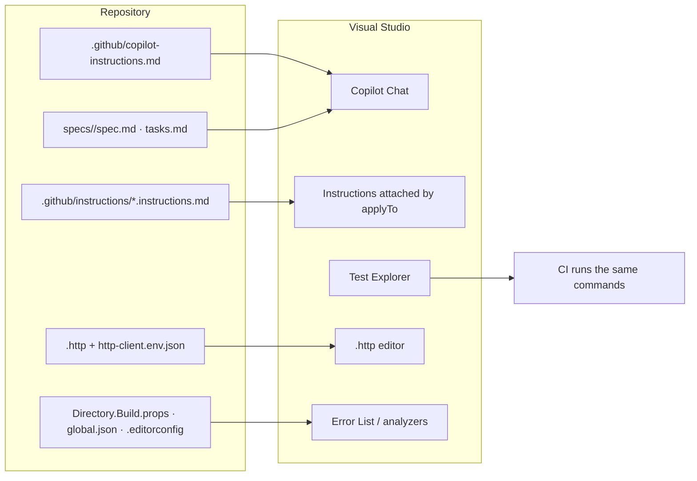
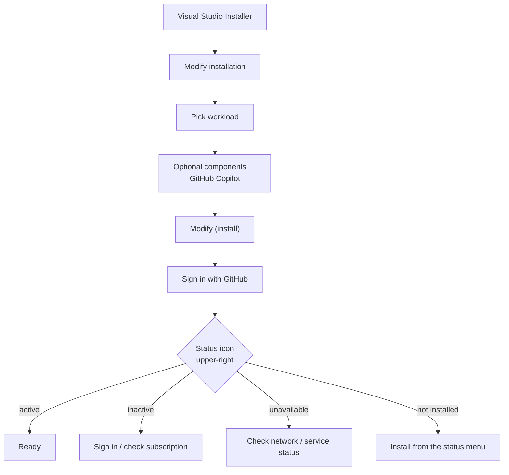
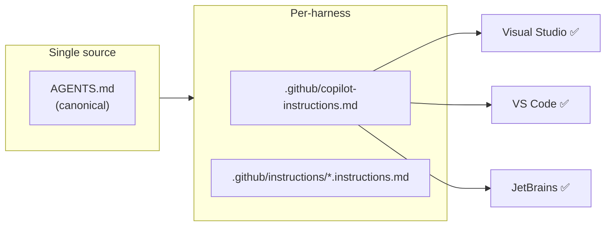
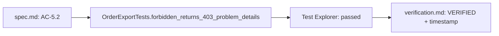
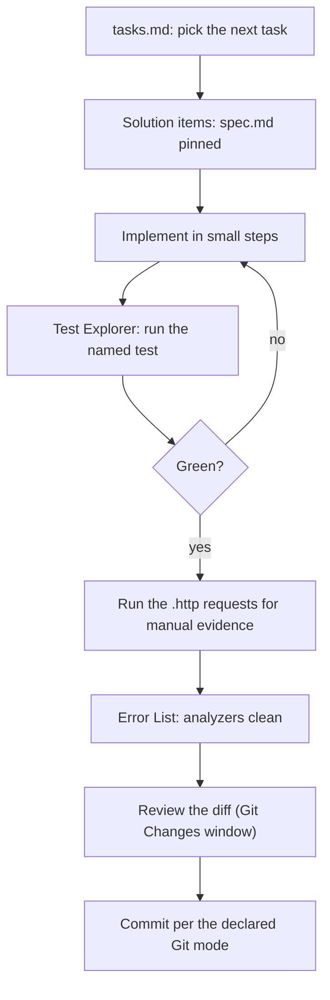

# 32 — Visual Studio Setup for SDD

> Verified against Microsoft Learn and GitHub Copilot's custom-instructions support reference on
> **2026-11-02**. This chapter targets **Visual Studio 2022 version 17.10 or later**.

---

## 1. Purpose

A complete, verifiable Visual Studio setup for Spec-Driven Development: the agent reads repository
rules, the Test Explorer produces the exact evidence your spec names, `.http` files make API
acceptance criteria executable, and analyzers agree with CI.



---

## 2. Prerequisites

| Requirement | Detail |
| --- | --- |
| Visual Studio 2022 | **17.10 or later** for the installation and status behavior described here |
| Visual Studio 2022 + ASP.NET workload | **17.8 or later** for the built-in `.http` editor |
| Workload | e.g. *.NET desktop development* / *ASP.NET and web development* |
| GitHub account | With Copilot access |
| Repository | Opened at the root so `.github/` and `global.json` resolve |

---

## 3. Install GitHub Copilot (verified steps)

1. Launch the **Visual Studio Installer**.
2. Select the installation you want to modify → **Modify**.
3. Select a workload (for example *.NET desktop development*).
4. In **Optional components**, select **GitHub Copilot** → **Modify**.
5. Sign in to Visual Studio with a GitHub account that has Copilot access.



### 3.1 Reading the status icon

With 17.10+, a Copilot status icon appears in the upper-right of the IDE:

| State | Meaning | Action |
| --- | --- | --- |
| **Active** | Signed in and functional | None |
| **Inactive** | Installed but not usable | Sign in; check the account has a subscription; refresh credentials |
| **Unavailable** | Network/service problem | Open the troubleshooting page from the dropdown |
| **Not installed** | Component not installed | Choose **Install Copilot** from the dropdown |

> If Copilot is inactive because the wrong GitHub account is active, switch accounts — a common
> cause when multiple accounts are signed in.

---

## 4. What Copilot reads in Visual Studio (verified)

| File | Support in Visual Studio |
| --- | --- |
| `.github/copilot-instructions.md` | ✅ Copilot Chat |
| `.github/instructions/**/*.instructions.md` | ✅ Copilot Chat |
| `AGENTS.md` | ❌ **Not listed** in the support reference |
| `CLAUDE.md` / `GEMINI.md` | ❌ Not listed |

> **This is the most common cross-IDE mistake.** A team that only writes `AGENTS.md` gets **no
> repository rules in Visual Studio**. Always maintain `.github/copilot-instructions.md`.



### 4.1 Files to create

`.github/copilot-instructions.md`:

```markdown
# Repository rules

## Non-negotiables
- Never commit secrets. Use User Secrets or environment variables.
- `Nullable` is enabled; no new `!` null-forgiving operator in production code.
- No `.Result` or `.Wait()`; async all the way.
- `DbContext` is scoped; never captured in a singleton or background service.
- Integration tests use Testcontainers, not the InMemory provider.

## Commands
- Build: `dotnet build -warnaserror`
- Test: `dotnet test --no-build`
- Format: `dotnet format --verify-no-changes`
- Vulnerabilities: `dotnet list package --vulnerable --include-transitive`

## Boundaries
- `Orders.Api` may reference `Orders.Infrastructure`; never the reverse.
- Migrations live in `Orders.Migrations` and require a `Down`.
```

`.github/instructions/tests.instructions.md`:

```markdown
---
applyTo: "**/*Tests*/**/*.cs,**/*.Tests/**"
---
# Test rules
- `[Fact]` for one behavior, `[Theory]` for table cases.
- Assert HTTP status **and** a `ProblemDetails` type where applicable.
- Use `WebApplicationFactory<Program>` for endpoint tests.
- Use Testcontainers for anything that depends on database semantics.
- A new test must fail on the base commit.
```

`.github/instructions/api.instructions.md`:

```markdown
---
applyTo: "**/Orders.Api/**/*.cs"
---
# API rules
- Every endpoint declares `.RequireAuthorization(...)` with an explicit policy.
- Return `ProblemDetails`; never `200` with an error payload.
- Bind DTOs, never EF entities.
- No `DateTime.Now`; inject `TimeProvider`.
```

---

## 5. Project configuration to commit

| File | Purpose |
| --- | --- |
| `.editorconfig` | Formatting contract across VS, VS Code, and CI |
| `global.json` | Pin the SDK band so IDE and CI compile with the same SDK |
| `Directory.Build.props` | Shared nullable/analyzer/warnings policy |
| `Directory.Packages.props` | Central package management (if used) |
| `*.http` | Executable API evidence |
| `http-client.env.json` | Non-secret environment variables |
| `Properties/launchSettings.json` | Local run profiles (no secrets) |
| `.gitignore` | `.vs/`, `*.user`, `*.suo`, `http-client.private.env.json` |

`global.json`:

```json
{
  "sdk": {
    "version": "10.0.100",
    "rollForward": "latestFeature"
  }
}
```

`Directory.Build.props`:

```xml
<Project>
  <PropertyGroup>
    <Nullable>enable</Nullable>
    <ImplicitUsings>enable</ImplicitUsings>
    <TreatWarningsAsErrors>true</TreatWarningsAsErrors>
    <AnalysisLevel>latest-recommended</AnalysisLevel>
    <EnforceCodeStyleInBuild>true</EnforceCodeStyleInBuild>
    <GenerateDocumentationFile>true</GenerateDocumentationFile>
  </PropertyGroup>
</Project>
```

> If the IDE's analyzer set differs from CI's, the agent will "fix" warnings CI never reported and
> miss the ones CI blocks. Pin the SDK and share the props file.

---

## 6. Test Explorer: the evidence panel

Test Explorer is where an acceptance criterion becomes an observed result.



| Practice | Why |
| --- | --- |
| Name tests after the acceptance criterion | Reviewers can trace AC → test |
| Run one test before the whole suite | Localizes failures quickly |
| Never mark a test as passed based on the IDE's cached state | Re-run after changes |
| Keep integration tests in a separate project | Different runtime and fixtures |
| Use Testcontainers for DB tests | Real semantics, not the InMemory provider |

---

## 7. `.http` files: executable API evidence

Verified: `.http` and `.rest` files are supported in **Visual Studio 2022 17.8 or later** with the
**ASP.NET and web development** workload. Environment variables come from `http-client.env.json`,
resolved relative to the `.http` file.

`specs/SDD-142/orders.http`:

```http
@host = http://localhost:5080

### AC-5.1 authorized export returns CSV
GET {{host}}/projects/{{projectId}}/orders/export
Authorization: Bearer {{viewerToken}}

### AC-5.2 forbidden export writes no CSV bytes
GET {{host}}/projects/{{otherProjectId}}/orders/export
Authorization: Bearer {{viewerToken}}
```

`http-client.env.json` (commit — no secrets):

```json
{
  "dev": {
    "projectId": "11111111-1111-1111-1111-111111111111",
    "otherProjectId": "22222222-2222-2222-2222-222222222222"
  },
  "staging": {}
}
```

Tokens: use environment variables or User Secrets; never commit them into the env file. Add
`http-client.private.env.json` to `.gitignore` if you use it locally.

> HTTP files are **manual verification**. Keep automated assertions in the test project
> ([chapter 20](./20-testing-and-verification.md)).

---

## 8. Keeping the package manager and CI in sync

| Setting | Location | Why it matters |
| --- | --- | --- |
| SDK version | `global.json` | IDE and CI compile with the same SDK |
| Package source | `NuGet.Config` | A private feed the agent cannot reach breaks restore |
| Central versions | `Directory.Packages.props` | One version per package |
| Analyzer level | `Directory.Build.props` | Same warnings as CI |
| Code style | `.editorconfig` | No formatting noise in diffs |
| Launch profile | `Properties/launchSettings.json` | Reproducible local run, no secrets |

```bash
dotnet --info
dotnet restore
dotnet build -warnaserror --no-restore
dotnet test --no-build
dotnet format --verify-no-changes
```

---

## 9. Working the SDD loop inside Visual Studio



### Solution organization for SDD

| Item | Where |
| --- | --- |
| `specs/` | Solution folder **Specs** (added as solution items, not compiled) |
| `docs/adr/` | Solution folder **Architecture** |
| `orders.http` | `specs/<id>/` so the contract lives with the spec |
| Test projects | One per layer, named after the layer under test |

> **Solution items are not code.** Adding `specs/` as solution items makes the artifacts one click
> away without putting Markdown into a build.

---

## 10. Verification

```text
In Copilot Chat:
1. "Which instruction files apply to Orders.Api/Endpoints/Export.cs?"
2. "What is the test command, and where is it defined?"
3. "Summarize the acceptance criteria for SDD-142."
4. "Which analyzer level does this solution use, and where is it configured?"
```

| Expected | Verdict |
| --- | --- |
| Names `.github/instructions/api.instructions.md` and quotes it | ✅ |
| Quotes `dotnet test` and points to the instruction file | ✅ |
| Lists AC IDs from `spec.md` | ✅ |
| Says "no repository instructions found" | ❌ Only `AGENTS.md` exists — add `.github/copilot-instructions.md` |
| Generic advice | ❌ Rules not loaded |

Confirm a clean clone builds:

```bash
git clone <repo> /tmp/sdd-vs && cd /tmp/sdd-vs
dotnet restore
dotnet build -warnaserror
dotnet test
```

---

## 11. Troubleshooting

| Symptom | Cause | Fix |
| --- | --- | --- |
| Copilot rules ignored | Only `AGENTS.md` exists | Add `.github/copilot-instructions.md` |
| Status icon shows inactive | Not signed in, or wrong account | Sign in / switch account with Copilot access |
| Status icon unavailable | Network or service issue | Use the troubleshooting page from the dropdown |
| `.http` files do not run | VS older than 17.8, or workload missing | Update VS; install the ASP.NET workload |
| HTTP request fails only in the IDE | Environment not selected | Choose the environment in the `.http` editor |
| Analyzer results differ from CI | Different SDK/analyzer level | `global.json` + `Directory.Build.props` |
| Restore fails in IDE only | Private NuGet feed credentials | Configure `NuGet.Config` credentials |
| Test not discovered | Missing test SDK/runner packages | Add `Microsoft.NET.Test.Sdk` + `xunit.runner.visualstudio` |
| Secret in a committed env file | Private env file not used | Move and rotate the secret |
| `.vs/` or `*.user` in diffs | `.gitignore` incomplete | Add them |

---

## 12. Security considerations

| Risk | Control |
| --- | --- |
| Secrets in `launchSettings.json` or `.http` env files | User Secrets, environment variables, private env file |
| `.vs/` committed with cached credentials | `.gitignore`; scan before pushing |
| Wildcard Copilot policy disabled by admin | Check with IT; do not work around policy |
| MCP server with write access | Grant per role; read-only for review |
| Agent edits `.github/**` | CODEOWNERS + branch protection |
| Debugging against production | Use local/staging launch profiles only |

---

## 13. Official references

- Visual Studio: manage Copilot installation and state — <https://learn.microsoft.com/en-us/visualstudio/ide/visual-studio-github-copilot-install-and-states>
- Visual Studio: `.http` files (17.8+) — <https://learn.microsoft.com/en-us/aspnet/core/test/http-files>
- Visual Studio: analyzers and code analysis — <https://learn.microsoft.com/dotnet/fundamentals/code-analysis/overview>
- Visual Studio: user secrets — <https://learn.microsoft.com/aspnet/core/security/app-secrets>
- `Directory.Build.props` — <https://learn.microsoft.com/visualstudio/msbuild/customize-by-directory>
- `global.json` — <https://learn.microsoft.com/dotnet/core/tools/global-json>
- `dotnet test` — <https://learn.microsoft.com/dotnet/core/tools/dotnet-test>
- Copilot custom instructions support by environment — <https://docs.github.com/en/copilot/reference/custom-instructions-support>
- Testcontainers for .NET — <https://dotnet.testcontainers.org/>

---

**Previous:** [31 — VS Code](./31-ide-vscode.md) ·
**Next:** [33 — End-to-end walkthrough](./33-end-to-end-walkthrough.md) ·
**Back to index:** [00-index.md](00-index.md)
