# 30 — End-to-End Walkthrough: "Add an Endpoint" from a Jira Ticket

> One ticket, one full cycle, every artifact shown. Commands and code are **illustrative** of a
> Java 21 / Spring Boot service; the process is identical in other stacks
> ([see §17](#17-the-same-cycle-in-other-stacks)). Nothing here was executed against a real
> repository.

---

## 1. The ticket

```text
SDD-142 — Add order export endpoint
Type: Story        Priority: High        Sprint: 24.11
Reporter: Finance Ops
Component: order-api

Description:
  Finance needs to pull order data out of the system for reconciliation.
  Today they copy-paste from the UI, about 3 hours per week.

  Please add an endpoint that exports orders for a project as CSV.

Acceptance criteria (as written by the reporter):
  - Endpoint returns CSV
  - Only the user's orders are included
  - Should be fast
```

Three problems with this ticket, all normal:

| Problem | Consequence if implemented as written |
| --- | --- |
| "Only the user's orders" is ambiguous | Project membership vs record-level ACL — different data exposure |
| "Should be fast" is not measurable | No way to accept or reject the implementation |
| No failure, empty, or limit behavior | Undefined behavior on day one in production |

The ticket is **input**, not a specification. Turning it into one is Step 1.

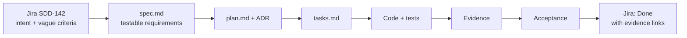

---

## 2. The cycle at a glance

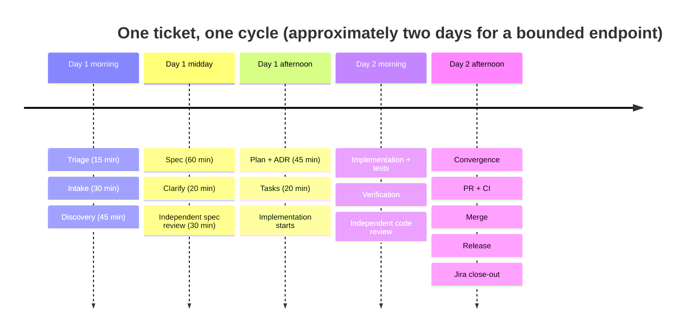

### Jira state machine (mapped to SDD phases)

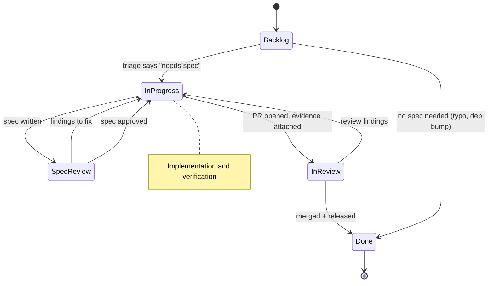

| Jira status | SDD phase | Exit evidence |
| --- | --- | --- |
| Backlog | — | Ticket triaged |
| In Progress | A–C | Discovery note, spec, plan, tasks |
| Spec Review | D | Review report, no open critical/high |
| In Progress | E–F | Code, tests, verification report |
| In Review | G | PR with evidence table, review report |
| Done | H | Merge commit, release, completion report |

---

## 3. Step 0 — Triage: does this need a spec?

Fifteen minutes, before any code.

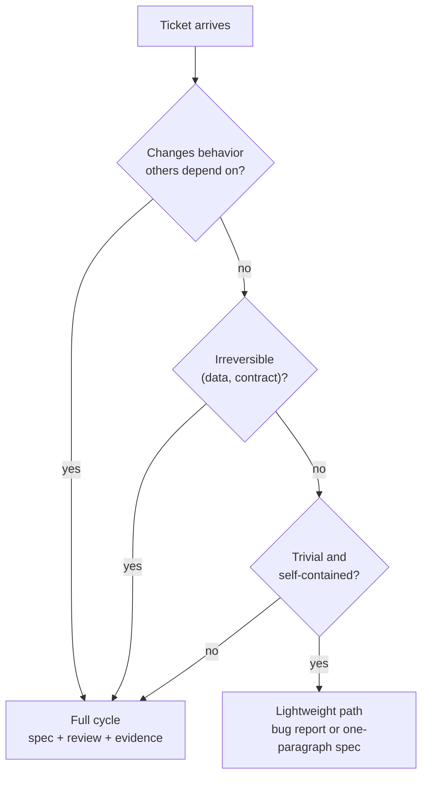

| Ticket type | Path |
| --- | --- |
| New public endpoint | **Full cycle** — external contract |
| Change to authorization behavior | **Full cycle** + security review |
| Schema migration | **Full cycle** + DB review |
| Internal helper, no consumers | Lightweight: one-paragraph intent + tests |
| Typo, formatting, dependency patch | No spec; normal review |

`SDD-142` is a new public endpoint with an authorization requirement → **full cycle**.

**Output of triage:**

```markdown
## Triage — SDD-142

- **Path:** full cycle (new external contract, authorization-relevant)
- **Risk tier:** high (customer data, cross-tenant exposure possible)
- **Required reviews:** specification review, code review, security review
- **Owner:** @backend-team
- **Mode:** Git Mode 2 (implement, human commits)
- **Timebox:** 2 days for the bounded endpoint; large exports are a follow-up
```

---

## 4. Step 1 — Intake: turn the ticket into an intent record

Do not start writing requirements from memory. Copy the ticket fields, then separate what is
**stated** from what is **assumed**.

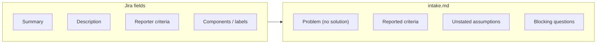

`specs/SDD-142/intake.md`:

```markdown
# Intake — SDD-142 Order export endpoint

**Jira:** SDD-142
**Reporter:** Finance Ops
**Date:** 2026-11-02
**Observed workaround:** manual copy-paste from the orders UI, ~3 hours/week
**Deadline pressure:** quarter close (2026-12-15) — not a reason to skip review

## Problem (no solution language)
Finance cannot extract order data in bulk. They reconcile by copying rows from the UI,
which is slow, error-prone, and cannot be scheduled.

## What the reporter asked for
- An endpoint returning CSV
- "Only the user's orders"
- "Should be fast"

## What was NOT stated (must be resolved)
| # | Unstated | Why it matters |
| --- | --- | --- |
| 1 | Whether record-level ACLs exist in addition to project roles | Changes the authorization design and the data exposure |
| 2 | Maximum export size | Drives streaming vs background job, and memory limits |
| 3 | Behavior when a project has no orders | CSV with header only, or 204? |
| 4 | Whether the export must be audited | Compliance requirement |
| 5 | Whether another service consumes this endpoint | Changes backward-compatibility risk |

## Initial assumption (unverified)
A1: Exports will stay under ~100k rows per request.
    Verification: ask Finance Ops for the largest reconciliation batch.
```

> **Rule:** the intake records the requester's proposed solution separately from the problem. If
> "CSV endpoint" had been a *requirement* from day one, nobody would have asked whether the real
> need was a scheduled data feed — which might have been cheaper.

---

## 5. Step 2 — Discovery: establish ground truth

Read-only. No code changes ([chapter 03](./03-repository-discovery.md)).

```bash
git --no-pager status --short --branch
git --no-pager log --oneline -5

# Stack and versions
grep -n "spring-boot" pom.xml | head -5
./mvnw -q dependency:tree -Dincludes=org.springframework.boot 2>/dev/null | head -10

# Existing similar endpoints
grep -rn --include='*.java' '@GetMapping' src/main/java/.../api | head -20
grep -rn --include='*.java' 'requireProjectAccess\|findVisibleTo' src/main/java | head -20

# Existing tests to mirror
find src/test -name '*Order*'
```

### Discovery note (excerpt)

```markdown
## Facts (verified)
| # | Fact | Evidence |
| --- | --- | --- |
| F1 | Spring Boot 3.x line, Java 21 (`release 21`) | `pom.xml:14`, `pom.xml:31` |
| F2 | Existing list endpoint `GET /projects/{id}/orders` returns paginated JSON | `OrderController.java:58` |
| F3 | Authorization is centralized in `requireProjectAccess(projectId, principal)` | `ProjectAccess.java:44` |
| F4 | Record-level ACL exists: `OrderQuery.visibleTo(...)` joins `record_acl` | `OrderQuery.java:91` |
| F5 | No streaming response helper exists in this service | `grep StreamingResponseBody` → 0 hits |
| F6 | Migrations are Flyway, versioned `V<number>__*.sql` | `db/migration/`, latest `V41` |
| F7 | Metrics are Micrometer; existing counter pattern in `OrderMetrics` | `OrderMetrics.java:22` |
| F8 | Baseline test suite: 412 passed, 3 skipped (recorded) | `./mvnw -q verify` |

## Assumptions (unverified)
| # | Assumption | Verification plan |
| --- | --- | --- |
| A2 | A server-side cursor is supported by the current JDBC driver | spike in `OrderQuery` test |
| A3 | The load balancer idle timeout is ≥ 120 s | ask platform team |

## Unknowns
| # | Unknown | Blocking? |
| --- | --- | --- |
| U1 | Is record-level ACL meant to apply to exports? | **Yes — blocks the spec** |
| U2 | Is an audit record required per export? | No — default: reuse existing audit middleware |
```

**Why F4 and U1 matter:** the ticket says "only the user's orders". If exports filter by project
only, a project viewer can download rows that the UI hides via record ACLs. That is a
cross-tenant data exposure — the kind of defect that a spec review catches and a code review may
miss.

**Output:** the blocker is resolved by the product owner in Step 4; everything else proceeds.

---

## 6. Step 3 — Declare the mode and branch

```bash
git switch -c feat/SDD-142-order-export
```

```text
Mode: 2 — implement, do not commit.
Branch created for isolation; the human commits after reviewing the diff.
```

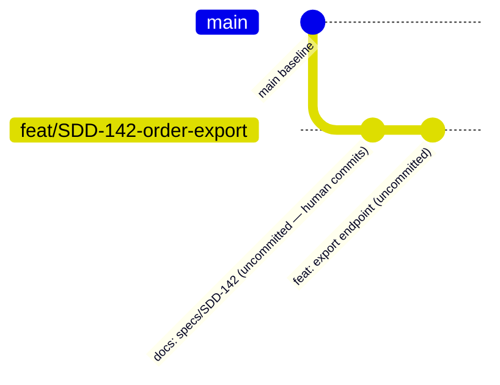

> In Mode 2 the graph above is what the **human** will do after review. The agent leaves the work
> uncommitted ([chapter 22](./22-git-and-commit-policy.md)).

---

## 7. Step 4 — Write the specification

Use [`templates/feature-spec.md`](../templates/feature-spec.md). This is the complete artifact.

```markdown
# Spec: SDD-142 — Order export endpoint

## 1. Problem statement
Finance analysts cannot extract order data in bulk. They copy rows from the UI three hours
per week, which is slow and error-prone, and cannot be scheduled or audited.

## 2. Goals
- G1: A project-authorized user can download the orders they are allowed to see, as CSV.
- G2: The download respects the same visibility rules as the UI list.
- G3: The export is observable (count, duration, failures).

## 3. Non-goals
- NG1: XLSX or JSON export.
- NG2: Asynchronous/background export jobs.
- NG3: Scheduled or emailed exports.
- NG4: Exporting more than 100,000 rows per request (follow-up ticket).

## 4. Users and scenarios
| Actor | Scenario | Value |
| --- | --- | --- |
| Finance analyst | Export one project's orders before month close | Removes manual copy-paste |
| Auditor | Confirm an export happened and who requested it | Traceability |

## 5. Functional requirements

### FR-1: Stream orders as CSV
`GET /projects/{projectId}/orders/export` SHALL return `200` with
`Content-Type: text/csv; charset=utf-8` and a header row followed by one row per order.

**Acceptance criteria**
- AC-1.1 Given a principal with `VIEWER` on project A, when they request the export,
  then the response is `200`, `text/csv`, and the first line is
  `id,created_at,amount_cents,status`.
- AC-1.2 Given a principal with no role on project B, when they request project B's export,
  then the response is `403` with `application/problem+json`, and **no CSV bytes** are written.

### FR-2: Row visibility matches the UI
The export SHALL include exactly the orders returned by
`GET /projects/{projectId}/orders` for the same principal and filters.

**Acceptance criteria**
- AC-2.1 For a principal with project membership but no record-level access to order X,
  the export SHALL NOT contain X.
- AC-2.2 For a principal with record-level access, the export SHALL contain the same order IDs
  as the JSON list endpoint, in the same order.

### FR-3: Empty result
**Acceptance criteria**
- AC-3.1 Given zero visible orders, the response SHALL be `200` with a header row and no data rows.

### FR-4: Error mapping
**Acceptance criteria**
- AC-4.1 Given an unknown project, the response SHALL be `404` with problem type
  `https://api.example.com/problems/not-found`.
- AC-4.2 Given an upstream timeout while streaming, the response SHALL terminate and the
  failure SHALL be recorded in the audit log without exposing internals.

## 6. Non-functional requirements
| ID | Category | Target | Condition | Verification |
| --- | --- | --- | --- | --- |
| NFR-1 | Performance | TTFB p95 ≤ 1.5 s; complete p95 ≤ 30 s | 100k rows, 20 concurrent exports | k6 script `perf/export.js` |
| NFR-2 | Memory | Heap growth ≤ 200 MB | 100k-row export with `-Xmx512m` | JFR recording |
| NFR-3 | Operability | Export count, duration, and failures visible; alert on p95 > 5 s for 10 min | Production | metrics + alert rule |
| NFR-4 | Security | Authorization identical to the JSON list endpoint | All roles | matrix test |

## 7. Edge cases
| Case | Expected behavior |
| --- | --- |
| Zero orders | 200, header only |
| 100k orders | Streamed, within NFR-1/NFR-2 |
| > 100k orders | 400 with problem type `export-limit-exceeded` |
| Client disconnects mid-stream | Request terminates; resource released; no error-level log |
| Duplicate request (retry) | Two exports; both audited (no idempotency requirement) |

## 8. Failure scenarios
| Failure | Detection | Behavior | Recovery |
| --- | --- | --- | --- |
| DB connection lost mid-stream | Exception | Stream aborts; audit records failure | Client retries |
| Upstream timeout | Timeout | Abort with no partial CSV silently accepted | Client sees truncated stream; documented |
| Authorization service unavailable | 5xx | Fail closed with 503 | Retry later |

## 9. Security requirements
- Authorization at one place: `requireProjectAccess` + `OrderQuery.visibleTo`.
- No PII beyond order fields already exposed by the JSON endpoint.
- Audit record: principal ID (hashed), project ID, row count, outcome.
- Export must not bypass record-level ACL (resolved from U1: **ACLs apply**).

## 10. Compatibility requirements
| Surface | Change | Backward compatible |
| --- | --- | --- |
| Public API | New path only | Yes — additive |
| Database | New index (see plan) | Yes — no schema change to existing columns |
| Events | None | N/A |

## 11. Rollback
| Artifact | Reversible | Procedure | Data loss |
| --- | --- | --- | --- |
| Deploy | Yes | Redeploy previous tag | None |
| Feature flag `export_v2` | Yes | Disable flag | None |
| Index | Yes | `DROP INDEX CONCURRENTLY` | None |

## 12. Open questions
| ID | Question | Blocking | Answer |
| --- | --- | --- | --- |
| U1 | Do record-level ACLs apply to exports? | Yes | **Yes** — resolved by product owner 2026-11-02 |
| U2 | Is a per-export audit record required? | No | Default: yes, reuse audit middleware |
```

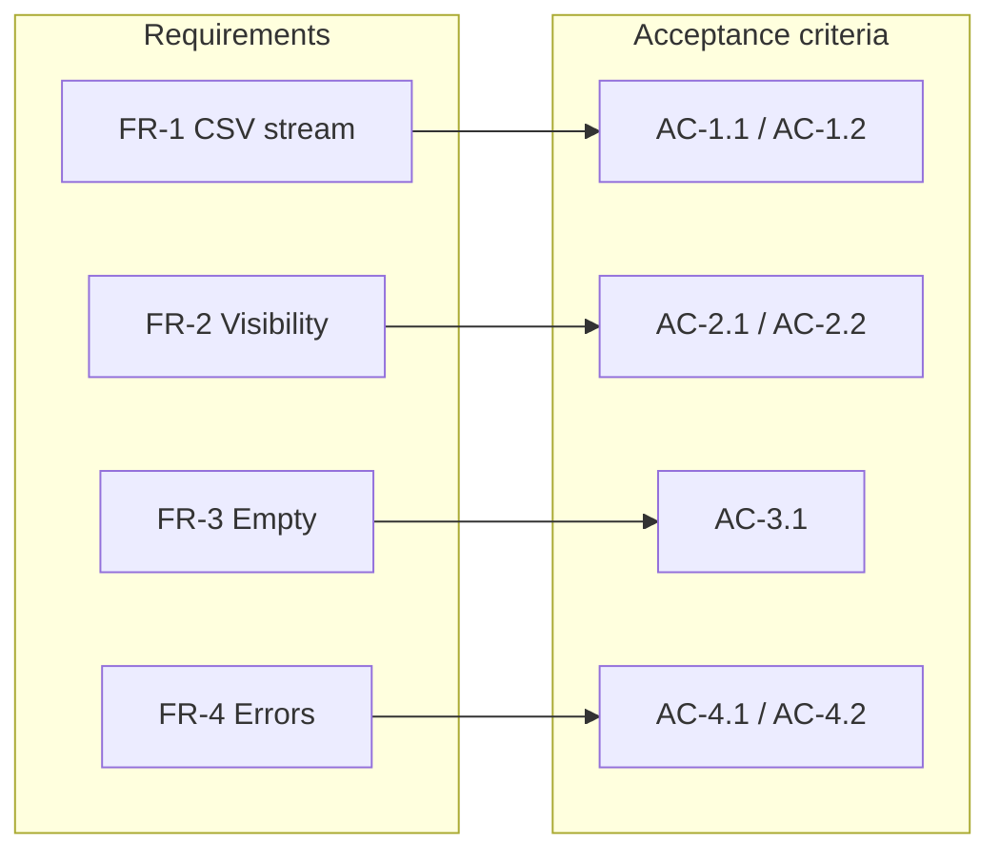

---

## 8. Step 5 — Clarify

Ask only questions whose answers change the design. Three here, all resolved or defaulted.

```text
Clarification round 1

1. "Only the user's orders" — does that mean project membership only, or also
   record-level access?  → Answer: record-level ACLs apply. (Changed AC-2.1.)
2. What is the largest realistic export?  → 100k rows at quarter close; larger is rare.
   → Non-goal NG4 + 400 above the limit.
3. Should retries be idempotent?  → No requirement; two exports are acceptable.
   → Documented in edge cases, no idempotency key.
```

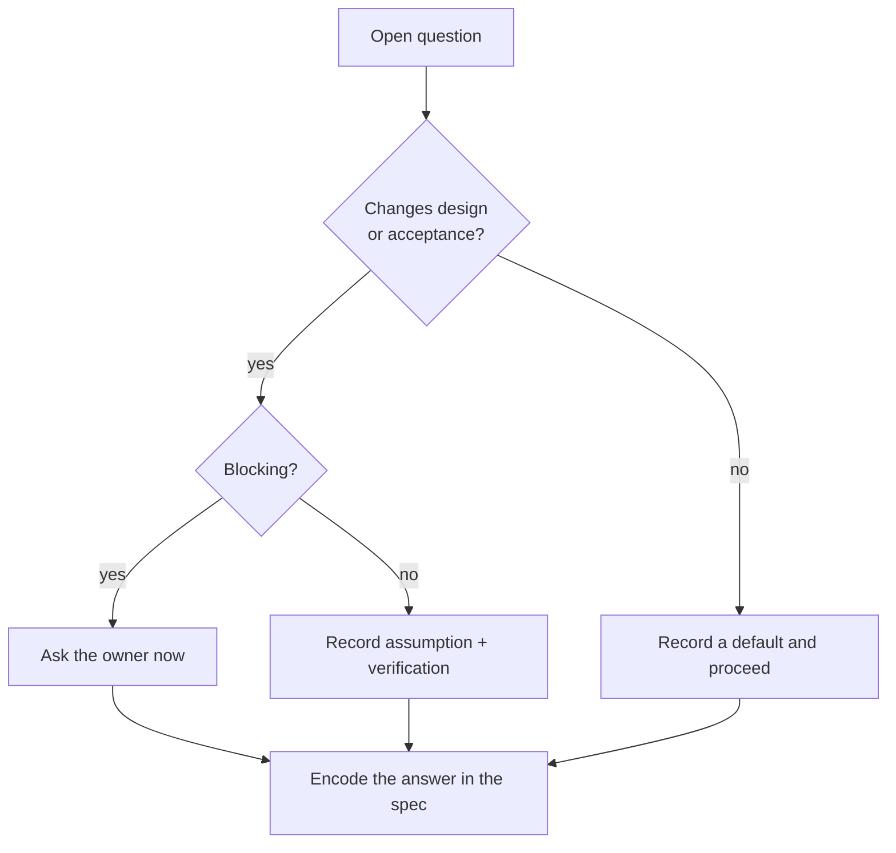

---

## 9. Step 6 — Independent specification review

A different role, read-only, with the spec and plan as inputs
([chapter 17](./17-specification-review.md)).

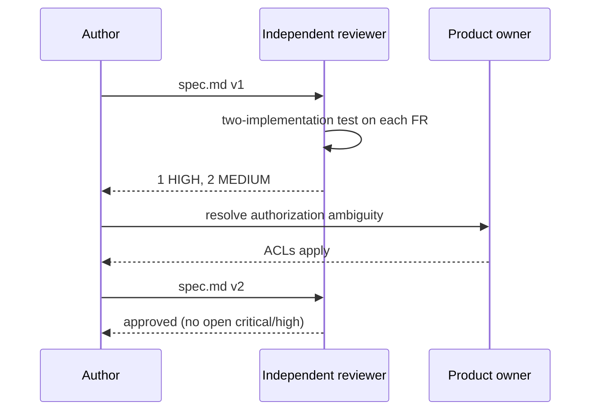

### Review report (excerpt)

```markdown
| ID | Severity | Requirement | Finding | Evidence | Recommendation |
| --- | --- | --- | --- | --- | --- |
| S-01 | HIGH | FR-2 | "Exactly the orders returned by GET /orders" is ambiguous: that endpoint paginates and defaults to 20 rows | spec.md:61 vs OrderController.java:58 | State "same filter semantics, no default page limit, same ordering" |
| S-02 | MEDIUM | FR-1 | Above-limit behavior only appears in edge cases, not as a requirement | spec.md:96 | Promote to FR-1 AC-1.3 |
| S-03 | MEDIUM | FR-1 | 403 response body shape unspecified | spec.md:44 | Name the problem type, as AC-4.1 does |
```

### Revisions applied

```markdown
- AC-2.2 (revised): "…the same order IDs as `GET /projects/{id}/orders` with
  `pageSize=all` semantics, same ordering (`created_at DESC`), no default page limit."
- AC-1.3 (new): "Given more than 100,000 visible orders, then `400` with problem type
  `https://api.example.com/problems/export-limit-exceeded` and no CSV bytes."
- AC-1.2 (revised): "…`403` with `application/problem+json` and type
  `https://api.example.com/problems/forbidden`."
```

**Gate:** zero open `CRITICAL`/`HIGH`. Reviewer confirms `git status` unchanged.

---

## 10. Step 7 — Plan and ADR

`specs/SDD-142/plan.md` (excerpt):

```markdown
## Component impact
| Module | Change |
| --- | --- |
| `order-api` | New controller method |
| `order-core` | `CsvOrderWriter`, `ExportService` |
| `order-persistence` | Streaming cursor query; new index |
| `db/migration` | `V42__orders_export_index.sql` |

## Streaming design
`StreamingResponseBody` with a server-side cursor (`fetchSize`), `READ COMMITTED`,
no write inside the request transaction. Audit write is a separate `REQUIRES_NEW`
transaction after the stream completes.

## Query
`OrderQuery.visibleTo(principal, projectId)` → adds `EXISTS (record_acl …)`.
Ordering: `created_at DESC, id DESC`.

## Limit
`EXPORT_MAX_ROWS = 100_000`. Count first (index-only count) → 400 if exceeded.
Count is cheap on the same predicate; documented in ADR-0012.

## Observability
- `orders_export_total{outcome}` counter
- `orders_export_duration_seconds` timer
- Alert: p95 > 5 s for 10 min
- Log: `correlationId, principalHash, projectId, rowCount, outcome`

## Test strategy
| Layer | Scope |
| --- | --- |
| Unit | CSV writer (header, escaping, empty) |
| Slice | `@WebMvcTest` status codes and problem types |
| Integration | Testcontainers Postgres: ACL matrix, ordering, limit |
| Performance | k6 at 100k rows / 20 concurrent |
```

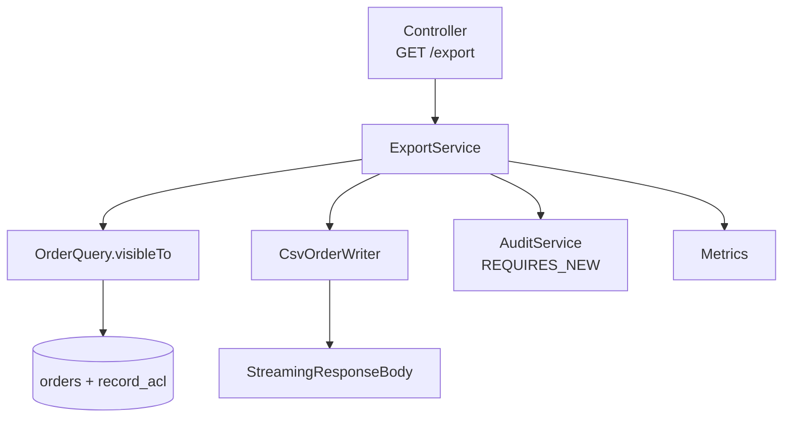

### ADR (excerpt)

```markdown
# ADR-0012: Cap synchronous export at 100k rows

**Status:** Accepted 2026-11-02

**Context:** Finance needs bulk export; NFR-1 requires p95 ≤ 30 s; no background job
infrastructure exists; team size is two engineers.

**Decision:** Synchronous streaming, hard cap of 100,000 rows. Above the cap, return 400.

**Alternatives**
- Background job + object storage: rejected for this iteration (new infra, notification channel).
- No cap: rejected — unbounded memory/connection use and an unpredictable p95.

**Consequences**
- Exports above the cap need the follow-up ticket (async job).
- The load balancer must allow ≥ 120 s idle connections.
```

---

## 11. Step 8 — Tasks

```markdown
## Tasks

### Phase 1 — Setup
- [ ] T-01 Add `export_v2` feature flag (default off) · FR-1 · `config/Flags.java`
- [ ] T-02 Add OpenAPI path + problem types · FR-1, FR-4 · `api/openapi.yaml`

### Phase 2 — Foundational (blocking)
- [ ] T-03 Migration `V42__orders_export_index.sql` (CONCURRENTLY) · NFR-1 · `db/migration/`
- [ ] T-04 `OrderQuery.visibleTo` ordering + cursor support · FR-2 · `OrderQuery.java`, IT

### Phase 3 — User story 1: export works
- [ ] T-05 `CsvOrderWriter` + unit tests (header, escaping, empty) · FR-1, FR-3 · `CsvOrderWriter.java`
- [ ] T-06 `ExportService` orchestration + row-count limit · FR-1, AC-1.3 · `ExportService.java`
- [ ] T-07 Controller + `@WebMvcTest` for 200/403/404/400 · FR-1, FR-4 · `OrderExportController.java`

### Phase 4 — User story 2: visibility and limits
- [ ] T-08 ACL matrix integration test (5 roles × 2 tenants) · FR-2, NFR-4 · `OrderExportIT.java`
- [ ] T-09 Streaming assertions (no buffering, disconnect handling) · NFR-2 · `StreamingIT.java`

### Phase 5 — Polish
- [ ] T-10 Metrics, alert, audit wiring, runbook · NFR-3 · `OrderMetrics.java`, `docs/runbooks/`
```

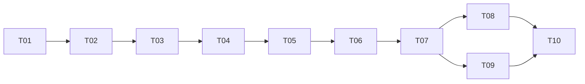

---

## 12. Step 9 — Implementation loop

One task at a time. Read, test, implement, run, record.

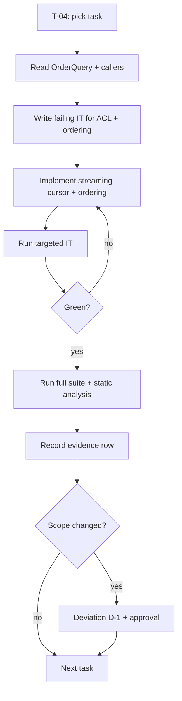

### Iteration 1 — T-04: query and ordering

```java
// order-persistence/src/main/java/.../OrderQuery.java (illustrative)
public final class OrderQuery {

    private static final String VISIBLE_ORDERS_SQL = """
        SELECT o.id, o.created_at, o.amount_cents, o.status
        FROM orders o
        WHERE o.project_id = :projectId
          AND EXISTS (
                SELECT 1 FROM record_acl acl
                WHERE acl.order_id = o.id
                  AND acl.principal_id = :principalId
                  AND acl.permission IN ('READ', 'WRITE')
              )
        ORDER BY o.created_at DESC, o.id DESC
        """;

    public Cursor<OrderRow> visibleTo(UUID projectId, UUID principalId, int fetchSize) {
        return jdbc.query(VISIBLE_ORDERS_SQL)
                   .setFetchSize(fetchSize)
                   .cursor(OrderRow.class);
    }
}
```

```java
// integration test — asserts AC-2.1 and AC-2.2
@Test
@DisplayName("AC-2.1: export excludes orders the principal cannot read")
void exportExcludesUnreadableOrders() {
    var result = service.export(viewerWithoutAcl, projectA);

    assertThat(result.orderIds()).doesNotContain(ORDER_WITHHELD);
    assertThat(result.orderIds()).containsExactlyElementsOf(
        listEndpointIds(viewerWithoutAcl, projectA));
}
```

**Evidence recorded:**

```markdown
| 1 | `visibleTo` filters by record ACL | `OrderQuery.java:91-110`; `exportExcludesUnreadableOrders` passed | test + inspection | VERIFIED | 9/10 |
| 2 | Ordering matches the JSON list endpoint | `exportExcludesUnreadableOrders` compares ID lists | test | VERIFIED | 8/10 |
```

### Iteration 2 — T-05/T-06: writer and limit

```java
// order-core/src/main/java/.../CsvOrderWriter.java (illustrative)
public final class CsvOrderWriter {

    private static final String HEADER = "id,created_at,amount_cents,status";

    public void writeHeader(Writer out) throws IOException {
        out.write(HEADER);
        out.write('\n');
    }

    public void writeRow(Writer out, OrderRow row) throws IOException {
        out.write(csv(row.id().toString()));
        out.write(',');
        out.write(csv(row.createdAt().toString()));
        out.write(',');
        out.write(Long.toString(row.amountCents()));
        out.write(',');
        out.write(csv(row.status()));
        out.write('\n');
    }

    private static String csv(String value) {
        if (value.indexOf(',') < 0 && value.indexOf('"') < 0 && value.indexOf('\n') < 0) {
            return value;
        }
        return '"' + value.replace("\"", "\"\"") + '"';
    }
}
```

```java
// ExportService — limit and audit
public ExportResult export(Principal principal, UUID projectId) {
    access.requireProjectAccess(projectId, principal);

    long total = query.countVisibleTo(projectId, principal.id());
    if (total > EXPORT_MAX_ROWS) {
        throw new ExportLimitExceededException(total, EXPORT_MAX_ROWS);
    }
    return query.streamVisibleTo(projectId, principal.id(), rows -> writer.write(rows));
}
```

**Evidence recorded:**

```markdown
| 3 | Empty export emits header only | `emptyExportEmitsHeaderOnly` passed | test | VERIFIED | 9/10 |
| 4 | Above-limit returns 400 with problem type | `aboveLimitReturnsProblem400` passed | test | VERIFIED | 9/10 |
| 5 | CSV escaping handles commas and quotes | `csvEscaping` (parameterized, 6 cases) passed | test | VERIFIED | 8/10 |
```

### Iteration 3 — T-07: controller and error mapping

```java
@GetMapping(value = "/projects/{projectId}/orders/export", produces = "text/csv")
public ResponseEntity<StreamingResponseBody> export(
        @PathVariable UUID projectId, Principal principal) {

    StreamingResponseBody body = out -> exportService.stream(principal, projectId, out);

    return ResponseEntity.ok()
            .contentType(MediaType.parseMediaType("text/csv; charset=utf-8"))
            .header(HttpHeaders.CONTENT_DISPOSITION,
                    "attachment; filename=\"orders-" + projectId + ".csv\"")
            .body(body);
}
```

**Deviation found during implementation:**

```markdown
## Deviation D-1

- **Trigger:** the export query without an index measured 4.2 s TTFB at 100k rows (NFR-1: 1.5 s).
- **Evidence:** `EXPLAIN ANALYZE` output in `specs/SDD-142/evidence/explain-before.txt`
- **Proposed change:** add `V42__orders_export_index.sql` with
  `CREATE INDEX CONCURRENTLY idx_orders_project_created ON orders (project_id, created_at DESC, id DESC)`.
  The plan already allowed this task; approval requested because it adds a migration.
- **Reversible:** yes — `DROP INDEX CONCURRENTLY`.
- **Approved by:** @db-owner, 2026-11-02
```

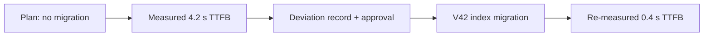

---

## 13. Step 10 — Verification

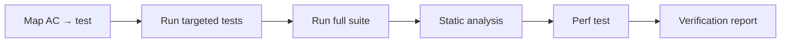

```bash
./mvnw -q -Dtest=OrderExportControllerTest,OrderExportIT,CsvOrderWriterTest test
./mvnw -q verify
./mvnw -q spotbugs:check checkstyle:check pmd:check
k6 run perf/export.js
```

`specs/SDD-142/verification.md` (excerpt):

```markdown
| AC | Status | Evidence |
| --- | --- | --- |
| AC-1.1 | VERIFIED | `OrderExportControllerTest.returnsCsvWithHeader` → passed |
| AC-1.2 | VERIFIED | `OrderExportIT.forbiddenWritesNoCsvBytes` → passed |
| AC-1.3 | VERIFIED | `OrderExportIT.aboveLimitReturnsProblem400` → passed |
| AC-2.1 | VERIFIED | `OrderExportIT.excludesUnreadableOrders` → passed |
| AC-2.2 | VERIFIED | `OrderExportIT.matchesListEndpointOrdering` → passed |
| AC-3.1 | VERIFIED | `CsvOrderWriterTest.emptyEmitsHeaderOnly` → passed |
| AC-4.1 | VERIFIED | `OrderExportControllerTest.unknownProjectReturns404` → passed |
| AC-4.2 | PARTIALLY VERIFIED | timeout path unit-tested; no chaos test in this environment |
| NFR-1 | VERIFIED | k6: TTFB p95 0.42 s, total p95 9.8 s @100k/20 concurrent |
| NFR-2 | VERIFIED | JFR: 120 MB heap growth with `-Xmx512m` |
| NFR-3 | VERIFIED | metrics emitted; alert rule in `alerts/order-export.yml` |

**Commands executed**
| Command | Exit | Summary |
| --- | --- | --- |
| `./mvnw -q verify` | 0 | 428 passed, 3 skipped |
| `./mvnw -q spotbugs:check checkstyle:check pmd:check` | 0 | no issues |
| `k6 run perf/export.js` | 0 | thresholds met |
```

> **AC-4.2 is `PARTIALLY VERIFIED`, not "done".** The completion report must say so, and the
> reviewer decides whether the limitation is acceptable.

---

## 14. Step 11 — Independent code review

Read-only. Reviews the diff **and the code it touches**
([chapter 19](./19-read-only-code-review.md)).

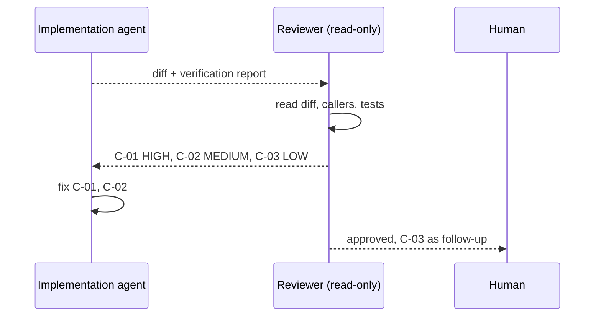

### Findings

```markdown
### C-01 — Unbounded page size on the list endpoint is now a correctness risk
- **Severity:** HIGH · **Confidence:** 8/10 (strong reading)
- **Location:** `OrderController.java:58` (not in the diff)
- **Evidence:** AC-2.2 now promises "same IDs as the list endpoint". The list endpoint
  accepts `pageSize` with no upper bound; a caller can request 1,000,000 and the export
  contract implicitly depends on it.
- **Impact:** the equivalence claim in AC-2.2 is untestable at scale; the IT uses default paging.
- **Remediation:** cap `pageSize` at 200 (or compare against a defined `all` semantics), and add
  a test asserting the export matches that definition.
- **Verification:** `matchesListEndpointOrdering` with `pageSize=201` → 400; export test uses the cap.

### C-02 — No test for a client disconnect mid-stream
- **Severity:** MEDIUM · **Confidence:** 7/10
- **Location:** `ExportService.java:66`
- **Evidence:** `StreamingIT` covers success and error, not cancellation.
- **Impact:** NFR-2/resource-release behavior on disconnect is unverified.
- **Remediation:** cancel the `StreamingResponseBody` in a test and assert the cursor closes.

### C-03 — CSV header duplicated in two classes
- **Severity:** LOW · **Confidence:** 10/10
- **Location:** `CsvOrderWriter.java:12`, `OrderExportIT.java:40`
- **Remediation:** expose `CsvOrderWriter.HEADER` and assert against it.
```

### What happened next

| Finding | Action | Result |
| --- | --- | --- |
| C-01 | Capped `pageSize` at 200 and redefined AC-2.2 wording | Fixed, test added |
| C-02 | Added cancellation test | Fixed |
| C-03 | Follow-up ticket `SDD-151` | Accepted, owner assigned |

> The most expensive finding was **outside the diff** — a pre-existing unbounded parameter that the
> new contract now depends on. That is why the review reads callers, not just changed lines.

---

## 15. Step 12 — Convergence

Convergence compares the implementation with the artifacts and appends what is missing.

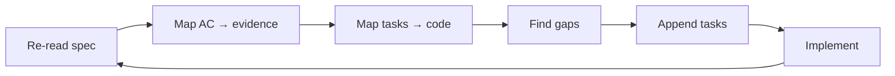

```markdown
## Convergence — SDD-142

| Item | Status | Gap | Appended task |
| --- | --- | --- | --- |
| FR-1 / AC-1.1–1.3 | Covered | — | — |
| FR-2 / AC-2.1–2.2 | Covered after C-01 | list cap added | T-11 |
| FR-3 / AC-3.1 | Covered | — | — |
| FR-4 / AC-4.1 | Covered | — | — |
| FR-4 / AC-4.2 | Partially verified | no chaos test | T-12 (spike) |
| NFR-3 | Covered | runbook missing | T-13 |
| Documentation | Missing | API docs page | T-14 |
```

Then T-11, T-13, T-14 are implemented; T-12 becomes a follow-up ticket rather than blocking the
release, with the limitation recorded.

---

## 16. Step 13–14 — PR, CI, merge, release, Jira close-out

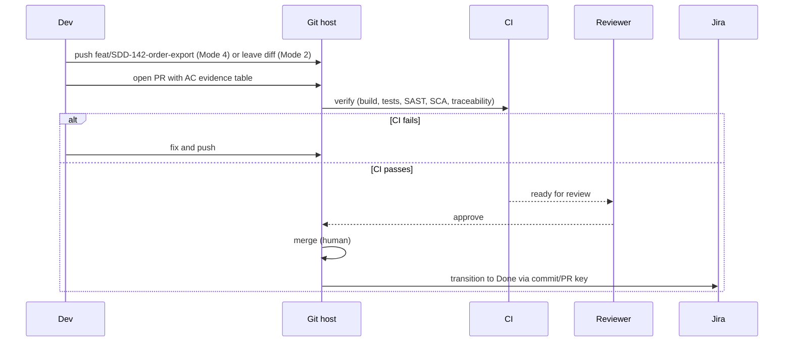

### PR body (filled from the template)

```markdown
## What & why
Adds `GET /projects/{projectId}/orders/export` returning streamed CSV of orders the caller
may read, matching the JSON list endpoint's visibility and ordering. Refs SDD-142.

## Specification
| Field | Value |
| --- | --- |
| Spec | `specs/SDD-142/spec.md` |
| Plan | `specs/SDD-142/plan.md` |
| ADR | `docs/adr/0012-export-row-cap.md` |
| Requirements | FR-1–FR-4, NFR-1–NFR-4 |

## Acceptance criteria
| AC | Status | Evidence |
| --- | --- | --- |
| AC-1.1 | VERIFIED | `OrderExportControllerTest` → passed |
| AC-1.2 | VERIFIED | `OrderExportIT.forbiddenWritesNoCsvBytes` → passed |
| AC-2.1 | VERIFIED | `excludesUnreadableOrders` → passed |
| AC-2.2 | VERIFIED | `matchesListEndpointOrdering` → passed |
| AC-3.1 | VERIFIED | `emptyEmitsHeaderOnly` → passed |
| AC-4.2 | PARTIALLY VERIFIED | no chaos test; follow-up SDD-152 |

## Risk & rollback
| Item | Detail |
| --- | --- |
| Risk | Long-lived streams; LB idle timeout must be ≥ 120 s |
| Rollback | Disable `export_v2`; index drop optional |
| Time to roll back | < 1 minute (flag) |

## Deviations
| ID | Deviation | Approved by |
| --- | --- | --- |
| D-1 | Added `V42` index migration | @db-owner |
```

### Release

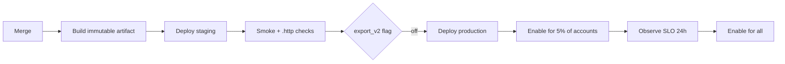

### Jira close-out

```markdown
## SDD-142 — Done

Implementation: <PR link> (merge commit abc1234)
Spec: specs/SDD-142/spec.md
Verification: 10/11 AC verified; AC-4.2 partial (SDD-152)
Review: 1 HIGH, 1 MEDIUM fixed; 1 LOW follow-up (SDD-151)
Release: v2.14.0, flag `export_v2` enabled 2026-11-06
Rollback: disable `export_v2`
Follow-ups: SDD-151 (CSV header constant), SDD-152 (timeout chaos test), SDD-153 (async export > 100k rows)
```

---

## 17. The same cycle in other stacks

The steps do not change. Only the commands and the test tooling do.

| Step | Java | Python | .NET | JS/TS | Go |
| --- | --- | --- | --- | --- | --- |
| Discovery | `./mvnw dependency:tree` | `uv tree` | `dotnet list package` | `pnpm list --depth 1` | `go list -m all` |
| Unit tests | `./mvnw test` | `uv run pytest` | `dotnet test` | `pnpm test` | `go test ./...` |
| Integration | Failsafe + Testcontainers | pytest + Testcontainers | Testcontainers | Vitest + testcontainers | `go test -tags=integration` |
| Static analysis | SpotBugs, PMD, Checkstyle | Ruff, mypy/Pyright | Roslyn analyzers, `dotnet format` | `tsc --noEmit`, ESLint | `go vet`, staticcheck, golangci-lint |
| Perf | k6 / Gatling | k6 / pytest-benchmark | BenchmarkDotNet | k6 / Lighthouse | `go test -bench` |
| Guide | [Java](../language-guides/java.md) | [Python](../language-guides/python.md) | [.NET](../language-guides/dotnet-csharp.md) | [JS/TS](../language-guides/javascript-typescript.md) | [Go](../language-guides/go.md) |

---

## 18. What if something goes wrong

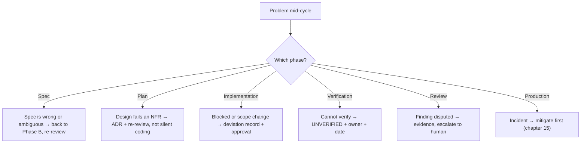

| Situation | Do | Do not |
| --- | --- | --- |
| Reporter adds scope mid-implementation | Reopen the spec, review the change | Silently implement it |
| Test is flaky | Quarantine with owner and ticket | Add `sleep` or skip silently |
| Review finds a pre-existing defect | Report it; fix only if in scope and approved | Fix it inside this PR unnoticed |
| Performance NFR cannot be measured | Record `UNVERIFIED` with a plan | Claim it meets the target |
| Deadline forces shipping with a gap | Record the gap in the completion report and Jira | Declare Done with unreported gaps |
| Reviewer and author disagree | Exchange evidence, then a human decides | Let the implementer close the finding |

---

## 19. The whole cycle on one page

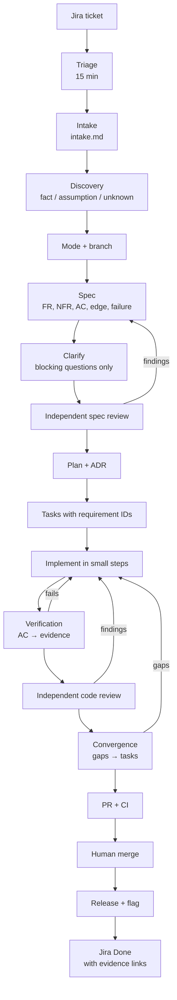

### Checklist you can copy into a ticket template

```markdown
- [ ] Triaged: full cycle vs lightweight
- [ ] Intake recorded; requester's solution separated from the problem
- [ ] Discovery note: facts, assumptions, unknowns, baseline test result
- [ ] Git mode declared; branch created (if permitted)
- [ ] Spec has: goals, non-goals, FR + AC, NFR with numbers, edge cases, failures,
      security, compatibility, rollback
- [ ] Blocking questions resolved; defaults recorded for the rest
- [ ] Independent spec review: no open CRITICAL/HIGH
- [ ] Plan + ADR (if a decision is expensive to reverse)
- [ ] Tasks: each maps to a requirement, lists files, has a definition of done
- [ ] Tests fail before, pass after
- [ ] Verification report: every AC has evidence or is UNVERIFIED
- [ ] Independent code review: no open CRITICAL/HIGH
- [ ] Convergence run; gaps appended as tasks
- [ ] PR body: AC table, risk, rollback, deviations
- [ ] CI required checks green (including traceability)
- [ ] Human merge and release approval
- [ ] Jira updated with spec, PR, verification, follow-ups
```

---

## 20. Common mistakes in this cycle

| Mistake | Consequence | Fix |
| --- | --- | --- |
| Copying Jira criteria verbatim as acceptance criteria | Untestable, ambiguous scope | Rewrite with observable outcomes |
| Skipping intake because "the ticket is clear" | The requester's solution becomes the requirement | 30 minutes of intake saves a day of rework |
| Discovery skipped | Agent invents an endpoint structure that already exists | Run the read-only discovery |
| Spec review by the author | Ambiguity survives into code | Independent reviewer, read-only |
| Tasks without requirement IDs | Untraceable work | Map every task to FR/AC |
| First commit is 900 lines | Unreviewable, unbisectable | Small steps, one concern |
| Verification says "tests pass" with no output | Unverifiable | Command + summary line |
| Review only reads the diff | Misses cross-file regressions (e.g. C-01) | Read callers and contracts |
| Convergence skipped | Spec and code drift on day one | Always converge |
| Jira closed on merge | No release verification | Close after release + flag enablement |

---

## 21. References

- [Chapter 02 — Engineering lifecycle](./02-engineering-lifecycle.md)
- [Chapter 03 — Repository discovery](./03-repository-discovery.md)
- [Chapter 14 — Feature development](./14-feature-development.md)
- [Chapter 17 — Review without implementation](./17-specification-review.md)
- [Chapter 19 — Read-only code review](./19-read-only-code-review.md)
- [Chapter 20 — Testing and verification](./20-testing-and-verification.md)
- [Chapter 22 — Git and commit policy](./22-git-and-commit-policy.md)
- [Chapter 23 — Hallucination prevention](./23-hallucination-prevention.md)
- [Chapter 29 — IDE setup overview](./29-ide-setup.md)
- [Chapter 30 — IntelliJ IDEA](./30-ide-intellij.md)
- [Chapter 31 — VS Code](./31-ide-vscode.md)
- [Chapter 32 — Visual Studio](./32-ide-visual-studio.md)
- Templates: [feature spec](../templates/feature-spec.md), [plan](../templates/implementation-plan.md), [verification](../templates/verification-report.md), [code review](../templates/code-review-report.md), [PR](../templates/pull-request-template.md)

---

**Previous:** [32 — Visual Studio](./32-ide-visual-studio.md) ·
**Back to index:** [00-index.md](./00-index.md)
