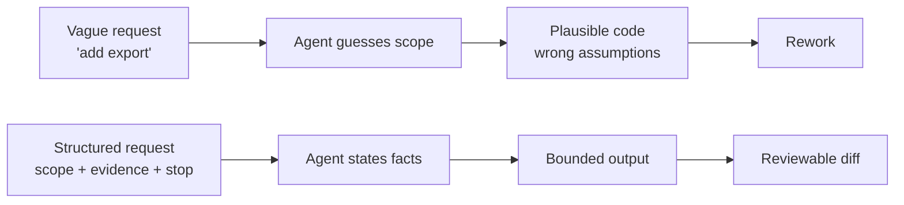
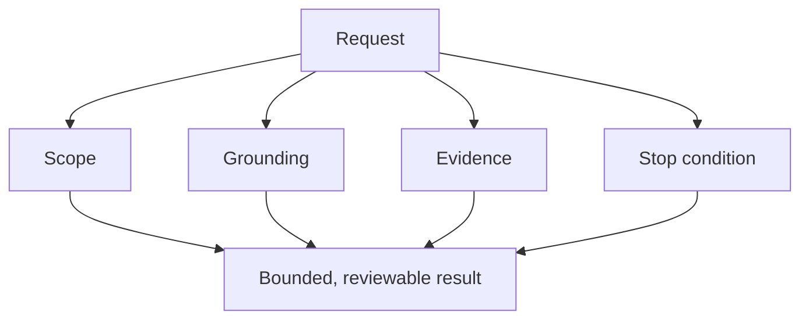
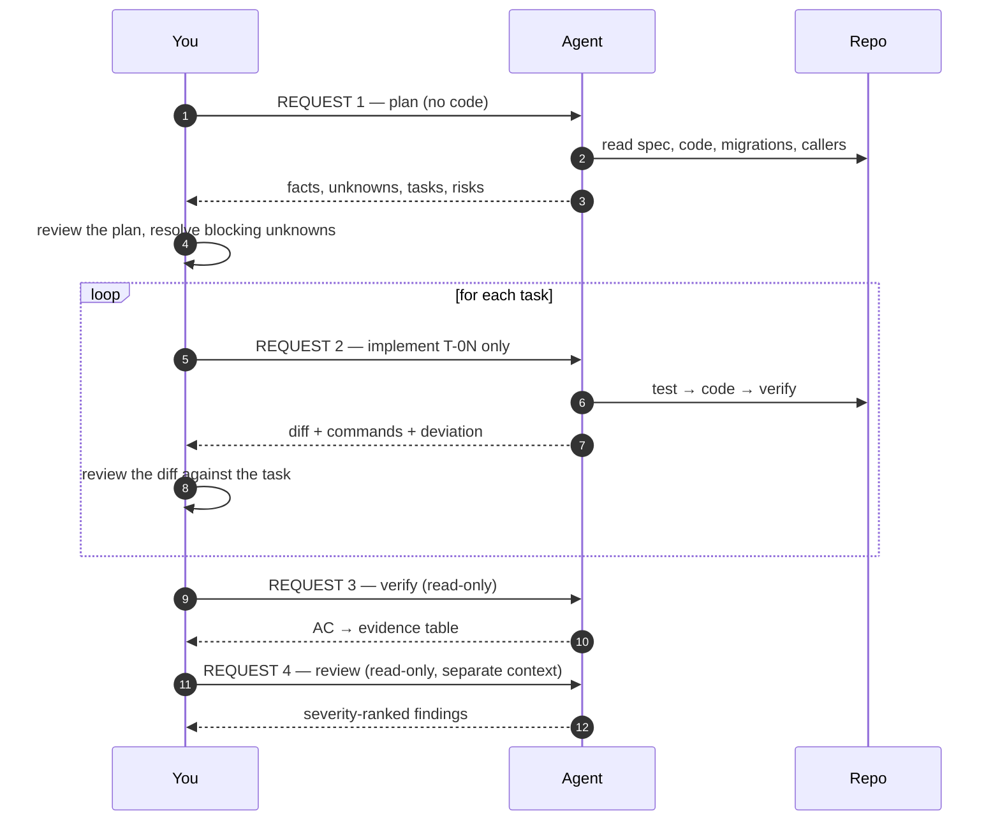
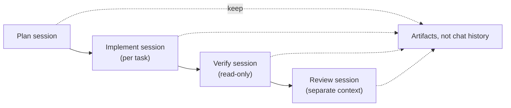

# 36 — Agent Prompt Playbook: Plan, Implement, Verify

> Copy-paste prompts for the three requests that actually drive a multi-step change, with the
> responses you should accept and the ones you should reject. All transcripts are **illustrative**:
> they show the shape of a correct exchange, not output from a specific model.

---

## 1. Purpose

Most wasted agent effort is not caused by a bad model. It is caused by a **bad request**: too broad,
no stopping condition, no evidence requirement, and no definition of done. This chapter gives you the
exact words.



---

## 2. The four ingredients of every request

Every prompt in this chapter contains the same four things. Missing any one of them is the most
common cause of a bad result.

| Ingredient | Question it answers | Example |
| --- | --- | --- |
| **Scope** | What exactly, and what not? | "Only the export endpoint; do not touch the list endpoint." |
| **Grounding** | What must you read first? | "Read `specs/SDD-142/spec.md`, `plan.md`, and `OrderQuery.java`." |
| **Evidence** | How will I know you did it? | "Paste the command and the summary line." |
| **Stop condition** | When do you stop and ask? | "Stop if a public contract must change." |



### The universal footer

Append this to any SDD request. It takes ten seconds and prevents most failure modes.

```text
Rules for this task:
- Read the files I named before proposing anything. Cite file:line for claims about this repo.
- Do not invent APIs, config keys, commands, or dependencies. Check the lockfile for versions.
- If you cannot verify something, write UNVERIFIED and say what is missing. Do not guess.
- Do not commit, push, or change branches. Mode 2.
- Stop and ask if: a public contract changes, a new dependency is needed, or the plan is wrong.
```

---

## 3. Request 1 — Plan a multi-step change

### 3.1 When to use it

You have an approved spec (or a clear ticket) and need a plan, a task breakdown, and the risks —
**without any code yet**.

### 3.2 The prompt

```text
Plan this change. Do not write or modify any code in this step.

Read first:
- specs/SDD-142/spec.md and plan.md (if it exists)
- src/main/java/.../api/OrderController.java
- src/main/java/.../repository/OrderQuery.java
- db/migration/ (list the latest 5 files)
- pom.xml (report the release level and Spring Boot version)

Produce:
1. Discovery summary: facts with file:line, then assumptions, then unknowns.
   Mark anything you could not verify as UNVERIFIED.
2. Component impact table: module → change → why.
3. API/event/schema contract impact, with backward-compatibility verdict.
4. Transaction boundaries and failure behavior.
5. Migration + rollback plan (or state "none").
6. Test strategy mapped to acceptance criteria (AC id → test type → what it asserts).
7. Task breakdown where every task has: id, requirement id, files, definition of done,
   and whether it can run in parallel.
8. Top 5 risks with likelihood, impact, and mitigation.

Constraints:
- Java 21, release 21. No new dependencies.
- Reuse OrderQuery.visibleTo; do not introduce a second visibility implementation.
- Do not propose a background job; that is out of scope (NG2).

If a blocking question remains after reading, list it and stop. Do not plan around it.
```

### 3.3 What a good response looks like

```markdown
## Discovery
| # | Fact | Evidence |
| --- | --- | --- |
| F1 | Java 21, `release 21` | pom.xml:31 |
| F2 | Spring Boot 3.x line | pom.xml:14 |
| F3 | Authorization is centralized | ProjectAccess.java:44 |
| F4 | Record-level ACL exists | OrderQuery.java:91 |
| F5 | Latest migration is V41 | db/migration/ |

## Assumptions
| # | Assumption | Verification |
| --- | --- | --- |
| A1 | LB idle timeout ≥ 120 s | ask platform team |

## Unknowns
| # | Unknown | Blocking |
| --- | --- | --- |
| U1 | Does the billing service consume this path? | **Yes** |

**Stopping here.** U1 is blocking: if billing consumes it, the additive-only claim is false.
```

Note what the agent **did not** do: it did not produce a task list built on an unverified assumption.
That is the correct behavior, and it is the behavior you must reward.

### 3.4 The gate: accept the plan only if

- [ ] Facts cite `file:line`; assumptions and unknowns are separated
- [ ] Every task maps to a requirement ID
- [ ] Every acceptance criterion appears in the test strategy
- [ ] Rollback is either specified or explicitly "none, because …"
- [ ] Non-goals from the spec are respected
- [ ] No code was written in this step
- [ ] Blocking unknowns were raised, not silently resolved

### 3.5 Bad vs good

| Bad prompt | Why it fails | Good prompt |
| --- | --- | --- |
| "Plan how to add export." | No scope, no inputs, no output shape | The full prompt in §3.2 |
| "Plan it and implement it." | Blends planning with execution; you cannot review the plan | Two separate requests |
| "Use your best judgment on the design." | Invites invention | "If the design is unclear, list options with trade-offs and stop." |
| "Make it scalable." | Not measurable | "NFR-1: p95 TTFB ≤ 1.5 s at 100k rows / 20 concurrent." |

### 3.6 Correction phrases

| Agent behavior | What to say |
| --- | --- |
| Wrote code during planning | "You wrote code. Revert to the pre-task state and produce only the plan." |
| Invented a file path | "`X.java` does not exist. Re-run discovery with `git ls-files` and cite real paths." |
| Ignored the non-goals | "NG2 excludes a background job. Remove it from the plan or explain why the spec must change." |
| Planned around an unknown | "U1 is blocking. Stop and list what you need to know." |

---

## 4. Request 2 — Implement an approved plan

### 4.1 When to use it

The spec and plan are approved and reviewed. You want code, tests, and evidence — one task at a time.

### 4.2 The prompt (per task, not per plan)

```text
Implement task T-04 only. Do not start T-05.

Read first:
- specs/SDD-142/spec.md (FR-2, AC-2.1, AC-2.2)
- specs/SDD-142/plan.md (sections: Query, Test strategy)
- src/main/java/.../repository/OrderQuery.java (whole file)
- src/test/java/.../OrderQueryIT.java (to follow the existing test style)
- Every caller of OrderQuery.visibleTo (grep for it and list them)

Do:
1. Write the failing test first, named after the acceptance criterion.
2. Confirm it fails for the right reason (paste the failure output).
3. Implement the minimal change.
4. Run the targeted test, then the full suite.
5. Paste the exact commands and summary lines.

Do not:
- Modify files outside: OrderQuery.java, OrderQueryIT.java
- Change the ordering or filtering of the existing list endpoint
- Add dependencies
- Reformat untouched code
- Commit or push (Mode 2)

If the plan is wrong, stop and report: what you found, the evidence, and the smallest correction.
Do not silently deviate.
```

### 4.3 What a good response looks like

```markdown
## T-04 — streaming cursor with ACL filtering

### Test written first
`OrderQueryIT.exportExcludesUnreadableOrders` — asserts AC-2.1.
Before implementation:
    [ERROR] OrderQueryIT.exportExcludesUnreadableOrders:42 expected <0> but was <1>
    1 test failed

### Change
`OrderQuery.java:91-118` — added `visibleTo(...)` returning a cursor with `fetchSize`,
ordering `created_at DESC, id DESC`, and an `EXISTS` on `record_acl`.

### Verification
    ./mvnw -q -Dtest=OrderQueryIT test   → Tests run: 6, Failures: 0
    ./mvnw -q verify                      → 428 passed, 3 skipped

### Deviation
None.

### Not done
T-05 and later. Awaiting review.
```

### 4.4 The gate: accept the implementation only if

- [ ] Only the declared files changed (`git diff --stat` matches)
- [ ] The test is named after the AC and fails on the base commit
- [ ] Commands and summary lines are quoted, not paraphrased
- [ ] The full suite ran, and pre-existing failures are labeled as such
- [ ] Deviations are reported with a trigger and evidence
- [ ] Nothing was committed (Mode 2)

### 4.5 Bad vs good

| Bad prompt | Why it fails | Good prompt |
| --- | --- | --- |
| "Implement the plan." | Unbounded; a 900-line diff appears | "Implement T-04 only." |
| "Fix the tests so they pass." | Invites weakening assertions | "If a test fails, report the failure. Do not change assertions without approval." |
| "Add whatever you need." | Unbounded dependency and file scope | Explicit file allow-list |
| "Make sure it works." | No definition of done | "Done when `./mvnw -q verify` passes and AC-2.1 is asserted." |

### 4.6 Correction phrases

| Agent behavior | What to say |
| --- | --- |
| Touched files outside scope | "Revert changes to X. Only the allowed files may change." |
| Changed a test to make it pass | "Restore the assertion. Explain why it failed instead." |
| "Tests pass" with no output | "Paste the command and its output. A claim is not evidence." |
| Bundled a refactor into the fix | "Split the refactor into its own task. Keep this diff minimal." |
| Silent design change | "That is a plan deviation. Stop, record it with the trigger and evidence, and request approval." |

---

## 5. Request 3 — Verify a change

### 5.1 When to use it

Implementation is finished. You want proof per acceptance criterion, not a summary.

### 5.2 The prompt

```text
Verify this change. Do not modify any file — this is a read-only task.

Inputs:
- Spec: specs/SDD-142/spec.md
- Implementation: `git diff origin/main...HEAD`
- Your report template: templates/verification-report.md

Do:
1. List every acceptance criterion (AC-*) and NFR-* from the spec.
2. For each, run or locate the evidence, then mark:
   VERIFIED | PARTIALLY VERIFIED | UNVERIFIED | CONTRADICTED
3. Paste the command and the summary line for every VERIFIED item.
4. For UNVERIFIED items, state exactly what is missing and who could provide it.
5. Run the full suite and report the summary line, separating pre-existing failures.
6. Record the environment: OS/image, runtime version, lockfile hash, DB image.

Rules:
- If a test cannot run, it is UNVERIFIED. Never mark it passed.
- Do not edit tests or source to make something pass.
- Do not infer a perf result from code inspection; mark NFR-1 UNVERIFIED.
- End with: what you did NOT verify, and why.
```

### 5.3 What a good response looks like

```markdown
| AC | Status | Evidence |
| --- | --- | --- |
| AC-1.1 | VERIFIED | `OrderExportControllerTest.returnsCsvWithHeader` → passed |
| AC-1.2 | VERIFIED | `OrderExportIT.forbiddenWritesNoCsvBytes` → passed |
| AC-2.1 | VERIFIED | `OrderExportIT.excludesUnreadableOrders` → passed |
| AC-2.2 | VERIFIED | `OrderExportIT.matchesListEndpointOrdering` → passed |
| AC-4.2 | UNVERIFIED | no chaos test; cannot simulate upstream timeout here |
| NFR-1 | UNVERIFIED | perf environment unavailable; k6 script exists at perf/export.js |
| NFR-2 | VERIFIED | JFR: 120 MB growth with -Xmx512m |

Not verified: AC-4.2, NFR-1. Owner: platform team. Blocking release? NFR-1 yes, AC-4.2 no.
```

### 5.4 The gate: accept the verification only if

- [ ] Every AC appears, including the ones that failed
- [ ] Evidence is a command + output, not a narrative
- [ ] Skipped and unrun tests are `UNVERIFIED`, not "passed"
- [ ] Pre-existing failures are distinguished from new ones
- [ ] The environment is recorded so the result is reproducible
- [ ] The "not verified" list exists and is non-empty when appropriate

### 5.5 Bad vs good

| Bad prompt | Why it fails | Good prompt |
| --- | --- | --- |
| "Is it done?" | Invites a yes | "Map each AC to evidence and mark status." |
| "Verify and fix anything you find." | Blends verification with implementation | Verify only; fix in a separate request |
| "Run the tests." | Does not check the acceptance criteria | "Run the tests **and** map them to ACs." |
| "Confirm the perf targets are met." | Invites estimation | "Run the benchmark; if you cannot, mark UNVERIFIED." |

### 5.6 Correction phrases

| Agent behavior | What to say |
| --- | --- |
| "All tests pass" with skips present | "List the skipped tests and mark their criteria UNVERIFIED." |
| Edits a test during verification | "Stop. Verification is read-only. Revert the edit." |
| Estimates performance | "You did not measure NFR-1. Mark it UNVERIFIED." |
| Omits failed criteria | "Every AC must appear, including the failed ones." |

---

## 6. The multi-step change: one change, three requests, many tasks



A four-step change therefore produces: **1 plan request + N task requests + 1 verify request +
1 review request**. Not one giant request.

### 6.1 Example: a cross-module refactor

```text
You: "Plan extracting CSV writing into a shared module used by three endpoints.
      Do not write code. Read all three endpoints, the existing CsvWriter if any, and the tests."

Agent: (facts, shared invariants, 6 tasks, risk: response byte-for-byte equivalence)

You: "Implement T-01 only (create the module + move the writer). Characterize current output
      with a golden test first. Do not change any endpoint yet."

Agent: (module added, golden test passing on identical output)

You: "Implement T-02 only (switch endpoint A). Byte-identical output is the acceptance criterion."

... T-03, T-04 ...

You: "Verify. Read-only. For each of the three endpoints, prove the output is byte-identical
      to the recorded golden files, and list anything you could not check."

You: "Review the whole branch read-only against the refactor spec. Findings only."
```

---

## 7. Prompt patterns library

Reusable sentence patterns. Combine as needed.

| Pattern | Prompt fragment |
| --- | --- |
| **Read-first** | "Before proposing anything, read X, Y, Z and report the versions you found with file:line." |
| **Evidence** | "For every claim, paste the command and its output. If you did not run it, write UNVERIFIED." |
| **Scope lock** | "You may modify exactly these files: … . Anything else is out of scope." |
| **Stop condition** | "Stop and ask if: a public contract changes, a dependency is needed, the plan is wrong, or a test fails for a reason you cannot explain." |
| **No-invention** | "Do not use any API you have not confirmed exists in the installed version (read the lockfile)." |
| **Deviation** | "If the plan is wrong, do not adapt silently. Record the trigger, the evidence, and the smallest correction." |
| **Minimality** | "Prefer the smallest change that satisfies the AC. No refactoring in this task." |
| **Reuse** | "Before adding code, search for an existing implementation and cite it. Reuse it or explain why not." |
| **Read-only** | "Do not modify any file. Do not run formatters with --fix. Do not commit." |
| **Uncertainty** | "If you do not know, say what you checked and what remains unknown. Do not fill the gap." |
| **Re-plan** | "The plan is invalid because X. Re-plan from the spec; do not patch the old plan." |
| **Stop-the-line** | "If you discover a pre-existing defect outside scope, report it and continue. Do not fix it." |

---

## 8. Say this, not that

| Instead of | Say |
| --- | --- |
| "Build the feature." | "Implement task T-03 only, per `specs/X/spec.md` FR-2." |
| "Make it robust." | "Handle these failures: DB down, timeout, empty result. Each needs a test." |
| "Follow best practices." | "Follow `AGENTS.md`; if a rule is missing, ask instead of inventing one." |
| "You should know the codebase." | "Read these 4 files and list every caller of `visibleTo`." |
| "Just make the tests pass." | "If a test fails, report it. Do not change assertions without approval." |
| "Looks good?" | "Review read-only against the spec; report severity, file:line, evidence." |
| "Add error handling." | "Map these exceptions to these status codes: …" |
| "Optimize it." | "NFR-1: p95 < 200 ms at 10k rows. Measure before and after." |

---

## 9. Session hygiene



| Rule | Reason |
| --- | --- |
| Plan and implement in different sessions | The implementer should not rationalize its own plan |
| Verify in a read-only session | Prevents "fixing" instead of measuring |
| Review in a separate context | Independence |
| Hand off artifacts, not transcripts | Transcripts invite invention of missing detail |
| Re-read the spec at the start of each session | Context compaction loses nuance |

> **Long sessions degrade.** After a compaction, an agent may not remember the non-goals. Re-state
> scope in the first message of a resumed session.

---

## 10. Checklist for every request you send

```markdown
- [ ] Scope is explicit, including what NOT to do
- [ ] Inputs are named by path
- [ ] Output shape is specified (table, diff, report)
- [ ] Evidence requirement is stated
- [ ] Stop conditions are stated
- [ ] Git mode is stated
- [ ] One phase per request (plan ≠ implement ≠ verify ≠ review)
```

---

## 11. References

- [prompts/plan-mode.md](../prompts/plan-mode.md)
- [prompts/implement-mode.md](../prompts/implement-mode.md)
- [prompts/verify-mode.md](../prompts/verify-mode.md)
- [Chapter 14 — Feature development](./14-feature-development.md)
- [Chapter 33 — End-to-end walkthrough](./33-end-to-end-walkthrough.md)
- [Chapter 37 — Escaping hallucination](./37-agent-anti-hallucination.md)
- [templates/verification-report.md](../templates/verification-report.md)

---

**Previous:** [35 — Confluence publishing](./35-confluence-publishing.md) ·
**Next:** [37 — Escaping hallucination](./37-agent-anti-hallucination.md) ·
**Back to index:** [00-index.md](00-index.md)
