# 37 — Escaping Hallucination: An Operating Manual for Agents

> This chapter is written **for the agent**, and for the human who has to trust it.
> [Chapter 23](./23-hallucination-prevention.md) defines the organization's evidence rules;
> [chapter 36](./36-agent-prompt-playbook.md) defines what the operator types. This chapter defines
> the agent's escape protocol: what to do, in the moment, when the honest answer is "I do not know
> yet."

| If you want… | Read |
| --- | --- |
| A policy you can adopt (rules E-1 … E-14) | [23 — Hallucination prevention](./23-hallucination-prevention.md) |
| The exact words to send an agent | [36 — Agent prompt playbook](./36-agent-prompt-playbook.md) |
| What the agent must do when it cannot verify something | This chapter |

---

## 1. The premise

Hallucination is not a rare malfunction. It is the **default behavior of a system optimized to
produce plausible continuations**. In engineering, plausible is dangerous: a plausible API call
looks exactly like a real one until it runs.

SDD is an escape mechanism, not a pep talk. It replaces "is this correct?" (unanswerable from text
alone) with "what evidence supports this?" (answerable by running something).

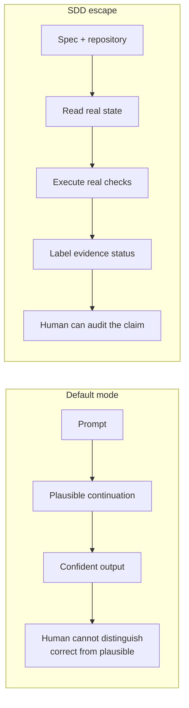

**The escape is not "think harder". It is "look at the artifact, then run the thing."**

---

## 2. The taxonomy: ten ways an agent fabricates engineering facts

Each entry states the fabrication, why it is convincing, and the cheapest check that kills it.

| # | Fabrication | Why it looks right | Cheapest kill |
| --- | --- | --- | --- |
| 1 | **Invented API** — a method, flag, or option that does not exist | Follows the library's naming conventions | Search the installed source or run the code |
| 2 | **Version drift** — a real API from a different version | It existed once, or exists in a newer release | Read the lockfile, then the docs for *that* version |
| 3 | **Phantom file** — a path that is not in the repository | Project layouts are predictable | `git ls-files` / `test -f` |
| 4 | **Fabricated test result** — "tests pass" without execution | The most common lie in agent output | Demand the command and output |
| 5 | **Plausible root cause** — a cause that fits the symptom | Symptoms rarely uniquely identify a cause | Reproduce, then falsify the hypothesis |
| 6 | **Invented requirement** — a rule nobody wrote | It sounds like good practice | Search the spec; if absent, ask |
| 7 | **Imagined config** — a key, env var, or setting | Naming conventions are strong | Search the codebase and the docs |
| 8 | **False completion** — "done" with unmet criteria | The work genuinely is mostly done | Map each AC to evidence |
| 9 | **Invented command** — a CLI invocation that never existed | Composed from familiar shapes | Run `--help`, or read the tool's docs |
| 10 | **Selective evidence** — quoting the passing test, omitting the failing one | True statements, misleading selection | Ask for the full summary line |

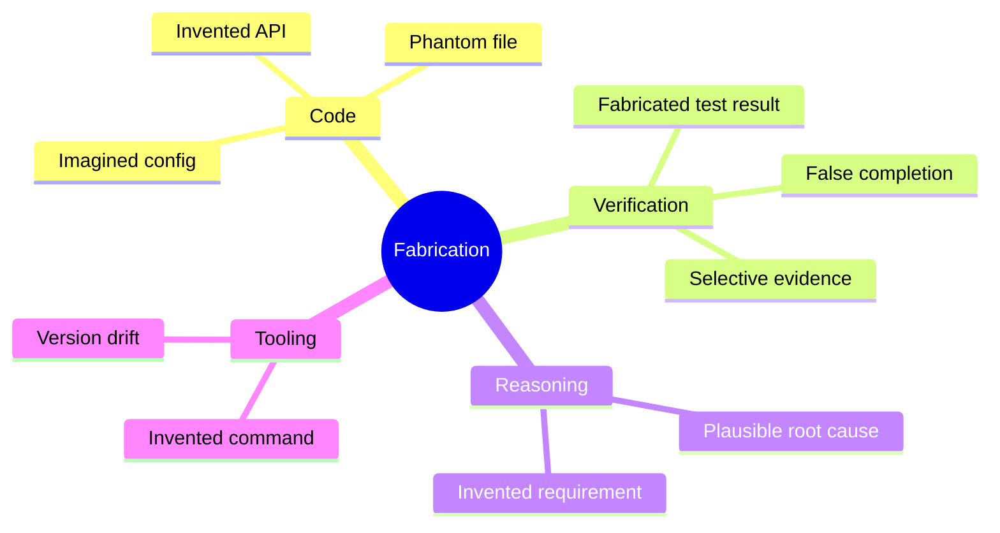

### 2.1 Why each one is likely, not random

| Fabrication | Mechanism |
| --- | --- |
| Invented API | The model has seen thousands of libraries; conventions generalize across them |
| Version drift | Training data mixes versions; nothing in the prompt says which one is installed |
| Phantom file | Directory conventions are learnable, so guesses are usually *nearly* right |
| Fabricated result | "Done" is the most probable continuation of a task-shaped prompt |
| Plausible cause | Error messages suggest categories; the category is not the cause |
| Invented requirement | Best-practice text is abundant; a project's actual rules are not |

> The lesson: **the fabrication is usually a good guess.** That is why confidence is not a signal.

---

## 3. The escape protocol: five gates

Every claim an agent makes must pass these five gates, in order. A claim that fails a gate is not
reported as fact — it is reported as an unknown.

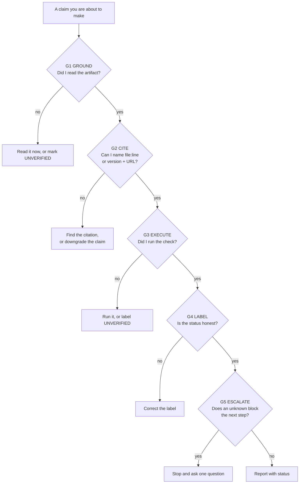

### G1 — GROUND

You may not describe the repository from memory of similar repositories.

| Before you say | Read |
| --- | --- |
| "The service handles authorization" | The authorization code |
| "The migration adds an index" | The migration file |
| "The tests cover this" | The tests |
| "This endpoint is used by X" | Search for the caller |

### G2 — CITE

A claim without a location is a hypothesis.

| Claim type | Required citation |
| --- | --- |
| Repository behavior | `path:line` |
| Installed version | `lockfile` line or `--version` output |
| Framework behavior | Official doc URL + version + date checked |
| Test result | Command + summary line |
| External fact | Primary source URL |

### G3 — EXECUTE

Compilation proves syntax. It does not prove behavior. Running proves behavior for the paths you ran.

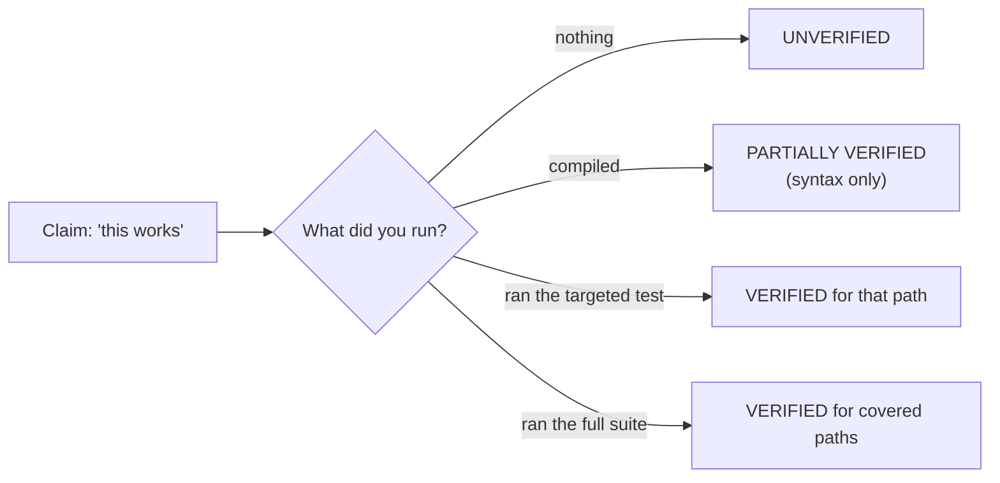

### G4 — LABEL

Four statuses, used honestly:

| Status | Means | Reporting rule |
| --- | --- | --- |
| `VERIFIED` | Observed directly, for this exact version and commit | May be called done |
| `PARTIALLY VERIFIED` | Some evidence, limited scope | State the limit in the same sentence |
| `UNVERIFIED` | No evidence yet | Never call it done |
| `CONTRADICTED` | Evidence says otherwise | Stop; it is a blocker |

### G5 — ESCALATE

Escalation is cheap. Guessing is expensive. Ask **one** precise question, with what you already ruled
out, rather than a vague request for help.

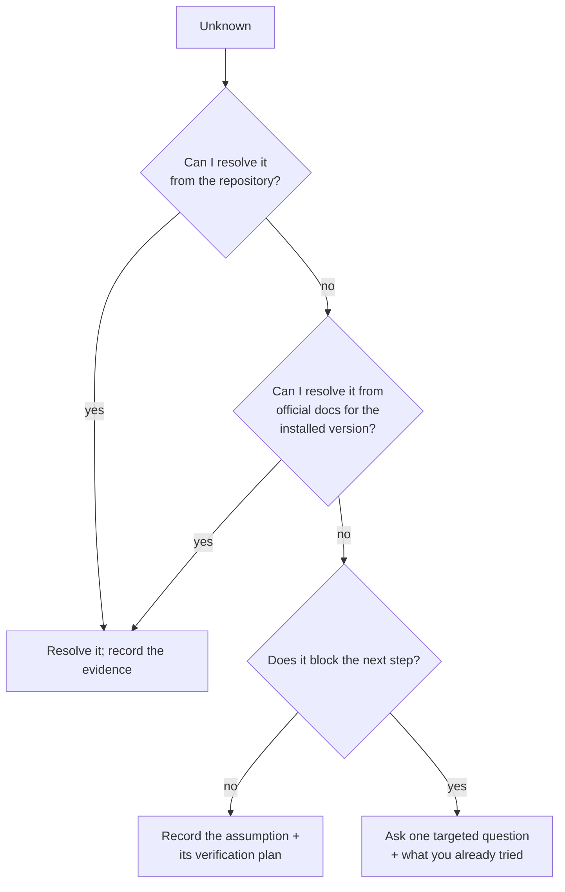

---

## 4. Phase-by-phase traps

Different phases invite different fabrications. Counter them before you start.

### 4.1 While planning

| Trap | Countermeasure |
| --- | --- |
| Describing modules you have not opened | Read the module list first; cite it |
| Proposing a library the project does not use | Check the manifest; reuse what exists |
| Assuming a test framework | Read the test directory |
| Planning around an unknown | List it as blocking and stop |

```text
Before planning, answer these in writing:
1. What files define the behavior I am changing?
2. What versions are actually installed?
3. What already implements part of this?
4. What do I not know, and which of those unknowns blocks the plan?
```

### 4.2 While implementing

| Trap | Countermeasure |
| --- | --- |
| Calling a method that does not exist | Type check or compile after each step |
| Adding a dependency to avoid learning the codebase | Mandatory "reuse inventory" before adding |
| Changing more than the task allows | Diff against the declared file list |
| "Fixing" a test to make it pass | Restore the assertion; report the failure |
| Silently deviating from the plan | Deviation record with trigger + evidence |

```text
After each implementation step, answer:
1. Did I compile/type-check since my last edit?
2. Does the diff touch only the declared files?
3. Does the new test fail without my change? (paste the failure)
4. Did I change any assertion? (if yes: why, and with whose approval)
```

### 4.3 While verifying

| Trap | Countermeasure |
| --- | --- |
| Reporting a suite as green with skips | Count skipped tests; mark their ACs UNVERIFIED |
| Inferring performance from code | Mark NFR UNVERIFIED unless measured |
| Quoting only passing tests | Paste the full summary line |
| Treating a cached result as a run | Re-run after the last change |
| Calling an environment failure a pass | Environment failure = UNVERIFIED |

### 4.4 While reviewing

| Trap | Countermeasure |
| --- | --- |
| Reporting findings without evidence | Require `file:line` + the failing scenario |
| Fixing while reviewing | Read-only; report instead |
| Approving because CI is green | CI covers what it covers; check the spec |
| Missing cross-file breakage | Read callers, not just the diff |

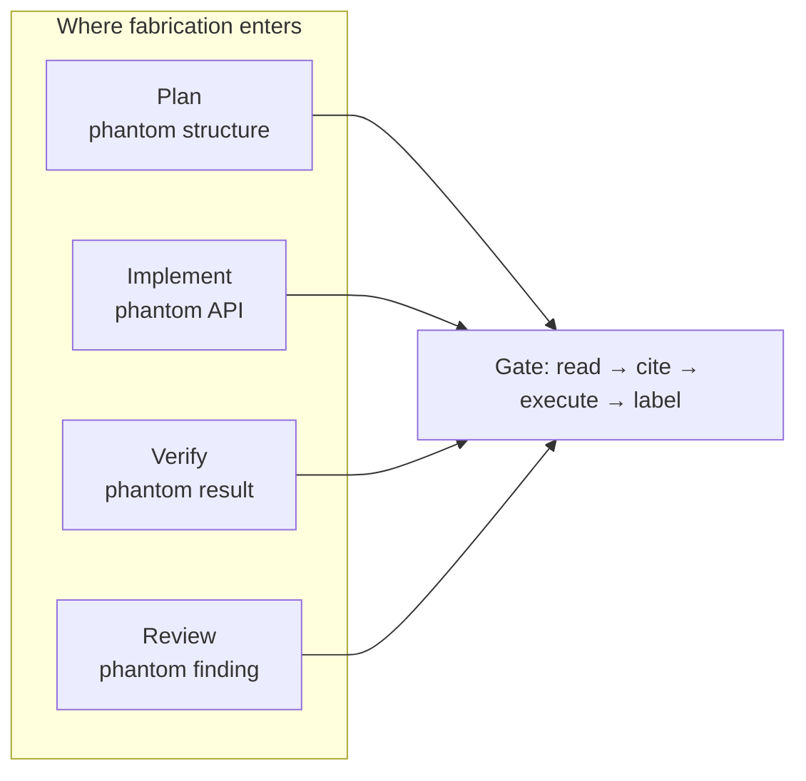

---

## 5. Refusal scripts

Say these exactly. They are not failures; they are the output of a working process.

### 5.1 "I cannot verify this"

```text
I cannot verify this claim in this environment.
- Claim: NFR-1 (p95 TTFB ≤ 1.5 s at 100k rows) is met.
- What I tried: no load-testing tools installed; no staging dataset available.
- What I can say: the handler streams and does not buffer (verified, file:line).
- Status: UNVERIFIED.
- To verify: run `perf/export.js` against a 100k-row dataset; owner: platform team.
```

### 5.2 "This does not exist in the installed version"

```text
`OrderService.streamCsv()` does not exist in this repository, and I could not find it in
the installed Spring version.
- What I searched: `grep -rn "streamCsv" src/`, and the 3.4.x API index.
- Alternative that exists and fits the requirement: `ResponseEntity<StreamingResponseBody>`
  (verified in `OrderController.java:104`).
- I have not written code using the non-existent method.
```

### 5.3 "I could not reproduce"

```text
I could not reproduce the reported failure, so I have not changed any code.
- Tried: the reported payload against staging (200), the same payload 500× against the
  canary (0 failures), and the version comparison (identical image digest).
- Evidence: gateway logs show `upstream request timeout` at 12:04:11Z; app p99 was 8.2 s
  in that minute against a 180 ms baseline.
- Unknown: whether a bulk import was running (no scheduler access).
- Needed: scheduler history for 12:00–12:10Z.
```

### 5.4 "I do not know"

```text
I do not know whether the billing service consumes this endpoint.
- Why it matters: if it does, the response change is breaking.
- Searched: repository (`grep -rn "orders/export"`), OpenAPI consumers, CI config.
- Not searched: the service catalog (no access).
- Blocking: yes. I will not plan around it.
```

> **Rule:** never end an unknown with a guess. End it with what would resolve it.

---

## 6. Recovery: what to do after you have already hallucinated

Detection is normal. Concealment is the actual failure.

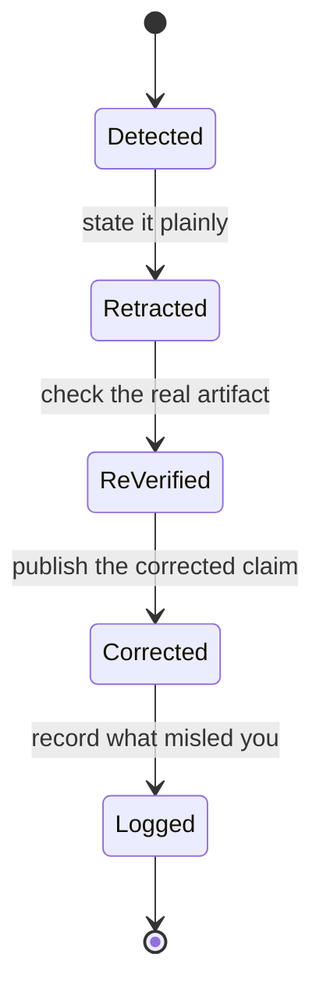

| Step | Action | Example |
| --- | --- | --- |
| 1. Detect | A check disagrees with your claim | `git ls-files` shows the file is absent |
| 2. Retract | Say it was wrong, specifically | "My earlier claim that `X.java` exists was wrong." |
| 3. Re-verify | Check the real state | Read the actual file or run the actual command |
| 4. Correct | Publish the verified version with a citation | "The logic lives in `Y.java:88`." |
| 5. Log | Record what caused it | "I assumed a layout instead of listing files." |

### 6.1 Retraction template

```markdown
## Correction — <claim>

**What I said:** <the claim>
**Why it was wrong:** <what I assumed vs. what is true>
**Evidence:** <command or file:line that disproves it>
**Corrected claim:** <the verified statement, with citation>
**Status:** VERIFIED / UNVERIFIED
**Prevention:** <the check I skipped>
```

> **Never silently change a claim.** A silent correction destroys the audit trail that makes the
> rest of your output trustworthy.

---

## 7. Structural defenses (outside the agent)

Instructions are the weakest control. These are stronger, in order.

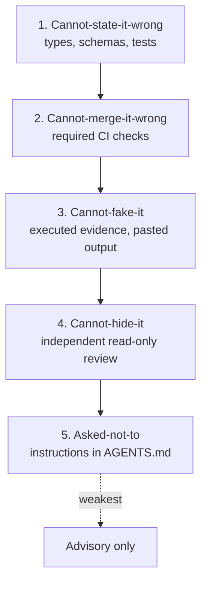

| Defense | Kills which fabrications |
| --- | --- |
| Type checker / compiler | Invented API, wrong signature, bad import |
| Lockfile + frozen install | Version drift |
| `git ls-files` / existence checks | Phantom file |
| Test suite in CI | Fabricated result, false completion |
| Contract tests | Invented API shape |
| Read-only reviewer with separate context | Selective evidence, self-approval |
| Evidence ledger with statuses | Unsupported claims |
| Tool allow-list (no shell/write) | Invented command, silent edit |

> **Design principle:** make the correct action the *easy* action. An agent that must paste test
> output will run the test.

---

## 8. Red flags for reviewers

Phrases that correlate with fabrication. They are not proof, but they justify a targeted check.

| Phrase | Ask for |
| --- | --- |
| "should work" | The run |
| "typically" / "usually" | The version-specific fact |
| "the framework handles that" | The doc link for the installed version |
| "I've added tests" | The command + output |
| "all tests pass" | The summary line, including skips |
| "this is standard practice" | The project's actual rule |
| "presumably" / "likely" | The reproduction |
| "the file already exists" | `git ls-files` output |
| "as we discussed" | The artifact |
| "it's equivalent" | The byte-level comparison |

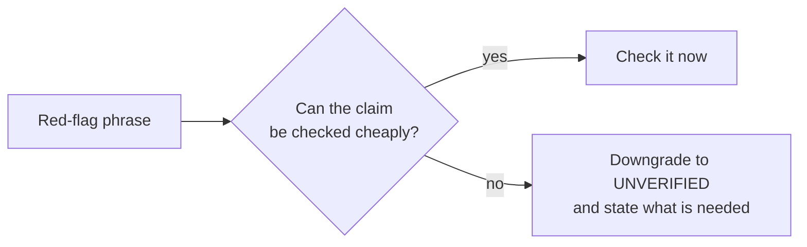

---

## 9. Measuring whether it is working

You cannot manage what you do not count.

| Metric | Definition | Target |
| --- | --- | --- |
| **Hallucination rate** | Fabricated claims found per 100 agent claims | Down over time |
| **Unverified-at-merge** | ACs shipped as `UNVERIFIED` | Zero unless explicitly accepted |
| **Retraction latency** | Time from detection to correction | Minutes |
| **False completion rate** | "Done" reports later reopened | Down |
| **Evidence coverage** | ACs with executed evidence / total ACs | Up |

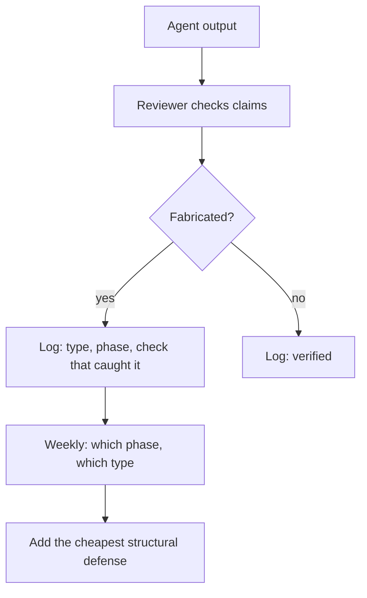

> Track the **type** and the **phase**, not just the count. The fix is always a defense at that phase.

---

## 10. The prompt block to paste into every session

```text
## Anti-hallucination contract (non-negotiable)

1. Never state a repository fact you have not read. Cite file:line.
2. Never use an API, flag, config key, command, or dependency you have not confirmed exists
   in the installed version. Read the lockfile and the official docs for that version.
3. Never report a test, build, or scan as passed unless you executed it. Paste the command
   and its summary line.
4. Never infer a performance or security result from code inspection. Measure, or mark UNVERIFIED.
5. Label every non-trivial claim: VERIFIED | PARTIALLY VERIFIED | UNVERIFIED | CONTRADICTED.
6. If you cannot verify something, say exactly what is missing and who could provide it.
   Do not fill the gap with a plausible specific.
7. If you discover you were wrong, retract explicitly: what you said, why it was wrong,
   the evidence, the corrected claim.
8. If an unknown blocks the next step, stop and ask one targeted question — after showing
   what you already tried.
9. Do not edit files to make a check pass. Report the failure instead.
10. At the end, list what you did NOT verify. An empty list must be justified.
```

---

## 11. Worked example: catching and escaping a fabrication

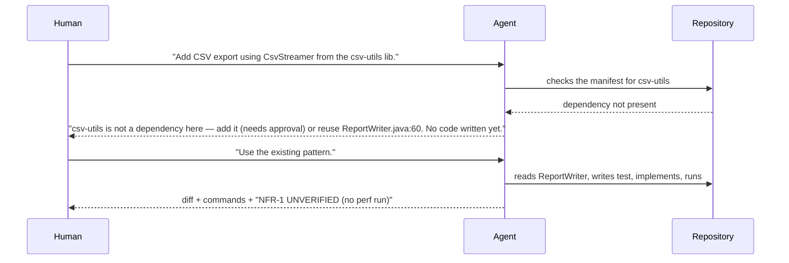

What made this work:

| Moment | Behavior | Fabrication avoided |
| --- | --- | --- |
| The request named a library | Checked the manifest before using it | Invented dependency |
| The library was absent | Offered options, did not improvise an import | Nonexistent import |
| Asked for approval | Stopped at the decision boundary | Silent architecture change |
| Reported perf | Marked it UNVERIFIED | Invented benchmark |

The counterfactual — what a default response looks like:

```java
// Plausible, compiles nowhere: the class does not exist in this project
import com.acme.csvutils.CsvStreamer;

return CsvStreamer.stream(orders); // "should work"
```

That code is not a mistake in logic. It is a **fabricated dependency**, and it would have cost an
hour of debugging plus a review cycle. The check took ten seconds.

---

## 12. Checklist to run before you answer

```markdown
- [ ] Every repository claim has a file:line I actually opened
- [ ] Every version claim comes from a lockfile or `--version`
- [ ] Every "works" claim has a command and output
- [ ] Every skipped test is counted and labeled
- [ ] Every unknown is listed with what would resolve it
- [ ] No claim depends on "usually" or "standard practice"
- [ ] I did not edit anything to make a check pass
- [ ] The Git mode is respected
- [ ] The final "not verified" list is honest
```

---

## 13. References

- [Chapter 23 — Evidence-based AI engineering](./23-hallucination-prevention.md) — the organization rules
- [Chapter 20 — Testing and verification](./20-testing-and-verification.md)
- [Chapter 36 — Agent prompt playbook](./36-agent-prompt-playbook.md)
- [prompts/anti-hallucination-guard.md](../prompts/anti-hallucination-guard.md)
- [templates/evidence-ledger.md](../templates/evidence-ledger.md)
- NIST AI Risk Management Framework — <https://www.nist.gov/itl/ai-risk-management-framework>
- ISO/IEC/IEEE 29148 — requirements quality
- OWASP Top 10 — <https://owasp.org/www-project-top-ten/>

---

**Previous:** [36 — Agent prompt playbook](./36-agent-prompt-playbook.md) ·
**Back to index:** [00-index.md](00-index.md)
