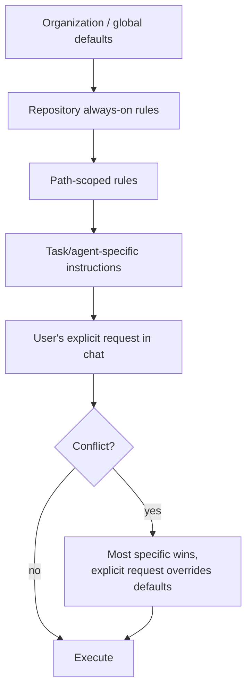
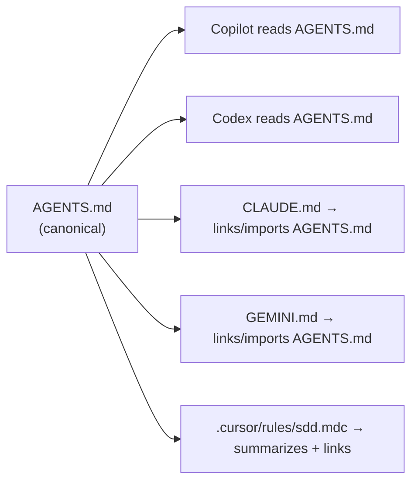
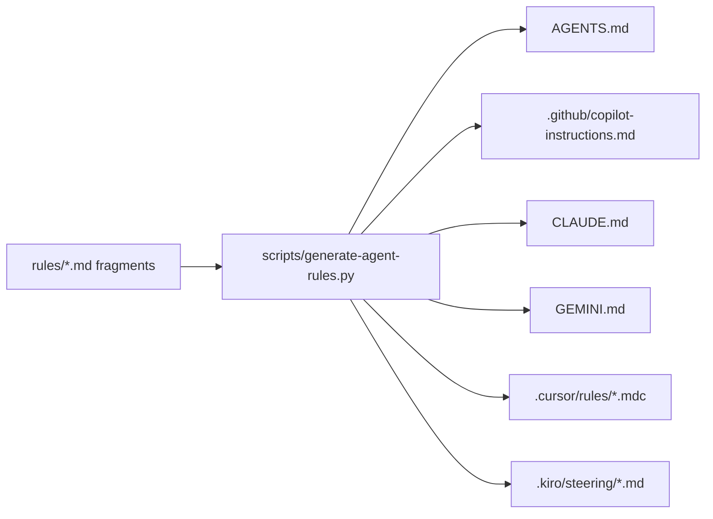
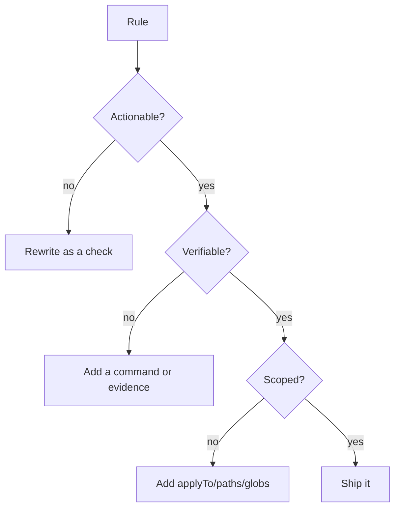
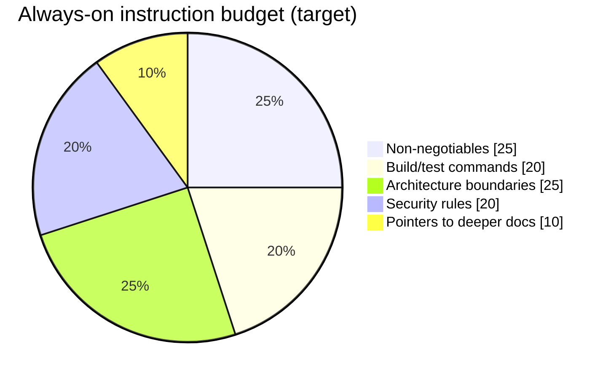
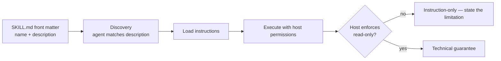
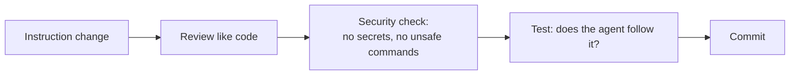

# 12 — Coding-Agent Integration

> Verified against VS Code Copilot, Claude Code, Codex, Cursor, Gemini CLI, and Kiro
> documentation on **2026-11-02**. File conventions change; verify against your installed
> version before standardizing.

---

## 1. Purpose

Every harness invents its own file names for the same three concepts:

1. **Always-on instructions** (repository rules)
2. **Scoped instructions** (rules for specific paths)
3. **Reusable procedures** (skills, commands, prompts, agents)

This chapter maps those concepts across harnesses and shows how to maintain **one canonical
source** without writing the same rules five times and letting them drift.

---

## 2. When to use it

Use this chapter when you are:

- Onboarding a second agent harness into a repository.
- Writing repository rules that must apply to every agent.
- Packaging a review or verification procedure as a reusable skill.
- Auditing an existing repository for conflicting instructions.

---

## 3. The concept map

```mermaid
flowchart TD
    subgraph Concepts["Three concepts"]
        C1["Always-on project rules"]
        C2["Path-scoped rules"]
        C3["Reusable procedure<br/>(skill / command / prompt)"]
    end
    subgraph Copilot["GitHub Copilot (VS Code)"]
        P1[".github/copilot-instructions.md<br/>or AGENTS.md"]
        P2[".github/instructions/**/*.instructions.md<br/>applyTo:"]
        P3[".github/skills/<name>/SKILL.md<br/>.github/prompts/*.prompt.md<br/>.github/agents/*.agent.md"]
    end
    subgraph Claude["Claude Code"]
        L1["CLAUDE.md"]
        L2[".claude/rules/*.md<br/>paths:"]
        L3[".claude/skills/<name>/SKILL.md"]
    end
    subgraph Codex["Codex"]
        X1["AGENTS.md"]
        X2["AGENTS.md in subfolders"]
        X3["Plugin skills"]
    end
    subgraph Cursor["Cursor"]
        R1[".cursor/rules/*.mdc"]
        R2["globs:"]
        R3["commands / plugins"]
    end
    subgraph Gemini["Gemini CLI"]
        G1["GEMINI.md"]
        G2["—"]
        G3["extensions"]
    end
    subgraph Kiro["Kiro"]
        K1[".kiro/steering/*.md<br/>inclusion: always"]
        K2["inclusion: fileMatch<br/>fileMatchPattern:"]
        K3[".kiro/skills, hooks, custom agents"]
    end
    C1 --> P1 & L1 & X1 & R1 & G1 & K1
    C2 --> P2 & L2 & X2 & R2 & K2
    C3 --> P3 & L3 & X3 & R3 & G3 & K3
```



### Verified conventions table

| Concept | GitHub Copilot | Claude Code | Codex | Cursor | Gemini CLI | Kiro |
| --- | --- | --- | --- | --- | --- | --- |
| Always-on rules | `.github/copilot-instructions.md`, `AGENTS.md`, `CLAUDE.md` | `CLAUDE.md` | `AGENTS.md` (root) | `.cursor/rules/*.mdc` with `alwaysApply` | `GEMINI.md` | `.kiro/steering/*.md` (`inclusion: always`) |
| Path-scoped | `.github/instructions/**/*.instructions.md` with `applyTo` | `.claude/rules/*.md` with `paths` | `AGENTS.md` in subfolders | `.mdc` with `globs` | — | `inclusion: fileMatch` + `fileMatchPattern` |
| On-demand | `.github/prompts/*.prompt.md` | skills | skills | commands | extensions | `inclusion: manual` (`#name`) |
| Skill package | `.github/skills/<name>/SKILL.md` | `.claude/skills/<name>/SKILL.md` | plugin skills | plugin | extension | agent skills |
| Custom agent | `.github/agents/*.agent.md` | subagents | — | — | — | custom agents |

> **Copilot reads several formats.** VS Code documents that Copilot uses
> `.github/copilot-instructions.md` or `AGENTS.md`, plus `CLAUDE.md` / `.claude/rules` for some
> harnesses. `AGENTS.md` is *not* Codex-specific — it is a cross-agent convention. When your
> team uses multiple harnesses, prefer a shared format and avoid contradictory copies.

---

## 4. Layering and precedence

Rules do not all have equal weight. Understand the layering before you add a file.



Practical implications:

| Situation | Correct behavior |
| --- | --- |
| Global says "use tabs", repo says "use spaces" | Repo wins |
| Repo says "never add deps", user asks for a dep | Ask; do not silently violate either |
| Kiro global vs workspace steering conflict | **Workspace wins** (verified) |
| Two repositories' rules disagree in a monorepo | The nearest applicable rule wins; document the exception |
| `AGENTS.md` and `CLAUDE.md` disagree | Treat as a defect: consolidate |

> **Anti-pattern:** copying the same paragraph into six files. It will drift. Keep one
> canonical file and reference it.

---

## 5. Canonical-source strategy

Three viable patterns. Pick one per repository.

### Pattern A — `AGENTS.md` as canonical, per-harness includes



Pros: one source of truth. Cons: harnesses that do not read `AGENTS.md` need a thin pointer file,
and "links" are not always followed automatically — keep pointer files short and self-sufficient
for the non-negotiables.

### Pattern B — generator



Pros: exact consistency, enforceable in CI (`generate --check`). Cons: build step ownership.

### Pattern C — per-harness authored files with a CI consistency check

Pros: simplest to start. Cons: drift is the default unless the check is real.

| Pattern | Best for | Failure mode |
| --- | --- | --- |
| A | Small teams, 1–2 harnesses | Pointer files diverge |
| B | 3+ harnesses, regulated | Tooling rot |
| C | Prototypes | Silent contradictions |

**Recommendation:** Pattern B once you have three or more harnesses. Until then, Pattern A with a
short, explicit "non-negotiables" block repeated verbatim in each pointer file.

---

## 6. Writing rules that agents actually follow



| Bad rule | Why | Better |
| --- | --- | --- |
| "Write clean code" | Not actionable | "Functions ≤ 40 lines; cyclomatic complexity ≤ 10 (enforced by SonarQube)" |
| "Test everything" | Unbounded | "Every new branch in `src/domain/` requires a unit test; CI fails under 80% line coverage for that package" |
| "Be careful with migrations" | Not verifiable | "Every migration must include a `down` migration or a documented forward-fix; `alembic check` must pass" |
| "Use good commit messages" | Subjective | "Conventional Commits; `commitlint` runs in `pre-commit`" |

### Size budget

Agents have finite attention. Keep always-on rules under roughly **150 lines**; move detail into
path-scoped files or skills.



---

## 7. Packaging a reusable procedure as a skill

A skill is a folder with a `SKILL.md` containing front matter (`name`, `description`) and
instructions.

```markdown
---
name: read-only-code-review
description: Review a git diff without modifying files. Use when asked to review code, a branch, or a pull request.
---

# Read-only code review

## Constraints
- Do not edit any file. Do not run formatters or linters with --fix.
- Do not commit, push, or create branches.

## Procedure
1. `git --no-pager diff --stat <base>...HEAD`
2. Read the full diff and the surrounding code for each hunk.
3. Map each change to a requirement or defect.
4. Verify tests exist and actually assert the acceptance criteria.
5. Produce findings with severity, file:line, evidence, impact, remediation.

## Output
Use `docs/sdd/templates/code-review-report.md`.
```



> **A skill cannot grant permissions.** If the host allows writes, a "read-only" skill is
> advisory. See [chapter 19](./19-read-only-code-review.md) for enforcement options.

---

## 8. Complete examples

### 8.1 Minimal Copilot setup

`.github/copilot-instructions.md`

```markdown
# Repository rules

## Non-negotiables
- Never commit secrets. `.env*` is gitignored; use `.env.example` for documented variables.
- Every change to `src/` requires a test that fails before and passes after.
- Do not add dependencies without an ADR in `docs/adr/`.

## Commands
- Test: `pnpm test`
- Lint: `pnpm lint`
- Type check: `pnpm typecheck`

## Architecture
- HTTP handlers live in `src/api/` and must not import from `src/infra/`.
- Domain logic lives in `src/domain/` and has no framework imports.

## Deeper docs
- SDD process: `docs/sdd/README.md`
- Review rules: `docs/sdd/19-read-only-code-review.md`
```

`.github/instructions/python-tests.instructions.md`

```markdown
---
applyTo: "tests/**/*.py"
---
# Test rules
- Use `pytest` with fixtures; no `unittest.TestCase`.
- One behavior per test; name it `test_<behavior>_<condition>`.
- Never call external networks; use `respx` or a fixture.
```

### 8.2 Claude Code

`CLAUDE.md`

```markdown
# Project instructions
Read `docs/sdd/README.md` before planning work.

## Non-negotiables
- Specification before implementation.
- No commits without explicit authorization.

## Commands
- `uv run pytest -q`
- `uv run ruff check .`
```

`.claude/rules/api.md`

```markdown
---
paths: ["src/api/**/*.py"]
---
# API rules
- Every endpoint declares an explicit response model.
- Authorization is enforced by `require_project_access`; never hand-roll checks.
```

### 8.3 Cursor

`.cursor/rules/sdd.mdc`

```markdown
---
description: Spec-driven development rules
globs: ["**/*"]
alwaysApply: true
---
# SDD rules
- Read the spec before changing code.
- Do not commit or push.
- Use the repository's test command: `pnpm test`.
```

### 8.4 Codex / `AGENTS.md`

```markdown
# AGENTS.md

## Build & test
- Install: `uv sync --all-extras`
- Test: `uv run pytest -q`
- Lint: `uv run ruff check .`

## Rules
- Read `docs/sdd/README.md` before proposing changes.
- Never run `git reset --hard`, `git clean`, or force-push.
- Mark unverified claims as UNVERIFIED.
```

### 8.5 Gemini CLI

`GEMINI.md`

```markdown
# Gemini project context
See `AGENTS.md` for the canonical rules. Summary of non-negotiables:
- Spec before implementation.
- Tests must be executed, not assumed.
- No commits or pushes without authorization.
```

### 8.6 Kiro steering

`.kiro/steering/security.md`

```markdown
---
inclusion: always
---
# Security
- Validate all input at the boundary.
- Never log tokens, passwords, or full request bodies.
```

`.kiro/steering/api.md`

```markdown
---
inclusion: fileMatch
fileMatchPattern: ["src/api/**/*.ts"]
---
# API conventions
- Return typed response models.
- Map domain errors to HTTP codes in one place.
```

---

## 9. Git and commit policy

| What | Commit? | Why |
| --- | --- | --- |
| `AGENTS.md`, `CLAUDE.md`, `GEMINI.md` | Yes | Shared policy |
| `.github/copilot-instructions.md`, `.github/instructions/`, `.github/skills/` | Yes | Shared policy and procedures |
| `.claude/rules/`, `.claude/skills/` | Yes | Shared procedures |
| `.cursor/rules/` | Yes | Shared rules |
| `.kiro/steering/` | Yes | Shared context |
| Personal global config (`~/.kiro`, `~/.claude`, user settings) | **No** | Machine-local |
| Secrets in any instruction file | **Never** | Instructions are plain text in Git |



---

## 10. Verification

| Check | Command | Expected |
| --- | --- | --- |
| Inventory | `find . -name 'AGENTS.md' -o -name 'CLAUDE.md' -o -name 'GEMINI.md'` | Known set |
| No contradictions | `python3 docs/sdd/tools/validate_docs.py --instructions` | No conflicting non-negotiables |
| Skills parse | Inspect `SKILL.md` front matter | `name` + `description` present |
| Rules load | Ask the agent to restate a non-negotiable | Correct |
| Scope works | Edit a file outside the `applyTo` glob; ask about the rule | Rule not applied |
| Read-only claims | Attempt a review task; check `git status` | Clean if enforced |
| Generated files current | `python3 scripts/generate-agent-rules.py --check` (if Pattern B) | Exit 0 |

---

## 11. Common mistakes

| Mistake | Effect | Fix |
| --- | --- | --- |
| Assuming `AGENTS.md` covers every harness | Rules silently absent | Verify per harness |
| Duplicating rules across files | Drift and contradictions | Canonical source or generator |
| Instruction files over 300 lines | Rules ignored | Move detail to scoped files/skills |
| Writing secrets into examples | Leak | Use placeholders |
| Claiming "read-only" in a rule only | Agent can still write | Enforce at filesystem/tool level |
| Using `alwaysApply` for everything (Cursor) | Context bloat | Scope with `globs` |
| Ignoring `AGENTS.md` subfolder semantics (Codex) | Wrong rules for a module | Place module rules next to the module |

---

## 12. Troubleshooting

| Symptom | Cause | Action |
| --- | --- | --- |
| Agent ignores a rule | File not read by that harness | Check the mapping table |
| Rules conflict | Two files with different instructions | Consolidate; add CI consistency check |
| Scoped rule applies everywhere | Glob too broad | Narrow `applyTo` / `paths` / `globs` |
| Skill never triggers | Weak `description` | Describe when to use it, not just what it is |
| Skill triggers too often | Description too generic | Add negative conditions ("Do not use for …") |
| Kiro ignores front matter | Front matter not first line | Move to byte 0 |
| Copilot prompt file not listed | Wrong directory | `.github/prompts/` |

---

## 13. Security considerations

| Risk | Control |
| --- | --- |
| Instruction files are an injection surface | Review changes like code; restrict who can merge |
| Repository rules can exfiltrate data via commands | No network calls to unknown hosts in rules/skills |
| Skills run with host permissions | Least-privilege harness configuration |
| Global config overrides | Audit `~/.claude`, `~/.kiro`, user settings |
| Third-party marketplace skills | Pin versions; review before install |
| Secrets in examples | Use `.env.example` with dummy values |

---

## 14. Official references

- VS Code Copilot custom instructions — <https://code.visualstudio.com/docs/copilot/customization/custom-instructions>
- VS Code Copilot agent skills — <https://code.visualstudio.com/docs/copilot/customization/agent-skills>
- VS Code Copilot custom agents — <https://code.visualstudio.com/docs/copilot/customization/custom-agents>
- Claude Code memory and rules — <https://docs.claude.com/en/docs/claude-code/memory>
- OpenAI Codex `AGENTS.md` — <https://github.com/openai/codex>
- Cursor rules — <https://cursor.com/docs/context/rules>
- Gemini CLI context files — <https://www.geminicli.com/docs/cli/gemini-md>
- Kiro steering — <https://kiro.dev/docs/steering/>
- `AGENTS.md` convention — <https://agents.md/>

---

**Previous:** [11 — Superpowers](./11-superpowers.md) ·
**Next:** [13 — Language guides](./language-guides/README.md)
