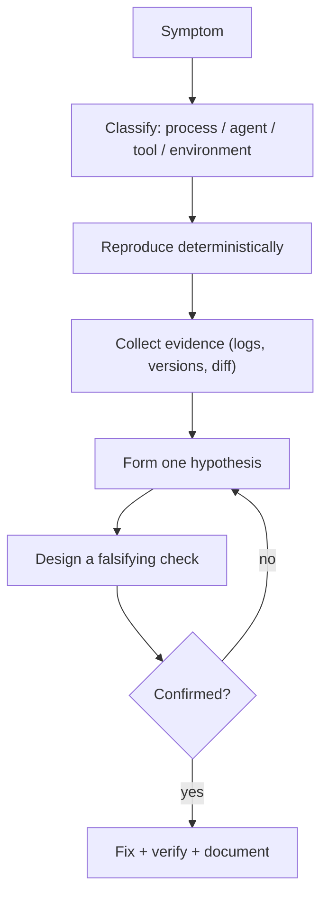
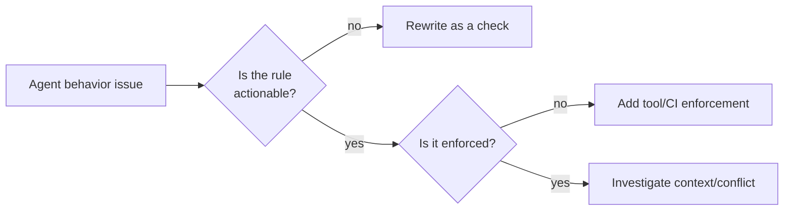
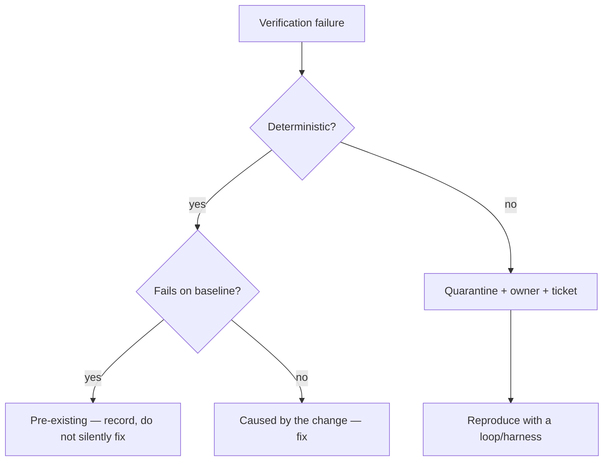
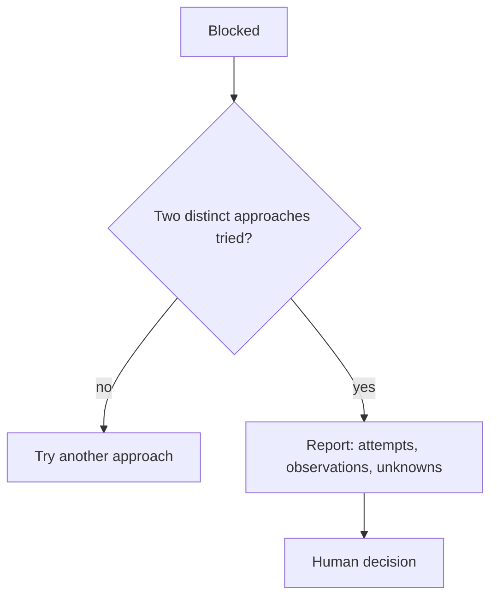

# 27 — Troubleshooting

> Symptom → likely cause → action. Covers adoption problems, agent behavior, and tooling.

---

## 1. How to use this chapter

Find the symptom, apply the check, and **record what you learned**. If a symptom is not listed,
the general diagnostic order is:



---

## 2. Process problems

| Symptom | Likely cause | Action |
| --- | --- | --- |
| Specs exist but nobody reads them | No link from review or PR | Require spec links in PR; cite requirement IDs in findings |
| Every change needs a spec, even typos | No sizing policy | Define a lightweight path ([14 §2](./14-feature-development.md)) |
| Review takes days | Reviewer is also the implementer | Separate roles; time-box reviews |
| Endless clarification | Feature too broad | Split by user-visible outcome |
| Spec review finds the same issues repeatedly | No single author | Assign one owner for the spec |
| Convergence never finishes | Acceptance criteria untestable | Rewrite criteria with observable outcomes |
| Teams bypass the process | Process cost > perceived value | Start with Mode 2 and one gate |
| Process works in pilot, fails at scale | Hand-crafted setup | Templatize and automate checks |

---

## 3. Agent behavior problems

| Symptom | Likely cause | Action |
| --- | --- | --- |
| Agent edits files it was told not to | Instruction-only enforcement | Remove write tools; use read-only mount ([19 §8](./19-read-only-code-review.md)) |
| Agent claims tests passed | No execution requirement | Demand command + output ([23](./23-hallucination-prevention.md)) |
| Agent invents APIs | Version drift, no lockfile read | Require lockfile citation; type check in CI |
| Agent rewrites unrelated files | No scope statement | Explicit file allow-list per task |
| Agent adds dependencies casually | No dependency policy | Constitution rule + review gate |
| Agent duplicates existing code | Did not search | Require "reuse inventory" in plan |
| Agent cannot finish a task | Task too large | Split; add definition of done |
| Agent declares done with gaps | No AC mapping | Require verification report |
| Agent keeps "fixing" a flaky test | Symptom chasing | Quarantine + owner + root cause |
| Agent reverts to old patterns | Instruction conflict | Consolidate rules ([12 §5](./12-coding-agent-integration.md)) |
| Agent ignores a rule | Rule too long/buried | Move to scoped file; make it actionable |
| Agent does too much in one turn | No mode declaration | Declare mode + task scope |



---

## 4. Tool-specific problems

### Spec Kit

| Symptom | Cause | Action |
| --- | --- | --- |
| `/speckit-*` not found | Integration files missing or wrong harness | `specify integration status`; reinstall |
| Commands target the wrong feature | `.specify/feature.json` stale | Edit it or set `SPECIFY_FEATURE_DIRECTORY` |
| `init` hangs in CI | Interactive picker | `--non-interactive` |
| `init` refuses non-empty dir | Safety | Back up, then `--force` |
| Analysis modified files | Misconfigured agent | Verify with `git status`; report |

### OpenSpec

| Symptom | Cause | Action |
| --- | --- | --- |
| Skills do nothing | No resolved root | `openspec init` at repo root |
| Store error | `store:` unregistered/invalid | `openspec store list` / `register` |
| Silent config drop | Invalid YAML field | `openspec validate --all` in CI |
| Archive refuses | Unchecked tasks or invalid deltas | `openspec status`, `validate` |
| Wrong next step after resume | Hand-edited checkboxes | `tasks.md` is the only state |

### Kiro

| Symptom | Cause | Action |
| --- | --- | --- |
| Steering ignored | Front matter not first line | Move `---` to byte 0 |
| `fileMatch` never applies | Glob mismatch | Test against real paths |
| Hook does not run | Wrong trigger for surface, bad matcher | Check docs + surface matrix |
| Custom agent ignores steering | Must be explicitly included | Add `file://.kiro/steering/**/*.md` |
| Global vs workspace conflict | — | Workspace wins; remove duplicate |

### BMAD

| Symptom | Cause | Action |
| --- | --- | --- |
| Skills not recognized | Wrong tool ID at install | `npx bmad-method install --list-tools` |
| `bmad-build` fails | `uv` missing | Install `uv` |
| Duplicate `bmad-*` commands | Legacy command dirs | Remove stale entries |
| v6/v7 conflict | Both installed | Keep one per repo |

### Spec Kitty

| Symptom | Cause | Action |
| --- | --- | --- |
| Commands missing | Setup not verified | `spec-kitty verify-setup` |
| Nothing to do in `next` | No work packages | Re-run `/spec-kitty.tasks` |
| Worktree errors | Disk/dirty tree/path collision | Clean, free space, prune |
| Retrospective missing | Merge does not author it | Run mission review at terminus |

### Ponytail / Superpowers

| Symptom | Cause | Action |
| --- | --- | --- |
| Rules inactive | Wrong file location for host | Check host docs |
| Commands unavailable | Rules-only adapter | Use `AGENTS.md`; manual review |
| Skills stop triggering | Compaction lost bootstrap | New session (Hermes has no post-compaction hook) |
| Agent ignores TDD | Conflicting instruction files | Consolidate |

### Documentation validator

| Symptom | Cause | Action |
| --- | --- | --- |
| Broken link reported | Renamed file | Update the link |
| False positive on external link | Network required | Run with `--offline` |
| YAML block not parsed | Placeholder syntax in example | Mark as illustrative, use valid YAML |
| Mermaid error | Unbalanced `subgraph`/`end` | Fix structure |

---

## 5. Environment problems

| Symptom | Cause | Action |
| --- | --- | --- |
| Cannot install tools (sandbox) | Filesystem/network policy | Report the restriction; do not work around it |
| TLS errors to registries | Proxy/CA trust | Configure the client's CA bundle |
| Docker unavailable | No daemon in CI | Service containers or a runner with Docker |
| Disk full during worktree creation | Many worktrees | Prune, increase disk |
| Slow test suite | Integration-heavy | Parallelize, cache, split jobs |
| Different results local vs CI | Version/timezone/locale | Pin and containerize |
| Line endings change in diff | `core.autocrlf` | `.gitattributes` |

---

## 6. Verification is failing



| Failure | First check |
| --- | --- |
| Test cannot find fixture | Path/fixture scope |
| Type error in CI only | Tool version, project references |
| Container startup failure | Image tag, Docker availability |
| Permission denied | File mode, user in container |
| Timeout | Real slowness vs deadlock |
| Snapshot mismatch | Intentional change? If yes, review the diff carefully |

---

## 7. When the agent is stuck



**Good stuck report:**

```markdown
## Blocked — cannot reproduce the 502

**Tried**
1. Reproduced with the reported payload against staging → 200.
2. Replayed the same payload 500× against production canary → 0 failures.
3. Checked staging vs production versions: identical image digest.
4. Checked the gateway logs for the reported window: upstream timeouts, no app errors.

**Evidence**
- Gateway log excerpt (redacted) shows `upstream request timeout` at 12:04:11Z.
- App p99 latency in that minute: 8.2 s (baseline 180 ms).

**Unknown**
- Whether a bulk import was running at that time (no access to the job scheduler).

**Needed**
- Job scheduler history for 12:00–12:10Z, or DB load metrics for the same window.
```

This is more valuable than a speculative fix.

---

## 8. Escalation matrix

| Situation | Escalate to | Timeframe |
| --- | --- | --- |
| Production data loss | Incident commander + DBA | Immediate |
| Suspected breach | Security | Immediate |
| Repeated CI failure on main | Platform team | Same day |
| Spec disagreement | Domain architect | Next business day |
| Tool cannot be installed | Platform/IT | Same day |
| Agent produced unsafe change | Engineering lead | Immediate |

---

## 9. Diagnostic command reference

```bash
# Repository state
git --no-pager status --short --branch
git --no-pager log --oneline -10
git --no-pager diff --stat

# Tool versions (verify, never assume)
node --version; npm --version; pnpm --version
python3 --version
java -version 2>&1 | head -3
dotnet --info | head -20
go version
cargo --version
php --version

# Installed tools
specify version 2>/dev/null
openspec version 2>/dev/null
spec-kitty --help 2>/dev/null | head -5

# Documentation validation (this repo)
python3 docs/sdd/tools/validate_docs.py
```

---

## 10. Reporting a problem

```markdown
## Problem report

**Symptom:**
**When it started:**
**Environment:** OS, tool versions, agent, mode
**Reproduction:** exact commands/steps
**Expected vs actual:**
**Evidence:** logs, screenshots, `git status`
**What I already ruled out:**
**What I need:**
```

> Include the **agent mode** (1–4) and the **instruction files** in effect. Most "agent misbehavior"
> reports are mode or instruction conflicts.

---

## 11. References

- [Chapter 03 — Repository discovery](./03-repository-discovery.md)
- [Chapter 12 — Coding-agent integration](./12-coding-agent-integration.md)
- [Chapter 23 — Hallucination prevention](./23-hallucination-prevention.md)
- [Chapter 05–11 — Tool chapters](./05-github-spec-kit.md)

---

**Previous:** [26 — Enterprise reference workflow](./26-enterprise-reference-workflow.md) ·
**Next:** [28 — Glossary](./28-glossary.md)
