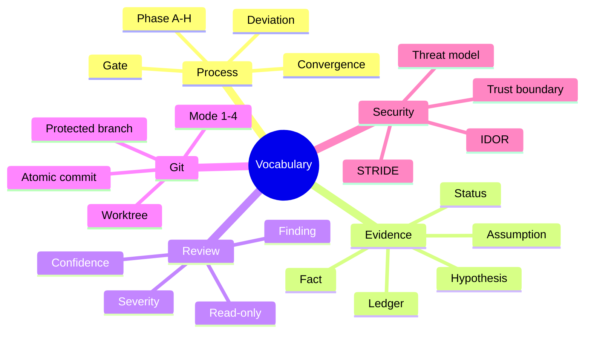

# 28 — Glossary

> Canonical vocabulary. When chapters disagree in wording, this file wins.

---

## A

**Acceptance criterion (AC)** — A testable, observable statement that must be true for a
requirement to be considered satisfied. Format: Given/When/Then, or a precise assertion.

**ADR (Architecture Decision Record)** — A short document capturing one significant decision:
context, decision, alternatives, consequences. Lives in the repository.

**Agent** — An AI system that can read files, reason, and (subject to permissions) modify a
repository. Distinct from a *model*: the agent is the model plus tools, context, and policy.

**Agent skill** — A packaged procedure (`SKILL.md`) discovered by an agent via its `description`
and loaded on demand. See [chapter 12](./12-coding-agent-integration.md).

**Artifact** — A durable file produced by the process: spec, plan, tasks, ADR, review report,
verification report, evidence ledger.

**Assumption** — A statement accepted without evidence, recorded explicitly with a verification
plan. Distinct from a *fact*.

**Autonomy ladder (L0–L4)** — How much an agent may do without human involvement. See
[chapter 01 §5](./01-fundamentals.md).

---

## B

**Baseline (test)** — The recorded result of running the existing suite before a change. Used to
distinguish pre-existing failures from regressions.

**Blast radius** — The set of systems, users, and data affected if a change fails.

**Bounded context** — A boundary within which a domain model is consistent and owned by one team.

**Brownfield** — An existing system with history, constraints, and incomplete tests, as opposed to
greenfield.

---

## C

**Characterization test** — A test that pins *current* behavior (including bugs) so that a
refactor can prove behavior is unchanged.

**CI (Continuous Integration)** — Automated verification on every change. In this handbook, CI is
the enforcement mechanism for SDD rules.

**Constitution** — Project-level principles that constrain every later decision (Spec Kit term;
equivalent to an engineering charter elsewhere).

**Contract test** — A test that verifies a provider satisfies what consumers expect (e.g. Pact,
OpenAPI validation).

**Convergence** — The step that compares implementation against specification and appends remaining
work until they align.

**Conventional Commits** — A commit message convention: `type(scope): subject`. See
[chapter 22 §4](./22-git-and-commit-policy.md).

**CRITICAL / HIGH / MEDIUM / LOW / INFO** — The shared severity scale. Defined by impact if
shipped, not by effort to fix. See [chapter 17 §4](./17-specification-review.md).

---

## D

**Definition of done (DoD)** — The checklist that makes a task complete. Must be verifiable.

**Delta spec** — A specification describing only what a change adds, modifies, or removes relative
to current truth (OpenSpec).

**Deviation** — An intentional departure from the approved plan, recorded with a trigger, an
approver, and evidence.

**Discovery note** — The output of Phase A: facts, assumptions, unknowns, risks, and constraints
about the repository and the requested change.

---

## E

**Evidence ledger** — A table mapping each significant claim to its evidence, method, status, and
confidence. See [chapter 23 §5](./23-hallucination-prevention.md).

**Evidence status** — One of `VERIFIED`, `PARTIALLY VERIFIED`, `UNVERIFIED`, `CONTRADICTED`.

**Expand/contract** — A migration pattern: add the new structure, dual-write, backfill, switch
reads, then remove the old structure.

---

## F

**Fact** — A statement supported by direct evidence for the exact version or commit in question.

**Feature flag** — A runtime switch that enables or disables behavior without redeploying. Used as
a rollback mechanism.

**Finding** — A review output with severity, location, evidence, impact, remediation, and
verification.

---

## G

**Gate** — A checkpoint that must pass before the next phase. Gates are either human-approved or
automated (CI).

**Greenfield** — A new system with no legacy constraints.

**Golden master test** — A test that compares output against a recorded reference file. Synonym:
approval test.

---

## H

**Hallucination** — A confident assertion not supported by evidence: nonexistent API, invented
dependency, fabricated test result.

**Handoff** — Passing work between roles via artifacts, not conversation.

**Human-in-the-loop** — A workflow where a human authorizes irreversible actions.

---

## I

**IDOR (Insecure Direct Object Reference)** — An authorization flaw where a user can access another
user's object by changing an identifier.

**Idempotency** — Property that repeating an operation produces the same result and side effects
once.

**Immutable artifact** — A build output identified by digest that is promoted, never rebuilt.

---

## L

**Lane (work package)** — A lifecycle state in Spec Kitty: `planned`, `in_progress`, `for_review`,
`approved`, `done`.

**Lockfile** — The resolved dependency graph (`uv.lock`, `package-lock.json`, `Cargo.lock`,
`packages.lock.json`). The authoritative source of installed versions.

---

## M

**Mission (Spec Kitty)** — A unit of work with spec, plan, tasks, work packages, and a
retrospective.

**Mode (Git)** — One of four declared permission sets (1–4). See
[chapter 22 §2](./22-git-and-commit-policy.md).

**MSRV (Minimum Supported Rust Version)** — The oldest Rust compiler a crate supports.

---

## N

**NFR (Non-functional requirement)** — A quality constraint: performance, reliability, security,
compatibility, operability. Must have a number, a condition, and a verification method.

**Non-goal** — An explicit exclusion that bounds scope.

---

## O

**Outbox pattern** — Write the event to a table in the same transaction as the state change, then
publish asynchronously. Solves dual-write inconsistency.

---

## P

**Plan** — The technical design artifact: boundaries, contracts, data changes, rollback, test
strategy.

**Postmortem** — A blameless review after an incident producing action items with owners.

**Protected branch** — A branch with enforced review and status checks; no force push or deletion.

---

## Q

**Quality attribute scenario** — A structured statement of a non-functional requirement: source,
stimulus, artifact, response, response measure.

---

## R

**Read-only review** — A review that cannot modify the artifact under review. Enforced technically
where possible, by instruction otherwise (and the limitation stated).

**Regression test** — A test that fails on the buggy version and passes on the fixed version.

**Requirement ID** — A stable identifier (`FR-3`, `AC-3.2`, `NFR-2`) used for traceability.

**Rollback** — Returning to a known-good state. Distinct from *revert* (a Git operation) and
*forward-fix* (repairing in place).

---

## S

**SLO (Service Level Objective)** — A target for a service-level indicator (e.g. p95 < 300 ms).

**Specification (`spec.md`)** — The contract: problem, goals, non-goals, functional and
non-functional requirements, acceptance criteria, edge cases, failures, compatibility.

**Spec drift** — Divergence between specification and implementation.

**STRIDE** — Threat-modeling taxonomy: Spoofing, Tampering, Repudiation, Information disclosure,
Denial of service, Elevation of privilege.

**Strangler fig** — An incremental modernization pattern: route traffic gradually from legacy to
new implementation, then decommission the old path.

**Supply chain** — Dependencies, build systems, and distribution channels that could introduce
vulnerabilities.

---

## T

**Task** — The smallest unit of implementation work. Must reference a requirement and have a
definition of done.

**Threat model** — An analysis of what can go wrong from an attacker's perspective, per trust
boundary.

**Traceability** — The ability to follow a chain from requirement → task → commit → test →
evidence → acceptance.

**Trust boundary** — A line across which data or control passes between differently trusted
components.

---

## U

**UNVERIFIED** — Evidence status: no direct evidence exists. May appear in reports but never as
"done".

**User story** — A short statement of value from a user's perspective. Not a substitute for
acceptance criteria.

---

## V

**Verification report** — The artifact recording which acceptance criteria were verified, by what
evidence, and what was not verified.

**VERTICAL SLICE** — An implementation slice that delivers one end-to-end outcome (UI → API → DB),
as opposed to a horizontal layer.

---

## W

**Work package** — A unit of work assignable to one agent in one worktree (Spec Kitty term).

**Worktree (Git)** — A second working directory attached to the same repository, with its own
branch and index. Used to isolate parallel agents.

---

## Symbol and abbreviation index

| Symbol | Meaning |
| --- | --- |
| `AC-x.y` | Acceptance criterion |
| `FR-x` | Functional requirement |
| `NFR-x` | Non-functional requirement |
| `G-x` | Goal |
| `NG-x` | Non-goal |
| `U-x` | Unknown |
| `A-x` | Assumption |
| `D-x` | Deviation |
| `SEC-x`, `C-x`, `H-x`, `M-x`, `L-x` | Finding IDs by review type/severity |
| `TB-x` | Trust boundary |

---

## Related vocabulary by chapter

---

## References

- [Chapter 01 — Fundamentals](./01-fundamentals.md)
- [Chapter 02 — Engineering lifecycle](./02-engineering-lifecycle.md)
- [Chapter 17 — Review without implementation](./17-specification-review.md)
- [Chapter 22 — Git and commit policy](./22-git-and-commit-policy.md)
- [Chapter 23 — Hallucination prevention](./23-hallucination-prevention.md)
- ISO/IEC/IEEE 29148 — requirements terminology
- C4 model glossary — <https://c4model.com/>

---

**Previous:** [27 — Troubleshooting](./27-troubleshooting.md) ·
**Back to index:** [README](./README.md)
