# 29 — IDE Setup: IntelliJ IDEA, VS Code, Visual Studio

> Verified against GitHub Copilot's custom-instructions support reference, Visual Studio and
> JetBrains documentation, and the Claude Code JetBrains guide on **2026-11-02**. IDE menus move
> between releases; the file paths in this chapter are the durable contract.

---

## 1. Purpose

The IDE is where the specification meets the code. This chapter makes three things concrete for
each major IDE:

1. **Where the SDD artifacts and agent rules live** so the agent actually reads them.
2. **What to install and configure**, step by step.
3. **What to commit** so a teammate on a different IDE gets the same behavior.

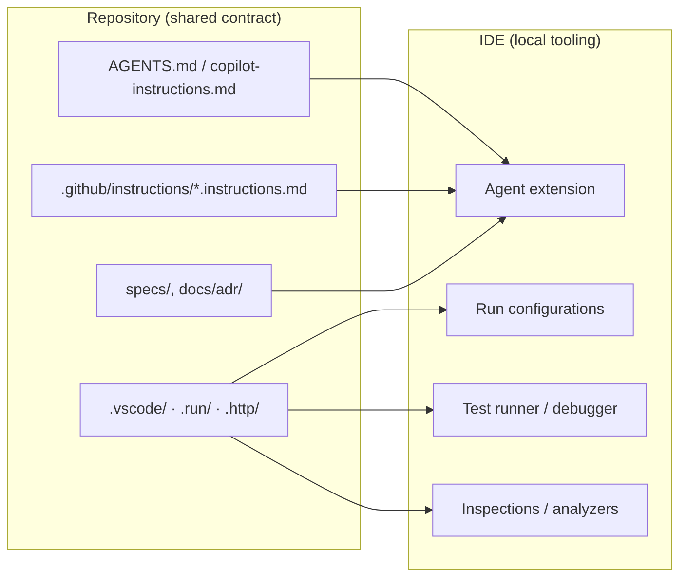

---

## 2. What the IDE can and cannot do for SDD

| The IDE is good at | The IDE cannot |
| --- | --- |
| Making artifacts visible while coding | Enforce that a spec exists |
| Running the agent with project context | Guarantee the agent read the spec |
| Running tests, debuggers, profilers | Prove acceptance criteria are met |
| Surfacing inspections and analyzers | Replace independent review |
| Storing reviewable run/HTTP/test configuration | Prevent an agent from editing files |

> **Rule:** the IDE improves **ergonomics**. Enforcement lives in CI and in read-only review
> ([chapter 25](./25-ci-cd-integration.md), [chapter 19](./19-read-only-code-review.md)).

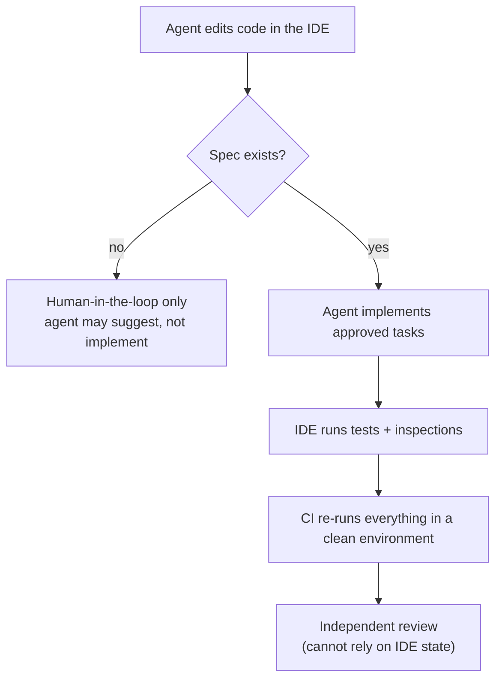

---

## 3. The repository contract: what to commit

Set this up **once**, before installing anything per-developer. It is what makes the IDE
interchangeable.

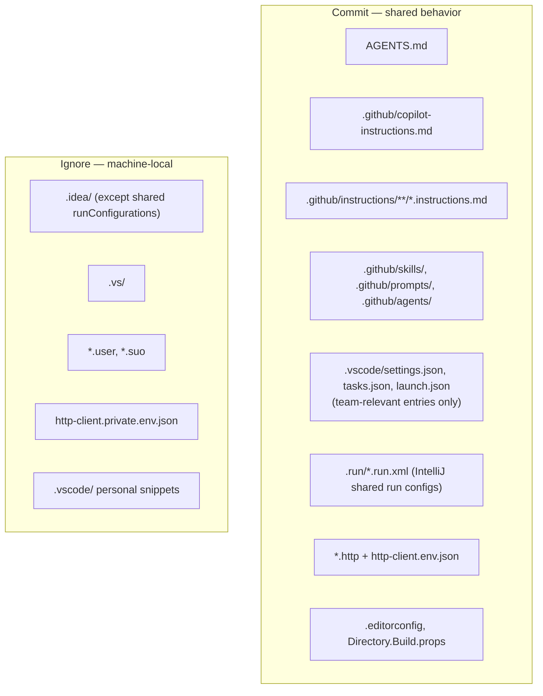

| Path | Commit? | Why |
| --- | --- | --- |
| `AGENTS.md` | **Yes** | Cross-agent rules; nearest file wins |
| `.github/copilot-instructions.md` | **Yes** | Repository-wide Copilot rules in all three IDEs |
| `.github/instructions/*.instructions.md` | **Yes** | Path-scoped rules (`applyTo` front matter) |
| `.github/skills/`, `.github/prompts/`, `.github/agents/` | **Yes** | Reusable procedures and roles |
| `.vscode/settings.json` | **Yes**, curated | Share only team-relevant settings |
| `.vscode/tasks.json`, `launch.json` | **Yes** | Makes build/test/debug reproducible for everyone |
| `.run/*.run.xml` | **Yes** | IntelliJ shared run configurations |
| `.idea/` | **No** (except the exception below) | Machine-local workspace state |
| `.idea/runConfigurations/` | **Yes**, via negation | Shared run configurations |
| `.vs/`, `*.user`, `*.suo` | **No** | Per-user state |
| `*.http` | **Yes** | Executable API contract checks |
| `http-client.env.json` | **Yes** | Non-secret environment variables |
| `http-client.private.env.json` | **No** | Secrets; add to `.gitignore` |
| `.editorconfig` | **Yes** | Style contract shared by all IDEs |

`.gitignore` for IntelliJ shared run configurations:

```gitignore
# .gitignore — keep the IDE folder local, share only run configurations
/.idea/*
!/.idea/runConfigurations/
```

`.gitignore` additions for the other IDEs and secrets:

```gitignore
.vs/
*.user
*.suo
http-client.private.env.json
```

---

## 4. Universal setup checklist

Identical for all three IDEs. Only the menu names change.

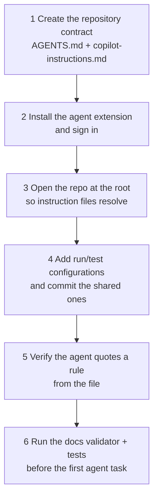

| Step | Check that it worked |
| --- | --- |
| 1 | `ls AGENTS.md .github/copilot-instructions.md` → both exist |
| 2 | The agent panel shows a signed-in account |
| 3 | The IDE's project root equals the Git root (`git rev-parse --show-toplevel`) |
| 4 | Running the configuration from a fresh clone works |
| 5 | Ask: "Which rules apply to `src/`?" — it quotes your file |
| 6 | `python3 docs/sdd/tools/validate_docs.py` and the project test command pass |

> **Open the repository root, not a subfolder.** Instruction resolution depends on the directory
> tree; opening a subdirectory hides the root-level files from some harnesses.

---

## 5. Visual Studio Code

### 5.1 Install

1. Install the **GitHub Copilot** extension (and sign in with a GitHub account that has Copilot
   access).
2. Optionally install a second harness (Claude Code, Codex, Cursor) — but keep **one** canonical
   rules file ([chapter 12](./12-coding-agent-integration.md)).
3. Open the repository root: **File → Open Folder**.

### 5.2 What Copilot reads in VS Code (verified)

| File | Scope | Support |
| --- | --- | --- |
| `.github/copilot-instructions.md` | Repository-wide | Copilot Chat ✅ |
| `.github/instructions/**/*.instructions.md` | Path-scoped via `applyTo` front matter | Copilot Chat ✅ |
| `AGENTS.md` | Agent instructions | Copilot Chat ✅ |
| `.github/skills/<name>/SKILL.md` | Reusable procedure | Documented by VS Code ✅ |
| `.github/prompts/*.prompt.md` | Reusable prompt | Documented by VS Code ✅ |
| `.github/agents/*.agent.md` | Custom agent | Documented by VS Code ✅ |

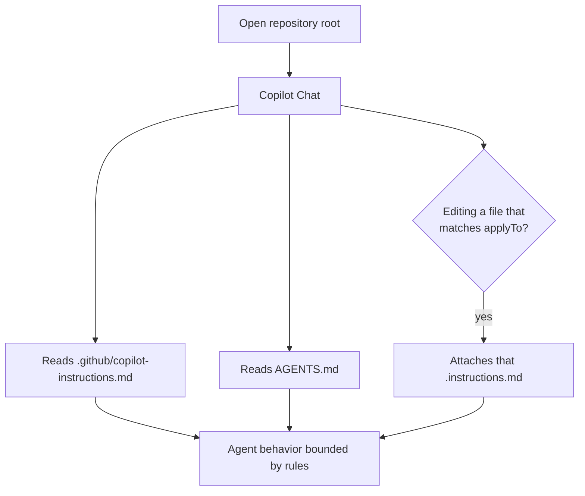

### 5.3 Workspace configuration to commit

`.vscode/settings.json` — keep it small and team-relevant:

```json
{
  "files.exclude": {
    "**/.git": true,
    "**/node_modules": true,
    "**/dist": true
  },
  "search.exclude": {
    "**/node_modules": true,
    "**/dist": true,
    "**/coverage": true
  },
  "editor.formatOnSave": true,
  "editor.codeActionsOnSave": { "source.fixAll": "explicit" }
}
```

`.vscode/tasks.json` — the exact commands your spec references:

```json
{
  "version": "2.0.0",
  "tasks": [
    { "label": "test", "type": "shell", "command": "pnpm test", "group": { "kind": "test", "isDefault": true } },
    { "label": "lint", "type": "shell", "command": "pnpm lint", "problemMatcher": ["$eslint-stylish"] },
    { "label": "typecheck", "type": "shell", "command": "pnpm typecheck", "problemMatcher": ["$tsc"] }
  ]
}
```

> Replace the commands with the ones that actually work in your repository. A task that fails on a
> clean clone is worse than no task.

### 5.4 Verification

```text
In Copilot Chat:
  "List the acceptance criteria for the change in specs/007-csv-export/spec.md."
  "Which instruction files did you use to answer that?"
  "What is the test command in this repository, and where is it defined?"
```

A correct agent cites `spec.md`, names the instruction files, and quotes the command from
`tasks.json` or `AGENTS.md`.

---

## 6. IntelliJ IDEA (and other JetBrains IDEs)

Applies to IntelliJ IDEA, PyCharm, WebStorm, PhpStorm, GoLand, Android Studio.

### 6.1 Install the agent

| Harness | Install steps |
| --- | --- |
| **GitHub Copilot** | **Settings → Plugins → Marketplace**, search "GitHub Copilot", install, restart, sign in |
| **Claude Code** | 1) Install the Claude Code CLI so `claude` is on `PATH`; 2) install the *Claude Code* plugin from JetBrains Marketplace; 3) restart the IDE |
| **JetBrains AI Assistant** | Not bundled; install the plugin, obtain a JetBrains AI license, accept the terms |

> **Claude Code in JetBrains (verified):** the CLI and the plugin are separate installations. The
> plugin shows *"Cannot launch Claude Code"* when `claude` is not on `PATH`; set the full path in
> the plugin's **Claude command** setting. Supported IDEs listed upstream include IntelliJ IDEA,
> PyCharm, Android Studio, WebStorm, PhpStorm, and GoLand.

### 6.2 What Copilot reads in JetBrains (verified)

Copilot Chat in JetBrains supports:

- **Personal** instructions
- **Repository-wide** instructions via `.github/copilot-instructions.md`
- **Path-specific** instructions via `.github/instructions/**/*.instructions.md`

You manage them from the **Agent Customizations** editor: in the Copilot Chat panel, click the
settings icon (top-right), then **Customizations**. It lets you view and edit custom agents, skills,
prompt files, and instructions, for the current project or personally across projects.

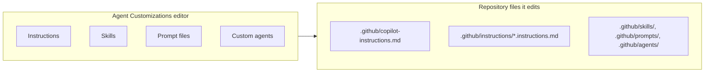

> **Consequence for teams:** because the editor can write the repository files, treat changes to
> `.github/**` as a reviewed code change. Do not let the agent silently rewrite team rules.

### 6.3 Run configurations — share them

1. **Run → Edit Configurations…**
2. Select the configuration, enable **Store as project file**, choose a location.
3. Commit the file.

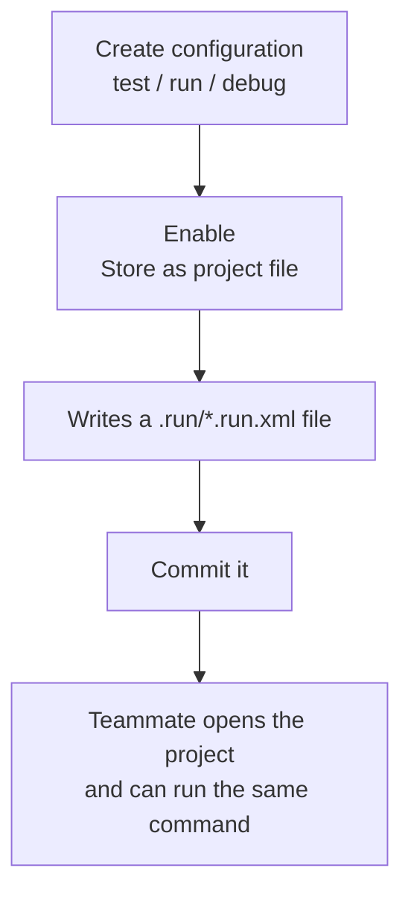

If `.idea/` is ignored, share only the run configurations:

```gitignore
/.idea/*
!/.idea/runConfigurations/
```

Enabling *Store as project file* does **not** commit anything — you must check the file in.

### 6.4 HTTP client — executable API checks

IntelliJ's HTTP Client runs `.http` and `.rest` files: highlight, completion for endpoints defined
via OpenAPI, folding, and environment variables.

```http
### orders.http — used as evidence for AC-3.1 and AC-3.2
@host = http://localhost:8080

### AC-3.1 authorized export
GET {{host}}/projects/p1/orders/export
Authorization: Bearer {{viewerToken}}

### AC-3.2 forbidden export
GET {{host}}/projects/p2/orders/export
Authorization: Bearer {{viewerToken}}
```

`http-client.env.json` (commit) and `http-client.private.env.json` (never commit):

```json
{
  "dev": { "host": "http://localhost:8080" },
  "staging": { "host": "https://staging.example.com" }
}
```

```json
{
  "dev": { "viewerToken": "<local token>" }
}
```

> HTTP files are **manual verification**, not automated regression tests. Use them for the evidence
> trail ([chapter 20](./20-testing-and-verification.md)); keep the equivalent assertions in the test
> suite.

### 6.5 Inspections and code style

| Setting | Why it matters for SDD |
| --- | --- |
| **Settings → Editor → Code Style** | Matches `.editorconfig`; prevents formatting noise in diffs |
| **Settings → Editor → Inspections** | Makes static findings visible before review |
| **Settings → Build → Compiler** | Treat warnings consistently with CI |
| **Settings → Build Tools** | Maven/Gradle wrapper usage matches the spec |

Commit `.editorconfig`. Do **not** rely on one developer's inspection profile; encode what matters
in CI instead.

---

## 7. Visual Studio

### 7.1 Install

Verified for **Visual Studio 2022 version 17.10 or later**:

1. Launch the **Visual Studio Installer**.
2. Select the installation → **Modify**.
3. Select a workload (for example *.NET desktop development*).
4. In **Optional components**, select **GitHub Copilot** → **Modify**.
5. Sign in with a GitHub account that has Copilot access; the status icon in the upper-right shows
   active/inactive/unavailable.

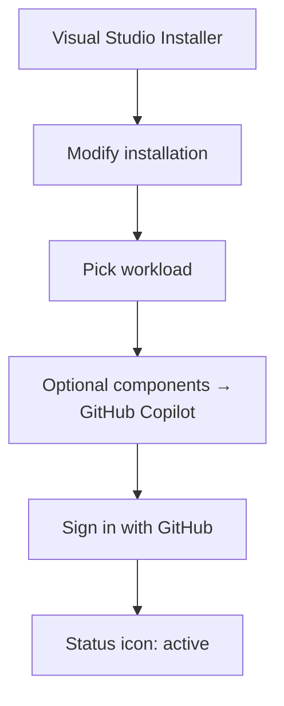

### 7.2 What Copilot reads in Visual Studio (verified)

| File | Support in Visual Studio |
| --- | --- |
| `.github/copilot-instructions.md` | ✅ Copilot Chat |
| `.github/instructions/**/*.instructions.md` | ✅ Copilot Chat |
| `AGENTS.md` | ❌ **Not listed** for Visual Studio in the support reference |
| `CLAUDE.md` / `GEMINI.md` | ❌ Not listed for Visual Studio |

> **This is the most common cross-IDE mistake.** A team that only writes `AGENTS.md` gets no
> repository rules in Visual Studio. Always maintain
> `.github/copilot-instructions.md` as the lowest common denominator, and add `AGENTS.md` as a
> pointer or a superset for harnesses that read it.

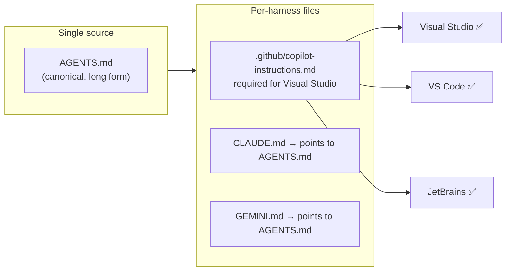

### 7.3 Project configuration to commit

| File | Purpose |
| --- | --- |
| `.editorconfig` | Formatting contract across VS, VS Code, and CI |
| `Directory.Build.props` | Shared analyzer level, nullable, warnings-as-errors |
| `.http` files | Manual API evidence (VS 2022 17.8+ with ASP.NET workload) |
| `launchSettings.json` | Local run profiles (no secrets) |
| `.gitignore` | `.vs/`, `*.user`, `*.suo` |

```xml
<!-- Directory.Build.props — makes IDE and CI agree -->
<Project>
  <PropertyGroup>
    <Nullable>enable</Nullable>
    <ImplicitUsings>enable</ImplicitUsings>
    <TreatWarningsAsErrors>true</TreatWarningsAsErrors>
    <AnalysisLevel>latest-recommended</AnalysisLevel>
    <EnforceCodeStyleInBuild>true</EnforceCodeStyleInBuild>
  </PropertyGroup>
</Project>
```

`.http` file with environments (VS 2022 17.8+):

```http
@host = http://localhost:5080

### AC-5.1 authorized export
GET {{host}}/projects/{{projectId}}/orders/export
Authorization: Bearer {{viewerToken}}

### AC-5.2 forbidden export
GET {{host}}/projects/{{otherProjectId}}/orders/export
Authorization: Bearer {{viewerToken}}
```

```json
{
  "dev": { "projectId": "11111111-1111-1111-1111-111111111111" }
}
```

> Secrets belong in user secrets or environment variables, not in `http-client.env.json`.

### 7.4 Test Explorer and analyzers

| Feature | SDD use |
| --- | --- |
| **Test Explorer** | Run the exact test named as evidence for an acceptance criterion |
| **Error List** | Analyzer findings before review; must match CI |
| **Code Cleanup** | Apply formatting consistent with `.editorconfig` |
| **Solution-wide analysis** | Catches nullable regressions in untouched projects |

> If the IDE's analyzer set differs from CI's, the agent will "fix" warnings CI never reported and
> miss the ones CI blocks. Pin the toolchain in `global.json` and share
> `Directory.Build.props`.

---

## 8. Model Context Protocol and external tools

All three IDEs can connect agents to MCP servers. Treat MCP as a **capability grant**, not a
convenience.

| Rule | Reason |
| --- | --- |
| Prefer read-only MCP servers for review roles | A reviewer with write tools is not read-only |
| Pin server versions | Reproducibility |
| Never grant production write access to an implementation agent | Blast radius |
| Review the server's tool list before enabling | Hidden destructive tools |
| Keep credentials in the IDE's secret store | Not in workspace settings |

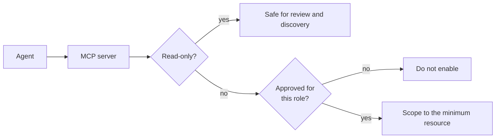

---

## 9. Feature parity across the three IDEs

| Capability | VS Code | IntelliJ IDEA | Visual Studio |
| --- | --- | --- | --- |
| Repo-wide instructions `.github/copilot-instructions.md` | ✅ | ✅ | ✅ |
| Path-specific `.github/instructions/*.instructions.md` | ✅ | ✅ | ✅ |
| `AGENTS.md` | ✅ | via customizations/agents | ❌ not listed |
| Custom agents / skills UI | ✅ files | ✅ Agent Customizations editor | partial |
| Shared run configurations | `launch.json` | `.run/*.run.xml` | `launchSettings.json` |
| Executable HTTP files | extension | `.http` + env files | `.http` (17.8+) |
| Offline-capable | depends on extension | depends on plugin | depends on extension |
| Read-only enforcement for review | tool allow-list | tool allow-list | tool allow-list |

> **Do not assume parity.** Verify the two rows your team depends on, in the IDE your team actually
> uses, before standardizing.

---

## 10. Verifying the agent actually sees your rules

Run this in each IDE after setup. It is the only proof that configuration worked.

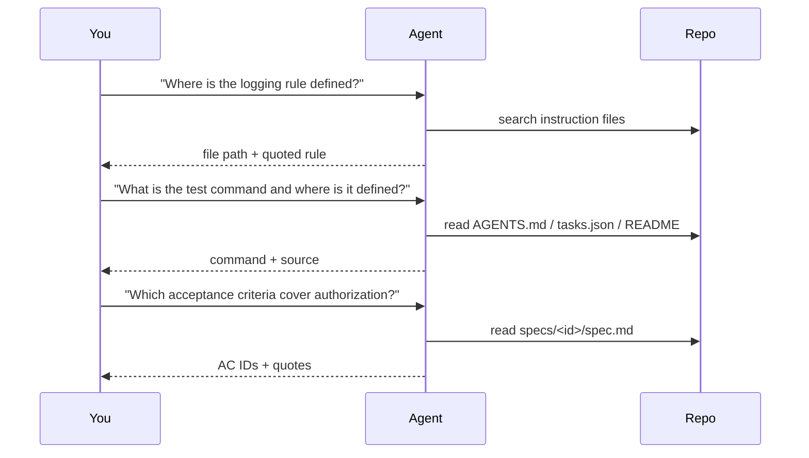

| Answer looks like | Verdict |
| --- | --- |
| Quotes the rule and names the file | ✅ Configured |
| Gives a generic best practice | ❌ Rules not loaded |
| Invents a path that does not exist | ❌ Wrong root, or no instruction file |
| Says "no rules found" | ❌ File missing or IDE opened a subfolder |

---

## 11. Everyday workflow inside the IDE

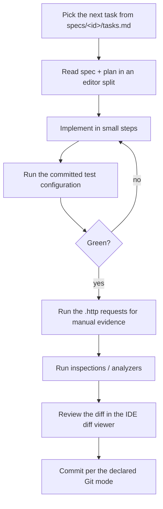

| IDE | Where the artifacts should be visible |
| --- | --- |
| VS Code | Explorer pinned to `specs/`, tasks from `.vscode/tasks.json`, diff view |
| IntelliJ IDEA | `specs/` as a directory, shared run config, HTTP client, local history for recovery |
| Visual Studio | Solution items pointing at `specs/`, Test Explorer, `.http` files |

> **Local history is not a backup.** IntelliJ's Local History and VS Code's timeline can recover
> accidental edits, but they are not a substitute for commits the team can review.

---

## 12. Troubleshooting

| Symptom | Likely cause | Fix |
| --- | --- | --- |
| Agent ignores rules | IDE opened a subfolder | Open the repository root |
| Visual Studio ignores `AGENTS.md` | Not supported there | Use `.github/copilot-instructions.md` |
| Rules apply everywhere instead of one path | Wrong `applyTo` glob | Test the glob against real paths |
| Copilot shows inactive | Not signed in / no subscription | Sign in with a Copilot-enabled account |
| Claude Code: "Cannot launch Claude Code" | `claude` not on `PATH` | Set the full path in the plugin's Claude command setting |
| Run configuration missing for a teammate | Not stored as project file | Enable **Store as project file**, commit it |
| `.idea/` changes keep appearing in diffs | Ignore rules wrong | `/.idea/*` + `!/.idea/runConfigurations/` |
| HTTP request fails only in IDE | Environment not selected | Choose the environment in the `.http` editor |
| Secrets in committed env file | Private env file not used | Move to `http-client.private.env.json`, rotate the secret |
| Analyzer results differ from CI | Different SDK/analyzer level | Pin SDK, share `Directory.Build.props` |
| Agent edits `.github/**` rules | Customizations editor is writable | Review those files like code; restrict who can merge |

---

## 13. Security considerations

| Risk | Control |
| --- | --- |
| IDE settings exfiltrating tokens | Never commit tokens in `settings.json`, `http-client.env.json`, `launchSettings.json` |
| `.idea/`, `.vs/` committed with secrets | Ignore directories; scan before pushing |
| MCP server with write access | Grant per role; prefer read-only for review |
| Agent rewriting instruction files | Review `.github/**` changes; protect with CODEOWNERS |
| Workspace trust prompt ignored | Only open trusted repositories |
| Extensions from unofficial publishers | Verify publisher and reviews |
| Local history recovery mistaken for audit | Use Git commits and review reports |

---

## 14. Official references

- Copilot custom instructions support by environment — <https://docs.github.com/en/copilot/reference/custom-instructions-support>
- Add repository custom instructions — <https://docs.github.com/en/copilot/how-tos/configure-custom-instructions/add-repository-instructions>
- VS Code: custom instructions — <https://code.visualstudio.com/docs/copilot/customization/custom-instructions>
- VS Code: agent skills — <https://code.visualstudio.com/docs/copilot/customization/agent-skills>
- VS Code: custom agents — <https://code.visualstudio.com/docs/copilot/customization/custom-agents>
- Visual Studio: manage Copilot installation and state — <https://learn.microsoft.com/en-us/visualstudio/ide/visual-studio-github-copilot-install-and-states>
- Visual Studio: `.http` files (17.8+) — <https://learn.microsoft.com/en-us/aspnet/core/test/http-files>
- IntelliJ IDEA: run/debug configurations and sharing — <https://www.jetbrains.com/help/idea/run-debug-configuration.html>
- IntelliJ IDEA: HTTP client — <https://www.jetbrains.com/help/idea/http-client-in-product-code-editor.html>
- JetBrains AI Assistant — <https://www.jetbrains.com/help/idea/ai-assistant.html>
- Claude Code in JetBrains IDEs — <https://docs.claude.com/en/docs/claude-code/jetbrains>
- JetBrains Marketplace: GitHub Copilot — <https://plugins.jetbrains.com/plugin/17718-github-copilot>

---

**Previous:** [28 — Glossary](./28-glossary.md) ·
**Next:** [30 — End-to-end walkthrough](./30-end-to-end-walkthrough.md)
