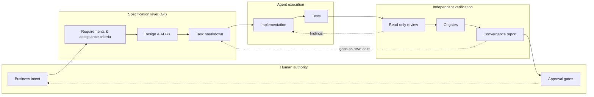
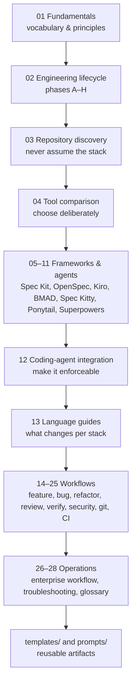
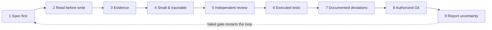
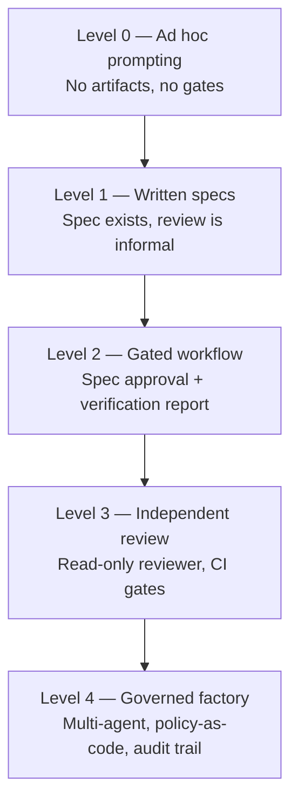
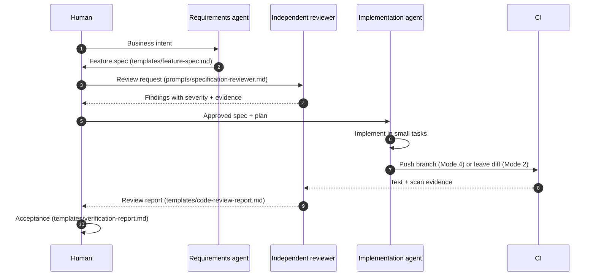

# Spec-Driven Development Engineering Playbook

A production-oriented handbook for running software delivery with AI coding agents under
specification control: specifications first, evidence-based implementation, independent
review, and verifiable acceptance.

> **Scope.** This handbook is technology-independent where the process is genuinely
> technology-independent, and language-specific where it is not. Verified tool behavior is
> labeled with the version and research date. Anything illustrative is labeled as such.

---

## 1. What this handbook is

It is **not** a list of prompts. It is an operating system for engineering work:

- **Specification as the contract** between humans and agents.
- **Artifacts as the source of truth**, stored in Git next to the code.
- **Independent verification** before anything is declared complete.
- **Explicit evidence** for every claim an agent makes.

---

## 2. Learning path

Read in this order if you are adopting the practice, or jump to a chapter if you already
know the model. Each chapter is self-contained but assumes the vocabulary defined in
[Fundamentals](./01-fundamentals.md).

### Reading tracks

| Track | Chapters | Time |
| --- | --- | --- |
| **Decision maker** — pick a framework, set policy | 01, 02, 04, 22, 26 | ~2 h |
| **Engineer adopting SDD** — full loop on a real feature | 01–04, 12, 14, 20 | ~4 h |
| **Platform / DevOps** — gates, CI, enforcement | 02, 12, 20, 22, 24, 25 | ~3 h |
| **Reviewer** — read-only review and evidence | 17–21, 23 | ~2.5 h |
| **Language specialist** — pick your guide | 01, 02, 13 + your language file | ~2 h |

---

## 3. Chapter index

### Foundations

| Chapter | Purpose |
| --- | --- |
| [01 Fundamentals](./01-fundamentals.md) | Definitions, artifact model, why specifications beat prompts |
| [02 Engineering lifecycle](./02-engineering-lifecycle.md) | Phases A–H from discovery to final acceptance |
| [03 Repository discovery](./03-repository-discovery.md) | How an agent establishes ground truth before changing anything |
| [04 Tool comparison](./04-tool-comparison.md) | Verified comparison of SDD frameworks and quality tooling |

### SDD frameworks and agent methodologies

| Chapter | Tool | Verified version |
| --- | --- | --- |
| [05 GitHub Spec Kit](./05-github-spec-kit.md) | [github/spec-kit](https://github.com/github/spec-kit) | v1.2.5 |
| [06 OpenSpec](./06-openspec.md) | [Fission-AI/OpenSpec](https://github.com/Fission-AI/OpenSpec) | v1.16.0 |
| [07 AWS Kiro](./07-aws-kiro.md) | [kiro.dev](https://kiro.dev) | docs checked 2026-11-02 |
| [08 BMAD Method](./08-bmad-method.md) | [bmad-code-org/BMAD-METHOD](https://github.com/bmad-code-org/BMAD-METHOD) | v6.12.4 stable / v7 alpha |
| [09 Spec Kitty](./09-spec-kitty.md) | [spec-kitty/spec-kitty](https://github.com/spec-kitty/spec-kitty) | CLI 3.2.7 |
| [10 Ponytail](./10-ponytail.md) | [DietrichGebert/ponytail](https://github.com/DietrichGebert/ponytail) | v5.3.3 |
| [11 Superpowers](./11-superpowers.md) | [obra/superpowers](https://github.com/obra/superpowers) | v7.0.1 |
| [12 Coding-agent integration](./12-coding-agent-integration.md) | Copilot, Claude Code, Codex, Cursor, Gemini | docs checked 2026-11-02 |

### Language guides

[Java](./language-guides/java.md) ·
[Python](./language-guides/python.md) ·
[.NET / C#](./language-guides/dotnet-csharp.md) ·
[JavaScript / TypeScript](./language-guides/javascript-typescript.md) ·
[Go](./language-guides/go.md) ·
[Rust](./language-guides/rust.md) ·
[Kotlin](./language-guides/kotlin.md) ·
[PHP](./language-guides/php.md) ·
[SQL](./language-guides/sql.md) ·
[Infrastructure as Code](./language-guides/infrastructure-as-code.md)

### Workflows

| Chapter | Purpose |
| --- | --- |
| [14 Feature development](./14-feature-development.md) | End-to-end feature delivery under a spec |
| [15 Bug fixing](./15-bug-fixing.md) | Root-cause-first bug workflow, including production incidents |
| [16 Refactoring and modernization](./16-refactoring.md) | Behavior-preserving change with characterization tests |
| [17 Review without implementation](./17-specification-review.md) | Read-only review hub: requirements, spec, DB, API, performance, test, docs |
| [18 Architecture review](./18-architecture-review.md) | Boundary, data, security, operability review with ADRs |
| [19 Read-only code review](./19-read-only-code-review.md) | Independent diff review with enforced read-only behavior |
| [20 Testing and verification](./20-testing-and-verification.md) | Evidence-based test strategy and reporting |
| [21 Security review](./21-security-review.md) | Threat-informed review and dependency/secret scanning |
| [22 Git and commit policy](./22-git-and-commit-policy.md) | Four operating modes, Conventional Commits, revert procedure |
| [23 Hallucination prevention](./23-hallucination-prevention.md) | Evidence rules, uncertainty handling, evidence ledger |
| [24 Multi-agent engineering](./24-multi-agent-engineering.md) | Role architecture, context isolation, human gates |
| [25 CI/CD integration](./25-ci-cd-integration.md) | Gate design, pipeline examples, spec-drift detection |
| [26 Enterprise reference workflow](./26-enterprise-reference-workflow.md) | Regulated, multi-team, brownfield adoption |
| [27 Troubleshooting](./27-troubleshooting.md) | Symptom → cause → fix for adoption problems |
| [28 Glossary](./28-glossary.md) | Canonical vocabulary used across all chapters |

### Reusable assets

- [`templates/`](./templates/) — feature spec, bug report, ADR, review reports, evidence ledger, PR template, agent role definition.
- [`prompts/`](./prompts/) — copy-paste prompts for each agent role, all carrying the evidence rules.
- [`examples/`](./examples/) — configuration examples, clearly separated from live configuration.
- [`tools/validate_docs.py`](./tools/validate_docs.py) — dependency-free validator for links, code fences, YAML/JSON examples, and Mermaid structure.
- [`tools/check_mermaid.mjs`](./tools/check_mermaid.mjs) — optional real Mermaid parser check (Node + `mermaid` + `jsdom`, installed outside the repo).
- [`tools/README.md`](./tools/README.md) — what each check proves and what it cannot.

---

## 4. The nine rules that make everything else work

These are normative. Every other chapter elaborates on them; none of them overrides them.

1. **No specification, no implementation.** An approved spec exists before production code changes.
2. **Read before write.** The agent inspects the real repository before proposing a change.
3. **Evidence over confidence.** Every claim is marked `VERIFIED`, `PARTIALLY VERIFIED`, `UNVERIFIED`, or `CONTRADICTED`.
4. **Small and traceable.** Every change maps to a requirement or a reported defect.
5. **Review is independent and read-only.** The implementer does not approve its own work.
6. **Tests are evidence only when executed.** Never report a test as passed without a result.
7. **Deviations are documented, never silent.** Architecture changes require a decision record.
8. **Git operations require authorization.** Modes are declared explicitly (see [chapter 22](./22-git-and-commit-policy.md)).
9. **Uncertainty is reported, not filled.** "I don't know yet" is an acceptable, useful answer.

---

## 5. Maturity model

Use this to decide where to start. Do not jump to Level 4 because it sounds better; each
level depends on the one below it.

| Level | Characteristics | Exit criteria to next level |
| --- | --- | --- |
| 0 | Work starts from chat prompts; requirements live in people's heads | A spec template is used for one real feature |
| 1 | Specs written and stored; implementation still loosely checked | Acceptance criteria are testable and reviewed before coding |
| 2 | Spec review gate + verification report; one agent | Independent reviewer runs on every change |
| 3 | Reviewer is a separate context with read-only access; CI enforces checks | Multiple roles, policy encoded in CI, audit trail |
| 4 | Role-based agents, worktrees, convergence reports, release gates | Continuous improvement; no fixed exit |

---

## 6. Verified sources and research date

All version claims in this handbook were checked on **2026-11-02** against the primary
sources listed in each chapter. Where a command could not be verified, the text says so
explicitly and marks the example as illustrative.

| Tool | Version verified | Primary source |
| --- | --- | --- |
| GitHub Spec Kit | `specify-cli` 1.2.5 (release 2026-10-28) | [github.com/github/spec-kit](https://github.com/github/spec-kit), [docs](https://github.github.io/spec-kit/) |
| OpenSpec | 1.16.0 (release 2026-10-30) | [openspec.dev/docs](https://openspec.dev/docs), [repo](https://github.com/Fission-AI/OpenSpec) |
| AWS Kiro | product docs (no public semver for IDE) | [kiro.dev/docs](https://kiro.dev/docs/) |
| BMAD Method | 6.12.4 stable; v7 preview alpha | [repo](https://github.com/bmad-code-org/BMAD-METHOD) |
| Spec Kitty | `spec-kitty-cli` 3.2.7 (4.0.0rc2 prerelease) | [PyPI](https://pypi.org/project/spec-kitty-cli/), [repo](https://github.com/spec-kitty/spec-kitty) |
| Ponytail | v5.3.3 (2026-10-29) | [repo](https://github.com/DietrichGebert/ponytail) |
| Superpowers | v7.0.1 (2026-10-21) | [repo](https://github.com/obra/superpowers) |

> **Version drift warning.** AI tooling releases frequently. Treat every version number as
> a snapshot, re-verify before installing, and never copy a command from this handbook
> without checking it against the installed version's `--help` output.

---

## 7. How to use the reusable assets

---

## 8. Validation status

Checks actually executed on **2026-11-02** against this working tree. Re-run them after any edit.

| Check | Command | Result |
| --- | --- | --- |
| Links, anchors, fences, table columns, JSON, YAML, Mermaid structure | `python3 docs/sdd/tools/validate_docs.py` | 0 errors, 0 warnings |
| YAML full parse (PyYAML 6.0.3) | same command inside a venv with `pyyaml` | 0 errors |
| Mermaid parse (mermaid 11.17.2 via jsdom) | `node docs/sdd/tools/check_mermaid.mjs docs/sdd <modules>` | 294/294 parsed (295 including the root README) |
| JSON examples | included in `validate_docs.py` | 4/4 parsed |

**Known limitations of this validation:**

- External URLs were **not** fetched. Link targets inside this repository were checked; external
  links were verified manually during research (see [chapter 04](./04-tool-comparison.md)).
- Diagram **rendering** (layout, overflow, theme) was not visually inspected; only parser
  acceptance was verified.
- Tool commands were verified against official documentation, not executed against a target
  project, because this repository contains no application code.
- Version claims are snapshots. They will drift.

---

## 9. Contributing to this handbook

- Follow the structure of the chapter you are editing: purpose, when to use, body, verification, references.
- Every diagram must be valid Mermaid; run `python3 docs/sdd/tools/validate_docs.py` before proposing a change.
- Never add a command you have not run or verified against official documentation. If it is illustrative, label it.
- Update the version table in this file when you re-verify a tool.

---

## License

Content in this repository is licensed under the terms in [LICENSE](../../LICENSE).
Third-party tool names and documentation remain the property of their respective owners;
links are provided for reference, not redistribution.
