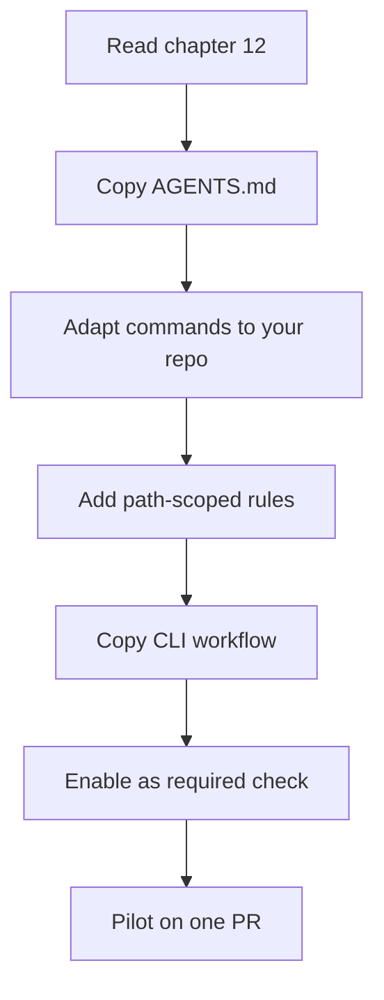

# Examples

Configuration examples that are **not active** in this repository. They exist so adopters can copy
and adapt them.

> **These are not installed.** Nothing in this directory affects the repository's behavior.
> Installing a framework is a separate, reviewed decision (see [chapter 04](../04-tool-comparison.md)).

| Example | Purpose |
| --- | --- |
| [`agents/AGENTS.md`](./agents/AGENTS.md) | Canonical cross-agent instruction file |
| [`agents/copilot-instructions.md`](./agents/copilot-instructions.md) | VS Code Copilot always-on rules |
| [`agents/instructions-tests.instructions.md`](./agents/instructions-tests.instructions.md) | Path-scoped Copilot instruction |
| [`agents/SKILL.md`](./agents/SKILL.md) | Review skill definition |
| [`ci/verify.yml`](./ci/verify.yml) | Minimal PR verification workflow |
| [`ci/CODEOWNERS`](./ci/CODEOWNERS) | Review routing |
| [`ci/pull_request_template.md`](./ci/pull_request_template.md) | PR template |
| [`tools/check_spec_traceability.py`](./tools/check_spec_traceability.py) | AC coverage check |

## Adoption checklist

- [ ] Replace every `<placeholder>`
- [ ] Verify commands by running them
- [ ] Remove rules that do not apply
- [ ] Review with the team before enabling branch protection
- [ ] Pilot on a non-critical PR

---

**Back to index:** [README](../README.md)
