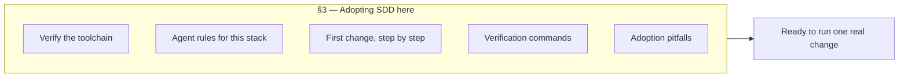
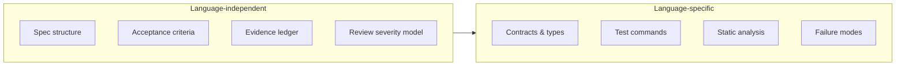

# Language Guides

The SDD **process** is language-independent. What changes per language is:

1. How you express requirements (contracts, types, migrations)
2. Which commands produce evidence
3. Which static analysis is mandatory
4. Which failure modes matter (concurrency, nullability, memory, transactions)

Every guide answers the same eight questions, and adds a stack-specific adoption walkthrough:

| # | Question | Section |
| --- | --- | --- |
| 1 | How do I install and verify this stack for SDD? | 3 |
| 2 | How should requirements be written? | 4 |
| 3 | How should the technical plan be created? | 5 |
| 4 | How should tasks be divided? | 6 |
| 5 | How should tests be specified? | 7 |
| 6 | How should the agent inspect existing code? | 8 |
| 7 | How should code review be performed? | 9 |
| 8 | Which static analysis tools are mandatory? | 10 |
| 9 | How should CI verify compliance? | 11 |

> Section numbers are stable per guide, except Python where the data/ML section is inserted after
> CI verification. Use the headings, not the numbers, when linking.

## What each guide gives you for adoption

## Verified runtime snapshot (2026-11-02)

Source: `endoflife.date` API for each product. Re-check before planning upgrades.

| Runtime | Current | Supported LTS lines | Note |
| --- | --- | --- | --- |
| **Java** (Temurin) | 27.0.x (non-LTS) | 25, 21, 17, 11, 8 | 25 is the newest LTS |
| **.NET** | 10.0.x | 10, 8 | .NET 8 EOL 2026-11-10 |
| **Python** | 3.15.2 | 3.15, 3.14, 3.13, 3.12, 3.11 | 3.10 EOL 2026-10-01 |
| **Node.js** | 26.13 | 26, 24, 22 | 20 EOL 2026-04-30 |
| **Go** | 1.27.x | 1.27, 1.26 | Two latest minors supported |
| **Rust** | 1.99.x | rolling | Six-week release train |
| **Kotlin** | 2.4.x | rolling | Align with Gradle/AGP |
| **PHP** | 8.5.x | 8.5, 8.4, 8.3 | 8.2 EOL 2026-12-31 |

> **Library versions are not listed here on purpose.** They change weekly. Read the lockfile of
> the repository you are working in — see [Repository discovery](../03-repository-discovery.md).

## Guides

| Guide | Focus |
| --- | --- |
| [Java](./java.md) | Maven/Gradle, Spring, JPA, Kafka, Testcontainers |
| [Python](./python.md) | uv/Poetry, FastAPI/Django/Flask, Pydantic, pytest, mypy/Pyright |
| [.NET / C#](./dotnet-csharp.md) | ASP.NET Core, EF Core, xUnit, nullable reference types, analyzers |
| [JavaScript / TypeScript](./javascript-typescript.md) | Node, pnpm, React/Next/Nest, Vitest/Jest, Playwright |
| [Go](./go.md) | Modules, errors, concurrency, table tests |
| [Rust](./rust.md) | Cargo, ownership, error handling, async |
| [Kotlin](./kotlin.md) | Coroutines, Gradle KTS, Spring/Ktor, detekt |
| [PHP](./php.md) | Composer, PSR standards, PHPUnit, static analysis |
| [SQL](./sql.md) | Migrations, backward compatibility, query plans |
| [Infrastructure as Code](./infrastructure-as-code.md) | Terraform, Ansible, Kubernetes |

---

**Previous:** [12 — Coding-agent integration](../12-coding-agent-integration.md) ·
**Next:** [Java](./java.md)
