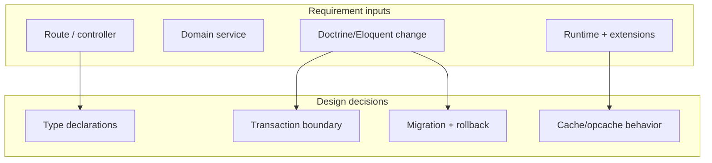
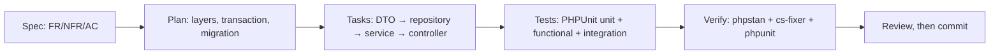
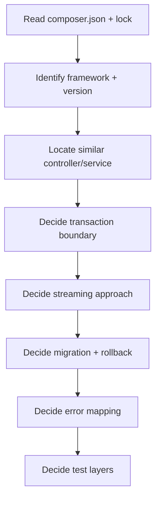
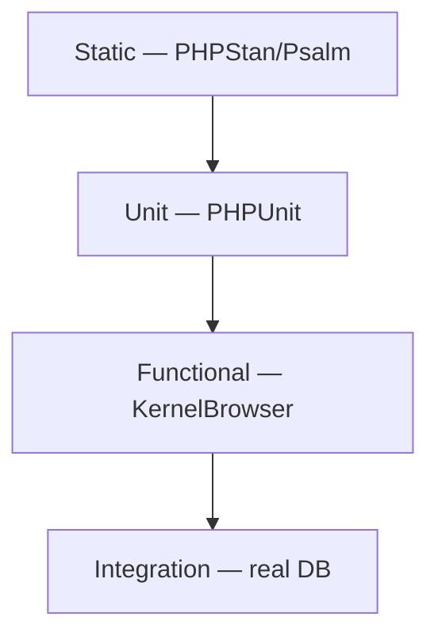
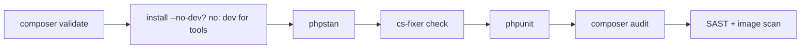

# PHP — SDD Guide

> Version data verified 2026-11-02 (`endoflife.date`): PHP **8.5.x** was current; 8.5, 8.4 and
> 8.3 are supported. PHP 8.2 reaches end of life on 2026-12-31.

---

## 1. Scope

Composer, PSR standards, framework-agnostic design (Symfony/Laravel), PHPUnit, static analysis,
and deployment constraints.



---

## 2. Runtime contract

| Requirement | Must state |
| --- | --- |
| PHP version | `composer.json` `require.php` |
| Extensions | Required `ext-*` packages |
| Composer | Locked (`composer.lock` committed) |
| Autoloading | PSR-4 mapping |
| Platform | `config.platform.php` if deployments differ from dev |

```json
{
  "require": {
    "php": ">=8.3 <8.6",
    "ext-pdo": "*",
    "ext-mbstring": "*"
  },
  "config": {
    "platform": { "php": "8.3.0" },
    "sort-packages": true
  }
}
```

> `config.platform.php` is a contract, not a convenience: it makes dependency resolution match
> the production runtime even when developers run a newer PHP locally.

---

## 3. Adopting SDD in a PHP project

### 3.1 Verify the toolchain

```bash
php --version
composer validate --strict
composer install --no-interaction
vendor/bin/phpunit --version
```

Check `config.platform.php` in `composer.json`. If it is missing, the agent resolves dependencies
against the local PHP while production runs an older one.

### 3.2 Add the agent rules

`AGENTS.md` (plus `.github/copilot-instructions.md` for Visual Studio and JetBrains — see
[chapter 29](../29-ide-setup.md)):

```markdown
## PHP rules
- `declare(strict_types=1);` in every file.
- Native parameter and return types on all new methods; no array soup for domain data.
- Parameterized queries only; never interpolate into SQL.
- No `unserialize()` on user-controlled input.
- Authorization on every new route (is_granted / policy), enforced server-side.
- Every migration implements `down()`.
```

### 3.3 Your first SDD change



### 3.4 Verification commands

| Check | Command |
| --- | --- |
| Composer metadata and lockfile | `composer validate --strict` |
| Static analysis | `vendor/bin/phpstan analyse` |
| Style | `vendor/bin/php-cs-fixer check --diff` |
| Tests | `vendor/bin/phpunit` |
| Advisories | `composer audit` |

### 3.5 Adoption pitfalls

| Pitfall | Fix |
| --- | --- |
| Missing `declare(strict_types=1)` | Add to the review checklist |
| `composer update` in CI | `composer install` from the lockfile only |
| Unbounded `fetchAllAssociative` | Stream with generators; specify memory limits |
| Untested `down()` migration | Definition of done requires it |

---

## 4. Writing requirements

| Universal requirement | PHP addition |
| --- | --- |
| Functional behavior | Route, controller/action, middleware |
| Acceptance criteria | HTTP status/body, DB state, domain event |
| NFRs | p95 latency, memory limit, opcache settings |
| Failure scenarios | Exception → status mapping, transaction rollback |
| Compatibility | PHP version, framework major, public API |

```markdown
### FR-4: CSV export (Symfony)

**Acceptance criteria**
- AC-4.1 `GET /projects/{id}/orders/export` returns `200` with `text/csv`.
- AC-4.2 A user without `ROLE_VIEWER` on the project receives `403` and no CSV bytes.
- AC-4.3 Streaming uses a generator; peak memory stays below the 128 MB `memory_limit`
  for 100k rows.
- AC-4.4 Declared types on all new methods (`declare(strict_types=1)`).

**Non-goals**
- Excel export; queue-based export.

**Constraints**
- PHP 8.3+, Symfony 7.x line already in use.
- No new Composer package.
- Reuse `OrderRepository::visibleTo()`.
```

### Strictness rules

| Rule | Why |
| --- | --- |
| `declare(strict_types=1);` in every file | Weak mode silently coerces types |
| Native return types on all functions | Static analysis needs them |
| No `@` error suppression | Hides real failures |
| No dynamic properties | Deprecated; use explicit classes |
| Typed properties, not arrays for domain data | Prevents "array soup" |

---

## 5. Technical plan



### Plan additions

```markdown
## Layers
| Layer | Namespace | Responsibility |
| --- | --- | --- |
| Http | `App\Controller` | Request/response |
| Domain | `App\Orders` | Rules, policies |
| Persistence | `App\Repository` | Query, streaming |

## Error mapping
| Exception | Status |
| --- | --- |
| `AccessDeniedException` | 403 |
| `NotFoundHttpException` | 404 |
| `Throwable` (unexpected) | 500, logged with correlation ID |

## Streaming
`StreamedResponse` with a generator; `ob_end_flush()` not required if output buffering is off.

## Migration
Doctrine migration `Version20261102`; `down()` drops the index.

## Tests
- Unit: CSV formatter
- Functional: `KernelBrowser` per role
- Integration: real DB via Testcontainers or a test database
```

---

## 6. Task division

| Task | Files | Parallelizable |
| --- | --- | --- |
| DTOs + validation | `src/Dto` | Yes |
| Repository query | `src/Repository` | Yes |
| CSV generator + tests | `src/Orders` | Yes |
| Controller + security | `src/Controller` | After service |
| Migration | `migrations/` | No |
| Functional tests | `tests/Functional` | After controller |

**Definition of done:**

- [ ] `composer validate --strict` passes
- [ ] `vendor/bin/phpstan analyse` passes at the configured level
- [ ] `vendor/bin/php-cs-fixer check` passes
- [ ] `vendor/bin/phpunit` passes
- [ ] `declare(strict_types=1)` present
- [ ] `down()` implemented for the migration

---

## 7. Specifying tests



```php
final class ExportControllerTest extends WebTestCase
{
    public function testForbiddenReturnsNoCsvBytes(): void
    {
        $client = static::createClient();
        $client->loginUser($this->userWithoutRole());

        $client->request('GET', '/projects/other/orders/export');

        self::assertResponseStatusCodeSame(403);
        self::assertSame('', $client->getResponse()->getContent());
    }

    public function testHeaderPresentForEmptyResult(): void
    {
        $csv = (new CsvExporter())->export([]);
        self::assertStringStartsWith("id,created_at,amount_cents\n", $csv);
    }
}
```

| Requirement type | Minimum evidence |
| --- | --- |
| Controller/auth | Functional test per role |
| Query | Integration test on the real DB |
| Streaming | Test asserting generator behavior / memory |
| Migration | `doctrine:migrations:migrate` then `execute --down` |
| Input validation | Test for each invalid field |

---

## 8. How the agent inspects existing code

```bash
cat composer.json
composer show --direct 2>/dev/null | head -30

grep -rn --include='*.php' 'Route(\|#\[Route' src | head -20
grep -rn --include='*.php' 'AccessDenied\|isGranted\|denyAccessUnlessGranted' src | head -20
grep -rn --include='*.php' 'StreamedResponse\|yield ' src | head -20
ls migrations 2>/dev/null | tail -5
```

Checklist:

- [ ] PHP constraint and platform config read
- [ ] Framework and major version identified
- [ ] Composer packages (lock) resolved
- [ ] Security configuration located
- [ ] Migration tooling and latest version identified
- [ ] Static analysis level read from config

---

## 9. Code review focus

| Area | Question |
| --- | --- |
| Types | Native types on new methods? `mixed` overused? |
| Strictness | `declare(strict_types=1)` present? |
| Security | Raw SQL? `eval`? Unserialize of user data? |
| Escaping | Output escaped in templates? `\|raw` justified? |
| Transactions | Writes wrapped? Nested transactions handled? |
| Mass assignment | DTOs used, not raw request arrays? |
| Streams | Output buffering interfering? |
| Errors | Exceptions logged with context? |

**High-severity PHP findings:**

- `unserialize()` on user-controlled input.
- SQL built with string interpolation.
- Missing `declare(strict_types=1)` combined with type juggling in security checks.
- `is_granted` omitted on a new route.
- `eval`/`assert` with dynamic strings.

---

## 10. Static analysis and tooling

| Tool | Purpose | Invocation |
| --- | --- | --- |
| **PHPUnit** | Tests | `vendor/bin/phpunit` |
| **PHPStan** | Static analysis | `vendor/bin/phpstan analyse` |
| **Psalm** | Alternative static analysis | `vendor/bin/psalm` |
| **PHP-CS-Fixer** | Style | `vendor/bin/php-cs-fixer check` |
| **PHP_CodeSniffer** | PSR-12 checks | `vendor/bin/phpcs` |
| **Rector** | Automated refactoring | `vendor/bin/rector --dry-run` |
| **Composer audit** | Dependency advisories | `composer audit` |
| **Trivy / Semgrep** | FS/SAST | CI |

```bash
composer validate --strict
composer install --no-interaction --prefer-dist
vendor/bin/phpstan analyse
vendor/bin/php-cs-fixer check --diff
vendor/bin/phpunit
composer audit
```

---

## 11. CI verification



```yaml
# .github/workflows/php-ci.yml (illustrative)
name: php-ci
on: [push, pull_request]
jobs:
  verify:
    runs-on: ubuntu-latest
    steps:
      - uses: actions/checkout@v4
      - uses: shivammathur/setup-php@v2
        with: { php-version: '8.3', tools: composer, coverage: none }
      - run: composer validate --strict
      - run: composer install --no-interaction --prefer-dist
      - run: vendor/bin/phpstan analyse
      - run: vendor/bin/php-cs-fixer check --diff
      - run: vendor/bin/phpunit
      - run: composer audit
```

| Gate | Fails when |
| --- | --- |
| `composer validate --strict` | Lockfile out of sync or invalid metadata |
| PHPStan | Error at configured level |
| CS-Fixer | Style drift |
| PHPUnit | Failure |
| `composer audit` | Known vulnerability |

---

## 12. Common mistakes

| Mistake | Consequence | Fix |
| --- | --- | --- |
| Missing `declare(strict_types=1)` | Silent coercion | Add to every file |
| `composer update` in CI | Non-reproducible | `composer install` from lock |
| No `config.platform.php` | Deps require newer PHP than prod | Set platform |
| Arrays for domain data | Runtime type errors | DTOs/readonly classes |
| `@` suppression | Hidden failures | Handle the error |
| Unbounded `fetchAllAssociative` | Memory exhaustion | Iterate the result |
| `unserialize` on input | RCE gadget chains | Use JSON + explicit mapping |
| Skipping `down()` | Irreversible migration | Implement and test it |

---

## 13. Troubleshooting

| Symptom | Cause | Action |
| --- | --- | --- |
| `Class not found` | Autoload cache | `composer dump-autoload` |
| PHPStan "cannot resolve" | Missing stubs | Install `phpstan/phpstan-*` or add a stub |
| CS-Fixer rewrites generated files | No exclude list | Add `.php-cs-fixer.dist.php` excludes |
| Functional test hits real DB | Missing test config | Use a dedicated test database |
| Opcache serves old code | Timestamp validation off | Restart FPM or enable `validate_timestamps` |
| Memory limit on export | Buffering entire result | Stream with generators |

---

## 14. Security considerations

| Risk | Control |
| --- | --- |
| SQL injection | Prepared statements; no interpolation |
| XSS | Context-aware escaping; audit `\|raw` |
| Deserialization | No `unserialize` on user data |
| File upload | Validate MIME + extension; store outside webroot |
| Session fixation | Regenerate ID on login |
| Secrets | Env vars; never in `composer.json` |
| Dependency advisories | `composer audit` in CI |
| Debug mode | `APP_DEBUG=false` in production |

---

## 15. Official references

- PHP releases — <https://www.php.net/supported-versions.php>
- PHP manual — <https://www.php.net/manual/en/>
- Composer — <https://getcomposer.org/doc/>
- PSR standards — <https://www.php-fig.org/psr/>
- Symfony — <https://symfony.com/doc/current/index.html>
- Laravel — <https://laravel.com/docs>
- Doctrine ORM — <https://www.doctrine-project.org/projects/orm.html>
- Doctrine migrations — <https://www.doctrine-project.org/projects/migrations.html>
- PHPUnit — <https://docs.phpunit.de/>
- PHPStan — <https://phpstan.org/user-guide/getting-started>
- Psalm — <https://psalm.dev/docs/>
- PHP-CS-Fixer — <https://cs.symfony.com/>
- Rector — <https://getrector.com/documentation>
- PHP_CodeSniffer — <https://github.com/PHPCSStandards/PHP_CodeSniffer>

---

**Previous:** [Kotlin](./kotlin.md) ·
**Next:** [SQL](./sql.md)
