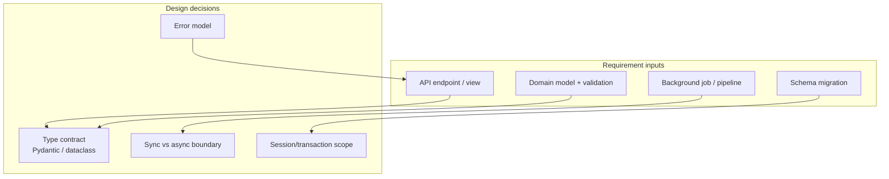
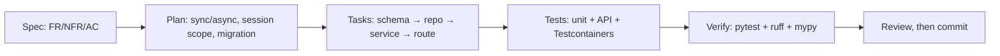
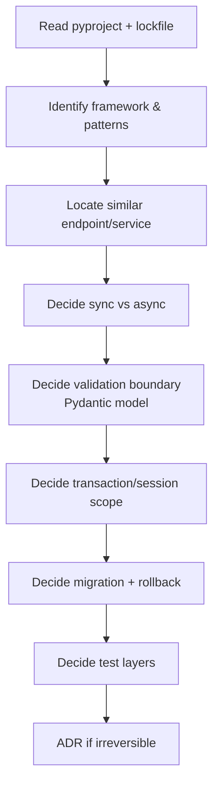
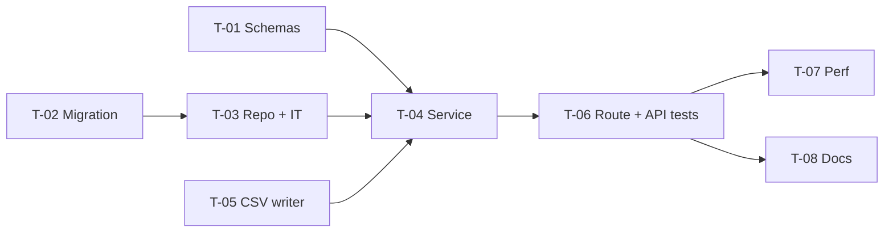
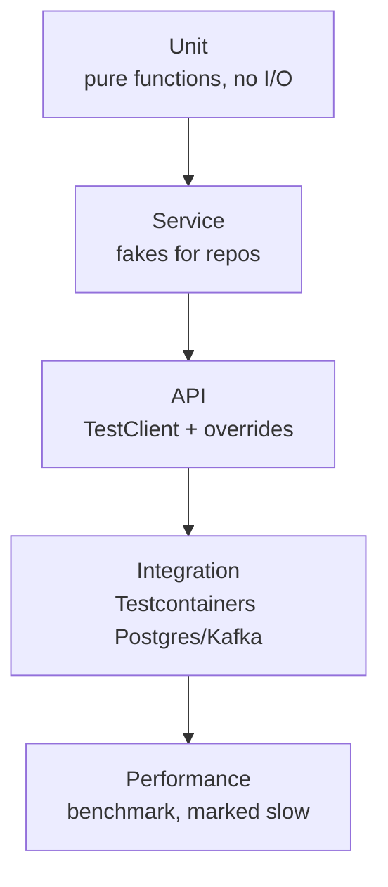
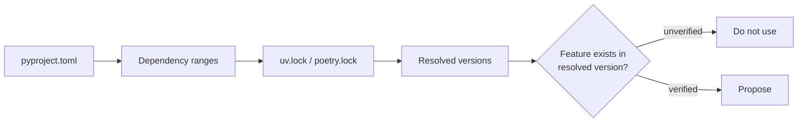
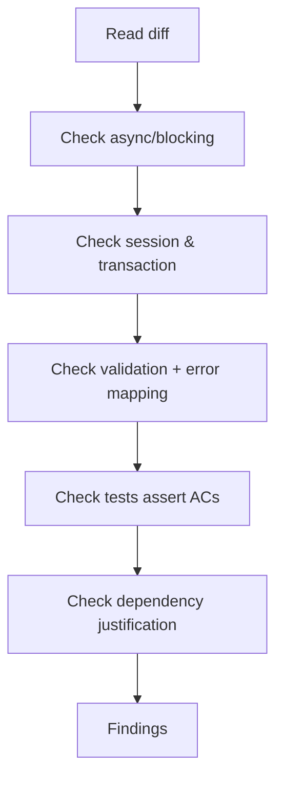
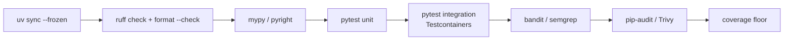
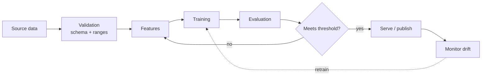

# Python — SDD Guide

> Runtime data verified 2026-11-02 (`endoflife.date`). Python 3.10 reached end of life on
> 2026-10-01; 3.11–3.15 are supported at the time of writing.

---

## 1. Scope

Python 3.11–3.15, `uv`/pip/Poetry, FastAPI/Django/Flask, Pydantic, pytest, mypy/Pyright,
Ruff, dependency management, async programming, data processing and ML projects.



---

## 2. Runtime and packaging contract

| Requirement | Must state |
| --- | --- |
| Python version | e.g. `requires-python = ">=3.12,<3.16"` |
| Package manager | `uv`, Poetry, or pip+requirements |
| Lockfile | Committed (`uv.lock`, `poetry.lock`) |
| Environment | venv managed by the tool, not ad hoc |
| Type-checking mode | strictness level per package |

```toml
# pyproject.toml (illustrative but standard)
[project]
name = "orders-api"
requires-python = ">=3.12,<3.16"
dependencies = ["fastapi>=0.115", "pydantic>=2.8", "sqlalchemy>=2.0"]

[dependency-groups]
dev = ["pytest>=8", "pytest-cov", "ruff", "mypy", "httpx"]

[tool.ruff]
line-length = 100
target-version = "py312"

[tool.mypy]
strict = true
```

> **Version-range trap:** `fastapi>=0.100` tells the agent nothing about the installed API.
> Always read `uv.lock` / `poetry.lock` for the resolved version before using a feature.

---

## 3. Adopting SDD in a Python project

### 3.1 Verify the toolchain

```bash
uv --version                 # or poetry --version / python -m pip --version
uv sync --frozen --all-groups  # fails if the lockfile is out of date (good)
uv run pytest -q
```

Pin `requires-python` in `pyproject.toml` before the first agent task. An unpinned interpreter lets
the agent use syntax the deployment runtime does not support.

### 3.2 Add the agent rules

`AGENTS.md` at the repository root (plus `.github/copilot-instructions.md` for Visual Studio and
JetBrains — see [chapter 29](../29-ide-setup.md)):

```markdown
## Python rules
- Resolve versions from uv.lock / poetry.lock, not from the range in pyproject.toml.
- No blocking I/O inside `async def`; use an async driver or run in a thread.
- Every endpoint change needs a TestClient/httpx test asserting status and body.
- Every query change needs an integration test against the real database.
- New dependencies require justification; prefer the standard library.
- Type annotations on public functions; mypy/pyright must pass at the configured level.
```

### 3.3 Your first SDD change



1. Spec first, including the async contract and error model.
2. Plan: session/transaction scope and the Alembic revision.
3. Implement test-first; keep pure logic in testable modules, not notebooks.
4. Record evidence, then a read-only review.

### 3.4 Verification commands

| Check | Command |
| --- | --- |
| Tests | `uv run pytest -q` |
| Lint and format | `uv run ruff check .` / `uv run ruff format --check .` |
| Types | `uv run mypy src` or `uv run pyright` |
| Security lint | `uv run bandit -r src -q` |
| Dependencies | `uv run pip-audit` |

### 3.5 Adoption pitfalls

| Pitfall | Fix |
| --- | --- |
| Agent edits `pyproject.toml` and skips `uv lock` | CI step `uv sync --frozen` fails fast |
| Sync ORM call inside an async route | State the async boundary in the spec |
| Tests mock the repository and prove nothing | Integration test with Testcontainers |
| Two package managers in one repo | One lockfile, one manager |

---

## 4. Writing requirements

### 3.1 Python-specific additions

| Universal requirement | Python addition |
| --- | --- |
| Functional behavior | Framework and routing style (FastAPI dependency, Django view, Flask blueprint) |
| Acceptance criteria | HTTP status/body, ORM state, or function return |
| NFRs | p95 latency, memory ceiling, event-loop blocking budget |
| Failure scenarios | Exception type → HTTP mapping, retry/backoff, idempotency |
| Compatibility | Supported Python versions, public API stability |

### 3.2 Example — FastAPI

```markdown
### FR-2: CSV export of visible orders

`GET /projects/{project_id}/orders/export` streams CSV for orders the caller may read.

**Acceptance criteria**
- AC-2.1 A user with `viewer` on project A exporting A receives exactly the rows returned
  by `GET /projects/A/orders` (same filters, same ordering).
- AC-2.2 A user without access to B receives `403` and a body matching
  `{"detail": "forbidden"}`; no `StreamingResponse` body bytes are sent.
- AC-2.3 With 100k rows, TTFB ≤ 1.5 s (p95) and total ≤ 30 s (p95); memory growth ≤ 100 MB,
  verified by a pytest benchmark marked `slow`.

**Non-goals**
- XLSX, async job queue, S3 offload.

**Constraints**
- Python 3.12+; FastAPI; SQLAlchemy 2.0 async session.
- No new runtime dependencies.
- Reuse `orders_repo.visible_to(user, project_id)`.
```

### 3.3 Async contract

Every async requirement must state the blocking budget:

| Rule | Why |
| --- | --- |
| No blocking I/O in `async def` | Blocks the event loop for all requests |
| DB driver must be async (`asyncpg`, `aiosqlite`) | sync driver in async path serializes |
| CPU-bound work goes to a worker | Otherwise it stalls the loop |
| Every `await` has a timeout | Prevents unbounded hangs |

---

## 5. Technical plan



### Plan template additions

```markdown
## Layering
| Layer | Module | Responsibility |
| --- | --- | --- |
| API | `app/api/orders.py` | HTTP, validation, status codes |
| Service | `app/services/export.py` | Orchestration, authorization |
| Repository | `app/repos/orders.py` | Query, streaming cursor |
| Schema | `app/schemas/export.py` | Pydantic response/params |

## Error model
| Exception | HTTP | Body |
| --- | --- | --- |
| `NotFoundError` | 404 | `{"detail": "..."}` |
| `ForbiddenError` | 403 | `{"detail": "forbidden"}` |
| `UpstreamTimeout` | 504 | `{"detail": "upstream timeout"}` |

## Session scope
- One `AsyncSession` per request via dependency.
- Streaming uses a server-side cursor; session closed in a `finally`.

## Migration
Alembic revision `0042_add_export_index`; `downgrade()` drops the index.

## Test strategy
- Unit: CSV writer, empty result
- API: `TestClient` + dependency overrides
- Integration: real Postgres via Testcontainers
- Perf: `pytest-benchmark` marked `slow`
```

---

## 6. Task division

| Task | Files | Parallelizable |
| --- | --- | --- |
| Pydantic schemas + validation tests | `app/schemas/` | Yes |
| Repository streaming query + test | `app/repos/` | After migration |
| CSV writer + unit tests | `app/services/csv.py` | Yes |
| Service orchestration + authorization | `app/services/` | After repo |
| Route + API tests | `app/api/` | After service |
| Alembic migration | `migrations/` | No (ordering) |
| Perf test | `tests/perf/` | After route |
| Docs/runbook | `docs/` | Yes |



**Definition of done:**

- [ ] `uv run ruff check .` and `uv run ruff format --check .` pass
- [ ] `uv run mypy src` (or `pyright`) passes at the configured strictness
- [ ] `uv run pytest -q` passes; new tests map to ACs
- [ ] Public models have explicit types (no untyped `dict`)
- [ ] No new dependency without justification
- [ ] Migration has `downgrade()` or a documented forward-fix

---

## 7. Specifying tests



### Fixtures and structure

```python
# tests/test_export.py
import pytest
from httpx import AsyncClient, ASGITransport

@pytest.mark.anyio
async def test_export_forbidden_without_role(app, other_project_id, viewer_token):
    """AC-2.2: no access → 403 and no CSV bytes."""
    transport = ASGITransport(app=app)
    async with AsyncClient(transport=transport, base_url="http://test") as client:
        resp = await client.get(
            f"/projects/{other_project_id}/orders/export",
            headers={"Authorization": f"Bearer {viewer_token}"},
        )
    assert resp.status_code == 403
    assert resp.json() == {"detail": "forbidden"}
    assert b"," not in resp.content
```

```python
@pytest.mark.parametrize("row_count", [0, 1, 1000])
def test_csv_header_always_present(row_count):
    """AC-2.4: header row emitted even for empty result sets."""
    out = render_csv(rows=[])
    assert out.splitlines()[0] == "id,created_at,amount_cents"
```

### Test matrix

| Requirement type | Minimum evidence |
| --- | --- |
| Request validation | 422 test for each constrained field |
| Authorization | One test per role, including the denial path |
| Streaming | Test that asserts incremental yield (not a single buffer) |
| Async correctness | `anyio`/`pytest-asyncio` test; no `time.sleep` |
| DB query | Integration test against the real engine |
| Migration | `alembic upgrade head` + `downgrade -1` |
| Data/ML | Deterministic seed, metric threshold, no network |

> **`unittest.mock` caution:** over-mocking produces tests that pass when the code is wrong.
> Prefer real objects, fixtures, and Testcontainers; mock only I/O boundaries.

---

## 8. How the agent inspects existing code

```bash
# Environment and resolved versions
cat pyproject.toml
grep -A2 '^name = "fastapi"' uv.lock | head -5
uv tree --depth 1 2>/dev/null | head -30

# Framework and patterns
grep -rn --include='*.py' '@router.get\|@app.get\|urlpatterns' app | head -20
grep -rn --include='*.py' 'StreamingResponse\|yield ' app | head -20
grep -rn --include='*.py' 'Depends(\|get_db\|async_session' app | head -20

# Existing tests
find tests -type f -name '*.py' | head -30
grep -rn --include='*.py' 'pytest.mark' tests | head -20
```



Checklist:

- [ ] `requires-python` and CI matrix read
- [ ] Lockfile resolved versions cited
- [ ] Sync/async style of the codebase identified
- [ ] Validation strategy identified (Pydantic v1 vs v2 differs)
- [ ] ORM and session pattern identified
- [ ] Migration tool and head revision identified

---

## 9. Code review focus

| Area | Question |
| --- | --- |
| Types | Are public functions annotated? Any `Any` leaks? |
| Async | Any blocking call inside `async def`? |
| Sessions | Is the session closed on every path? Leaked connections? |
| Exceptions | Broad `except Exception` swallowing errors? |
| Mutable defaults | `def f(x=[])` present? |
| Validation | Is user input validated at the boundary (Pydantic) or deep inside? |
| Security | SQL string interpolation? `eval`/`exec`? `pickle` on untrusted data? |
| Streaming | Is the whole dataset materialized? |
| Imports | Circular imports hidden behind local imports? |
| Dependency | New package for something stdlib does? |



**High-severity Python findings:**

- Sync DB call inside an `async` endpoint.
- Authorization implemented per-endpoint instead of a shared dependency.
- `pickle.loads` or `yaml.load` (without `SafeLoader`) on untrusted input.
- `subprocess` with `shell=True` and interpolated user input.
- Unbounded `read()`/`fetchall()` on a large dataset.

---

## 10. Static analysis and tooling

| Tool | Purpose | Invocation |
| --- | --- | --- |
| **Ruff** | Lint + format (replaces flake8/isort/black) | `ruff check .` / `ruff format` |
| **mypy** | Static typing | `mypy src` |
| **Pyright** | Static typing (VS Code/Pylance engine) | `pyright` |
| **pytest** | Tests | `pytest -q` |
| **pytest-cov** | Coverage | `pytest --cov` |
| **pytest-xdist** | Parallel tests | `pytest -n auto` |
| **pytest-asyncio / anyio** | Async tests | plugin |
| **Testcontainers for Python** | Real dependencies | `testcontainers` package |
| **Bandit** | Security linting | `bandit -r src` |
| **Semgrep** | SAST with custom rules | `semgrep ci` |
| **pip-audit** | Dependency CVEs | `pip-audit` |
| **Trivy** | FS/image/secrets | `trivy fs .` |
| **Syft / CycloneDX** | SBOM | CI step |

```bash
# Local verification loop (uv)
uv sync --all-groups
uv run ruff check .
uv run ruff format --check .
uv run mypy src
uv run pytest -q
```

> `uv run` executes inside the project environment. Without `uv`, use
> `python -m ruff ...`, `python -m mypy ...`, `python -m pytest ...` inside an activated venv.

---

## 11. CI verification



```yaml
# .github/workflows/python-ci.yml (illustrative)
name: python-ci
on: [push, pull_request]
jobs:
  verify:
    runs-on: ubuntu-latest
    strategy:
      matrix:
        python-version: ['3.12', '3.13']
    steps:
      - uses: actions/checkout@v4
      - uses: astral-sh/setup-uv@v5
      - run: uv sync --frozen --all-groups
      - run: uv run ruff check .
      - run: uv run ruff format --check .
      - run: uv run mypy src
      - run: uv run pytest -q --cov=src --cov-fail-under=80
      - run: uv run bandit -r src -q
      - run: uv run pip-audit
```

| Gate | Fails when |
| --- | --- |
| `uv sync --frozen` | Lockfile out of date |
| Ruff | Any error-level rule |
| Type check | Any error at configured strictness |
| Tests | Any failure; skips beyond an allow-list |
| Coverage | Below the package floor |
| Security | Bandit high severity; pip-audit vulnerability with no exception |

> **Coverage is a floor, not a goal.** A 95% suite with no assertions proves nothing.

---

## 12. Data processing and ML projects

Data and ML work adds three requirement types that ordinary application specs miss: **data
contracts**, **reproducibility**, and **evaluation**.



### Requirements to specify

| Area | Must state |
| --- | --- |
| Data contract | Schema, types, nullability, allowed ranges, source of truth |
| Data quality | Row-count bounds, freshness SLA, duplicate policy |
| Privacy | PII classification, retention, deletion propagation into features |
| Reproducibility | Seed, dependency lock, data snapshot ID, code commit |
| Evaluation | Metric, threshold, dataset split, baseline to beat |
| Failure | Empty input, schema drift, missing features, model unavailable |
| Operations | Latency budget, batch window, retrain cadence, rollback model version |

### Notebook and pipeline rules

| Rule | Reason |
| --- | --- |
| Notebooks are exploration, not production | They are hard to test and diff |
| Production logic lives in a module with tests | Testable, importable |
| Pin the data snapshot | Otherwise results are unreproducible |
| Seed every random source | Determinism |
| Separate feature computation from training | Prevents train/serve skew |
| Never evaluate on training data | Leakage |
| Record the baseline | A metric without a baseline is uninterpretable |

```python
# Feature computation is a pure, testable function
def add_ratio_features(df: pd.DataFrame) -> pd.DataFrame:
    out = df.copy()
    out["amount_per_item"] = out["amount_cents"] / out["item_count"].where(out["item_count"] > 0)
    return out

def test_amount_per_item_handles_zero_items():
    df = pd.DataFrame({"amount_cents": [100], "item_count": [0]})
    result = add_ratio_features(df)
    assert result["amount_per_item"].isna().all()
```

### ML evaluation as an acceptance criterion

```markdown
### NFR-4: Ranking quality
On the frozen evaluation snapshot `2026-10-01` (n=50,000 labelled pairs), the model SHALL achieve
NDCG@10 ≥ 0.42, which is at least +0.03 over the current production baseline (0.39).
Verification: `pytest -m eval tests/eval/test_ranking.py` records the metric and baseline delta.
```

> **Never report a model improvement without the baseline, dataset version, and metric definition.**
> "Accuracy went up" without those three is not evidence.

### Data-specific security

| Risk | Control |
| --- | --- |
| PII in training data | Classify, minimize, hash/pseudonymize, document retention |
| Prompt/data injection in LLM pipelines | Treat retrieved content as untrusted; isolate instructions from data |
| Model artifact tampering | Verify hashes/signatures before load |
| Secrets in notebooks | Scan before commit; use environment variables |
| Excessive data retention | Deletion jobs that propagate to features and caches |

---

## 13. Common mistakes

| Mistake | Consequence | Fix |
| --- | --- | --- |
| Reading `pyproject.toml` ranges as versions | Using nonexistent APIs | Read the lockfile |
| Mixing sync ORM in async routes | Event-loop starvation | Async driver + async session |
| `except Exception: pass` | Silent data loss | Catch specific exceptions, log, re-raise |
| Mocking the repository in integration tests | False confidence | Use Testcontainers |
| Mutable default arguments | Cross-request state | `None` + `field(default_factory=...)` |
| Unpinned test images | Unreproducible evidence | Pin image tags |
| `requirements.txt` + `uv.lock` drift | Two sources of truth | One package manager |
| Untyped `dict` across layers | Runtime errors | Pydantic/dataclass models |
| Whole-file `# type: ignore` | Hides real errors | Narrow ignores with error codes |

---

## 14. Troubleshooting

| Symptom | Cause | Action |
| --- | --- | --- |
| `ModuleNotFoundError` under `uv run` | Package not in the project env | `uv add` / `uv sync` |
| Lockfile conflict | Manual `pyproject` edit | `uv lock` and commit |
| mypy fails on third-party types | No stubs | Add `types-*` package or a scoped ignore |
| Tests hang | Async test without a runner | Use `pytest-asyncio`/`anyio` marker |
| Testcontainers cannot connect | Docker not available | Enable Docker in CI |
| Alembic multiple heads | Branched revisions | `alembic merge` |
| Slow tests | DB per test | Session-scoped container + transaction rollback |
| Pydantic v1 syntax in v2 project | v2 removed `@validator` | Use `field_validator` / `model_validator` |
| Random CI failures | Unseeded randomness/time | Freeze time, seed `random` |

---

## 15. Security considerations

| Risk | Control |
| --- | --- |
| SQL injection | Parameterized queries / ORM; no f-strings in SQL |
| Insecure deserialization | Avoid `pickle`; `yaml.safe_load` |
| Path traversal | `pathlib.Path.resolve()` + allow-list root |
| SSRF | Allow-list outbound hosts; block link-local |
| Secrets | Env/secret manager; `detect-secrets` or Trivy secret scan |
| Dependency confusion | Pin index, use hashes, private registry config |
| Debug endpoints | Never ship `debug=True` in production |
| JWT pitfalls | Verify signature, `exp`, `aud`, `iss`; reject `alg: none` |
| ML model trust | Treat model artifacts as untrusted input; verify hashes |

---

## 16. Official references

- Python releases — <https://www.python.org/downloads/>
- Python support lifecycle (PEP 602/602) — <https://devguide.python.org/versions/>
- uv — <https://docs.astral.sh/uv/>
- Poetry — <https://python-poetry.org/docs/>
- FastAPI — <https://fastapi.tiangolo.com/>
- Django — <https://docs.djangoproject.com/>
- Flask — <https://flask.palletsprojects.com/>
- Pydantic — <https://docs.pydantic.dev/>
- SQLAlchemy — <https://docs.sqlalchemy.org/>
- Alembic — <https://alembic.sqlalchemy.org/>
- pytest — <https://docs.pytest.org/>
- pytest-asyncio — <https://pytest-asyncio.readthedocs.io/>
- Ruff — <https://docs.astral.sh/ruff/>
- mypy — <https://mypy.readthedocs.io/>
- Pyright — <https://microsoft.github.io/pyright/>
- Bandit — <https://bandit.readthedocs.io/>
- pip-audit — <https://pypi.org/project/pip-audit/>
- Testcontainers for Python — <https://testcontainers-python.readthedocs.io/>

---

**Previous:** [Java](./java.md) ·
**Next:** [.NET / C#](./dotnet-csharp.md)
