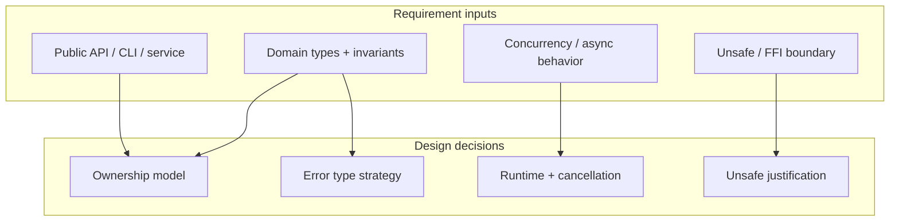
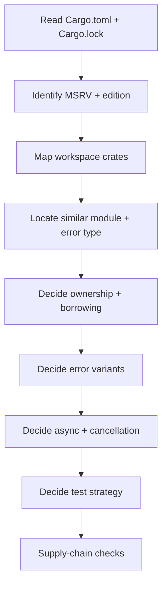
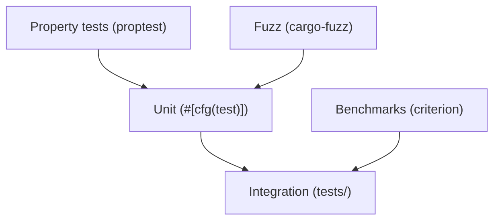
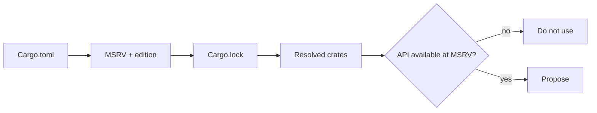
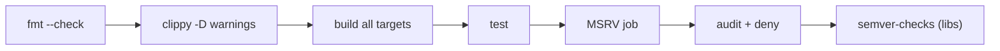

# Rust — SDD Guide

> Version data verified 2026-11-02 (`endoflife.date`): Rust releases every six weeks on a
> rolling basis; **1.99.x** was current at the time of writing. Editions are the stable
> compatibility unit.

---

## 1. Scope

Cargo workspaces, ownership and lifetimes, error handling, async runtimes, testing, fuzzing,
and supply-chain verification.



---

## 2. Toolchain contract

| Requirement | Must state |
| --- | --- |
| MSRV | `rust-version` in `Cargo.toml` |
| Edition | `edition = "2024"` (or the current supported edition) |
| Toolchain | `rust-toolchain.toml` when pinning |
| Targets | `x86_64-unknown-linux-gnu` etc. |
| Runtime | `tokio` / `async-std` / none |

```toml
# Cargo.toml (illustrative)
[package]
name = "orders"
version = "0.1.0"
edition = "2024"
rust-version = "1.85"

[dependencies]
tokio = { version = "1", features = ["rt-multi-thread", "macros", "net"] }
thiserror = "2"
serde = { version = "1", features = ["derive"] }
```

> **MSRV is a contract.** Agents frequently use APIs newer than the declared MSRV. CI should
> verify the MSRV with the pinned toolchain, not just the latest stable.

---

## 3. Writing requirements

| Universal requirement | Rust addition |
| --- | --- |
| Functional behavior | Public API shape, trait bounds, CLI surface |
| Acceptance criteria | Observable output, `Result` variant, panic-freedom |
| NFRs | Latency, allocations, binary size, compile time |
| Failure scenarios | Error enum variants, `From` conversions, retry |
| Compatibility | MSRV, semver policy for public items |

```markdown
### FR-6: Streaming CSV export

**Acceptance criteria**
- AC-6.1 `GET /projects/{id}/orders/export` returns `200` with `text/csv`.
- AC-6.2 Unauthorized access returns `403` and writes no CSV bytes.
- AC-6.3 Peak heap growth ≤ 20 MB at 100k rows (streaming, no full buffering).
- AC-6.4 The handler returns `Ok(())` on client disconnect and logs at `debug`.
- AC-6.5 No `unsafe` blocks are introduced.

**Non-goals**
- Compression; resumable downloads.

**Constraints**
- Edition 2024, MSRV 1.85.
- `axum` and `sqlx` are already present; no new direct dependencies.
- Errors use the existing `AppError` enum.
```

### Panic policy

| Context | Rule |
| --- | --- |
| Library code | No panics on user input; return `Result` |
| Binary entry point | Panics only for unrecoverable invariant violations |
| Tests | Panics are fine (`unwrap` in tests) |
| Production handlers | `unwrap`/`expect` on user-controlled data is a **high** finding |

---

## 4. Technical plan



### Plan additions

```markdown
## Workspace impact
| Crate | Change |
| --- | --- |
| `orders-api` | New route |
| `orders-core` | Streaming iterator |
| `orders-db` | Query |

## Ownership
- The stream borrows the connection pool (`&PgPool`), not a transaction.
- No `Arc<Mutex<_>>` introduced; state is immutable per request.

## Errors
| Variant | HTTP | Source |
| --- | --- | --- |
| `AppError::Forbidden` | 403 | auth layer |
| `AppError::Db(sqlx::Error)` | 500 | `#[from]` |

## Async
- `tokio` multi-thread runtime.
- Cancellation via `tokio::select!` on `request.cancelled()`.
- No blocking calls in async context (`spawn_blocking` if needed).

## Tests
- Unit tests in-module (`#[cfg(test)]`).
- Integration tests in `tests/` with `testcontainers`.
- Property tests for the encoder.
```

---

## 5. Task division

| Task | Files | Parallelizable |
| --- | --- | --- |
| Domain types + invariants | `crates/core/src/domain.rs` | Yes |
| Error enum extension | `crates/core/src/error.rs` | No (shared) |
| DB query | `crates/db/src/orders.rs` | Yes |
| CSV encoder + proptests | `crates/core/src/csv.rs` | Yes |
| HTTP handler | `crates/api/src/export.rs` | After error + DB |
| Integration tests | `crates/api/tests/` | After handler |
| Benchmarks | `benches/` | After encoder |

**Definition of done:**

- [ ] `cargo build --workspace --all-targets` passes
- [ ] `cargo test --workspace` passes
- [ ] `cargo clippy --workspace --all-targets -- -D warnings` passes
- [ ] `cargo fmt --check` passes
- [ ] No new `unsafe` without a safety comment and a test
- [ ] MSRV job passes
- [ ] `cargo deny check` passes

---

## 6. Specifying tests



```rust
#[cfg(test)]
mod tests {
    use super::*;

    #[test]
    fn ac_6_2_forbidden_writes_no_csv_bytes() {
        let result = export_authorized(&Principal::anonymous(), "p1");
        assert!(matches!(result, Err(AppError::Forbidden)));
    }

    #[test]
    fn ac_6_3_streams_without_buffering() {
        // The encoder must yield before consuming the whole iterator.
        let mut iter = (0..100_000).map(|i| Order { id: i, amount_cents: 100 });
        let first = encode_next(&mut iter).expect("first row");
        assert!(first.starts_with("id,"));
        assert_eq!(iter.count(), 99_999, "encoder must not drain the iterator");
    }
}
```

```rust
proptest! {
    #[test]
    fn csv_roundtrip_never_panics(rows in proptest::collection::vec(any::<u32>(), 0..1000)) {
        let encoded = encode_rows(rows.iter().map(|r| Order { id: *r, amount_cents: 0 }));
        prop_assert!(encoded.is_ok());
    }
}
```

| Requirement type | Minimum evidence |
| --- | --- |
| Pure logic | Unit test |
| Error contract | Test asserting the exact variant |
| Streaming | Test proving incremental yield |
| Concurrency | `loom` or `tokio::test` with timeouts |
| Serialization | Round-trip + proptest |
| Unsafe | Test covering the safety invariant |

---

## 7. How the agent inspects existing code

```bash
cat Cargo.toml
cargo tree --depth 1 | head -40
cargo metadata --no-deps --format-version 1 | head -c 500

grep -rn --include='*.rs' 'unsafe ' . | head -20
grep -rn --include='*.rs' 'unwrap()\|expect(' src | head -20
grep -rn --include='*.rs' '#\[tokio::main\]\|spawn_blocking' . | head -10
grep -rn --include='*.rs' 'thiserror\|anyhow' . | head -10
```



Checklist:

- [ ] MSRV and edition read
- [ ] Workspace layout and crate responsibilities mapped
- [ ] Error strategy identified (`thiserror` vs `anyhow`)
- [ ] Async runtime identified
- [ ] Existing `unsafe` inventory noted
- [ ] Feature flags that gate APIs noted

---

## 8. Code review focus

| Area | Question |
| --- | --- |
| Panics | New `unwrap`/`expect`/indexing on user input? |
| Unsafe | Safety comment? Invariant tested? |
| Ownership | Unnecessary `clone()`? `Arc<Mutex<_>>` hiding design problems? |
| Errors | Variants meaningful? `From` conversions lossless? |
| Async | Blocking call in async? Missing cancellation? |
| Traits | Over-generic bounds? Object safety issues? |
| Allocation | Allocation in a hot loop? |
| MSRV | API newer than `rust-version`? |
| Features | New default feature that bloats builds? |

**High-severity Rust findings:**

- `unsafe` without a `// SAFETY:` justification.
- `unwrap()` on deserialization or network input.
- Blocking I/O inside `async`.
- `Arc<Mutex<_>>` introduced to bypass ownership analysis.
- Panic-based error handling in a library.

---

## 9. Static analysis and tooling

| Tool | Purpose | Invocation |
| --- | --- | --- |
| **rustfmt** | Formatting | `cargo fmt --check` |
| **Clippy** | Lints | `cargo clippy -- -D warnings` |
| **`cargo test`** | Tests | `cargo test --workspace` |
| **Miri** | UB detection in unsafe | `cargo +nightly miri test` |
| **`cargo audit`** | RUSTSEC advisories | `cargo audit` |
| **`cargo deny`** | Licenses, bans, advisories | `cargo deny check` |
| **`cargo semver-checks`** | API compatibility | `cargo semver-checks check-release` |
| **proptest / quickcheck** | Property tests | library |
| **cargo-fuzz** | Fuzzing | `cargo fuzz run <target>` |
| **criterion** | Benchmarks | `cargo bench` |
| **Testcontainers** | Integration deps | library |

```bash
cargo fmt --all --check
cargo clippy --workspace --all-targets -- -D warnings
cargo test --workspace
cargo audit
cargo deny check
cargo build --workspace --all-targets
```

---

## 10. CI verification



```yaml
# .github/workflows/rust-ci.yml (illustrative)
name: rust-ci
on: [push, pull_request]
jobs:
  verify:
    runs-on: ubuntu-latest
    steps:
      - uses: actions/checkout@v4
      - uses: dtolnay/rust-toolchain@stable
        with: { components: 'rustfmt, clippy' }
      - run: cargo fmt --all --check
      - run: cargo clippy --workspace --all-targets -- -D warnings
      - run: cargo test --workspace
      - run: cargo install cargo-deny --locked && cargo deny check
```

| Gate | Fails when |
| --- | --- |
| Format | Any drift |
| Clippy | Any warning |
| Tests | Any failure |
| MSRV | Build fails on the declared minimum |
| `cargo deny` | Banned license, advisory, or duplicate |
| Semver checks | Public API break without a major bump |

---

## 11. Common mistakes

| Mistake | Consequence | Fix |
| --- | --- | --- |
| Using APIs above MSRV | Downstream build break | CI MSRV job |
| `unwrap()` on input | Panic in production | `Result` + `?` |
| `unsafe` without justification | Undefined behavior risk | `// SAFETY:` + test |
| Blocking in async | Runtime starvation | `spawn_blocking` or async I/O |
| Clone-heavy code | Performance regression | Borrow or restructure |
| New default feature | Build bloat for consumers | Opt-in feature |
| Ignoring semver checks | Accidental breaking change | `cargo semver-checks` |

---

## 12. Troubleshooting

| Symptom | Cause | Action |
| --- | --- | --- |
| `error[E0277]` trait bound | Missing bound or wrong type | Read the full compiler note |
| Borrow checker error on return | Returning a reference to a local | Return owned data or restructure |
| Clippy fails in CI only | Different toolchain | Pin toolchain |
| MSRV job fails | Dependency raised its MSRV | Pin an older version or raise MSRV |
| `cargo deny` blocks a license | Policy | Get legal approval; document exception |
| Async test hangs | No timeout / blocking call | `tokio::time::timeout` |
| Miri reports UB | Invalid unsafe | Fix or remove unsafe |

---

## 13. Security considerations

| Risk | Control |
| --- | --- |
| Unsafe code | Minimize; Miri; safety comments; review |
| Deserialization DoS | Size limits; avoid unbounded recursion |
| Supply chain | `cargo audit`, `cargo deny`, lockfile committed |
| Cryptography | Use audited crates; never implement primitives |
| Secrets | `secrecy`/zeroize; never log |
| Integer overflow | `checked_*` in release-sensitive paths |
| Panics as DoS | No `unwrap` on request data |

---

## 14. Official references

- Rust releases — <https://blog.rust-lang.org/>
- The Rust Book — <https://doc.rust-lang.org/book/>
- Rustonomicon (unsafe) — <https://doc.rust-lang.org/nomicon/>
- Cargo book — <https://doc.rust-lang.org/cargo/>
- Clippy lints — <https://rust-lang.github.io/rust-clippy/master/>
- Miri — <https://github.com/rust-lang/miri>
- RustSec advisories — <https://rustsec.org/>
- `cargo-audit` — <https://github.com/rustsec/rustsec/tree/main/cargo-audit>
- `cargo-deny` — <https://embarkstudios.github.io/cargo-deny/>
- `cargo-semver-checks` — <https://github.com/obi1kenobi/cargo-semver-checks>
- Tokio — <https://tokio.rs/>
- proptest — <https://proptest-rs.github.io/proptest/>
- criterion — <https://bheisler.github.io/criterion.rs/book/>

---

**Previous:** [Go](./go.md) ·
**Next:** [Kotlin](./kotlin.md)
