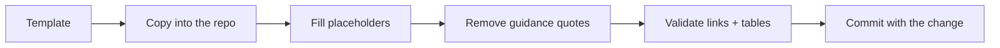

# Templates

Copy-paste artifacts. Each template is a standalone Markdown file with placeholders in
`<angle brackets>`.

| Template | Use when | Chapter |
| --- | --- | --- |
| [feature-spec.md](./feature-spec.md) | Starting any feature | [14](../14-feature-development.md) |
| [bug-report.md](./bug-report.md) | Reporting or fixing a defect | [15](../15-bug-fixing.md) |
| [architecture-decision-record.md](./architecture-decision-record.md) | A decision is expensive to reverse | [18](../18-architecture-review.md) |
| [implementation-plan.md](./implementation-plan.md) | Designing a change before code | [14](../14-feature-development.md) |
| [specification-review-report.md](./specification-review-report.md) | Reviewing a spec (read-only) | [17](../17-specification-review.md) |
| [code-review-report.md](./code-review-report.md) | Reviewing a diff (read-only) | [19](../19-read-only-code-review.md) |
| [verification-report.md](./verification-report.md) | Proving acceptance criteria | [20](../20-testing-and-verification.md) |
| [evidence-ledger.md](./evidence-ledger.md) | Tracking claims → evidence | [23](../23-hallucination-prevention.md) |
| [pull-request-template.md](./pull-request-template.md) | Opening a PR | [22](../22-git-and-commit-policy.md) |
| [agent-role-definition.md](./agent-role-definition.md) | Defining a new agent role | [24](../24-multi-agent-engineering.md) |

## Usage rules



1. **Copy, don't edit in place.** Templates stay generic; instances live next to the work.
2. **Keep requirement IDs stable.** Reviews and evidence reference them.
3. **Delete guidance blockquotes** in instances so reviewers see content, not instructions.
4. **Never leave a placeholder** in a document you call complete.
5. **One artifact per change** — `specs/<id>/spec.md`, not `spec-final-v2.md`.

## Where instances live

```text
repo/
├── specs/
│   └── 007-csv-export/
│       ├── spec.md            # from feature-spec.md
│       ├── plan.md            # from implementation-plan.md
│       ├── tasks.md           # task list
│       ├── evidence.md        # from evidence-ledger.md
│       └── verification.md    # from verification-report.md
├── docs/adr/
│   └── 0007-streaming-export.md
└── docs/reviews/
    └── 2026-11-02-pr-142-code-review.md
```

---

**Back to index:** [README](../README.md)
