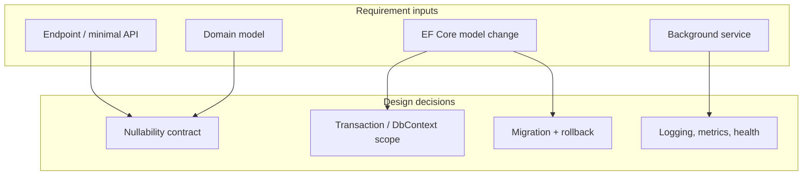
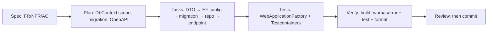
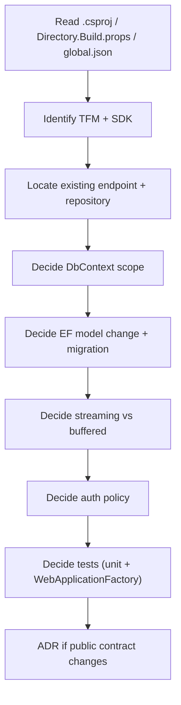
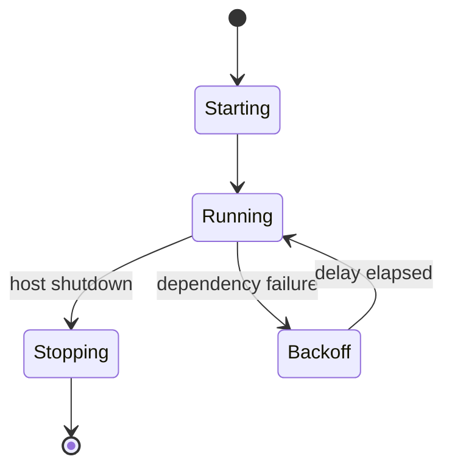
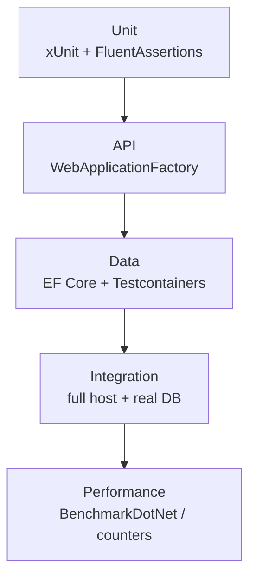
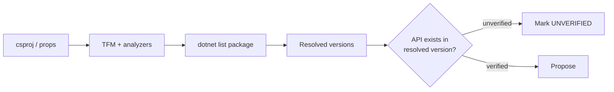
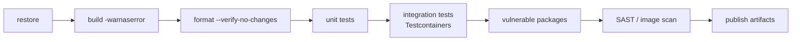

# .NET / C# — SDD Guide

> Runtime data verified 2026-11-02 (`endoflife.date`): **.NET 10.0.x is the current LTS**
> (support to 2028-11-14). **.NET 8 reaches end of support on 2026-11-10** — plan migrations
> accordingly. .NET 9 is already out of support for practical purposes (EOL 2026-11-10).

---

## 1. Scope

ASP.NET Core, Entity Framework Core, REST APIs, background services, xUnit/NUnit integration
tests, nullable reference types, Roslyn analyzers, NuGet dependency management.



---

## 2. Runtime contract

| Requirement | Must state |
| --- | --- |
| Target framework | `net10.0` (or explicit `net8.0` during migration) |
| SDK | `global.json` pinned |
| Nullable | `<Nullable>enable</Nullable>` |
| Language version | Implicit from TFM unless overridden |
| Central package management | `Directory.Packages.props` if used |

`global.json` — pin the SDK band, not an exact patch:

```json
{
  "sdk": {
    "version": "10.0.100",
    "rollForward": "latestFeature"
  }
}
```

```xml
<PropertyGroup>
  <TargetFramework>net10.0</TargetFramework>
  <Nullable>enable</Nullable>
  <ImplicitUsings>enable</ImplicitUsings>
  <TreatWarningsAsErrors>true</TreatWarningsAsErrors>
  <AnalysisLevel>latest-recommended</AnalysisLevel>
</PropertyGroup>
```

> **Migration trap:** multi-targeting `net8.0;net10.0` is a legitimate transition strategy, but
> the agent must not use `net10.0`-only APIs inside shared code. The specification should name
> the target(s) explicitly.

---

## 3. Adopting SDD in a .NET project

### 3.1 Verify the toolchain

```bash
dotnet --info                    # confirm the SDK band from global.json
dotnet restore
dotnet build -warnaserror --no-restore
```

Pin the SDK in `global.json` and share `Directory.Build.props`. Without both, the IDE, the agent,
and CI disagree about nullable and analyzer warnings.

### 3.2 Add the agent rules

`AGENTS.md` (plus `.github/copilot-instructions.md`, which is the only repository-wide instruction
file Visual Studio reads — see [chapter 29](../docs/29-ide-setup.md)):

```markdown
## .NET rules
- Target the TFM declared in the csproj; never use APIs from a newer target.
- `Nullable` enabled; no new `!` null-forgiving operator in production code.
- No `.Result` or `.Wait()`; async all the way.
- `DbContext` is scoped per request; never captured in a singleton or background service.
- Integration tests use Testcontainers, not the InMemory provider.
- Every migration implements `Down` and is reviewed for lock impact.
```

### 3.3 Your first SDD change



### 3.4 Verification commands

| Check | Command |
| --- | --- |
| Build with warnings as errors | `dotnet build -warnaserror` |
| Formatting | `dotnet format --verify-no-changes` |
| Tests | `dotnet test --no-build` |
| Vulnerable packages | `dotnet list package --vulnerable --include-transitive` |

### 3.5 Adoption pitfalls

| Pitfall | Fix |
| --- | --- |
| InMemory provider used for integration tests | Testcontainers with the real engine |
| Analyzer set differs between IDE and CI | Share `Directory.Build.props`, pin the SDK |
| Agent uses an API from `net10.0` in an `net8.0` project | State the TFM in the spec and plan |
| Migration without `Down` | Definition of done requires it |

---

## 4. Writing requirements

### 3.1 .NET-specific additions

| Universal requirement | .NET addition |
| --- | --- |
| Functional behavior | Endpoint style (controller vs minimal API), route, auth policy |
| Acceptance criteria | HTTP status + ProblemDetails body; EF row state |
| NFRs | p95 latency, allocations, DbContext lifetime |
| Failure scenarios | Exception → `ProblemDetails`, `DbContext` rollback behavior |
| Compatibility | TFM, public API surface, serialization contract |

### 3.2 Example

```markdown
### FR-5: CSV export for authorized projects

`GET /projects/{projectId}/orders/export` streams CSV for orders the caller can read.

**Acceptance criteria**
- AC-5.1 A caller with `Viewer` on project A exporting A receives the same rows as
  `GET /projects/A/orders`, in the same order.
- AC-5.2 A caller without a role on B receives `403` with `ProblemDetails`
  (`type = "https://api.example.com/problems/forbidden"`), and no CSV bytes.
- AC-5.3 At 100k rows, TTFB ≤ 1.5 s p95 and total ≤ 30 s p95, with working set ≤ 200 MB
  above baseline (measured by `dotnet-counters`).

**Non-goals**
- Excel export; background export jobs.

**Constraints**
- `net10.0`, ASP.NET Core, EF Core 10.
- Nullable enabled; no `!` (null-forgiving) in new code.
- Reuse `IOrderRepository.GetVisibleToAsync`.
```

### 3.3 Nullability as a requirement

```csharp
// The signature IS the contract. Require it in the spec.
public sealed record OrderExportRequest(
    Guid ProjectId,
    DateOnly? From = null,
    DateOnly? To = null);
```

| Rule | Rationale |
| --- | --- |
| Nullable annotations on all public members | Prevents runtime `NullReferenceException` |
| No `!` in new production code | Suppresses the compiler's only defense |
| `required` for mandatory init properties | Compile-time enforcement |
| Validate at the boundary, not deep inside | Clear error contract |

---

## 5. Technical plan



### Plan template additions

```markdown
## Project impact
| Project | Change |
| --- | --- |
| `Orders.Api` | New endpoint, policy registration |
| `Orders.Domain` | No change |
| `Orders.Infrastructure` | Streaming query |
| `Orders.Migrations` | New migration |

## EF Core
- `AsNoTracking()` for read path.
- Streaming with `IAsyncEnumerable`; no `ToListAsync()`.
- DbContext scoped per request (default); do not share across threads.

## Migration
`AddOrderExportIndex`:
- Up: `CREATE INDEX ...`
- Down: `DROP INDEX ...`
- Data impact: none (index only)

## API contract
- Additive endpoint; no change to existing DTOs.
- OpenAPI updated; `Produces(StatusCodes.Status403Forbidden)` declared.

## Tests
- Unit: CSV formatter, empty input
- Integration: `WebApplicationFactory<Program>` + Testcontainers SQL Server/Postgres
- Perf: benchmark with 100k rows
```

### Background service requirements

| Must specify | Example |
| --- | --- |
| Trigger | `BackgroundService` loop interval / queue |
| Idempotency | `ProcessedMessage.Id` unique constraint |
| Shutdown behavior | Honor `CancellationToken`; drain within host shutdown timeout |
| Failure policy | Exponential backoff; poison message handling |
| Observability | `ILogger` scope + counters |



---

## 6. Task division

| Task | Files | Parallelizable |
| --- | --- | --- |
| DTOs + validation | `Contracts/` | Yes |
| EF configuration + migration | `Infrastructure/`, `Migrations/` | No (ordering) |
| Repository streaming query + tests | `Infrastructure/` | After migration |
| CSV formatter + unit tests | `Api/Formatters/` | Yes |
| Endpoint + policy | `Api/Endpoints/` | After service |
| Integration tests | `Tests/` | After endpoint |
| Perf benchmark | `Benchmarks/` | After endpoint |
| Health/metrics wiring | `Api/` | Yes |

**Definition of done:**

- [ ] `dotnet build -warnaserror` passes
- [ ] `dotnet test` passes
- [ ] `dotnet format --verify-no-changes` passes
- [ ] No new analyzer warnings
- [ ] Migration has `Down` and is reviewed for lock impact
- [ ] OpenAPI/endpoint metadata updated
- [ ] No `!` null-forgiving in new code

---

## 7. Specifying tests



```csharp
public sealed class ExportEndpointTests : IClassFixture<ApiFactory>
{
    private readonly HttpClient _client;
    public ExportEndpointTests(ApiFactory factory) => _client = factory.CreateClient();

    [Fact]
    public async Task AC5_2_export_without_role_returns_403_problem_details()
    {
        var response = await _client.GetAsync($"/projects/{Guid.NewGuid()}/orders/export");

        response.StatusCode.Should().Be(HttpStatusCode.Forbidden);
        var problem = await response.Content.ReadFromJsonAsync<ProblemDetails>();
        problem!.Type.Should().Be("https://api.example.com/problems/forbidden");
        (await response.Content.ReadAsByteArrayAsync()).Should().BeEmpty();
    }

    [Theory]
    [InlineData(0)]
    [InlineData(1)]
    [InlineData(1000)]
    public async Task AC5_4_header_present_for_any_row_count(int rows)
    {
        var csv = await ExportCsv(rows);
        csv.Split('\n')[0].Should().Be("id,created_at,amount_cents");
    }
}
```

| Requirement type | Minimum evidence |
| --- | --- |
| Route/auth | `WebApplicationFactory` test per policy |
| EF query | Integration test against real provider |
| Streaming | Test asserting chunked response, not a buffered array |
| Concurrency | `Parallel.ForEachAsync` test with a unique constraint |
| Migration | Apply + `dotnet ef database update` on a container |
| Background service | `TestHost` + `FakeTimeProvider` |

> **InMemory provider is not a database.** It does not enforce constraints, transactions, or
> SQL semantics. Use Testcontainers for anything you intend to rely on.

---

## 8. How the agent inspects existing code

```bash
# Solution/project layout
ls -la *.sln *.slnx 2>/dev/null
find . -name '*.csproj' -not -path './bin/*' -not -path './obj/*'

# Effective target framework and package versions
grep -rn 'TargetFramework' --include='*.csproj' .
dotnet list package --include-transitive

# Existing endpoints and patterns
grep -rn --include='*.cs' 'MapGet\|MapPost\|\[HttpGet\]' src | head -20
grep -rn --include='*.cs' 'IAsyncEnumerable\|AsNoTracking' src | head -20
grep -rn --include='*.cs' 'AddAuthorization\|RequireAuthorization\|\[Authorize\]' src | head -20

# Migrations
ls -la **/Migrations 2>/dev/null || find . -type d -name Migrations
```



---

## 9. Code review focus

| Area | Question |
| --- | --- |
| Async | Any `.Result` / `.Wait()`? `async void`? |
| DbContext | Shared across threads? Long-lived? Tracking on read path? |
| Nullability | New `!`? Ignored nullable warnings? |
| Disposal | `IAsyncDisposable` awaited? `HttpClient` misuse? |
| Exceptions | `catch (Exception)` swallowing? Rethrow losing stack (`throw ex`)? |
| Serialization | Contract change? Case sensitivity? `System.Text.Json` options? |
| EF queries | N+1? Client evaluation? Missing `AsNoTracking`? |
| Auth | New endpoint with `RequireAuthorization`? Policy correct? |
| Migration | `Down` implemented? Lock impact? |
| Allocations | Hot path allocating per request? |

**High-severity .NET findings:**

- New endpoint without `RequireAuthorization` / `[Authorize]`.
- `DbContext` captured in a singleton or background service without a scope.
- `async void` outside event handlers.
- Migration with a destructive `Down` that cannot restore data.
- `IOptions` vs `IOptionsSnapshot` misuse for reloadable config.

---

## 10. Static analysis and tooling

| Tool | Purpose | Invocation |
| --- | --- | --- |
| **Roslyn analyzers** | Compile-time correctness/style | built into build |
| **`AnalysisLevel`/`EnforceCodeStyleInBuild`** | Enable analyzer enforcement | `Directory.Build.props` |
| **`dotnet format`** | Formatting + analyzer fixes | `dotnet format --verify-no-changes` |
| **xUnit** | Tests | `dotnet test` |
| **FluentAssertions** | Readable assertions | library |
| **Testcontainers for .NET** | Real dependencies | library |
| **BenchmarkDotNet** | Micro/macro benchmarks | console project |
| **`dotnet list package --vulnerable`** | Known-vulnerable packages | CI step |
| **Trivy** | Image/FS/secrets | CI step |
| **Semgrep / CodeQL** | SAST | CI step |
| **SonarQube** | Quality gate | CI step |

```bash
dotnet restore
dotnet build -warnaserror --no-restore
dotnet format --verify-no-changes --no-restore
dotnet test --no-build
dotnet list package --vulnerable --include-transitive
```

---

## 11. CI verification



```yaml
# .github/workflows/dotnet-ci.yml (illustrative)
name: dotnet-ci
on: [push, pull_request]
jobs:
  verify:
    runs-on: ubuntu-latest
    steps:
      - uses: actions/checkout@v4
      - uses: actions/setup-dotnet@v4
        with:
          dotnet-version: '10.0.x'
      - run: dotnet restore
      - run: dotnet build --no-restore -warnaserror
      - run: dotnet format --verify-no-changes --no-restore
      - run: dotnet test --no-build
      - run: dotnet list package --vulnerable --include-transitive
```

| Gate | Fails when |
| --- | --- |
| Build | Any warning (with `-warnaserror`) |
| Format | Any formatting drift |
| Tests | Any failure |
| Vulnerable packages | Any high/critical advisory with no documented exception |
| SAST | Any high-confidence finding |

---

## 12. Common mistakes

| Mistake | Consequence | Fix |
| --- | --- | --- |
| Using `InMemory` provider for integration tests | False confidence | Testcontainers |
| `.Result` in async code | Deadlocks, thread-pool starvation | `await` all the way |
| `DbContext` in a singleton | Concurrency corruption | Scope per request/operation |
| Null-forgiving `!` to silence warnings | Runtime NREs | Fix the model, validate at boundaries |
| `ToListAsync()` before streaming | Memory spike | `IAsyncEnumerable` |
| Untested `Down` migration | Irreversible failure | Run `database update` + rollback in CI |
| Tracking queries on read paths | Slower, memory heavy | `AsNoTracking()` |
| `DateTime.Now` | Timezone bugs, untestable | `TimeProvider` |
| Optional `Nullable` disabled in one project | Contract holes | Enforce repo-wide |

---

## 13. Troubleshooting

| Symptom | Cause | Action |
| --- | --- | --- |
| `NETSDK1045` | SDK older than TFM | Install matching SDK or lower TFM |
| `dotnet test` finds no tests | Wrong test SDK/packages | Add `xunit.runner.visualstudio`, `Microsoft.NET.Test.Sdk` |
| Testcontainers cannot start | Docker unavailable | Enable Docker in CI |
| Migration pending at startup | Not applied | Apply explicitly; do not rely on startup migration |
| `InvalidOperationException` on DbContext | Concurrent use / captured context | Create a scope per operation |
| Flaky `TimeProvider` tests | Real clock | Inject `FakeTimeProvider` |
| NuGet restore fails in CI | Missing source/auth | Configure `nuget.config` with credentials |
| Analyzer noise | Too many rules at once | Raise `AnalysisLevel` incrementally |
| JSON casing mismatch in client | Options differ | Share serializer options in tests |

---

## 14. Security considerations

| Risk | Control |
| --- | --- |
| Missing authorization | `RequireAuthorization` + endpoint tests |
| Over-posting | DTOs, never bind EF entities directly |
| SQL injection | Parameterized EF queries; avoid `FromSqlRaw` interpolation |
| Secrets | User Secrets locally; Key Vault/managed identity in prod |
| Data protection keys | Persist and protect; not ephemeral per instance |
| Deserialization | `System.Text.Json` with explicit types; avoid `BinaryFormatter` |
| CORS | Explicit origins, no `AllowAnyOrigin` with credentials |
| Health endpoints | Do not leak dependency details publicly |

---

## 15. Official references

- .NET support policy — <https://dotnet.microsoft.com/platform/support/policy/dotnet-core>
- .NET releases — <https://dotnet.microsoft.com/download/dotnet>
- ASP.NET Core docs — <https://learn.microsoft.com/aspnet/core/>
- Minimal APIs — <https://learn.microsoft.com/aspnet/core/fundamentals/minimal-apis/>
- EF Core docs — <https://learn.microsoft.com/ef/core/>
- EF Core migrations — <https://learn.microsoft.com/ef/core/managing-schemas/migrations/>
- Nullable reference types — <https://learn.microsoft.com/dotnet/csharp/nullable-references>
- Roslyn analyzers — <https://learn.microsoft.com/dotnet/fundamentals/code-analysis/overview>
- xUnit — <https://xunit.net/>
- NUnit — <https://docs.nunit.org/>
- Testcontainers for .NET — <https://dotnet.testcontainers.org/>
- BenchmarkDotNet — <https://benchmarkdotnet.org/>
- `dotnet format` — <https://learn.microsoft.com/dotnet/core/tools/dotnet-format>
- `dotnet list package` — <https://learn.microsoft.com/dotnet/core/tools/dotnet-list-package>

---

**Previous:** [Python](./python.md) ·
**Next:** [JavaScript / TypeScript](./javascript-typescript.md) ·
**Back to index:** [00-index.md](../docs/00-index.md)
