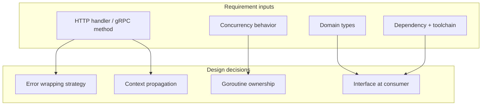
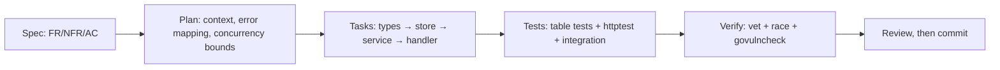
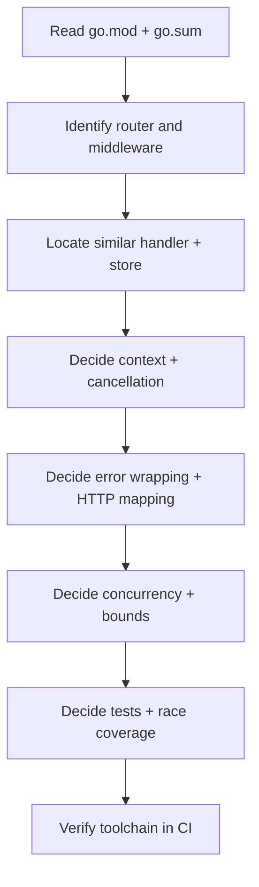
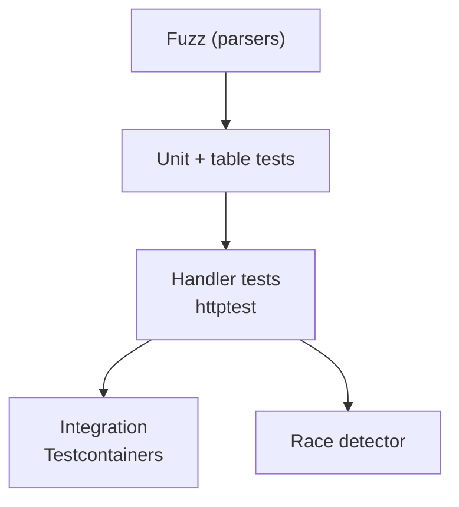
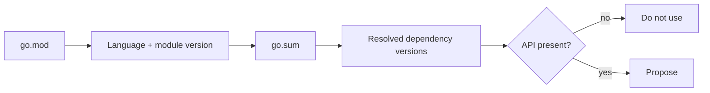
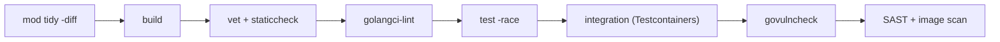

# Go — SDD Guide

> Runtime data verified 2026-11-02 (`endoflife.date`): Go supports the two most recent minor
> releases — **1.27.x and 1.26.x** at the time of writing.

---

## 1. Scope

Modules, error handling, concurrency, `net/http` and common routers, table-driven tests,
race detection, fuzzing, and static analysis.



---

## 2. Toolchain contract

| Requirement | Must state |
| --- | --- |
| Go version | `go` directive in `go.mod` |
| Toolchain | `toolchain` line if pinned |
| Module path | Stable import path |
| Build tags | Required tags for platform/special builds |

```go
// go.mod (illustrative)
module github.com/acme/orders

go 1.27

toolchain go1.27.3
```

> **Version trap:** the `go` directive is a *language version* for the module. Do not bump it
> casually — it changes language semantics (e.g. loop variable scoping) for the whole module.

---

## 3. Adopting SDD in a Go project

### 3.1 Verify the toolchain

```bash
go version
go mod tidy -diff     # prints a diff instead of modifying: perfect for a read-only check
go build ./...
go test ./...
```

`go mod tidy -diff` is the read-only form. Never let the agent run plain `go mod tidy` during
discovery.

### 3.2 Add the agent rules

`AGENTS.md` (plus `.github/copilot-instructions.md` for Visual Studio and JetBrains — see
[chapter 29](../docs/29-ide-setup.md)):

```markdown
## Go rules
- Do not bump the `go` directive without an explicit decision; it changes semantics module-wide.
- Propagate `ctx` as the first parameter; no `context.Background()` in request paths.
- Wrap errors with `%w` and map them to HTTP in one place.
- Every goroutine has a documented owner and exit path; no unbounded starts.
- Table-driven tests; `go test -race ./...` must pass.
- Integration tests use a real dependency (Testcontainers), not a mock of the store.
```

### 3.3 Your first SDD change



### 3.4 Verification commands

| Check | Command |
| --- | --- |
| Formatting | `gofmt -l .` (must be empty) |
| Vet | `go vet ./...` |
| Lint | `staticcheck ./...` or `golangci-lint run` |
| Tests with race detector | `go test -race ./...` |
| Vulnerabilities | `govulncheck ./...` |
| Module tidiness | `go mod tidy -diff` |

### 3.5 Adoption pitfalls

| Pitfall | Fix |
| --- | --- |
| Agent runs `go get` and changes `go.mod` silently | Review manifest diffs; `go mod tidy -diff` in CI |
| Goroutine started per request with no bound | Specify bounded concurrency in the plan |
| `rows.Err()` ignored | Review checklist item |
| Interfaces designed before a second implementation exists | Define interfaces at the consumer |

---

## 4. Writing requirements

| Universal requirement | Go addition |
| --- | --- |
| Functional behavior | Handler/method, route, middleware chain |
| Acceptance criteria | Status code, body, returned error (`errors.Is`) |
| NFRs | p95 latency, allocations per request, goroutine count |
| Failure scenarios | Error wrapping, sentinel errors, retry policy |
| Compatibility | Minimum Go version, public API stability |

```markdown
### FR-3: Stream CSV export of visible orders

**Acceptance criteria**
- AC-3.1 `GET /projects/{id}/orders/export` returns `200` with `text/csv`.
- AC-3.2 A caller without project access receives `403` and **no CSV bytes**.
- AC-3.3 The handler does not buffer the full result set: memory growth ≤ 20 MB at 100k rows.
- AC-3.4 When the client disconnects, the handler returns promptly and releases the DB rows
  (`context.Canceled` observed in logs, no goroutine leak).

**Non-goals**
- Compression negotiation; per-row authorization checks.

**Constraints**
- Go 1.27; standard library `net/http`; `pgx` already present.
- No new module dependency.
- Reuse `store.VisibleOrders(ctx, userID, projectID)`.
```

### Concurrency requirements must be explicit

| Must specify | Example |
| --- | --- |
| Ownership | "The handler owns the goroutine it starts; it must exit before the handler returns" |
| Cancellation | "All blocking calls take `ctx`" |
| Boundedness | "Worker pool size = 4; queue capacity = 100" |
| Idempotency | "Retries use `Idempotency-Key`; duplicate keys return the first result" |

---

## 5. Technical plan



### Plan additions

```markdown
## Layering
| Layer | Package | Responsibility |
| --- | --- | --- |
| HTTP | `internal/api` | Parse, authorize, encode |
| Service | `internal/export` | Orchestration, streaming |
| Store | `internal/store` | SQL, rows iteration |

## Errors
| Sentinel | HTTP | Wrapping |
| --- | --- | --- |
| `ErrForbidden` | 403 | `fmt.Errorf("export: %w", ErrForbidden)` |
| `ErrNotFound` | 404 | same |
| driver error | 500 | wrap with operation, log, do not leak |

## Concurrency
- No goroutines in the request path except the `http` server's own.
- Streaming loop is single-goroutine; `rows.Close()` deferred.

## Tests
- Table-driven handler tests with `httptest`.
- Store tests against Testcontainers Postgres.
- `go test -race` in CI.
- Leak check with `goleak` in the package test.
```

---

## 6. Task division

| Task | Files | Parallelizable |
| --- | --- | --- |
| Domain types + validation | `internal/domain` | Yes |
| Store query + tests | `internal/store` | Yes |
| CSV encoder + tests | `internal/export` | Yes |
| HTTP handler + tests | `internal/api` | After service |
| Middleware/auth wiring | `internal/api` | After handler |
| Integration test | `internal/.../integration_test.go` | After all |
| Race/leak test | package tests | After all |

**Definition of done:**

- [ ] `go build ./...` passes
- [ ] `go vet ./...` passes
- [ ] `golangci-lint run` passes
- [ ] `go test -race ./...` passes
- [ ] Errors are wrapped with `%w` and mapped centrally
- [ ] No goroutine started without a documented exit path
- [ ] `gofmt -l .` is empty

---

## 7. Specifying tests



```go
func TestExportHandler_Forbidden(t *testing.T) {
	t.Parallel()

	tests := []struct {
		name       string
		user       User
		wantStatus int
		wantBody   string
	}{
		{"viewer can export", viewer(), http.StatusOK, ""},
		{"no role forbidden", noRole(), http.StatusForbidden, "forbidden"},
	}

	for _, tt := range tests {
		t.Run(tt.name, func(t *testing.T) {
			t.Parallel()
			rr := httptest.NewRecorder()
			req := httptest.NewRequest(http.MethodGet, "/projects/p1/orders/export", nil)
			req = req.WithContext(withUser(req.Context(), tt.user))

			newHandler(fakeStore{}).ServeHTTP(rr, req)

			if rr.Code != tt.wantStatus {
				t.Fatalf("status: got %d want %d", rr.Code, tt.wantStatus)
			}
			if tt.wantStatus == http.StatusForbidden && rr.Body.Len() != 0 {
				t.Fatalf("forbidden response must not write a body, got %q", rr.Body.String())
			}
		})
	}
}

func FuzzParseFilter(f *testing.F) {
	f.Add("status=open&limit=10")
	f.Fuzz(func(t *testing.T, raw string) {
		_, _ = ParseFilter(raw) // must never panic
	})
}
```

| Requirement type | Minimum evidence |
| --- | --- |
| Handler behavior | `httptest` table test |
| Store query | Integration test with real DB |
| Concurrency | `-race` run plus a leak check |
| Parsing | Fuzz test |
| Cancellation | Test that cancels context and asserts prompt return |

---

## 8. How the agent inspects existing code

```bash
cat go.mod
go list -m all | head -30
go version

grep -rn --include='*.go' 'http.HandleFunc\|mux.Handle\|r.Get(' . | head -20
grep -rn --include='*.go' 'errors.Is\|errors.As\|fmt.Errorf' internal | head -20
grep -rn --include='*.go' 'go func' . | head -20
grep -rn --include='*.go' 'sql.Open\|pgxpool.New' . | head -10
```



Checklist:

- [ ] `go` directive and toolchain read
- [ ] Router/middleware identified
- [ ] Existing error mapping located
- [ ] Store pattern and DB driver identified
- [ ] Existing goroutine usage audited for ownership
- [ ] Test conventions (table tests, helpers) identified

---

## 9. Code review focus

| Area | Question |
| --- | --- |
| Errors | Wrapped with `%w`? Checked with `errors.Is/As`? Leaked internals? |
| Context | Is `ctx` the first parameter and propagated? Any `context.Background()` in request paths? |
| Goroutines | Who stops it? Is there a leak on error? |
| HTTP | Body closed? Status written before body? Double `WriteHeader`? |
| Slices/maps | Returned references mutated? Aliasing bugs? |
| Interfaces | Defined at the consumer, not the producer? |
| Nil handling | Nil map writes? Nil pointer in interface? |
| Security | SQL concatenation? `os/exec` with user input? |
| Tests | Table tests with meaningful cases? `t.Parallel` safety? |

**High-severity Go findings:**

- `go func()` inside a request handler without ownership/cancellation.
- `defer resp.Body.Close()` inside a loop.
- Authorization middleware missing from a new route group.
- Ignoring `rows.Err()`.
- `context.Background()` inside a request handler.

---

## 10. Static analysis and tooling

| Tool | Purpose | Invocation |
| --- | --- | --- |
| **`go vet`** | Built-in correctness checks | `go vet ./...` |
| **`gofmt`** | Formatting | `gofmt -l .` |
| **`staticcheck`** | Advanced static analysis | `staticcheck ./...` |
| **`golangci-lint`** | Aggregated linters | `golangci-lint run` |
| **`govulncheck`** | Known vulnerabilities in called code | `govulncheck ./...` |
| **race detector** | Data races | `go test -race ./...` |
| **`goleak`** | Goroutine leaks in tests | library |
| **Testcontainers for Go** | Real dependencies | library |
| **Trivy / Semgrep** | Image/FS/SAST | CI |

```bash
go mod tidy -diff
go build ./...
go vet ./...
gofmt -l .
staticcheck ./...
golangci-lint run
go test -race ./...
govulncheck ./...
```

> `go mod tidy -diff` prints the diff instead of modifying `go.mod`/`go.sum`, which is exactly
> what a read-only verification step needs.

---

## 11. CI verification



```yaml
# .github/workflows/go-ci.yml (illustrative)
name: go-ci
on: [push, pull_request]
jobs:
  verify:
    runs-on: ubuntu-latest
    steps:
      - uses: actions/checkout@v4
      - uses: actions/setup-go@v5
        with: { go-version: '1.27', cache: true }
      - run: go mod tidy -diff
      - run: go build ./...
      - run: go vet ./...
      - run: gofmt -l . | tee /tmp/fmt && test ! -s /tmp/fmt
      - run: go test -race ./...
      - run: go install golang.org/x/vuln/cmd/govulncheck@latest
      - run: govulncheck ./...
```

| Gate | Fails when |
| --- | --- |
| `mod tidy -diff` | `go.mod`/`go.sum` not tidy |
| Build | Compile error |
| Vet/lint | Any finding at configured severity |
| Format | Any unformatted file |
| Tests | Any failure under `-race` |
| Vulnerabilities | Reachable vulnerable symbol |

---

## 12. Common mistakes

| Mistake | Consequence | Fix |
| --- | --- | --- |
| Goroutine per request without ownership | Leaks under load | Bounded pools, context cancellation |
| `response.Body.Close()` in a loop | File descriptor exhaustion | Close per iteration |
| Ignoring `rows.Err()` | Silent partial results | Always check |
| `context.Background()` in handlers | No cancellation/timeout | Propagate `r.Context()` |
| Premature interfaces | Indirection without benefit | Define at the consumer |
| Panic/recover as error handling | Hidden failures | Return errors |
| Unbounded `io.ReadAll` | Memory exhaustion | `io.LimitReader` |
| Bumping `go` directive casually | Semantic change module-wide | Treat as a spec change |

---

## 13. Troubleshooting

| Symptom | Cause | Action |
| --- | --- | --- |
| `missing go.sum entry` | Dependency added without tidy | `go mod tidy` |
| Tests pass locally, fail `-race` | Data race | Fix synchronization, don't skip |
| CI Go version mismatch | `toolchain` not pinned | Add `toolchain` line |
| Build tag files ignored | Tags not passed | `go test -tags=...` |
| `govulncheck` false positive | Unreachable symbol | Document the exception |
| CGO-dependent test fails in CI | Missing toolchain | Avoid CGO or install deps |
| Flaky table test | Shared mutable fixture | Copy fixtures per subtest |

---

## 14. Security considerations

| Risk | Control |
| --- | --- |
| SQL injection | Parameterized queries; never `fmt.Sprintf` into SQL |
| Command injection | `exec.Command` with fixed binary + args, never a shell string |
| Path traversal | `filepath.Clean` + root containment check |
| SSRF | Custom `http.Client` with allow-list and timeouts |
| Unbounded reads | `http.MaxBytesReader`, `io.LimitReader` |
| Secret leakage | Never log structs containing tokens; explicit log fields |
| TLS | Do not set `InsecureSkipVerify` |

---

## 15. Official references

- Go releases — <https://go.dev/doc/devel/release>
- Go modules reference — <https://go.dev/ref/mod>
- `net/http` — <https://pkg.go.dev/net/http>
- `context` — <https://pkg.go.dev/context>
- `errors` — <https://pkg.go.dev/errors>
- `testing` and fuzzing — <https://pkg.go.dev/testing>
- Go vulnerability database — <https://vuln.go.dev/>
- `govulncheck` — <https://pkg.go.dev/golang.org/x/vuln/cmd/govulncheck>
- staticcheck — <https://staticcheck.dev/>
- golangci-lint — <https://golangci-lint.run/>
- Testcontainers for Go — <https://golang.testcontainers.org/>

---

**Previous:** [JavaScript / TypeScript](./javascript-typescript.md) ·
**Next:** [Rust](./rust.md)
