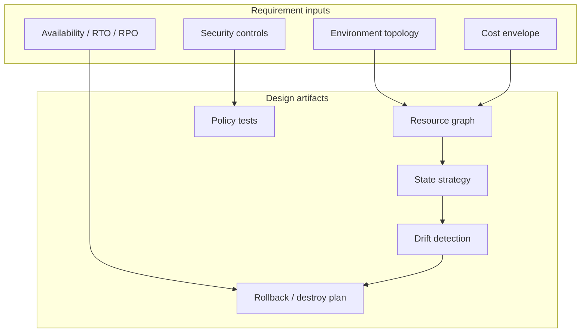
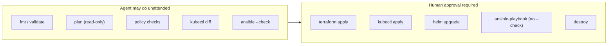
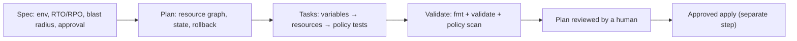
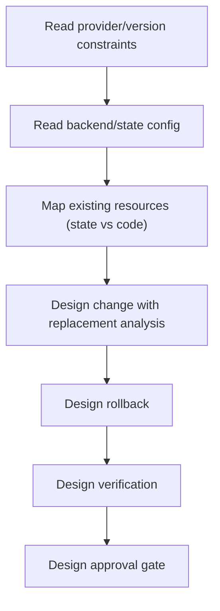
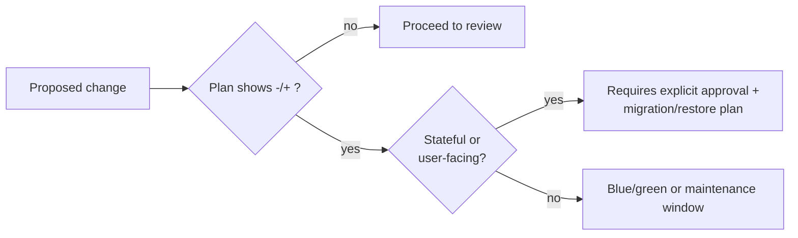
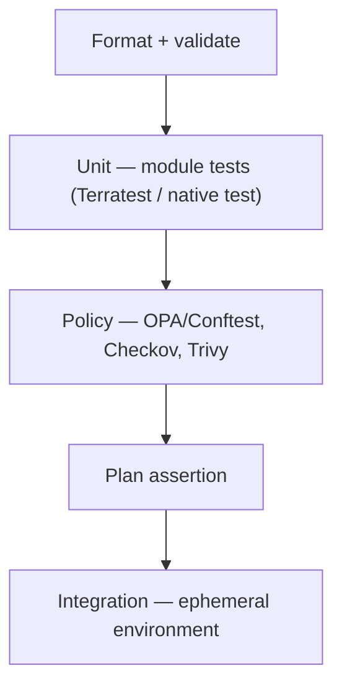
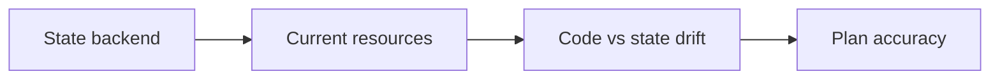
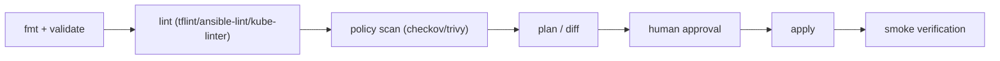

# Infrastructure as Code — SDD Guide

> Covers Terraform/OpenTofu, Ansible, and Kubernetes manifests. Tool versions are intentionally
> not pinned here; read the repository's `.terraform-version`, `requirements.yml`, or cluster
> version instead.

---

## 1. Scope

Declarative infrastructure, environment promotion, drift, state, secrets, disaster recovery,
and policy enforcement for Terraform/OpenTofu, Ansible, and Kubernetes.



---

## 2. The blast-radius contract

Infrastructure changes are **the highest blast radius** changes an agent can make. Every
requirement must state what happens on failure.

| Requirement | Must state |
| --- | --- |
| Environment | dev/staging/prod, account/subscription, region |
| Reversibility | Can this be destroyed and re-created? Is stateful data involved? |
| Downtime | Allowed maintenance window or zero-downtime strategy |
| Data | Backups, retention, restore test |
| Approval | Who authorizes apply to which environment |
| Rollback | Previous state, snapshot, or blue/green switch |



---

## 3. Adopting SDD for infrastructure changes

Infrastructure has the largest blast radius of any change. The "install" step is verifying that the
tooling can plan and validate **without applying**.

### 3.1 Verify the toolchain

```bash
terraform version
terraform fmt -check -recursive
terraform init -backend=false          # validate without touching state
terraform validate

ansible --version
ansible-lint --version

kubectl version --client
kubeconform -v
```

> `terraform init -backend=false` is the read-only setup step. Do not run a real `init` or `plan`
> against a production backend during discovery.

### 3.2 Add the agent rules

`AGENTS.md` (plus `.github/copilot-instructions.md` if the team uses Copilot — see
[chapter 29](../docs/29-ide-setup.md)):

```markdown
## Infrastructure rules
- Never run `terraform apply`, `kubectl apply`, or `ansible-playbook` without explicit approval.
- Plan first; report every `-/+` (replacement) and justify it.
- No secrets in code, variables files, or committed state.
- No wildcard IAM actions or resources.
- No public ingress to a data store.
- Stateful resources require a migration/restore plan before replacement.
```

### 3.3 Your first SDD change



### 3.4 Verification commands

| Target | Commands |
| --- | --- |
| Terraform | `terraform fmt -check -recursive`, `terraform validate`, `terraform plan -out=tfplan` |
| Policy | `checkov -d .`, `trivy config .`, `conftest test tfplan.json` |
| Ansible | `ansible-lint`, `ansible-playbook site.yml --check --diff` |
| Kubernetes | `kubectl diff -f manifests/`, `kubeconform -strict -summary manifests/`, `kube-linter lint manifests/` |
| Helm | `helm lint charts/<name>`, `helm template ... \| kubeconform` |

### 3.5 Adoption pitfalls

| Pitfall | Fix |
| --- | --- |
| Agent runs `apply -auto-approve` | State the prohibition in `AGENTS.md`; scope CI credentials |
| Plan output ignored | Require plan review in the PR |
| Local state | Remote backend with locking |
| Secrets in `.tfvars` | Secret manager + `sensitive = true` |

---

## 4. Writing requirements

### 3.1 Terraform

```markdown
### FR-1: Managed Postgres for the orders service

**Acceptance criteria**
- AC-1.1 `terraform plan` on a clean workspace produces exactly the resources in the
  module contract (no unexpected replacements).
- AC-1.2 Changing `instance_class` produces an in-place update, not a replacement
  (`plan` shows `~` not `-/+`).
- AC-1.3 Automated backups enabled with 14-day retention; restore tested in staging.
- AC-1.4 Deletion protection enabled in production.
- AC-1.5 `terraform validate` and policy tests pass; no public CIDR ingress on 5432.

**Non-goals**
- Multi-region failover.

**Constraints**
- State in the existing S3 backend with locking.
- No provider version bump.
- Module interface: `instance_class`, `storage_gb`, `environment`.
```

### 3.2 Ansible

```markdown
### FR-2: Harden the application hosts

**Acceptance criteria**
- AC-2.1 A second run reports `changed=0` (idempotent).
- AC-2.2 `--check --diff` shows no unexpected changes on a clean host.
- AC-2.3 SSH password authentication is disabled and verified by a test task.
- AC-2.4 The playbook can run against a single host without side effects on others.

**Non-goals**
- OS major upgrades.
```

### 3.3 Kubernetes

```markdown
### FR-3: Deploy orders-api v2

**Acceptance criteria**
- AC-3.1 `kubectl diff` shows only the expected Deployment and ConfigMap changes.
- AC-3.2 Rollout completes with `kubectl rollout status` within 5 minutes.
- AC-3.3 Readiness probe fails on dependency loss, removing the pod from endpoints.
- AC-3.4 Resource requests/limits set; HPA configured.
- AC-3.5 No `latest` image tag; image digest pinned.
```

---

## 5. Technical plan



### Replacement analysis

| Change | Typical plan symbol | Risk |
| --- | --- | --- |
| Tag change | `~` update in place | Low |
| Security group rule | `~` in place | Medium |
| Instance type | `-/+` replace | High if stateful |
| Name/identifier change | `-/+` replace | High (downtime) |
| State move (`moved` block) | no-op | Low if correct |



---

## 6. Task division

| Task | Files | Parallelizable |
| --- | --- | --- |
| Module interface | `modules/*/variables.tf` | Yes |
| Resource definitions | `modules/*/main.tf` | Yes |
| Policy tests | `policies/` | Yes |
| Environment wiring | `envs/<env>/` | No (ordering) |
| Rollback doc | `docs/runbooks/` | Yes |
| Verification script | `scripts/verify_*.sh` | Yes |

**Definition of done:**

- [ ] `terraform fmt -check -recursive` passes
- [ ] `terraform validate` passes
- [ ] `terraform plan` reviewed by a human
- [ ] Policy checks pass
- [ ] Rollback documented and rehearsed in staging
- [ ] No secrets in code or state committed to Git

---

## 7. Specifying tests



| Layer | Terraform | Ansible | Kubernetes |
| --- | --- | --- | --- |
| Static | `fmt`, `validate`, `tflint` | `ansible-lint`, `yamllint` | `kubeconform`, `kube-linter` |
| Policy | Checkov, Trivy config, Conftest | Conftest | Conftest, Gatekeeper/Kyverno |
| Plan/diff | `terraform plan -out` | `--check --diff` | `kubectl diff` |
| Integration | Ephemeral workspace | Molecule / container | Ephemeral namespace / kind |

```bash
# Terraform
terraform fmt -check -recursive
terraform init -backend=false
terraform validate
terraform plan -out=tfplan
terraform show -json tfplan > tfplan.json

# Policy
checkov -d .
trivy config .
conftest test tfplan.json

# Ansible
ansible-lint
ansible-playbook site.yml --check --diff

# Kubernetes
kubectl diff -f manifests/
kubeconform -strict -summary manifests/
kube-linter lint manifests/
helm lint charts/orders
helm template charts/orders | kubeconform -strict -summary
```

> `terraform init -backend=false` avoids touching remote state during validation. Use the real
> backend only when a plan is intended and approved.

---

## 8. How the agent inspects existing code

```bash
# Terraform
ls -la *.tf **/*.tf 2>/dev/null
grep -rn 'required_version\|required_providers' --include='*.tf' . | head
grep -rn 'backend "' --include='*.tf' . | head
grep -rn 'resource "' --include='*.tf' . | head -30

# Ansible
ls -la ansible.cfg site.yml roles/ 2>/dev/null
grep -rn 'become:\|hosts:' --include='*.yml' . | head -20

# Kubernetes
find . -name 'kustomization.yaml' -o -name 'Chart.yaml' | head
kubectl config current-context 2>/dev/null
```



Checklist:

- [ ] Provider and module versions read
- [ ] Backend/state location and locking identified
- [ ] Workspace/environment strategy identified
- [ ] Secrets source identified (never read values)
- [ ] Current cluster context confirmed (must not be production for read-only checks)
- [ ] Existing policy tests located

---

## 9. Review focus

| Area | Question |
| --- | --- |
| Replacement | Does the plan destroy stateful resources? |
| Blast radius | Which accounts/regions/environments? |
| Secrets | Any plaintext in code, variables, or outputs? |
| IAM | Wildcards (`*`) in actions or resources? |
| Network | `0.0.0.0/0` ingress? Public buckets? |
| Deletion | `prevent_destroy` where required? |
| State | Remote backend + locking? |
| Drift | Will apply overwrite manual changes? |
| Rollback | Documented and tested? |
| Idempotency | Ansible second run `changed=0`? |

**High-severity IaC findings:**

- `-/+` replacement of a database or persistent volume without a migration plan.
- Wildcard IAM policy attached to a service role.
- Public ingress to a data store.
- Secrets committed in `.tf`, `values.yaml`, or inventory.
- `kubectl apply` to a production context without approval.

---

## 10. Tooling

| Tool | Purpose |
| --- | --- |
| **`terraform fmt` / `validate` / `plan`** | Format, syntax, dry run |
| **TFLint** | Provider-aware linting |
| **Checkov** | Policy-as-code scanning |
| **Trivy (`config`)** | Misconfiguration scanning |
| **Conftest / OPA** | Custom policy tests over plan JSON |
| **Terratest / `terraform test`** | Module tests |
| **ansible-lint** | Playbook linting |
| **Molecule** | Role testing |
| **kubeconform** | Schema validation |
| **kube-linter** | Best-practice linting |
| **kube-score** | Security/robustness scoring |
| **Helm (`lint`, `template`)** | Chart validation |
| **Kyverno / Gatekeeper** | Cluster admission policy |

---

## 11. CI verification



```yaml
# .github/workflows/iac-ci.yml (illustrative)
name: iac-ci
on: [pull_request]
jobs:
  validate:
    runs-on: ubuntu-latest
    steps:
      - uses: actions/checkout@v4
      - uses: hashicorp/setup-terraform@v3
      - run: terraform fmt -check -recursive
      - run: terraform init -backend=false
      - run: terraform validate
      - run: terraform plan -out=tfplan
      - run: terraform show -json tfplan > tfplan.json
      - run: conftest test tfplan.json
```

| Gate | Fails when |
| --- | --- |
| Format | Any drift |
| Validate | Syntax or provider error |
| Lint | Any configured rule |
| Policy | Forbidden resource/attribute |
| Plan | Unexpected replacement (policy rule) |
| Approval | Missing reviewer for production |

> **Do not auto-apply from a pull request.** Plan is read-only; apply requires an approved
> environment with a human or a separately approved automation policy.

---

## 12. Common mistakes

| Mistake | Consequence | Fix |
| --- | --- | --- |
| Editing console resources | Drift, next apply reverts | Import or codify |
| Local state | Lost/corrupted state | Remote backend + locking |
| `apply -auto-approve` in CI on prod | Unreviewed outage | Plan + approval gate |
| Secrets in variables files | Leak | Secret manager + `sensitive = true` |
| `latest` image tags | Non-reproducible deploys | Digest pinning |
| No resource limits | Noisy-neighbor outages | Requests + limits |
| Ansible `shell` where `module` exists | Non-idempotent | Use idempotent modules |
| Ignoring `-/+` in plan | Data loss | Replacement analysis |

---

## 13. Troubleshooting

| Symptom | Cause | Action |
| --- | --- | --- |
| `Error acquiring the state lock` | Stale lock or concurrent run | Inspect lock; release only after confirming no run |
| Plan shows phantom changes | Provider drift/normalization | Investigate attribute; do not ignore |
| `terraform init` fails offline | Provider cache missing | Pre-populate plugin cache |
| `kubectl diff` empty but rollout broken | Admission controller mutation | Check `kubectl get -o yaml` |
| Ansible always `changed` | Non-idempotent task | Use module + `creates`/`when` |
| Helm upgrade fails | Immutable field change | New resource name or delete/recreate with approval |
| Policy test false failure | Plan JSON shape changed | Update policy tests with provider upgrade |

---

## 14. Security considerations

| Risk | Control |
| --- | --- |
| Broad IAM | Least privilege; deny `*` actions/resources |
| Public storage | Block public access at account level |
| Unencrypted data | Encryption at rest with managed keys |
| Secret leakage | Secret manager; `sensitive`; scan with Trivy/Gitleaks |
| State exposure | Encrypted backend, restricted access (state contains secrets) |
| Over-privileged CI | Short-lived OIDC credentials, scoped roles |
| Cluster admission bypass | Kyverno/Gatekeeper in enforce mode |

---

## 15. Official references

- Terraform docs — <https://developer.hashicorp.com/terraform/docs>
- OpenTofu — <https://opentofu.org/docs/>
- Terraform `plan` — <https://developer.hashicorp.com/terraform/cli/commands/plan>
- Terraform state — <https://developer.hashicorp.com/terraform/language/state>
- TFLint — <https://github.com/terraform-linters/tflint>
- Checkov — <https://www.checkov.io/>
- Conftest — <https://www.conftest.dev/>
- Terratest — <https://terratest.gruntwork.io/>
- Ansible docs — <https://docs.ansible.com/ansible/latest/>
- ansible-lint — <https://ansible.readthedocs.io/projects/lint/>
- Molecule — <https://ansible.readthedocs.io/projects/molecule/>
- Kubernetes `kubectl diff` — <https://kubernetes.io/docs/reference/kubectl/generated/kubectl_diff/>
- kubeconform — <https://github.com/yannh/kubeconform>
- kube-linter — <https://docs.kubelinter.io/>
- Kyverno — <https://kyverno.io/docs/>
- Gatekeeper — <https://open-policy-agent.github.io/gatekeeper/website/docs/>
- Trivy config scanning — <https://trivy.dev/latest/docs/scanner/misconfiguration/>

---

**Previous:** [SQL](./sql.md) ·
**Next:** [14 — Feature development](../docs/14-feature-development.md) ·
**Back to index:** [00-index.md](../docs/00-index.md)
