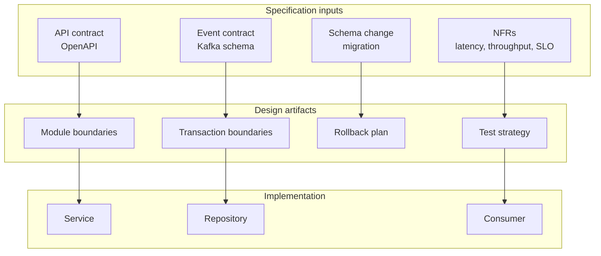
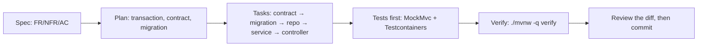
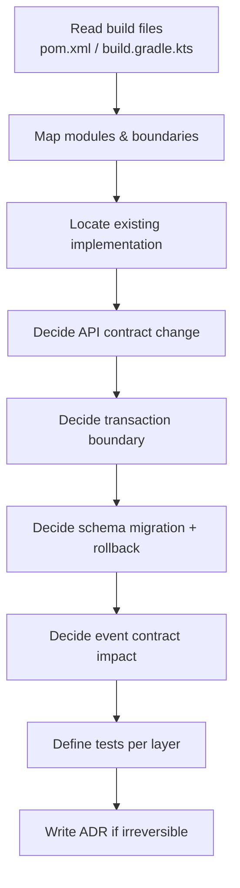
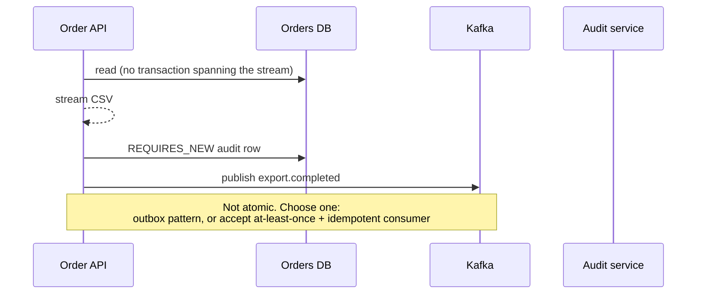
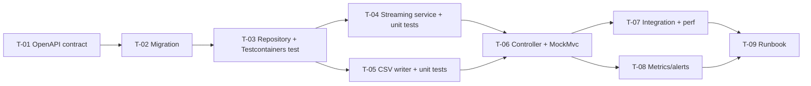
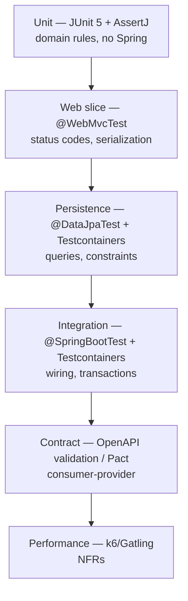
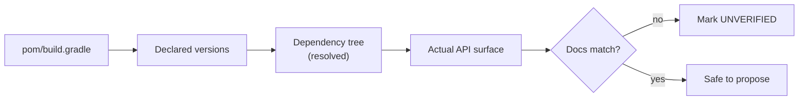
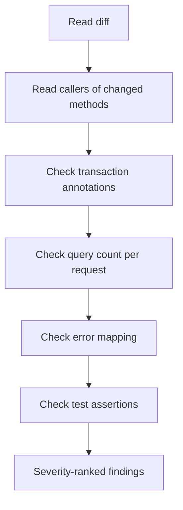
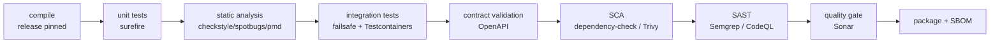

# Java — SDD Guide

> Runtime data verified 2026-11-02 via `endoflife.date` (Temurin/Adoptium). Library versions
> must be read from the target repository's build files.

---

## 1. Scope

Java 8, 11, 17, 21, and 25 (LTS lines), Maven and Gradle, Spring Boot/Spring Framework,
Spring Security, Hibernate/JPA, REST + OpenAPI, Kafka, database migrations, JUnit 5, Mockito,
Testcontainers, microservices, distributed transactions, observability.



---

## 2. Platform compatibility requirements

Java versions are a **compatibility contract**, not a preference. Specify them explicitly.

| Requirement | Must state |
| --- | --- |
| `source`/`target` or `release` | Exact value (e.g. `release 17`) |
| Runtime | Vendor + version (e.g. Temurin 21.0.x) |
| Framework baseline | Spring Boot minor line, not "latest" |
| Dependency policy | Whether new dependencies are allowed |

| Version | Status (2026-11-02) | Guidance |
| --- | --- | --- |
| 8 | Legacy, still deployed widely | New code should not target it; document migration path |
| 11 | Supported | Maintenance mode for new features |
| 17 | Supported | Minimum for modern Spring Boot 3.x |
| 21 | Supported LTS | Recommended default for new services |
| 25 | Current LTS | Adopt after library certification |

> **Java 8 gotcha:** `--release 8` on a modern JDK prevents accidental use of newer APIs. Without
> it, an agent may compile against 21 APIs and break the runtime. Make the release flag part of
> the spec.

```xml
<!-- Maven: enforce the contract -->
<properties>
  <maven.compiler.release>21</maven.compiler.release>
</properties>
```

```kotlin
// Gradle (Kotlin DSL)
java {
    toolchain { languageVersion = JavaLanguageVersion.of(21) }
}
```

---

## 3. Adopting SDD in a Java project

### 3.1 Verify the toolchain before writing anything

```bash
java -version                 # must satisfy the release level in the spec
./mvnw -version               # or ./gradlew -version — use the wrapper, never a global install
./mvnw -q verify -DskipTests  # resolves every plugin the agent will rely on
```

If the repository has no wrapper, add one first (`mvn wrapper:wrapper` or `gradle wrapper`) and
commit it. An unpinned wrapper means the agent and CI compile with different plugin versions.

### 3.2 Add the agent rules

`AGENTS.md` at the repository root (and `.github/copilot-instructions.md` for Visual Studio and
JetBrains — see [chapter 29](../docs/29-ide-setup.md)):

```markdown
## Java rules
- Compile with the pinned `release` level; never use APIs newer than it.
- Read resolved versions with `./mvnw dependency:tree` before using a framework API.
- Every endpoint change needs a MockMvc or `@WebMvcTest` assertion on status and body.
- Every query change needs an integration test with Testcontainers, not H2.
- No new dependency without an ADR in `docs/adr/`.
- Migrations are versioned, reversible, and use CONCURRENTLY for indexes on hot tables.
```

### 3.3 Your first SDD change (a new endpoint)



1. Write `specs/<id>/spec.md` using [`templates/feature-spec.md`](../templates/feature-spec.md).
2. Write `plan.md` covering transaction boundaries, the OpenAPI change, and the migration.
3. Break it into tasks that each name a requirement ID.
4. Implement test-first: slice test for the web layer, Testcontainers for the query.
5. Record evidence per acceptance criterion, then review (read-only) before committing.

### 3.4 Verification commands

| Check | Command |
| --- | --- |
| Compile with the pinned release | `./mvnw -q compile` |
| Unit tests | `./mvnw -q test` |
| Integration tests | `./mvnw -q verify` |
| Static analysis | `./mvnw -q spotbugs:check checkstyle:check pmd:check` |
| Dependencies | `./mvnw -q dependency-check:check` |

### 3.5 Adoption pitfalls

| Pitfall | Fix |
| --- | --- |
| Agent compiles with the local JDK instead of `release` | Pin `maven.compiler.release` or the Gradle toolchain |
| Tests use H2 and pass while production fails | Testcontainers with the same engine and version |
| Agent adds a library for one utility | Check the JDK and existing dependencies first |
| `@Transactional` wrapped around a network call | Specify transaction boundaries in the plan |

---

## 4. Writing requirements

### 3.1 What Java requirements must add

| Universal requirement | Java-specific addition |
| --- | --- |
| Functional behavior | Exact method/service boundary and owning module |
| Acceptance criteria | Assertable outcome at the HTTP/DB/event level |
| Non-goals | Whether public API changes are allowed |
| NFRs | p95/p99 targets, heap/GC constraints, connection pool sizing |
| Failure scenarios | Exception type, retry policy, transaction rollback behavior |

### 3.2 Example

```markdown
### FR-4: Order export streams authorized rows

The `GET /projects/{projectId}/orders/export` endpoint SHALL stream CSV rows for orders
the authenticated principal may read.

**Acceptance criteria**
- AC-4.1 Given a principal with `VIEWER` on project A, when they export project A,
  then the response contains exactly the orders visible via `GET /projects/A/orders`.
- AC-4.2 Given no `VIEWER`/`EDITOR`/`OWNER` role on project B,
  when they export project B, then the response is `403` with problem detail type
  `https://api.example.com/problems/forbidden` and zero CSV bytes.
- AC-4.3 Given 100,000 orders, the first byte is emitted within 1.5 s (p95) and the
  response completes within 30 s (p95), with heap growth < 200 MB over baseline.

**Non-goals**
- XLSX export.
- Asynchronous export jobs.

**Constraints**
- Java 21 (`release 21`), Spring Boot 3.x line already in use.
- No new runtime dependencies.
- Must reuse `OrderRepository.findVisibleTo(...)`.
```

### 3.3 NFR table

| ID | Target | Condition | Verification |
| --- | --- | --- | --- |
| NFR-1 | p95 < 300 ms | `GET /orders` at 50 RPS | Gatling/k6 test in `perf/` |
| NFR-2 | Heap < 512 MB | 100k-row export | JFR recording + `-Xmx512m` run |
| NFR-3 | No connection leak | 1h soak | HikariCP metrics `activeConnections` stable |

---

## 5. Technical plan



### Plan template additions

```markdown
## Module impact
| Module | Change | Owner |
| --- | --- | --- |
| `order-api` | New endpoint | — |
| `order-core` | Streaming query | — |
| `order-persistence` | New index | — |

## Transaction boundaries
- Read-only streaming transaction, `READ COMMITTED`, no write in the request path.
- Audit write is a separate `REQUIRES_NEW` transaction after the stream completes.

## API contract
- Additive only: new path, no change to existing schemas.
- OpenAPI 3.1 updated in `api/openapi.yaml`.

## Schema migration
| ID | Change | Reversible | Backfill |
| --- | --- | --- | --- |
| V42 | `CREATE INDEX CONCURRENTLY idx_orders_project_created` | Yes (drop) | No |

## Event contract
Kafka: no new topic. If an export-completed event is added:
- Topic: `order.export.completed.v1`
- Key: `projectId`
- Idempotency: `eventId` = deterministic hash of `(projectId, requestedAt, principalId)`

## Observability
- Metrics: `order_export_rows_total`, `order_export_duration_seconds`
- Log: correlation ID, principal ID (hashed), project ID, row count
- Alert: p95 > 5 s for 10 min
```

### Distributed transaction reality check



| Requirement | Must specify |
| --- | --- |
| Consistency model | Atomic, at-least-once, or best-effort |
| Idempotency key | Exact fields |
| Compensations | What runs on partial failure |
| Ordering | Per-key ordering guarantees |

> **Anti-pattern:** an agent "solving" distributed atomicity with `@Transactional` across a DB
> write and a Kafka send. That is a local transaction plus a network call — not atomic.

---

## 6. Task division

| Task type | Size guide | Parallelizable |
| --- | --- | --- |
| Contract change (`openapi.yaml`) | One file | No — blocks others |
| Migration | One versioned file | No — ordering matters |
| Repository method + query test | One class + one test | Yes, after migration |
| Service | One class + unit tests | Yes |
| Controller | One class + MockMvc tests | Yes, after service |
| Integration test | One class | Yes |
| Observability wiring | Config + dashboards | Yes |
| Docs/runbook | Markdown | Yes |



**Definition of done for a Java task:**

- [ ] Compiles with the pinned `release` level
- [ ] Unit tests pass (`mvn test` / `gradlew test`)
- [ ] No new Checkstyle/PMD/SpotBugs violations in touched files
- [ ] Public API change reflected in OpenAPI
- [ ] Migration has rollback/forward-fix
- [ ] No unbounded collection growth in the hot path

---

## 7. Specifying tests



### Test naming that maps to acceptance criteria

```java
@DisplayName("AC-4.2: export without project role returns 403 with problem detail")
@Test
void exportWithoutProjectRoleReturns403() throws Exception {
    mockMvc.perform(get("/projects/{id}/orders/export", otherProjectId)
            .with(authentication(principalWithoutRole())))
        .andExpect(status().isForbidden())
        .andExpect(content().contentType("application/problem+json"))
        .andExpect(jsonPath("$.type").value("https://api.example.com/problems/forbidden"))
        .andExpect(content().string(not(containsString(",")))); // no CSV bytes
}
```

### Testcontainers integration test

```java
@SpringBootTest
@Testcontainers
class OrderExportIT {

    @Container
    static PostgreSQLContainer<?> postgres = new PostgreSQLContainer<>("postgres:17-alpine");

    @DynamicPropertySource
    static void props(DynamicPropertyRegistry registry) {
        registry.add("spring.datasource.url", postgres::getJdbcUrl);
        registry.add("spring.datasource.username", postgres::getUsername);
        registry.add("spring.datasource.password", postgres::getPassword);
    }

    @Test
    @DisplayName("AC-4.1: export contains exactly the visible orders")
    void exportContainsOnlyVisibleOrders() { /* ... */ }
}
```

> Pin the container image tag. `latest` makes evidence unreproducible.

### Required test coverage per requirement type

| Requirement | Minimum test |
| --- | --- |
| API behavior | `@WebMvcTest` or `MockMvc` assertion on status + body |
| Query correctness | `@DataJpaTest` with real DB (Testcontainers) |
| Transaction semantics | Integration test asserting rollback/commit |
| Concurrency | Multi-threaded test or a documented serialization argument |
| Migration | Apply → assert schema → roll back (or forward-fix) |
| Event contract | Serialize/deserialize test + schema compatibility check |

---

## 8. How the agent inspects existing code

```bash
# Build system and versions
ls -la pom.xml build.gradle build.gradle.kts settings.gradle* 2>/dev/null
./mvnw -q help:evaluate -Dexpression=project.version -DforceStdout 2>/dev/null
./mvnw -q dependency:tree -Dincludes=org.springframework.boot 2>/dev/null

# Effective Java version
./mvnw -q help:evaluate -Dexpression=maven.compiler.release -DforceStdout

# Existing endpoint to mirror
grep -rn --include='*.java' '@GetMapping' src/main/java | head -20
grep -rn --include='*.java' 'findVisibleTo\|requireProjectAccess' src/main/java | head

# Tests for the area
find src/test -type f -name '*Order*'
```



Checklist:

- [ ] `release` / toolchain level read from build files
- [ ] Spring Boot line read from the BOM or parent version
- [ ] Existing similar endpoint found and cited by file:line
- [ ] Security configuration located (do not assume defaults)
- [ ] Transaction manager type identified (JPA, JDBC, reactive)
- [ ] Migration tool and latest version number identified

---

## 9. Code review focus

| Area | Questions |
| --- | --- |
| Transactions | Is the boundary explicit? Are reads in a write transaction by mistake? |
| Streaming | Is anything buffered into memory (`List`, `ByteArrayOutputStream`)? |
| Exceptions | Are checked exceptions wrapped? Is the cause preserved? |
| Security | Is authorization centralized? Any `@PreAuthorize` gap on new endpoints? |
| N+1 queries | Does the plan fetch-lazy inside a loop? |
| Nullability | Does the code depend on `@Nullable` absent? |
| Concurrency | Shared mutable state? `ConcurrentHashMap` misuse? |
| Resource leaks | `EntityManager`, streams, and executors closed? |
| Migrations | Locking behavior on large tables (`CONCURRENTLY` vs plain index) |
| Observability | Cardinality explosion in metric tags? |



**High-severity examples in Java:**

- New endpoint without method-level authorization.
- `@Transactional` on a method that performs a remote call inside the transaction.
- Migration that takes an `ACCESS EXCLUSIVE` lock on a hot table without a plan.
- Catching `Exception` and returning `200`.

---

## 10. Static analysis and verification tools

| Tool | Purpose | Typical invocation |
| --- | --- | --- |
| **JUnit 5** | Unit/integration tests | via Surefire/Failsafe |
| **Mockito** | Test doubles | `@MockitoBean` in Spring tests |
| **Testcontainers** | Real dependencies | annotation-driven |
| **Checkstyle** | Style rules | `mvn checkstyle:check` |
| **SpotBugs** (+ `find-sec-bugs`) | Bytecode bug/security patterns | `mvn spotbugs:check` |
| **PMD** | Source anti-patterns | `mvn pmd:check` |
| **Error Prone** | Compile-time correctness | compiler plugin |
| **SonarQube / SonarCloud** | Quality gate, duplication, coverage | scanner in CI |
| **OWASP Dependency-Check** | Known-vulnerable components | `mvn dependency-check:check` |
| **Semgrep** | SAST with custom rules | `semgrep ci` |
| **Trivy** | Image + filesystem + secrets | `trivy fs .` / `trivy image` |
| **OpenAPI validator** | Contract conformance | build plugin or CI job |

> Plugin coordinates and task names vary by version. Verify against the plugin's official docs
> before adding them to a build file. The commands above assume the standard plugin prefixes.

### Build wiring example (Maven)

```xml
<build>
  <plugins>
    <plugin>
      <groupId>org.apache.maven.plugins</groupId>
      <artifactId>maven-surefire-plugin</artifactId>
      <!-- unit tests: *Test -->
    </plugin>
    <plugin>
      <groupId>org.apache.maven.plugins</groupId>
      <artifactId>maven-failsafe-plugin</artifactId>
      <!-- integration tests: *IT, bound to verify -->
      <executions>
        <execution>
          <goals><goal>integration-test</goal><goal>verify</goal></goals>
        </execution>
      </executions>
    </plugin>
  </plugins>
</build>
```

---

## 11. CI verification



### Minimal pipeline

```yaml
# .github/workflows/java-ci.yml (illustrative)
name: java-ci
on: [push, pull_request]
jobs:
  verify:
    runs-on: ubuntu-latest
    steps:
      - uses: actions/checkout@v4
      - uses: actions/setup-java@v4
        with:
          distribution: temurin
          java-version: '21'
          cache: maven
      - run: ./mvnw -B -ntp verify
      - run: ./mvnw -B -ntp dependency-check:check
```

| Gate | Fails build when |
| --- | --- |
| Compile | `release` mismatch or warnings-as-errors |
| Unit tests | Any failure |
| Integration tests | Any failure or container startup failure |
| Static analysis | New violation above threshold |
| SCA | CVSS ≥ 7 with no documented exception |
| Contract | OpenAPI or Pact incompatibility |
| Coverage | Below the package floor (not a global number) |

---

## 12. Common mistakes

| Mistake | Consequence | Fix |
| --- | --- | --- |
| Compiling without `--release` | Uses newer APIs than runtime supports | Pin `release` |
| Trusting the parent POM version | Wrong framework API | Read the dependency tree |
| `@Transactional` around HTTP calls | Connection held during network I/O | Split boundaries |
| Buffering a stream into a `List` | OOM on large exports | Stream with a cursor |
| Testing only with H2 | Behavior differs from production DB | Testcontainers with the real engine |
| `postgres:latest` in tests | Unreproducible evidence | Pin tags |
| Adding a new dependency for one utility | Supply-chain surface | Check the JDK/stdlib first |
| Ignoring JPA N+1 | Latency regressions | Query count assertions |
| Migrations without lock analysis | Production outage | `CONCURRENTLY`, batched backfills |

---

## 13. Troubleshooting

| Symptom | Cause | Action |
| --- | --- | --- |
| `UnsupportedClassVersionError` | Compiled with newer JDK than runtime | Set `release`, rebuild |
| `NoSuchMethodError` at runtime | Dependency conflict | `dependency:tree`, dependency management |
| Tests pass locally, fail in CI | Different DB or timezone | Testcontainers + fixed timezone |
| Testcontainers cannot start | No Docker socket in CI | Enable container runtime or use a service container |
| `@Transactional` test passes but production fails | Test rollback masks commit behavior | Add a commit-asserting integration test |
| Kafka consumer reprocesses events | Non-idempotent handler | Add idempotency key + dedupe store |
| Migration times out | Lock contention | `CONCURRENTLY` / batched migration |
| Flaky concurrency test | Timing assumptions | Use latches, not `Thread.sleep` |

---

## 14. Security considerations

| Risk | Control |
| --- | --- |
| Broken object-level authorization | Central `@PreAuthorize` + integration tests per role |
| Deserialization gadgets | Avoid Java serialization; validate JSON with explicit types |
| SpEL injection | Never build SpEL from user input |
| Log injection / PII | Structured logging, allow-list fields |
| Vulnerable transitive deps | `dependency-check` + Dependabot + SBOM |
| Secrets in `application.yml` | Env/secret manager; never commit |
| Actuator exposure | Restrict `management.endpoints.web.exposure.include` |
| SSRF via user-supplied URLs | Allow-list hosts, block link-local ranges |

---

## 15. Official references

- Java SE releases — <https://www.oracle.com/java/technologies/java-se-support-roadmap.html>
- Adoptium/Temurin — <https://adoptium.net/>
- Maven — <https://maven.apache.org/guides/>
- Gradle — <https://docs.gradle.org/current/userguide/userguide.html>
- Spring Boot — <https://docs.spring.io/spring-boot/index.html>
- Spring Security — <https://docs.spring.io/spring-security/reference/index.html>
- Jakarta Persistence — <https://jakarta.ee/specifications/persistence/>
- Hibernate ORM — <https://hibernate.org/orm/documentation/>
- Flyway — <https://documentation.red-gate.com/flyway>
- Liquibase — <https://docs.liquibase.com/>
- JUnit 5 — <https://junit.org/junit5/docs/current/user-guide/>
- Mockito — <https://javadoc.io/doc/org.mockito/mockito-core/latest/org.mockito/org/mockito/Mockito.html>
- Testcontainers for Java — <https://java.testcontainers.org/>
- Apache Kafka — <https://kafka.apache.org/documentation/>
- springdoc-openapi — <https://springdoc.org/>
- Checkstyle — <https://checkstyle.org/>
- SpotBugs — <https://spotbugs.github.io/>
- PMD — <https://pmd.github.io/>
- Error Prone — <https://errorprone.info/>
- OWASP Dependency-Check — <https://owasp.org/www-project-dependency-check/>

---

**Previous:** [Language guides index](./README.md) ·
**Next:** [Python](./python.md) ·
**Back to index:** [00-index.md](../docs/00-index.md)
